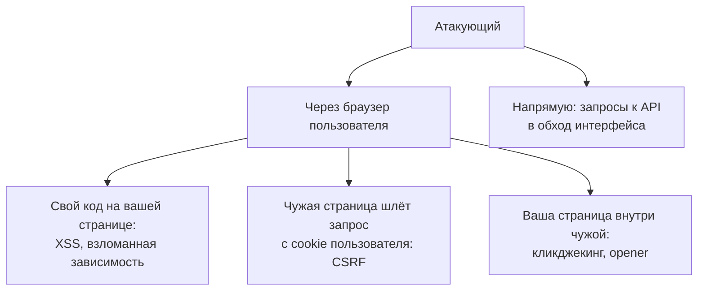
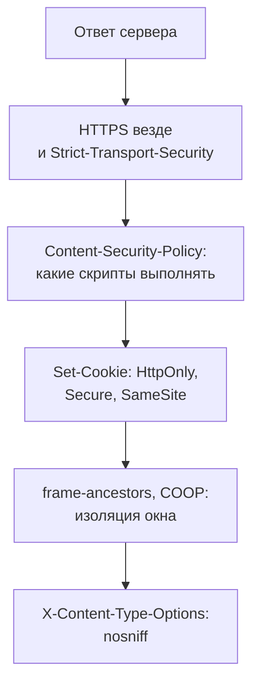

## О чём урок

С чего начинается безопасность фронтенда: от кого и что защищаем, на чём держится модель безопасности браузера (origin и site), что фронтенд защитить не может в принципе (секреты в бандле, проверки прав на клиенте), какие риски из OWASP Top 10:2025 касаются фронтенда и какие заголовки ответа включают защиту. Остальные уроки трека разбирают каждую угрозу отдельно. Примеры выполняются в Node.js.

## Кто нападает и на что



Фронтенд-разработчик отвечает за первые три пути: чтобы чужой код не выполнился на странице, чтобы браузер не отправил запрос от имени пользователя без его ведома и чтобы страницу нельзя было использовать из чужого окна. Четвёртый путь закрывает только сервер: атакующему не нужен ваш интерфейс, он отправит запрос `curl`-ом.

## Origin и site

Почти вся защита браузера опирается на два понятия:

- **Origin** (источник): схема, хост и порт. `https://app.example.com` и `https://api.example.com` это разные источники. Политика одного источника (урок `net-cors`) не даёт скрипту одного источника читать ответы и DOM другого.
- **Site** (сайт): схема и регистрируемый домен, то есть одна метка над публичным суффиксом из Public Suffix List. `app.example.com` и `api.example.com` это один сайт. На site смотрят `SameSite` у cookie (урок `net-cookies-storage`) и заголовок `Sec-Fetch-Site` (урок `sec-csrf`).

```ts run
// A tiny excerpt of the Public Suffix List: names under which anyone can register a site.
const publicSuffixes = ['com', 'org', 'co.uk', 'github.io']

// The site is the scheme plus the registrable domain: one label above a public suffix.
function site(url: URL): string {
  const labels = url.hostname.split('.')
  for (let i = 0; i < labels.length - 1; i++) {
    if (publicSuffixes.includes(labels.slice(i + 1).join('.'))) return `${url.protocol}//${labels.slice(i).join('.')}`
  }
  return `${url.protocol}//${url.hostname}`
}

const pairs = [
  ['https://app.example.com', 'https://app.example.com:443/orders'],
  ['https://app.example.com', 'https://api.example.com'],
  ['https://app.example.com', 'http://app.example.com'],
  ['https://shop.co.uk', 'https://evil.co.uk'],
  ['https://alice.github.io', 'https://bob.github.io'],
  ['https://app.example.com', 'https://example.org'],
]
for (const [a, b] of pairs) {
  const [x, y] = [new URL(a), new URL(b)]
  const sameOrigin = x.origin === y.origin
  const sameSite = site(x) === site(y)
  console.log(`${x.host} -> ${y.protocol}//${y.host}`.padEnd(46), `origin: ${sameOrigin ? 'same' : 'cross'}, site: ${sameSite ? 'same' : 'cross'}`)
}
```

```output
app.example.com -> https://app.example.com     origin: same, site: same
app.example.com -> https://api.example.com     origin: cross, site: same
app.example.com -> http://app.example.com      origin: cross, site: cross
shop.co.uk -> https://evil.co.uk               origin: cross, site: cross
alice.github.io -> https://bob.github.io       origin: cross, site: cross
app.example.com -> https://example.org         origin: cross, site: cross
```

- Поддомены одного домена: разные источники, но **один сайт**. Поэтому взломанный или чужой поддомен (`blog.example.com` на внешнем хостинге) обходит защиту, построенную на `SameSite`.
- Схема входит в site: `http` и `https` с одним хостом это разные сайты (schemeful same-site).
- `co.uk` и `github.io` есть в списке публичных суффиксов: `alice.github.io` и `bob.github.io` это разные сайты, иначе любой пользователь GitHub Pages считался бы «своим».

## Что фронтенд защитить не может

Всё, что попадает в браузер, читает пользователь, а значит и атакующий: бандл, ответы API, `localStorage`, переменные окружения, вшитые при сборке.

```ts run
import { rolldown } from 'rolldown'

// The app reads two "secrets" from the environment, as with VITE_* variables in Vite.
const files: Record<string, string> = {
  'main.js': `
    const payments = import.meta.env.VITE_PAYMENTS_SECRET
    export async function pay(amount) {
      return fetch('https://api.payments.example/charge', {
        method: 'POST',
        headers: { Authorization: 'Bearer ' + payments },
        body: JSON.stringify({ amount }),
      })
    }`,
}
const virtual = { name: 'virtual', resolveId: (id: string) => id, load: (id: string) => files[id] }

const bundle = await rolldown({
  input: 'main.js',
  plugins: [virtual],
  // Vite does the same: env variables are replaced by their values at build time.
  transform: { define: { 'import.meta.env.VITE_PAYMENTS_SECRET': JSON.stringify('sk_live_51Hx9QeZ') } },
  logLevel: 'silent',
})
const { output } = await bundle.generate({ minify: true })
const code = output[0].code
console.log('secret in the bundle:', code.includes('sk_live_51Hx9QeZ'))
console.log(code.match(/.{0,30}sk_live_51Hx9QeZ.{0,2}/)![0])
```

```output
secret in the bundle: true
eaders:{Authorization:`Bearer sk_live_51Hx9QeZ`}
```

- Переменные с префиксом `VITE_` (в Next.js `NEXT_PUBLIC_`) подставляются в код при сборке и лежат в бандле открытым текстом. Минификация и обфускация не прячут строку.
- Секретные ключи (платёжный провайдер, база данных, ключ с правом записи к стороннему API) живут только на сервере. Фронтенд обращается к своему серверу, а тот к стороннему API.
- Публичные ключи, которые сервис разрешает держать в браузере (ключ карт с ограничением по домену, publishable key платёжного провайдера), допустимы: их права ограничены на стороне сервиса.
- **Проверки на клиенте не защищают.** Скрытая кнопка «Удалить», guard маршрута и валидация формы улучшают интерфейс, но запрос можно отправить напрямую. Права и данные проверяет сервер, это первый риск OWASP Top 10:2025, Broken Access Control.

## OWASP Top 10:2025 глазами фронтенда

| Риск | Что это на фронтенде | Урок |
|---|---|---|
| A01 Broken Access Control | Права проверяются только скрытием кнопок; CSRF; открытые редиректы | `sec-csrf`, `sec-isolation` |
| A02 Security Misconfiguration | Нет CSP и других заголовков, CORS отражает любой `Origin`, карты исходников в продакшене | `sec-csp`, `sec-checklist` |
| A03 Software Supply Chain Failures | Взломанный пакет npm, скрипт со стороннего CDN без проверки | `sec-supply-chain` |
| A04 Cryptographic Failures | Нет HTTPS, токены в URL, «шифрование» в браузере ключом из бандла | этот урок, `sec-auth` |
| A05 Injection | XSS, внедрение шаблона, prototype pollution | `sec-xss`, `sec-supply-chain` |
| A07 Authentication Failures | Токены в `localStorage`, implicit flow, JWT без проверки | `sec-auth` |

## Защита на уровне ответа



- **HTTPS везде**: без него любой участник сети (публичный Wi-Fi, провайдер) читает и подменяет страницу, включая её скрипты. `Strict-Transport-Security` (HSTS) заставляет браузер ходить на сайт только по HTTPS и не даёт подменить первый запрос по HTTP.
- **`X-Content-Type-Options: nosniff`**: браузер не угадывает тип файла, и загруженная пользователем «картинка» не выполнится как скрипт.
- Остальные заголовки разобраны в своих уроках; проверка всех сразу в уроке `sec-checklist`.
- `X-XSS-Protection` больше не нужен: встроенный в браузеры XSS-фильтр удалён, сам фильтр создавал уязвимости. Рекомендуемое значение `0` или отсутствие заголовка.

## Главное

- Фронтенд защищает от трёх путей: чужой код на странице, запросы от имени пользователя с чужого сайта, использование страницы из чужого окна. Прямые запросы к API закрывает только сервер.
- Origin это схема, хост и порт; site это схема и регистрируемый домен. Поддомены одного домена это один сайт.
- Всё в бандле публично: секреты только на сервере, `VITE_` и `NEXT_PUBLIC_` попадают в код открытым текстом.
- Проверки на клиенте улучшают интерфейс, права проверяет сервер (A01 в OWASP Top 10:2025).
- База на уровне ответа: HTTPS и HSTS, CSP, флаги cookie, `frame-ancestors`, `nosniff`; `X-XSS-Protection` не нужен.
