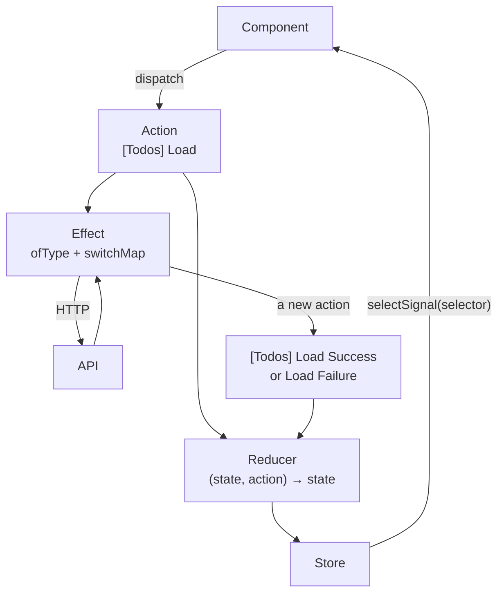

## What this lesson covers

How state is kept in Angular today: a service with signals (often enough), NgRx SignalStore, the classic NgRx Store with actions, reducers, selectors and effects, NGXS, and how to choose. These are the topics of the "NgRx | NGXS" section of the Angular notes. The examples run on Angular 22 and `@ngrx/signals` 22 in Node.js.

## A service with signals

Before any library, Angular has a service: a singleton in DI that outlives components. With signals it became a full-fledged store:

```ts run
import { computed, Injectable, Injector, signal } from '@angular/core'

// Often enough: a service with signals, state private, a read-only view outside
@Injectable({ providedIn: 'root' })
class CartService {
  private readonly items = signal<{ name: string; price: number }[]>([])
  readonly list = this.items.asReadonly()
  readonly total = computed(() => this.items().reduce((sum, i) => sum + i.price, 0))

  add(name: string, price: number) {
    this.items.update((items) => [...items, { name, price }]) // a new array: signals compare by Object.is
  }
}

const cart = Injector.create({ providers: [CartService] }).get(CartService) // in an app: inject(CartService)
cart.add('tea', 4)
cart.add('cake', 6)
console.log(cart.list().map((i) => i.name), cart.total())
console.log('can components write?', 'set' in cart.list)
```

```output
[ 'tea', 'cake' ] 10
can components write? false
```

- The writable signal is private, and the outside gets `asReadonly()` and `computed`: components read, but change only through the service methods. It is the same "changes in one place" principle as in Redux, without the boilerplate.
- `update` returns a **new** array: signals compare values with `Object.is`, and mutating with `items().push(...)` would not notify subscribers.
- For server data such a service uses `resource` or `httpResource`, not hand-written loading flags.
- An app-level service (`providedIn: 'root'`) is global state; in a component's `providers` it becomes the state of that screen and is destroyed with it.

## NgRx SignalStore

`@ngrx/signals` adds structure to the service: state, computed values, methods, lifecycle hooks and extensions are assembled from `with...` functions.

```ts run
import { computed, Injector } from '@angular/core'
import { getState, patchState, signalStore, watchState, withComputed, withHooks, withMethods, withState } from '@ngrx/signals'

type Todo = { id: number; title: string; done: boolean }

const TodosStore = signalStore(
  withState({ todos: [] as Todo[], filter: 'all' as 'all' | 'open' }),
  withComputed(({ todos, filter }) => ({
    visible: computed(() => (filter() === 'open' ? todos().filter((t) => !t.done) : todos())),
    left: computed(() => todos().filter((t) => !t.done).length),
  })),
  withMethods((store) => ({
    add(title: string) {
      patchState(store, (s) => ({ todos: [...s.todos, { id: s.todos.length + 1, title, done: false }] }))
    },
    toggle(id: number) {
      patchState(store, (s) => ({ todos: s.todos.map((t) => (t.id === id ? { ...t, done: !t.done } : t)) }))
    },
    showOpen: () => patchState(store, { filter: 'open' }),
  })),
  withHooks({
    onInit(store) {
      watchState(store, (state) => console.log('state:', state.filter, state.todos.length))
    },
  }),
)

const store = Injector.create({ providers: [TodosStore] }).get(TodosStore)
store.add('Write tests')
store.add('Ship')
store.toggle(1)
store.showOpen()
console.log(store.visible().map((t) => t.title), '| left:', store.left())
console.log(JSON.stringify(getState(store)))
```

```output
state: all 0
state: all 1
state: all 2
state: all 2
state: open 2
[ 'Ship' ] | left: 1
{"todos":[{"id":1,"title":"Write tests","done":true},{"id":2,"title":"Ship","done":false}],"filter":"open"}
```

- `withState` creates a signal per field (`store.todos()`, `store.filter()`), `withComputed` the derived values, `withMethods` the actions, `withHooks` code run when the store is created and destroyed.
- `patchState` merges changes into the state immutably. By default the state is **protected** (`protectedState: true`): TypeScript will not let you call `patchState` from outside the store, so it changes only through methods. This is protection at the type level, not at runtime.
- `watchState` runs synchronously on every change (handy for logging and persistence), unlike `effect`, which batches changes.
- Extensions: `withEntities` (normalized collections, like `createEntityAdapter`), `rxMethod` for RxJS streams (search with `debounceTime` and `switchMap`), `withProps`, custom features through `signalStoreFeature`. The store is provided like a service: `providers: [TodosStore]` in a component or `{ providedIn: 'root' }`.

## NgRx Store: Redux on RxJS

The classic NgRx Store is the Redux pattern (see the Redux lesson) with RxJS streams: one store, actions, pure reducers, memoized selectors, and **effects** for side effects.



```ts
export const TodosActions = createActionGroup({
  source: 'Todos',
  events: {
    Load: emptyProps(),
    'Load Success': props<{ todos: Todo[] }>(),
    'Load Failure': props<{ error: string }>(),
  },
})

export const todosFeature = createFeature({
  name: 'todos',
  reducer: createReducer(
    { todos: [] as Todo[], loading: false, error: null as string | null },
    on(TodosActions.load, (state) => ({ ...state, loading: true })),
    on(TodosActions.loadSuccess, (state, { todos }) => ({ ...state, todos, loading: false })),
    on(TodosActions.loadFailure, (state, { error }) => ({ ...state, error, loading: false })),
  ),
}) // generates selectTodos, selectLoading, selectError

export const loadTodos = createEffect(
  (actions$ = inject(Actions), api = inject(TodosApi)) =>
    actions$.pipe(
      ofType(TodosActions.load),
      switchMap(() =>
        api.getAll().pipe(
          map((todos) => TodosActions.loadSuccess({ todos })),
          catchError((e) => of(TodosActions.loadFailure({ error: e.message }))),
        ),
      ),
    ),
  { functional: true },
)

// in a component
readonly todos = inject(Store).selectSignal(todosFeature.selectTodos)
```

- `createActionGroup` generates actions with types like `[Todos] Load Success` and creators like `TodosActions.loadSuccess`.
- `createFeature` combines the name, the reducer and automatically created selectors for every state field.
- An **effect** listens to the action stream, makes the request and dispatches a new action. Choose the operator by meaning: `switchMap` cancels the previous request (search, loading), `concatMap` queues (saving in order), `exhaustMap` ignores repeats (a "Pay" button), `mergeMap` runs in parallel (see the RxJS lesson).
- Catch the error **inside** `switchMap`: a `catchError` outside would complete the whole effect, and it would stop reacting to actions.
- Components often work through a **facade**: a service that hides `dispatch` and selectors behind `load()` methods and `todos` signals, so components do not know about NgRx.

## NGXS

NGXS solves the same problem with less code thanks to classes and decorators: state is a class with `@State`, action handlers are methods with `@Action`, selectors are marked `@Selector`, and actions are classes.

```ts
export class AddTodo {
  static readonly type = '[Todos] Add'
  constructor(readonly title: string) {}
}

@State<TodosModel>({ name: 'todos', defaults: { items: [] } })
@Injectable()
export class TodosState {
  @Selector() static items(state: TodosModel) {
    return state.items
  }
  @Action(AddTodo) add(ctx: StateContext<TodosModel>, { title }: AddTodo) {
    ctx.patchState({ items: [...ctx.getState().items, title] }) // side effects can live here too
  }
}
```

In NGXS an action handler can make the request itself and return an Observable or a promise; there is no separate effects layer. The "NgRx or NGXS" interview question is usually about the trade-off: NgRx is stricter and more popular, with a bigger ecosystem and DevTools; NGXS is shorter and closer to an object-oriented style.

## How to choose in Angular

| Task | What to use |
|---|---|
| State of one screen or feature | A service with signals in the component's `providers` |
| Shared state with computed values and methods | SignalStore or a service with signals |
| A large app, many teams, an action log and DevTools, complex event flows | NgRx Store with effects |
| An existing NGXS project | NGXS (no need to rewrite for fashion) |
| Server data | `httpResource` or TanStack Query for Angular; in NgRx through effects or `rxMethod` |

## Key points

- A service with a private signal, `asReadonly`, `computed` and methods often replaces a state library; update immutably with `update`.
- SignalStore: `withState`, `withComputed`, `withMethods`, `withHooks`, `patchState`; protection from outside writes at the type level.
- NgRx Store is Redux on RxJS: `createActionGroup`, `createFeature` with selectors, functional effects, `selectSignal`.
- In an effect choose the operator by meaning (`switchMap`, `concatMap`, `exhaustMap`, `mergeMap`), with `catchError` inside the inner stream.
- NGXS: classes with `@State`, `@Action`, `@Selector`, no separate effects; shorter, but less widespread.
- A facade hides the state manager from components.
