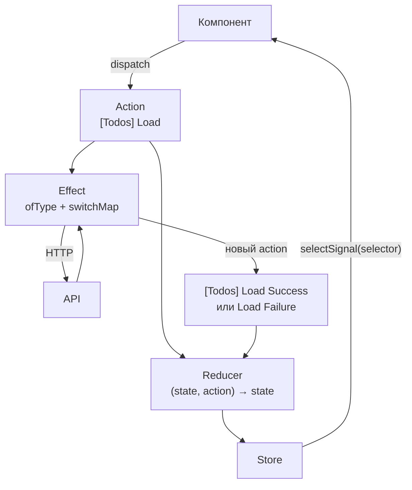

## О чём урок

Как держат состояние в Angular сейчас: сервис с сигналами (часто этого достаточно), NgRx SignalStore, классический NgRx Store с actions, reducers, selectors и effects, NGXS, и как выбрать. Это темы раздела «NgRx | NGXS» из заметок по Angular. Примеры выполняются на Angular 22 и `@ngrx/signals` 22 в Node.js.

## Сервис с сигналами

До любой библиотеки в Angular есть сервис: синглтон в DI, который живёт дольше компонентов. С сигналами он стал полноценным хранилищем:

```ts run
import { computed, Injectable, Injector, signal } from '@angular/core'

// Often enough: a service with signals, state private, a read-only view outside
@Injectable({ providedIn: 'root' })
class CartService {
  private readonly items = signal<{ name: string; price: number }[]>([])
  readonly list = this.items.asReadonly()
  readonly total = computed(() => this.items().reduce((sum, i) => sum + i.price, 0))

  add(name: string, price: number) {
    this.items.update((items) => [...items, { name, price }]) // a new array: signals compare by Object.is
  }
}

const cart = Injector.create({ providers: [CartService] }).get(CartService) // in an app: inject(CartService)
cart.add('tea', 4)
cart.add('cake', 6)
console.log(cart.list().map((i) => i.name), cart.total())
console.log('can components write?', 'set' in cart.list)
```

```output
[ 'tea', 'cake' ] 10
can components write? false
```

- Изменяемый сигнал закрыт (`private`), наружу отдаётся `asReadonly()` и `computed`: компоненты читают, но меняют только через методы сервиса. Это тот же принцип «изменения в одном месте», что у Redux, без шаблонного кода.
- `update` возвращает **новый** массив: сигналы сравнивают значения через `Object.is`, и мутация `items().push(...)` не уведомила бы подписчиков.
- Для данных с сервера в таком сервисе используют `resource` или `httpResource`, а не ручные флаги загрузки.
- Сервис на уровне приложения (`providedIn: 'root'`) это глобальное состояние; в `providers` компонента он становится состоянием конкретного экрана и уничтожается вместе с ним.

## NgRx SignalStore

`@ngrx/signals` добавляет к сервису структуру: состояние, вычисляемые значения, методы, хуки жизненного цикла и расширения собираются функциями `with...`.

```ts run
import { computed, Injector } from '@angular/core'
import { getState, patchState, signalStore, watchState, withComputed, withHooks, withMethods, withState } from '@ngrx/signals'

type Todo = { id: number; title: string; done: boolean }

const TodosStore = signalStore(
  withState({ todos: [] as Todo[], filter: 'all' as 'all' | 'open' }),
  withComputed(({ todos, filter }) => ({
    visible: computed(() => (filter() === 'open' ? todos().filter((t) => !t.done) : todos())),
    left: computed(() => todos().filter((t) => !t.done).length),
  })),
  withMethods((store) => ({
    add(title: string) {
      patchState(store, (s) => ({ todos: [...s.todos, { id: s.todos.length + 1, title, done: false }] }))
    },
    toggle(id: number) {
      patchState(store, (s) => ({ todos: s.todos.map((t) => (t.id === id ? { ...t, done: !t.done } : t)) }))
    },
    showOpen: () => patchState(store, { filter: 'open' }),
  })),
  withHooks({
    onInit(store) {
      watchState(store, (state) => console.log('state:', state.filter, state.todos.length))
    },
  }),
)

const store = Injector.create({ providers: [TodosStore] }).get(TodosStore)
store.add('Write tests')
store.add('Ship')
store.toggle(1)
store.showOpen()
console.log(store.visible().map((t) => t.title), '| left:', store.left())
console.log(JSON.stringify(getState(store)))
```

```output
state: all 0
state: all 1
state: all 2
state: all 2
state: open 2
[ 'Ship' ] | left: 1
{"todos":[{"id":1,"title":"Write tests","done":true},{"id":2,"title":"Ship","done":false}],"filter":"open"}
```

- `withState` создаёт сигнал на каждое поле (`store.todos()`, `store.filter()`), `withComputed` производные, `withMethods` действия, `withHooks` код при создании и уничтожении стора.
- `patchState` неизменяемо сливает изменения с состоянием. По умолчанию состояние **защищено** (`protectedState: true`): вызвать `patchState` снаружи стора не даст TypeScript, менять можно только через методы. Это защита на уровне типов, а не во время выполнения.
- `watchState` вызывается синхронно на каждое изменение (удобно для логирования и сохранения), в отличие от `effect`, который группирует изменения.
- Расширения: `withEntities` (нормализованные коллекции, как `createEntityAdapter`), `rxMethod` для потоков RxJS (поиск с `debounceTime` и `switchMap`), `withProps`, свои фичи через `signalStoreFeature`. Стор подключается как сервис: `providers: [TodosStore]` в компоненте или `{ providedIn: 'root' }`.

## NgRx Store: Redux на RxJS

Классический NgRx Store это паттерн Redux (урок о Redux) с потоками RxJS: один store, actions, чистые reducers, мемоизированные selectors и **effects** для побочных эффектов.



```ts
export const TodosActions = createActionGroup({
  source: 'Todos',
  events: {
    Load: emptyProps(),
    'Load Success': props<{ todos: Todo[] }>(),
    'Load Failure': props<{ error: string }>(),
  },
})

export const todosFeature = createFeature({
  name: 'todos',
  reducer: createReducer(
    { todos: [] as Todo[], loading: false, error: null as string | null },
    on(TodosActions.load, (state) => ({ ...state, loading: true })),
    on(TodosActions.loadSuccess, (state, { todos }) => ({ ...state, todos, loading: false })),
    on(TodosActions.loadFailure, (state, { error }) => ({ ...state, error, loading: false })),
  ),
}) // generates selectTodos, selectLoading, selectError

export const loadTodos = createEffect(
  (actions$ = inject(Actions), api = inject(TodosApi)) =>
    actions$.pipe(
      ofType(TodosActions.load),
      switchMap(() =>
        api.getAll().pipe(
          map((todos) => TodosActions.loadSuccess({ todos })),
          catchError((e) => of(TodosActions.loadFailure({ error: e.message }))),
        ),
      ),
    ),
  { functional: true },
)

// in a component
readonly todos = inject(Store).selectSignal(todosFeature.selectTodos)
```

- `createActionGroup` генерирует actions с типами вида `[Todos] Load Success` и создателями `TodosActions.loadSuccess`.
- `createFeature` объединяет имя, reducer и автоматически созданные селекторы для каждого поля состояния.
- **Effect** слушает поток actions, выполняет запрос и отправляет новый action. Оператор выбирают по смыслу: `switchMap` отменяет прошлый запрос (поиск, загрузка), `concatMap` ставит в очередь (сохранение по порядку), `exhaustMap` игнорирует повторы (кнопка «Оплатить»), `mergeMap` выполняет параллельно (урок RxJS).
- Ошибку ловят **внутри** `switchMap`: `catchError` снаружи завершил бы весь effect, и он перестал бы реагировать на actions.
- Компонент часто работает через **фасад**: сервис, который скрывает `dispatch` и селекторы за методами `load()` и сигналами `todos`, чтобы компоненты не знали про NgRx.

## NGXS

NGXS решает ту же задачу с меньшим количеством кода за счёт классов и декораторов: состояние это класс с `@State`, обработчики действий это методы с `@Action`, селекторы помечены `@Selector`, а actions это классы.

```ts
export class AddTodo {
  static readonly type = '[Todos] Add'
  constructor(readonly title: string) {}
}

@State<TodosModel>({ name: 'todos', defaults: { items: [] } })
@Injectable()
export class TodosState {
  @Selector() static items(state: TodosModel) {
    return state.items
  }
  @Action(AddTodo) add(ctx: StateContext<TodosModel>, { title }: AddTodo) {
    ctx.patchState({ items: [...ctx.getState().items, title] }) // side effects can live here too
  }
}
```

В NGXS обработчик действия может сам выполнить запрос и вернуть Observable или промис, отдельного слоя effects нет. Вопрос «NgRx или NGXS» на собеседовании обычно про компромисс: NgRx строже и популярнее, у него больше экосистема и DevTools, NGXS короче и ближе к объектно-ориентированному стилю.

## Как выбрать в Angular

| Задача | Что брать |
|---|---|
| Состояние одного экрана или фичи | Сервис с сигналами в `providers` компонента |
| Общее состояние с вычислениями и методами | SignalStore или сервис с сигналами |
| Большое приложение, много команд, нужны лог actions и DevTools, сложные потоки событий | NgRx Store с effects |
| Существующий проект на NGXS | NGXS (переписывать ради моды не нужно) |
| Данные с сервера | `httpResource` или TanStack Query для Angular; в NgRx через effects или `rxMethod` |

## Главное

- Сервис с приватным сигналом, `asReadonly`, `computed` и методами часто заменяет библиотеку состояния; обновлять неизменяемо через `update`.
- SignalStore: `withState`, `withComputed`, `withMethods`, `withHooks`, `patchState`; защита состояния от записи снаружи на уровне типов.
- NgRx Store это Redux на RxJS: `createActionGroup`, `createFeature` с селекторами, функциональные effects, `selectSignal`.
- В effect оператор выбирают по смыслу (`switchMap`, `concatMap`, `exhaustMap`, `mergeMap`), `catchError` внутри внутреннего потока.
- NGXS: классы с `@State`, `@Action`, `@Selector`, без отдельных effects; короче, но менее распространён.
- Фасад скрывает менеджер состояний от компонентов.
