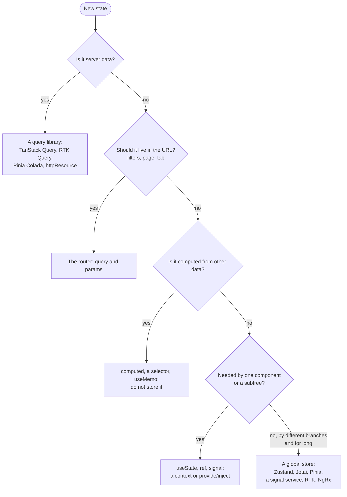

## What this lesson covers

The summary of the track: how to answer "which state manager would you choose and why" in a way that shows understanding rather than knowledge of names. This lesson covers the order of reasoning, a summary table of libraries, the equivalents in React, Vue and Angular, the signs of a poor state architecture and a short interview answer. No code runs in this lesson: everything needed was shown in the previous lessons.

## The order of reasoning

The key idea: a global store is needed only for the last case, and once server data has gone to a query library and filters to the URL, little global client state usually remains (the user, settings, a cart, a draft). The choice of library for it is secondary.

## Summary table

| | Model | Change | Subscription | Strengths | Cost |
|---|---|---|---|---|---|
| Redux Toolkit | One store, actions, reducers | `dispatch`, Immer | Selectors | Predictability, an action log, DevTools, RTK Query, large teams | More code and concepts |
| Zustand | A store hook | `set` | Selectors | Minimal code, works outside React | Less structure: the team sets the discipline |
| Jotai | Atoms | `set(atom)` | An atom | Fine-grained dependencies, derived atoms, Suspense | Many small atoms are hard to overview |
| MobX | Observable objects | Assignment in an action | Automatic | Complex domain models, little code | Implicitness, dereferencing traps |
| React context | A value in a provider | The provider's `setState` | The whole value | Built in, for rare changes | Re-renders every consumer |
| Pinia | Stores as composables | Direct change, `$patch` | Vue reactivity | Official for Vue, DevTools, SSR | Vue only |
| A service with signals | A class in DI | Methods, `update` | Signals | Built into Angular, no libraries | The team sets the structure |
| NgRx SignalStore | A store from `with...` | `patchState` in methods | Signals | Structure, extensions, `withEntities` | One more library |
| NgRx Store | Redux on RxJS | `dispatch`, effects | `selectSignal` | A strict flow, DevTools, complex event chains | Lots of boilerplate |
| TanStack Query | A query cache | Mutations, invalidation | A query key | Server data: cache, retries, background refetch | Not for client state |
| XState | Finite state machines | Events | A machine snapshot | Complex flows without impossible states | Overkill for simple cases |

## Equivalents across frameworks

| Task | React | Vue | Angular |
|---|---|---|---|
| Local state | `useState`, `useReducer` | `ref`, `reactive` | `signal` |
| Derived | Computed in render, `useMemo` | `computed` | `computed`, `linkedSignal` |
| Passing down | Context | `provide`/`inject` | DI, a service in `providers` |
| Global client | Zustand, Jotai, Redux Toolkit, MobX | Pinia | A service with signals, SignalStore, NgRx |
| Server data | TanStack Query, RTK Query, SWR | TanStack Query, Pinia Colada | `httpResource`, TanStack Query, NgRx effects |
| URL | React Router `useSearchParams` | `route.query` | `ActivatedRoute`, `withComponentInputBinding` |
| Forms | React Hook Form, Actions | `v-model`, VeeValidate | Reactive Forms, Signal Forms |

## Signs of a poor state architecture

- Server data lives in the global store together with `isLoading` and `error`, and someone "sometimes forgets" to reload it.
- The same data is stored in two places (a prop copied into state, a response in both the store and the cache) and drifts apart.
- The store holds derived data: a cart total, a filtered list, `isFormValid`.
- Local state ended up global: whether a modal is open, the text typed into a field. Every keystroke re-renders half of the app.
- Flags instead of a status: `isLoading` and `isError` both `true`.
- Selectors create new objects, and components re-render on any store change.
- Filters and the page are not in the URL: you cannot share a link, and Back resets the results.

## The interview answer

A short answer to "which state manager would you choose", to expand as the interviewer asks:

1. "First I split state by kind. Server data goes to a query library (TanStack Query, or RTK Query if the project already uses Redux): it handles caching, deduplication, background refresh and optimistic updates."
2. "Filters, sorting and the page go into the URL; derived values are computed with selectors."
3. "Local state stays in components, and I lift it only when it becomes shared."
4. "For the remaining global client state in React I'd take Zustand: little code and fine-grained subscriptions. If the team is large and needs a strict structure with an action log, Redux Toolkit. In Vue that is Pinia, in Angular a service with signals or SignalStore, and NgRx Store for complex event chains."
5. "For complex flows with many states, a checkout wizard for example, I use a state machine, or at least a discriminated union instead of flags."

The answer shows that the choice follows from the requirements (data, team size, debugging, SSR), not from a library's popularity.

## Key points

- Order: server data → a query library; the URL → the router; derived → compute; local → the component; only the rest → a global store.
- After that little global client state remains, and the choice of library for it is secondary.
- React: Zustand for simplicity, Jotai for atoms, RTK for a strict structure, MobX for complex models; Vue: Pinia; Angular: a service with signals, SignalStore or NgRx Store.
- Warning signs: server data in the store, duplication, stored derived values, global instead of local, flags instead of a status, unstable selectors, filters not in the URL.
- In an interview, explain the choice by the requirements, not by popularity.
