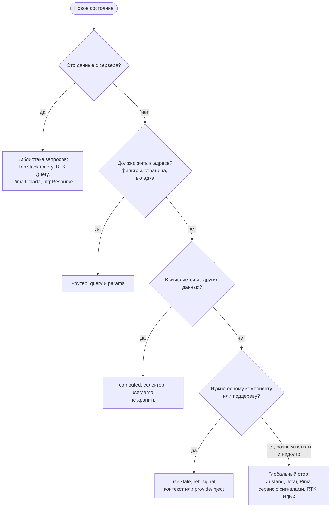

## О чём урок

Итог трека: как ответить на вопрос «какой менеджер состояния вы бы выбрали и почему» так, чтобы ответ показывал понимание, а не знание названий. Здесь порядок рассуждения, сводная таблица библиотек, соответствие инструментов в React, Vue и Angular, признаки неудачной архитектуры состояния и короткий ответ для собеседования. Код в этом уроке не запускается: всё нужное показано в предыдущих уроках.

## Порядок рассуждения

Главная мысль: глобальный стор нужен только последнему пункту, и после того как серверные данные ушли в библиотеку запросов, а фильтры в адрес, клиентского глобального состояния обычно остаётся немного (пользователь, настройки, корзина, черновик). Выбор библиотеки для него вторичен.

## Сводная таблица

| | Модель | Изменение | Подписка | Сильные стороны | Цена |
|---|---|---|---|---|---|
| Redux Toolkit | Один store, actions, reducers | `dispatch`, Immer | Селекторы | Предсказуемость, лог actions, DevTools, RTK Query, большие команды | Больше кода и понятий |
| Zustand | Стор-хук | `set` | Селекторы | Минимум кода, работает вне React | Меньше структуры: дисциплину задаёт команда |
| Jotai | Атомы | `set(atom)` | Атом | Точечные зависимости, производные атомы, Suspense | Много мелких атомов сложно обозреть |
| MobX | Наблюдаемые объекты | Присваивание в action | Автоматически | Сложные модели предметной области, мало кода | Неявность, ловушки разыменования |
| Контекст React | Значение в провайдере | `setState` провайдера | Всё значение | Встроен, для редких изменений | Перерисовывает всех потребителей |
| Pinia | Сторы-composables | Прямое изменение, `$patch` | Реактивность Vue | Официальный для Vue, DevTools, SSR | Только Vue |
| Сервис с сигналами | Класс в DI | Методы, `update` | Сигналы | Встроен в Angular, без библиотек | Структуру задаёт команда |
| NgRx SignalStore | Стор из `with...` | `patchState` в методах | Сигналы | Структура, расширения, `withEntities` | Ещё одна библиотека |
| NgRx Store | Redux на RxJS | `dispatch`, effects | `selectSignal` | Строгий поток, DevTools, сложные цепочки событий | Много шаблонного кода |
| TanStack Query | Кэш запросов | Мутации, инвалидация | Ключ запроса | Серверные данные: кэш, повторы, фоновая загрузка | Не для клиентского состояния |
| XState | Конечные автоматы | События | Снимок автомата | Сложные сценарии без невозможных состояний | Избыточен для простого |

## Соответствие во фреймворках

| Задача | React | Vue | Angular |
|---|---|---|---|
| Локальное состояние | `useState`, `useReducer` | `ref`, `reactive` | `signal` |
| Производное | Вычисление в рендере, `useMemo` | `computed` | `computed`, `linkedSignal` |
| Передача вниз | Контекст | `provide`/`inject` | DI, сервис в `providers` |
| Глобальное клиентское | Zustand, Jotai, Redux Toolkit, MobX | Pinia | Сервис с сигналами, SignalStore, NgRx |
| Серверные данные | TanStack Query, RTK Query, SWR | TanStack Query, Pinia Colada | `httpResource`, TanStack Query, NgRx effects |
| Адрес | React Router `useSearchParams` | `route.query` | `ActivatedRoute`, `withComponentInputBinding` |
| Формы | React Hook Form, Actions | `v-model`, VeeValidate | Reactive Forms, Signal Forms |

## Признаки неудачной архитектуры состояния

- Серверные данные лежат в глобальном сторе вместе с `isLoading` и `error`, и их «иногда забывают» перезагрузить.
- Одни и те же данные хранятся в двух местах (копия пропса в состоянии, ответ запроса в сторе и в кэше) и расходятся.
- В сторе лежит производное: сумма корзины, отфильтрованный список, `isFormValid`.
- В глобальное состояние попало локальное: открыта ли модалка, введённый в поле текст. Каждое нажатие клавиши перерисовывает половину приложения.
- Флаги вместо статуса: `isLoading` и `isError` одновременно `true`.
- Селекторы создают новые объекты, и компоненты перерисовываются на любое изменение стора.
- Фильтры и страница не в адресе: ссылкой не поделиться, «Назад» сбрасывает выдачу.

## Ответ на собеседовании

Короткий ответ на «какой стейт-менеджер вы бы выбрали», который можно развернуть по вопросам интервьюера:

1. «Сначала разделю состояние по видам. Серверные данные отдам библиотеке запросов (TanStack Query или RTK Query, если в проекте уже Redux): она решает кэш, дедупликацию, фоновое обновление и оптимистичные обновления».
2. «Фильтры, сортировку и страницу положу в адрес, производное буду вычислять селекторами».
3. «Локальное состояние оставлю в компонентах и подниму, только когда оно станет общим».
4. «Для оставшегося глобального клиентского состояния в React возьму Zustand: мало кода и точечные подписки. Если команда большая и нужна строгая структура с логом действий, Redux Toolkit. В Vue это Pinia, в Angular сервис с сигналами или SignalStore, NgRx Store при сложных цепочках событий».
5. «Для сложных сценариев с множеством состояний, например мастера оформления, использую конечный автомат или хотя бы размеченное объединение вместо флагов».

Ответ показывает, что выбор следует из требований (данные, размер команды, отладка, SSR), а не из популярности библиотеки.

## Главное

- Порядок: серверные данные → библиотека запросов; адрес → роутер; производное → вычислять; локальное → компонент; только остальное → глобальный стор.
- После этого глобального клиентского состояния остаётся немного, и выбор библиотеки для него вторичен.
- React: Zustand для простоты, Jotai для атомов, RTK для строгой структуры, MobX для сложных моделей; Vue: Pinia; Angular: сервис с сигналами, SignalStore или NgRx Store.
- Признаки проблем: серверные данные в сторе, дублирование, хранение производного, глобальное вместо локального, флаги вместо статуса, нестабильные селекторы, фильтры не в адресе.
- На собеседовании выбор объясняют требованиями, а не популярностью.
