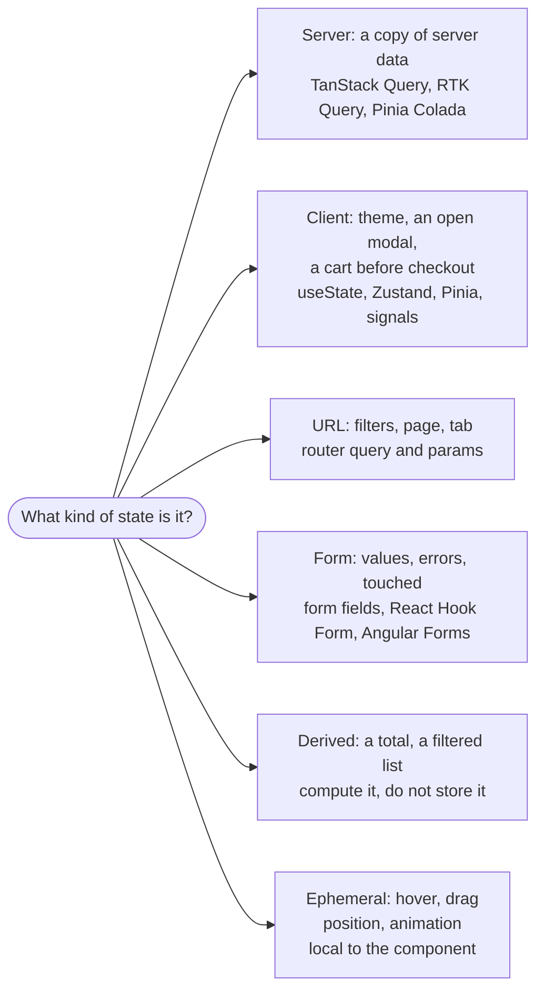
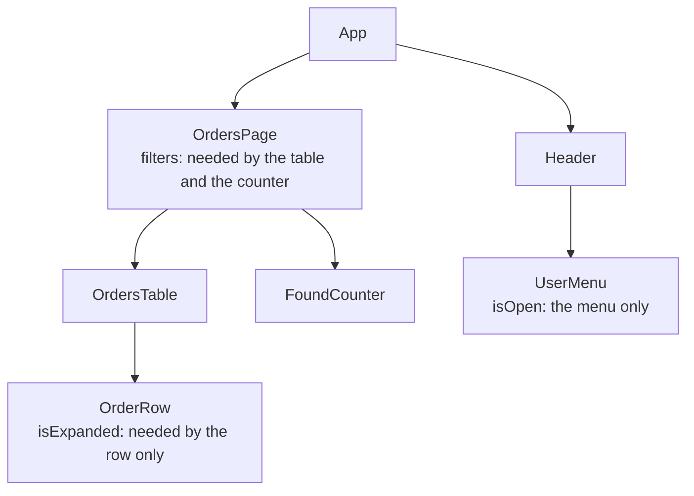

## What this lesson covers

Where any interview conversation about state begins: what kinds of state exist, where each one should live, and why "put everything in a global store" is usually a mistake. This lesson covers the kinds of state and the matching tools, derived state, colocation and lifting state up, the URL as storage, and what a state manager actually gives you. The examples run in Node.js and jsdom.

## Why a state manager

State is data that changes while the app runs and that the UI depends on. While one component needs it, `useState`, `ref` or a class field is enough. A state manager (Redux, Zustand, MobX, Pinia, NgRx) is needed when:

- the same data is read and changed by components **far apart** from each other, and passing it through props over many levels is awkward;
- you need **predictability**: every change goes through one place, so it can be logged, debugged (Redux DevTools with "time travel") and tested apart from the UI;
- data must **outlive** a screen being unmounted (a cart, a draft, settings).

A manager does not make an app faster by itself: performance comes from components subscribing only to the parts of state they need. And it has a cost: boilerplate, one more abstraction, global data anyone can change. So first decide **which kind** of state it is.

## Kinds of state



| Kind | Example | Source of truth | What holds it |
|---|---|---|---|
| Server | Order list, profile, stock levels | The server; the client has only a cache that goes stale | A query library: cache, refetching, deduplication |
| Client (UI) | Theme, collapsed panel, selected row, cart | The client | Local state; a store when many screens share it |
| URL | `?q=tea&sort=price&page=2` | The address bar | The router; no copy in a store needed |
| Form | Typed values, errors, `touched` | Form fields until submit | Form state or a form library |
| Derived | Cart total, visible todos | Computed from other data | `computed`, `useMemo`, a selector |
| Ephemeral | Hover, focus, animation progress | The current interaction | Local, often just the DOM or CSS |

The most common mistake of past years' projects: keeping **server data in Redux** together with `isLoading` and `error` flags and deciding by hand when to reload it. That is a cache, not app state, and it has its own problems: staleness, refetching when the user returns to the tab, cancellation, deduplication. Query libraries exist for them (see the server state lesson), and the global store keeps only truly client data, which is usually small.

## Derived state is not stored

If a value can be computed from other data, compute it when reading. Storing a copy creates a second source of truth, and sooner or later the copies drift apart. The classic interview example is a prop copied into state.

```jsx dom
import { useState } from 'react'
import { createRoot } from 'react-dom/client'
import { flushSync } from 'react-dom'

function CopiedPrice({ price }) {
  const [shown] = useState(price) // copied once: later props are ignored
  return <p>copied: {shown}</p>
}
function DerivedPrice({ price, currency }) {
  const label = `${price} ${currency}` // computed during render: always current
  return <p>derived: {label}</p>
}

const el = document.createElement('div')
const root = createRoot(el)
for (const price of [10, 12]) {
  flushSync(() =>
    root.render(
      <>
        <CopiedPrice price={price} />
        <DerivedPrice price={price} currency="EUR" />
      </>,
    ),
  )
  console.log([...el.querySelectorAll('p')].map((p) => p.textContent).join(' | '))
}
```

```output
copied: 10 | derived: 10 EUR
copied: 10 | derived: 12 EUR
```

`useState(price)` uses the prop only as the initial value: the parent passed a new price, and the component still shows the old one. The derived value updated by itself. The same rule holds in every library: `computed` in Vue and MobX, `computed` and `linkedSignal` in Angular, selectors in Redux, getters in Pinia. If the computation is expensive, cache it (`useMemo`, a memoized selector), but still do not store it separately.

## Where to keep it: colocation and lifting



- **Colocation**: state lives in the lowest component that needs it. A row's `isExpanded` should not live in the page: expanding one row would then re-render the whole table.
- **Lifting state up**: if two siblings need a value, move it to their nearest common parent (`filters` in `OrdersPage`), pass it down as props and send changes back up through callbacks or events.
- **Context or provide/inject** when intermediate levels do not need the value but would have to pass it on (prop drilling). **A store** when different branches of the tree need the data and it must outlive screen changes.
- Move state back down as soon as it stops being shared: unnecessary globality makes it harder to see who changes it and why.

## The URL as storage

Anything the user would want to share by link, or that must survive a reload and the Back button, lives in the URL: search, filters, sorting, page number, the open tab. The URL becomes the source of truth, and the component reads and writes it through the router (`useSearchParams`, `route.query`, `ActivatedRoute`).

```js run
// Filters live in the URL: shareable, survive reload, Back and Forward restore them
const defaults = { q: '', sort: 'relevance', page: 1, tags: [] }

function toSearch(filters) {
  const params = new URLSearchParams()
  if (filters.q) params.set('q', filters.q)
  if (filters.sort !== defaults.sort) params.set('sort', filters.sort)
  if (filters.page !== defaults.page) params.set('page', String(filters.page))
  for (const tag of filters.tags) params.append('tag', tag)
  return params.toString()
}
function fromSearch(search) {
  const params = new URLSearchParams(search)
  const page = Number(params.get('page'))
  return {
    q: params.get('q') ?? defaults.q,
    sort: ['relevance', 'price', 'new'].includes(params.get('sort')) ? params.get('sort') : defaults.sort,
    page: Number.isInteger(page) && page > 0 ? page : defaults.page,
    tags: params.getAll('tag'),
  }
}

const search = toSearch({ q: 'green tea', sort: 'price', page: 2, tags: ['organic', 'loose'] })
console.log(search)
console.log(fromSearch(search))
console.log(fromSearch('?page=-3&sort=hack'))
```

```output
q=green+tea&sort=price&page=2&tag=organic&tag=loose
{
  q: 'green tea',
  sort: 'price',
  page: 2,
  tags: [ 'organic', 'loose' ]
}
{ q: '', sort: 'relevance', page: 1, tags: [] }
```

- Default values are not written to the URL: links are shorter, and the same results have one address.
- The URL is **user input**: parse it with validation (`page=-3` and an unknown sort fell back to defaults), like form data.
- For frequent changes (typing in a search box) update the URL with `replace`, not `push`, or every letter becomes a history entry.

## Key points

- A state manager is for shared data of distant components, predictable changes and data that outlives screens; performance comes from fine-grained subscriptions, not from the manager.
- Kinds of state: server (a cache), client, URL, form, derived, ephemeral; each has its own tool.
- Server data in a global store with manual `isLoading` is an outdated approach: use a query library.
- Derived state is computed, not stored; a prop copied into `useState` does not update.
- Colocation: keep state as low as possible; lift it to a common parent when siblings need it; use a store for different branches and long life.
- Filters, search and the page live in the URL; parse it with validation, use `replace` for frequent changes.
