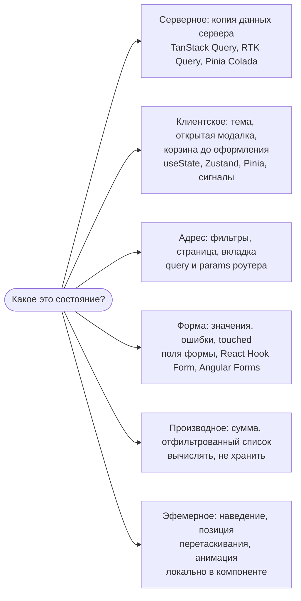
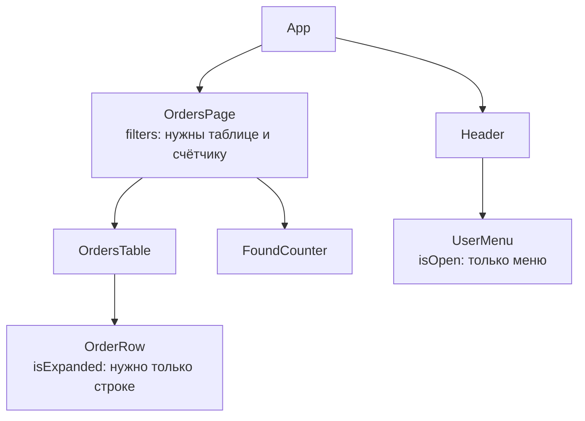

## О чём урок

С чего начинается любой разговор о состоянии на собеседовании: какое состояние бывает, где каждое из них должно жить и почему «положить всё в глобальный стор» обычно ошибка. Здесь виды состояния и подходящие инструменты, производное состояние, колокация и подъём состояния, адрес страницы как хранилище и что на самом деле даёт менеджер состояний. Примеры выполняются в Node.js и jsdom.

## Зачем менеджер состояний

Состояние это данные, которые меняются во время работы и от которых зависит интерфейс. Пока оно нужно одному компоненту, хватает `useState`, `ref` или поля класса. Менеджер состояний (Redux, Zustand, MobX, Pinia, NgRx) нужен, когда:

- одни и те же данные читают и меняют **далёкие** друг от друга компоненты, и передавать их через пропсы на много уровней неудобно;
- нужна **предсказуемость**: все изменения проходят через одно место, их можно логировать, отлаживать (Redux DevTools с «путешествием во времени»), тестировать отдельно от интерфейса;
- данные должны **переживать** размонтирование экрана (корзина, черновик, настройки).

Менеджер сам по себе не делает приложение быстрее: производительность даёт подписка компонентов только на нужные им части состояния. И у него есть цена: шаблонный код, ещё одна абстракция, глобальные данные, которые может изменить кто угодно. Поэтому сначала определяют, **какое** это состояние.

## Виды состояния



| Вид | Пример | Источник правды | Чем держать |
|---|---|---|---|
| Серверное | Список заказов, профиль, остатки на складе | Сервер; на клиенте только кэш, который устаревает | Библиотека запросов: кэш, повторная загрузка, дедупликация |
| Клиентское (UI) | Тема, свёрнутая панель, выбранная строка, корзина | Клиент | Локальное состояние; общее для многих экранов в сторе |
| Адрес | `?q=tea&sort=price&page=2` | Строка адреса | Роутер; копия в сторе не нужна |
| Форма | Введённые значения, ошибки, `touched` | Поля формы до отправки | Состояние формы или библиотека форм |
| Производное | Сумма корзины, видимые задачи | Вычисляется из других данных | `computed`, `useMemo`, селектор |
| Эфемерное | Наведение, фокус, прогресс анимации | Текущее взаимодействие | Локально, часто вообще в DOM или CSS |

Самая частая ошибка проектов прошлых лет: держать **серверные данные в Redux** вместе с флагами `isLoading` и `error` и вручную решать, когда их перезагрузить. Это кэш, а не состояние приложения, и у него свои задачи: устаревание, повторный запрос при возврате на вкладку, отмена, дедупликация. Для них есть библиотеки запросов (урок о серверном состоянии), а глобальный стор остаётся для действительно клиентских данных, которых обычно немного.

## Производное состояние не хранят

Если значение можно вычислить из других данных, его вычисляют при чтении. Хранение копии создаёт второй источник правды, и рано или поздно копии разойдутся. Классический пример на собеседовании: пропс, скопированный в состояние.

```jsx dom
import { useState } from 'react'
import { createRoot } from 'react-dom/client'
import { flushSync } from 'react-dom'

function CopiedPrice({ price }) {
  const [shown] = useState(price) // copied once: later props are ignored
  return <p>copied: {shown}</p>
}
function DerivedPrice({ price, currency }) {
  const label = `${price} ${currency}` // computed during render: always current
  return <p>derived: {label}</p>
}

const el = document.createElement('div')
const root = createRoot(el)
for (const price of [10, 12]) {
  flushSync(() =>
    root.render(
      <>
        <CopiedPrice price={price} />
        <DerivedPrice price={price} currency="EUR" />
      </>,
    ),
  )
  console.log([...el.querySelectorAll('p')].map((p) => p.textContent).join(' | '))
}
```

```output
copied: 10 | derived: 10 EUR
copied: 10 | derived: 12 EUR
```

`useState(price)` использует пропс только как начальное значение: родитель передал новую цену, а компонент показывает старую. Производное значение пересчиталось само. То же правило во всех библиотеках: `computed` в Vue и MobX, `computed` и `linkedSignal` в Angular, селекторы в Redux, геттеры в Pinia. Если вычисление дорогое, его кэшируют (`useMemo`, мемоизированный селектор), но всё равно не хранят отдельно.

## Где держать: колокация и подъём



- **Колокация**: состояние живёт в самом нижнем компоненте, которому оно нужно. `isExpanded` строки не должно лежать в странице: тогда раскрытие одной строки перерисовывало бы всю таблицу.
- **Подъём состояния** (lifting state up): если значение нужно двум соседям, его поднимают в ближайшего общего предка (`filters` в `OrdersPage`) и передают вниз пропсами, а изменения возвращают колбэками или событиями.
- **Контекст или provide/inject**, когда промежуточным уровням значение не нужно, но передавать его через них приходится (prop drilling). **Стор**, когда данные нужны разным веткам дерева и должны переживать смену экранов.
- Состояние опускают обратно, как только оно перестаёт быть общим: лишняя глобальность усложняет понимание, кто и почему его меняет.

## Адрес страницы как хранилище

Всё, чем пользователь хотел бы поделиться ссылкой или что должно пережить перезагрузку и кнопку «Назад», хранят в адресе: поиск, фильтры, сортировку, номер страницы, открытую вкладку. Адрес становится источником правды, а компонент читает и пишет его через роутер (`useSearchParams`, `route.query`, `ActivatedRoute`).

```js run
// Filters live in the URL: shareable, survive reload, Back and Forward restore them
const defaults = { q: '', sort: 'relevance', page: 1, tags: [] }

function toSearch(filters) {
  const params = new URLSearchParams()
  if (filters.q) params.set('q', filters.q)
  if (filters.sort !== defaults.sort) params.set('sort', filters.sort)
  if (filters.page !== defaults.page) params.set('page', String(filters.page))
  for (const tag of filters.tags) params.append('tag', tag)
  return params.toString()
}
function fromSearch(search) {
  const params = new URLSearchParams(search)
  const page = Number(params.get('page'))
  return {
    q: params.get('q') ?? defaults.q,
    sort: ['relevance', 'price', 'new'].includes(params.get('sort')) ? params.get('sort') : defaults.sort,
    page: Number.isInteger(page) && page > 0 ? page : defaults.page,
    tags: params.getAll('tag'),
  }
}

const search = toSearch({ q: 'green tea', sort: 'price', page: 2, tags: ['organic', 'loose'] })
console.log(search)
console.log(fromSearch(search))
console.log(fromSearch('?page=-3&sort=hack'))
```

```output
q=green+tea&sort=price&page=2&tag=organic&tag=loose
{
  q: 'green tea',
  sort: 'price',
  page: 2,
  tags: [ 'organic', 'loose' ]
}
{ q: '', sort: 'relevance', page: 1, tags: [] }
```

- Значения по умолчанию не пишут в адрес: ссылки короче, и у одной и той же выдачи один адрес.
- Адрес это **пользовательский ввод**: его разбирают с проверкой (`page=-3` и неизвестная сортировка заменены значениями по умолчанию), как данные формы.
- Для частых изменений (ввод в поиске) адрес обновляют через `replace`, а не `push`, иначе каждая буква станет записью в истории.

## Главное

- Менеджер состояний нужен для общих данных далёких компонентов, предсказуемости изменений и данных, переживающих экраны; производительность даёт не он, а точечные подписки.
- Виды состояния: серверное (это кэш), клиентское, адрес, форма, производное, эфемерное; у каждого свой инструмент.
- Серверные данные в глобальном сторе с ручными `isLoading` это устаревший подход: для них библиотеки запросов.
- Производное состояние вычисляют, а не хранят; пропс, скопированный в `useState`, не обновится.
- Колокация: состояние как можно ниже; подъём в общего предка, когда оно нужно соседям; стор для разных веток и долгой жизни.
- Фильтры, поиск, страница живут в адресе; его разбирают с проверкой, частые изменения через `replace`.
