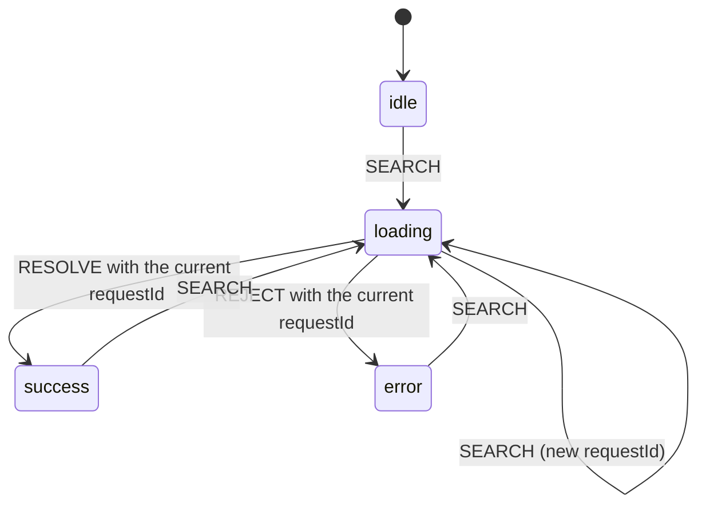

## What this lesson covers

Why a set of `isLoading`, `isError`, `data` flags produces impossible states and how to avoid them: discriminated unions in TypeScript, a reducer as a finite state machine that ignores stale responses, and the XState library for complex flows. This is the basis for questions like "what states does this component have" and "what happens if responses arrive out of order". The examples run in Node.js.

## Impossible states

A component with a user list is often described with flags:

```ts
const [isLoading, setIsLoading] = useState(false)
const [isError, setIsError] = useState(false)
const [data, setData] = useState<User[]>()
```

Three independent values allow combinations that make no sense: `isLoading` and `isError` at once, an error together with old data, "not loading, no error, no data" (is that the initial state or an empty response?). The UI has to render each of these combinations somehow, and that is where bugs like "the spinner never goes away" or "old data shown with an error message" live.

The fix: describe the **finite set of states** the component can actually be in, and the data that exists in each of them.

```ts run
// Booleans allow combinations that make no sense
type FlagsState = { isLoading: boolean; isError: boolean; data?: string[]; error?: string }
const broken: FlagsState = { isLoading: true, isError: true, data: ['a'] } // compiles, means nothing

// A discriminated union lists only the states that can happen
type RequestState =
  | { status: 'idle' }
  | { status: 'loading' }
  | { status: 'success'; data: string[] }
  | { status: 'error'; error: string }

function render(state: RequestState): string {
  switch (state.status) {
    case 'idle':
      return 'Type to search'
    case 'loading':
      return 'Loading…'
    case 'success':
      return state.data.length ? state.data.join(', ') : 'Nothing found' // data exists only here
    case 'error':
      return `Error: ${state.error}`
  }
}
console.log('compiles, but means nothing:', JSON.stringify(broken))
for (const s of [{ status: 'idle' }, { status: 'loading' }, { status: 'success', data: [] }, { status: 'error', error: '500' }] as RequestState[])
  console.log(s.status.padEnd(8), '→', render(s))
```

```output
compiles, but means nothing: {"isLoading":true,"isError":true,"data":["a"]}
idle     → Type to search
loading  → Loading…
success  → Nothing found
error    → Error: 500
```

- **A discriminated union**: the shared `status` field tells the variants apart, and inside `case 'success'` TypeScript knows that `data` exists, and in `case 'error'` that `error` does. Code simply cannot read `data` in the loading state.
- An empty result is a separate, explicitly handled case ("Nothing found"), not "no data at all".
- The UI must show **every** state: loading (a skeleton is better than a spinner), an error with a retry, an empty result, success. In a frontend design interview you name these for every component.

## A reducer as a state machine

**A finite state machine**: a finite number of states, events, and rules for which event in which state leads to which transition. An event the current state does not expect changes nothing. A reducer expresses this easily:

```js run
// A reducer as a finite state machine: each event is handled only in some states
function searchReducer(state, event) {
  switch (event.type) {
    case 'SEARCH': // allowed in any state: a new query restarts loading
      return { status: 'loading', requestId: event.requestId }
    case 'RESOLVE':
    case 'REJECT':
      if (state.status !== 'loading' || event.requestId !== state.requestId) return state // stale or unexpected
      return event.type === 'RESOLVE' ? { status: 'success', data: event.data } : { status: 'error', error: event.error }
    default:
      return state
  }
}

let state = { status: 'idle' }
const events = [
  { type: 'RESOLVE', requestId: 0, data: ['too early'] }, // nothing is loading: ignored
  { type: 'SEARCH', requestId: 1 }, // the user typed "a"
  { type: 'SEARCH', requestId: 2 }, // then "an"
  { type: 'RESOLVE', requestId: 1, data: ['alice', 'ann'] }, // the slow answer for "a": ignored
  { type: 'RESOLVE', requestId: 2, data: ['ann'] },
]
for (const event of events) {
  state = searchReducer(state, event)
  console.log(`${event.type} #${event.requestId}`.padEnd(11), JSON.stringify(state))
}
```

```output
RESOLVE #0  {"status":"idle"}
SEARCH #1   {"status":"loading","requestId":1}
SEARCH #2   {"status":"loading","requestId":2}
RESOLVE #1  {"status":"loading","requestId":2}
RESOLVE #2  {"status":"success","data":["ann"]}
```



- The slow response to the "a" request arrived after the "an" request and was **ignored**: its `requestId` did not match the current one. This is the classic autocomplete race; without the check the screen would show results for the old query.
- The same reducer works in `useReducer`, in a Redux or Zustand store, and is tested without a UI: feed a sequence of events, check the state.
- Cancelling the stale request (`AbortController`) is still worth doing to save network, but the reducer check also protects against responses that could not be cancelled.

## XState: machines with complex logic

When there are many states and transitions (a checkout wizard, file upload with pause, a video player, retries with a limit), the machine is described declaratively with **XState** (version 5). It provides nested and parallel states, guards, async tasks started on entering a state, and the Stately visual editor.

```js run
import { assign, createActor, fromPromise, setup, waitFor } from 'xstate'

let calls = 0
const machine = setup({
  actors: {
    loadUsers: fromPromise(async () => {
      calls++
      if (calls === 1) throw new Error('timeout') // the first request fails
      return ['ann', 'bob']
    }),
  },
  guards: { canRetry: ({ context }) => context.attempts < 3 },
}).createMachine({
  id: 'users',
  initial: 'idle',
  context: { attempts: 0, users: [], error: null },
  states: {
    idle: { on: { LOAD: 'loading' } },
    loading: {
      entry: assign({ attempts: ({ context }) => context.attempts + 1 }),
      invoke: {
        src: 'loadUsers',
        onDone: { target: 'success', actions: assign({ users: ({ event }) => event.output, error: null }) },
        onError: { target: 'failure', actions: assign({ error: ({ event }) => event.error.message }) },
      },
    },
    failure: { on: { RETRY: { target: 'loading', guard: 'canRetry' } } },
    success: { on: { LOAD: 'loading' } },
  },
})

const actor = createActor(machine)
actor.subscribe((snapshot) => console.log(String(snapshot.value).padEnd(8), JSON.stringify(snapshot.context)))
actor.start()
actor.send({ type: 'RETRY' }) // not allowed in idle: the snapshot is the same idle
actor.send({ type: 'LOAD' })
await waitFor(actor, (s) => s.matches('failure'))
actor.send({ type: 'RETRY' })
await waitFor(actor, (s) => s.matches('success'))
```

```output
idle     {"attempts":0,"users":[],"error":null}
idle     {"attempts":0,"users":[],"error":null}
loading  {"attempts":1,"users":[],"error":null}
failure  {"attempts":1,"users":[],"error":"timeout"}
loading  {"attempts":2,"users":[],"error":"timeout"}
success  {"attempts":2,"users":["ann","bob"],"error":null}
```

- `RETRY` is not expected in `idle`, so the machine stayed in `idle` (the subscriber got the same snapshot). In `failure` the same `RETRY` is allowed, but only while the `canRetry` guard lets it through: after three attempts there is no retry.
- `invoke` starts a promise on entering `loading` and automatically discards its result if the machine left the state earlier: one more protection against races.
- `context` holds the data (like `data` and `error` in the union), and `value` shows which state the machine is in.
- For a simple request XState is overkill: a union with a reducer, or a query library, is enough. A machine pays off where there are dozens of transitions and a mistake in one of them is expensive.

## Key points

- A set of independent flags allows impossible combinations; a finite set of states rules them out.
- A discriminated union on a `status` field: data exists only in the states where it makes sense.
- A component shows every state: loading, an error with a retry, an empty result, success.
- A reducer as a machine: an event not expected in a state changes nothing; a `requestId` drops stale responses.
- XState for complex flows: nested states, guards, `invoke` for async tasks with automatic discarding of results.
