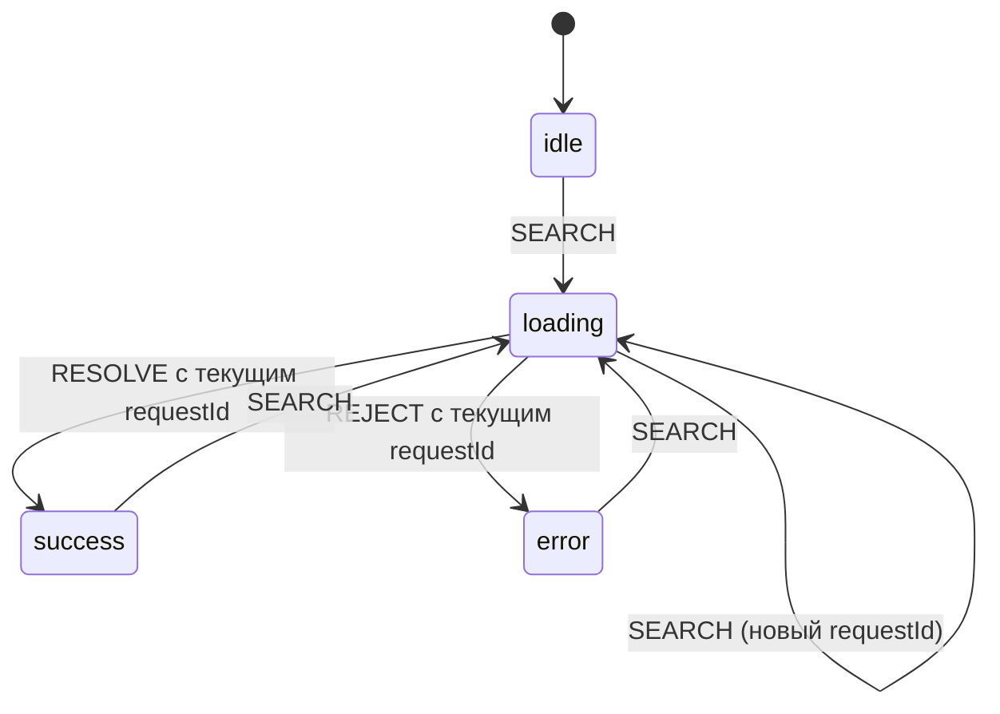

## О чём урок

Почему набор флагов `isLoading`, `isError`, `data` порождает невозможные состояния и как этого избежать: размеченные объединения в TypeScript, редьюсер как конечный автомат, который игнорирует устаревшие ответы, и библиотека XState для сложных сценариев. Это основа для вопросов «какие состояния у этого компонента» и «что будет, если ответ придёт не по порядку». Примеры выполняются в Node.js.

## Невозможные состояния

Компонент со списком пользователей часто описывают флагами:

```ts
const [isLoading, setIsLoading] = useState(false)
const [isError, setIsError] = useState(false)
const [data, setData] = useState<User[]>()
```

Три независимых значения дают комбинации, которые не имеют смысла: `isLoading` и `isError` одновременно, ошибка вместе со старыми данными, «не загружается, нет ошибки, нет данных» (это начальное состояние или пустой ответ?). Каждую такую комбинацию интерфейс должен как-то нарисовать, и именно там живут ошибки вида «спиннер не пропадает» или «показали старые данные с сообщением об ошибке».

Решение: описать **конечный набор состояний**, в котором компонент реально может находиться, и данные, которые есть в каждом из них.

```ts run
// Booleans allow combinations that make no sense
type FlagsState = { isLoading: boolean; isError: boolean; data?: string[]; error?: string }
const broken: FlagsState = { isLoading: true, isError: true, data: ['a'] } // compiles, means nothing

// A discriminated union lists only the states that can happen
type RequestState =
  | { status: 'idle' }
  | { status: 'loading' }
  | { status: 'success'; data: string[] }
  | { status: 'error'; error: string }

function render(state: RequestState): string {
  switch (state.status) {
    case 'idle':
      return 'Type to search'
    case 'loading':
      return 'Loading…'
    case 'success':
      return state.data.length ? state.data.join(', ') : 'Nothing found' // data exists only here
    case 'error':
      return `Error: ${state.error}`
  }
}
console.log('compiles, but means nothing:', JSON.stringify(broken))
for (const s of [{ status: 'idle' }, { status: 'loading' }, { status: 'success', data: [] }, { status: 'error', error: '500' }] as RequestState[])
  console.log(s.status.padEnd(8), '→', render(s))
```

```output
compiles, but means nothing: {"isLoading":true,"isError":true,"data":["a"]}
idle     → Type to search
loading  → Loading…
success  → Nothing found
error    → Error: 500
```

- **Размеченное объединение** (discriminated union): общее поле `status` различает варианты, и TypeScript внутри `case 'success'` знает, что `data` есть, а в `case 'error'` есть `error`. Получить `data` в состоянии загрузки код просто не может.
- Пустой результат это отдельный, явно обработанный случай («Nothing found»), а не «нет данных вообще».
- Интерфейс должен показать **каждое** состояние: загрузку (лучше скелетон, чем спиннер), ошибку с повтором, пустой результат, успех. На собеседовании по дизайну это проговаривают для каждого компонента.

## Редьюсер как конечный автомат

**Конечный автомат** (finite state machine): конечное число состояний, события и правила, какое событие в каком состоянии к какому переходу приводит. Событие, которое в текущем состоянии не предусмотрено, ничего не меняет. Это легко выразить редьюсером:

```js run
// A reducer as a finite state machine: each event is handled only in some states
function searchReducer(state, event) {
  switch (event.type) {
    case 'SEARCH': // allowed in any state: a new query restarts loading
      return { status: 'loading', requestId: event.requestId }
    case 'RESOLVE':
    case 'REJECT':
      if (state.status !== 'loading' || event.requestId !== state.requestId) return state // stale or unexpected
      return event.type === 'RESOLVE' ? { status: 'success', data: event.data } : { status: 'error', error: event.error }
    default:
      return state
  }
}

let state = { status: 'idle' }
const events = [
  { type: 'RESOLVE', requestId: 0, data: ['too early'] }, // nothing is loading: ignored
  { type: 'SEARCH', requestId: 1 }, // the user typed "a"
  { type: 'SEARCH', requestId: 2 }, // then "an"
  { type: 'RESOLVE', requestId: 1, data: ['alice', 'ann'] }, // the slow answer for "a": ignored
  { type: 'RESOLVE', requestId: 2, data: ['ann'] },
]
for (const event of events) {
  state = searchReducer(state, event)
  console.log(`${event.type} #${event.requestId}`.padEnd(11), JSON.stringify(state))
}
```

```output
RESOLVE #0  {"status":"idle"}
SEARCH #1   {"status":"loading","requestId":1}
SEARCH #2   {"status":"loading","requestId":2}
RESOLVE #1  {"status":"loading","requestId":2}
RESOLVE #2  {"status":"success","data":["ann"]}
```



- Медленный ответ на запрос «a» пришёл после запроса «an» и был **проигнорирован**: его `requestId` не совпал с текущим. Это классическая гонка в поиске с автодополнением; без проверки на экране оказались бы результаты для старой строки.
- Тот же редьюсер работает в `useReducer`, в сторе Redux или Zustand и тестируется без интерфейса: подали последовательность событий, проверили состояние.
- Отменять устаревший запрос всё равно стоит (`AbortController`), чтобы не тратить сеть, но проверка в редьюсере защищает и от ответов, которые отменить не удалось.

## XState: автоматы со сложной логикой

Когда состояний и переходов много (мастер оформления заказа, загрузка файлов с паузой, видеоплеер, повтор с ограничением попыток), автомат описывают декларативно библиотекой **XState** (версия 5). Она даёт вложенные и параллельные состояния, охранные условия (guards), запуск асинхронных задач при входе в состояние и визуальный редактор Stately.

```js run
import { assign, createActor, fromPromise, setup, waitFor } from 'xstate'

let calls = 0
const machine = setup({
  actors: {
    loadUsers: fromPromise(async () => {
      calls++
      if (calls === 1) throw new Error('timeout') // the first request fails
      return ['ann', 'bob']
    }),
  },
  guards: { canRetry: ({ context }) => context.attempts < 3 },
}).createMachine({
  id: 'users',
  initial: 'idle',
  context: { attempts: 0, users: [], error: null },
  states: {
    idle: { on: { LOAD: 'loading' } },
    loading: {
      entry: assign({ attempts: ({ context }) => context.attempts + 1 }),
      invoke: {
        src: 'loadUsers',
        onDone: { target: 'success', actions: assign({ users: ({ event }) => event.output, error: null }) },
        onError: { target: 'failure', actions: assign({ error: ({ event }) => event.error.message }) },
      },
    },
    failure: { on: { RETRY: { target: 'loading', guard: 'canRetry' } } },
    success: { on: { LOAD: 'loading' } },
  },
})

const actor = createActor(machine)
actor.subscribe((snapshot) => console.log(String(snapshot.value).padEnd(8), JSON.stringify(snapshot.context)))
actor.start()
actor.send({ type: 'RETRY' }) // not allowed in idle: the snapshot is the same idle
actor.send({ type: 'LOAD' })
await waitFor(actor, (s) => s.matches('failure'))
actor.send({ type: 'RETRY' })
await waitFor(actor, (s) => s.matches('success'))
```

```output
idle     {"attempts":0,"users":[],"error":null}
idle     {"attempts":0,"users":[],"error":null}
loading  {"attempts":1,"users":[],"error":null}
failure  {"attempts":1,"users":[],"error":"timeout"}
loading  {"attempts":2,"users":[],"error":"timeout"}
success  {"attempts":2,"users":["ann","bob"],"error":null}
```

- `RETRY` в состоянии `idle` не предусмотрен, и автомат остался в `idle` (подписчик получил тот же снимок). В `failure` тот же `RETRY` разрешён, но только пока охранное условие `canRetry` пропускает: после трёх попыток повтора не будет.
- `invoke` запускает промис при входе в `loading` и автоматически отменяет его результат, если автомат ушёл из состояния раньше: ещё одна защита от гонок.
- `context` хранит данные (как `data` и `error` в объединении), а `value` показывает, в каком состоянии автомат.
- Для простого запроса XState избыточен: хватает объединения и редьюсера или библиотеки запросов. Автомат окупается там, где переходов десятки и ошибка в одном из них дорогая.

## Главное

- Набор независимых флагов допускает невозможные комбинации; конечный набор состояний их исключает.
- Размеченное объединение по полю `status`: данные существуют только в тех состояниях, где они имеют смысл.
- Компонент показывает каждое состояние: загрузка, ошибка с повтором, пустой результат, успех.
- Редьюсер как автомат: событие, не предусмотренное в состоянии, ничего не меняет; `requestId` отсекает устаревшие ответы.
- XState для сложных сценариев: вложенные состояния, guards, `invoke` асинхронных задач с автоматической отменой результата.
