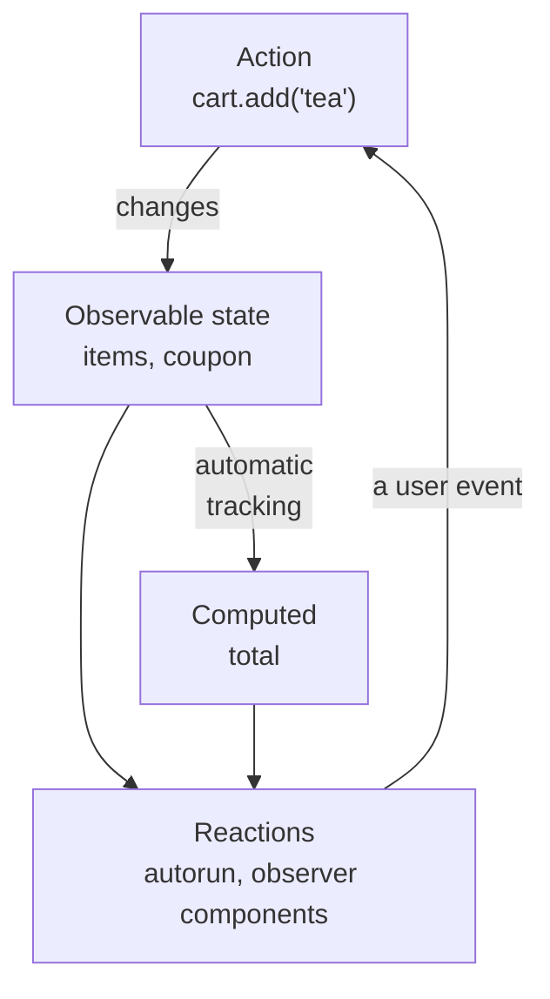

## What this lesson covers

MobX, the second best-known approach to state after Redux: mutable observable objects and automatic dependency tracking instead of actions and immutable reducers. This lesson covers `makeAutoObservable`, `computed`, reactions (`autorun`, `reaction`), transactions in actions, strict mode, destructuring traps, the React integration and a comparison with Redux and the signals of Vue and Angular. The examples run on MobX 7 in Node.js.

## Observable state and derivations

The MobX idea: "anything that can be derived from the state should be derived automatically". State is plain objects and classes changed by plain assignment, and MobX itself knows who read what and updates only the dependents.



```js run
import { autorun, makeAutoObservable, reaction, runInAction } from 'mobx'

class CartStore {
  items = []
  coupon = null
  constructor() {
    makeAutoObservable(this) // fields → observable, getters → computed, methods → actions
  }
  get total() {
    console.log('· computing total')
    return this.items.reduce((sum, i) => sum + i.price * i.qty, 0) * (this.coupon === 'HALF' ? 0.5 : 1)
  }
  add(name, price) {
    const found = this.items.find((i) => i.name === name)
    if (found) found.qty++ // plain mutation: MobX tracks it
    else this.items.push({ name, price, qty: 1 })
  }
}

const cart = new CartStore()
const dispose = autorun(() => console.log('render: total', cart.total, '| items', cart.items.length))
cart.add('tea', 4)
cart.add('tea', 4)
reaction(
  () => cart.coupon, // what to track
  (coupon) => console.log('coupon applied:', coupon), // the side effect, not run on start
)
runInAction(() => {
  cart.coupon = 'HALF'
  cart.add('cake', 6)
}) // one transaction: derivations run once at the end
dispose()
```

```output
· computing total
render: total 0 | items 0
· computing total
render: total 4 | items 1
· computing total
render: total 8 | items 1
· computing total
render: total 7 | items 2
coupon applied: HALF
```

- `makeAutoObservable(this)` makes fields observable, getters computed and methods actions. Explicit annotation: `makeObservable(this, { items: observable, total: computed, add: action })`, or TC39 standard decorators (`@observable accessor items`).
- `found.qty++` is a plain mutation, and `autorun` saw it: MobX wraps objects and arrays in proxies and tracks reads of every property. No immutable copies are needed.
- `autorun` runs at once and then on every change of what it read. `reaction` separates "what to track" from "what to do" and does not run the effect on creation: that is how saving, requests and analytics are written.
- An action is a **transaction**: two changes inside `runInAction` (the coupon and a new item) gave one recompute and one reaction, not two.
- A `computed` is cached while it has observers and recomputes only when its dependencies change. Without observers it is computed again on every read.

## Strict mode and traps

```js run
import { autorun, configure, makeAutoObservable, runInAction } from 'mobx'

configure({ enforceActions: 'observed' }) // the default: changes outside actions are warned about
const user = makeAutoObservable({ name: 'Ann', address: { city: 'Oslo' } })

const { name } = user // a copied string: no longer tracked
autorun(() => console.log('destructured:', name))
autorun(() => console.log('dereferenced inside:', user.name))
const city = user.address // an object reference: its fields are still observable
autorun(() => console.log('city:', city.city))

const warn = console.warn
console.warn = (message) => console.log('warning:', String(message).split('.')[0])
user.name = 'Bob' // outside an action
console.warn = warn
runInAction(() => (user.address.city = 'Rome')) // the right way
```

```output
destructured: Ann
dereferenced inside: Ann
city: Oslo
warning: [MobX] Since strict-mode is enabled, changing (observed) observable values without using an action is not allowed
dereferenced inside: Bob
city: Rome
```

- **Dereference late**: MobX tracks property reads of an observable object. `const { name } = user` copies a string, and a reaction on it will never fire. A reference to a nested object (`city`) works: its properties are still observable. The same rule applies in Vue (`toRefs`) and in Pinia stores (`storeToRefs`).
- By default `enforceActions: 'observed'`: changing an observed observable value outside an action prints a warning. Actions make changes explicit and group them into transactions.
- Async code: everything that changes state **after** an `await` is wrapped in `runInAction` again (or written as a generator with `flow`), because after `await` it is a different synchronous part.
- MobX tracks only what is read **synchronously** inside a reaction: a read in a `setTimeout` or after an `await` in a reaction does not become a dependency.

## MobX in React

```tsx
import { observer } from 'mobx-react-lite'

const CartBadge = observer(function CartBadge({ cart }: { cart: CartStore }) {
  return <span>{cart.items.length} items, {cart.total} €</span> // re-renders only when these change
})
```

- `observer` turns a component into a reaction: it re-renders only when the observable values read during its render change. No selectors or `memo` needed.
- The store is passed through a context or a module import; with SSR it is created per request, like any global store.
- `observer` must wrap every component that reads observable data: if you pass `cart.items` to a plain child component and it reads the items, it will not see changes to them.

## MobX, Redux and signals

| | Redux (RTK) | MobX | Signals (Vue, Angular, Solid, Preact) |
|---|---|---|---|
| Change | `dispatch(action)`, immutable update | Direct assignment in an action | `ref.value = x`, `signal.set(x)` |
| Subscription | Selectors, compared by reference | Automatic tracking of reads | Automatic tracking of reads |
| Derived | `createSelector` | `computed` | `computed` |
| Debugging | An action log, "time travel" | MobX DevTools, `trace()` | The framework's DevTools |
| Strength | Predictability, an explicit flow, large teams | Minimal code, complex domain models | Built into the framework, fine-grained updates |
| Cost | Boilerplate | Implicitness: "who changed it?", dereferencing traps | The same dereferencing traps |

By mechanism MobX is closest to Vue reactivity and signals: in all of them track happens on read and trigger on write (see the Vue reactivity lesson). That is why Vue and Angular hardly need a separate library like MobX: `reactive` and Pinia, signals and services play that role.

## Key points

- MobX: mutable observable objects, automatic dependency tracking, derivations computed by themselves.
- `makeAutoObservable`: fields observable, getters computed, methods actions; `autorun` runs at once, `reaction` separates tracking from the effect.
- An action is a transaction: several changes give one reaction; after `await` changes go into `runInAction` or `flow` again.
- Dereference late: destructuring copies a value and loses tracking.
- In React wrap components in `observer`; they re-render only when what they read changes.
- By mechanism MobX is a relative of Vue reactivity and Angular signals; against Redux it wins on brevity and loses on explicitness.
