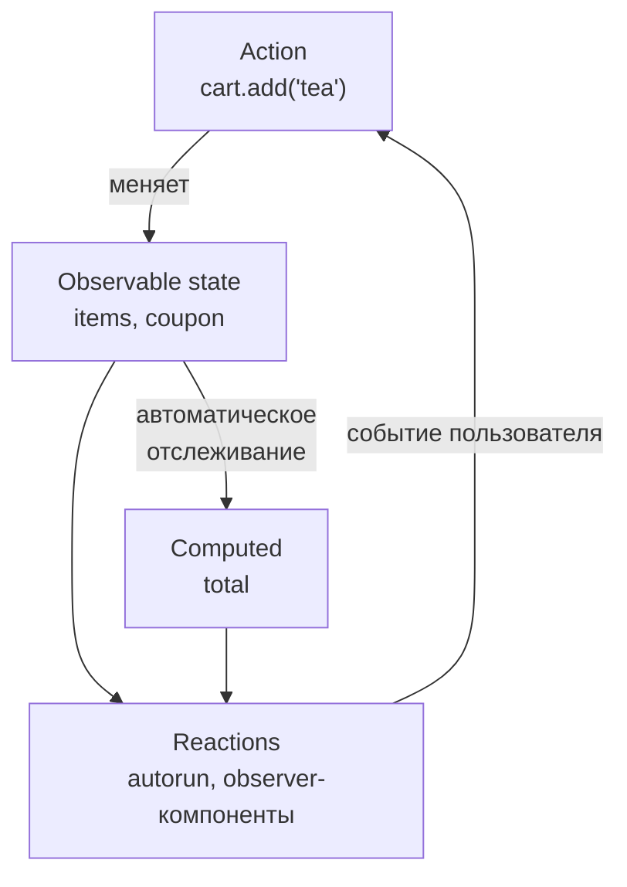

## О чём урок

MobX, второй по известности подход к состоянию после Redux: изменяемые наблюдаемые объекты и автоматическое отслеживание зависимостей вместо actions и неизменяемых reducers. Здесь `makeAutoObservable`, `computed`, реакции (`autorun`, `reaction`), транзакции в actions, строгий режим, ловушки с деструктуризацией, подключение к React и сравнение с Redux и сигналами Vue и Angular. Примеры выполняются на MobX 7 в Node.js.

## Наблюдаемое состояние и производные

Идея MobX: «всё, что можно вывести из состояния, должно выводиться автоматически». Состояние это обычные объекты и классы, которые меняют прямым присваиванием, а MobX сам знает, кто что прочитал, и обновляет только зависимых.



```js run
import { autorun, makeAutoObservable, reaction, runInAction } from 'mobx'

class CartStore {
  items = []
  coupon = null
  constructor() {
    makeAutoObservable(this) // fields → observable, getters → computed, methods → actions
  }
  get total() {
    console.log('· computing total')
    return this.items.reduce((sum, i) => sum + i.price * i.qty, 0) * (this.coupon === 'HALF' ? 0.5 : 1)
  }
  add(name, price) {
    const found = this.items.find((i) => i.name === name)
    if (found) found.qty++ // plain mutation: MobX tracks it
    else this.items.push({ name, price, qty: 1 })
  }
}

const cart = new CartStore()
const dispose = autorun(() => console.log('render: total', cart.total, '| items', cart.items.length))
cart.add('tea', 4)
cart.add('tea', 4)
reaction(
  () => cart.coupon, // what to track
  (coupon) => console.log('coupon applied:', coupon), // the side effect, not run on start
)
runInAction(() => {
  cart.coupon = 'HALF'
  cart.add('cake', 6)
}) // one transaction: derivations run once at the end
dispose()
```

```output
· computing total
render: total 0 | items 0
· computing total
render: total 4 | items 1
· computing total
render: total 8 | items 1
· computing total
render: total 7 | items 2
coupon applied: HALF
```

- `makeAutoObservable(this)` делает поля наблюдаемыми, геттеры вычисляемыми (`computed`), а методы действиями (`action`). Явная разметка: `makeObservable(this, { items: observable, total: computed, add: action })` или декораторы стандарта TC39 (`@observable accessor items`).
- `found.qty++` это обычная мутация, и `autorun` её увидел: MobX оборачивает объекты и массивы в прокси и отслеживает чтение каждого свойства. Неизменяемые копии не нужны.
- `autorun` выполняется сразу и потом при каждом изменении того, что прочитал. `reaction` разделяет «что отслеживать» и «что делать» и не запускает эффект при создании: так пишут сохранение, запросы, аналитику.
- Действие это **транзакция**: два изменения внутри `runInAction` (купон и новый товар) дали один пересчёт и одну реакцию, а не две.
- `computed` кэшируется, пока у него есть наблюдатели, и пересчитывается только при изменении зависимостей. Без наблюдателей он вычисляется заново при каждом чтении.

## Строгий режим и ловушки

```js run
import { autorun, configure, makeAutoObservable, runInAction } from 'mobx'

configure({ enforceActions: 'observed' }) // the default: changes outside actions are warned about
const user = makeAutoObservable({ name: 'Ann', address: { city: 'Oslo' } })

const { name } = user // a copied string: no longer tracked
autorun(() => console.log('destructured:', name))
autorun(() => console.log('dereferenced inside:', user.name))
const city = user.address // an object reference: its fields are still observable
autorun(() => console.log('city:', city.city))

const warn = console.warn
console.warn = (message) => console.log('warning:', String(message).split('.')[0])
user.name = 'Bob' // outside an action
console.warn = warn
runInAction(() => (user.address.city = 'Rome')) // the right way
```

```output
destructured: Ann
dereferenced inside: Ann
city: Oslo
warning: [MobX] Since strict-mode is enabled, changing (observed) observable values without using an action is not allowed
dereferenced inside: Bob
city: Rome
```

- **Разыменовывайте поздно**: MobX отслеживает чтение свойства наблюдаемого объекта. `const { name } = user` копирует строку, и реакция на неё никогда не сработает. Ссылка на вложенный объект (`city`) работает: его свойства по-прежнему наблюдаемые. То же правило в Vue (`toRefs`) и в сторах Pinia (`storeToRefs`).
- По умолчанию `enforceActions: 'observed'`: изменение наблюдаемого значения, за которым кто-то следит, вне action даёт предупреждение. Действия делают изменения явными и группируют их в транзакции.
- Асинхронный код: всё, что меняет состояние **после** `await`, снова заворачивают в `runInAction` (или пишут генератор с `flow`), потому что после `await` это уже другая синхронная часть.
- MobX отслеживает только то, что прочитано **синхронно** внутри реакции: чтение в `setTimeout` или после `await` в реакции не станет зависимостью.

## MobX в React

```tsx
import { observer } from 'mobx-react-lite'

const CartBadge = observer(function CartBadge({ cart }: { cart: CartStore }) {
  return <span>{cart.items.length} items, {cart.total} €</span> // re-renders only when these change
})
```

- `observer` превращает компонент в реакцию: он перерисовывается, только когда изменились наблюдаемые значения, прочитанные при его рендере. Селекторы и `memo` не нужны.
- Стор передают через контекст или импортом модуля; для SSR создают на запрос, как и любые глобальные сторы.
- `observer` должен оборачивать каждый компонент, который читает наблюдаемые данные: если передать `cart.items` в обычный дочерний компонент, а тот прочитает элементы, изменения в них он не увидит.

## MobX, Redux и сигналы

| | Redux (RTK) | MobX | Сигналы (Vue, Angular, Solid, Preact) |
|---|---|---|---|
| Изменение | `dispatch(action)`, неизменяемое обновление | Прямое присваивание в action | `ref.value = x`, `signal.set(x)` |
| Подписка | Селекторы, сравнение по ссылке | Автоматическое отслеживание чтений | Автоматическое отслеживание чтений |
| Производные | `createSelector` | `computed` | `computed` |
| Отладка | Лог actions, «путешествие во времени» | MobX DevTools, `trace()` | DevTools фреймворка |
| Сильная сторона | Предсказуемость, явный поток, большие команды | Минимум кода, сложные модели предметной области | Встроено во фреймворк, точечные обновления |
| Цена | Шаблонный код | Неявность: «кто изменил?», ловушки разыменования | Те же ловушки разыменования |

MobX по механизму ближе всего к реактивности Vue и сигналам: и там и там track при чтении и trigger при записи (урок о реактивности Vue). Поэтому в Vue и Angular отдельная библиотека вроде MobX почти не нужна: эту роль играют `reactive` и Pinia, сигналы и сервисы.

## Главное

- MobX: изменяемые наблюдаемые объекты, автоматическое отслеживание зависимостей, производные выводятся сами.
- `makeAutoObservable`: поля observable, геттеры computed, методы actions; `autorun` запускается сразу, `reaction` разделяет отслеживание и эффект.
- Action это транзакция: несколько изменений дают одну реакцию; после `await` изменения снова в `runInAction` или `flow`.
- Разыменовывайте поздно: деструктуризация копирует значение и теряет отслеживание.
- В React компоненты оборачивают в `observer`; перерисовка только при изменении прочитанного.
- По механизму MobX родственник реактивности Vue и сигналов Angular; против Redux выигрывает краткостью, проигрывает явностью.
