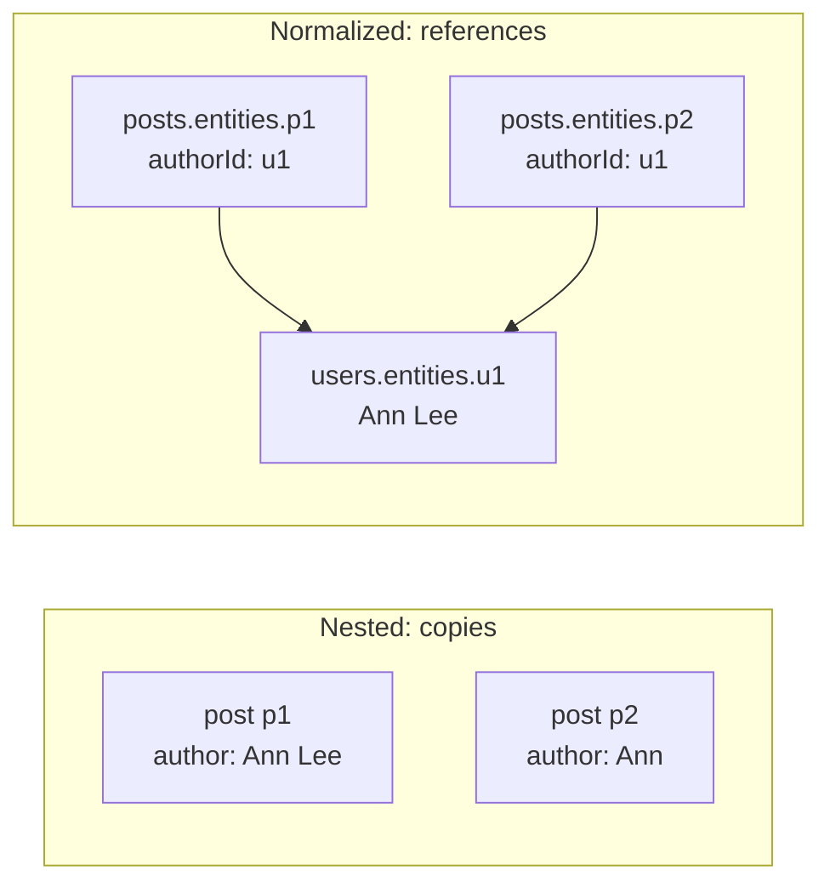
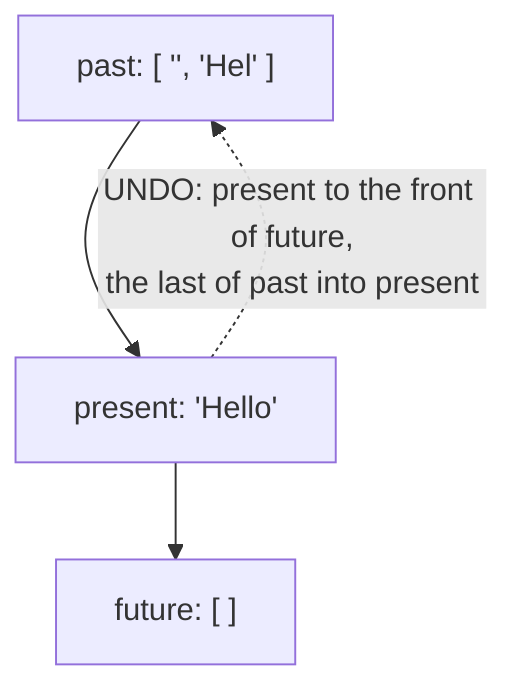
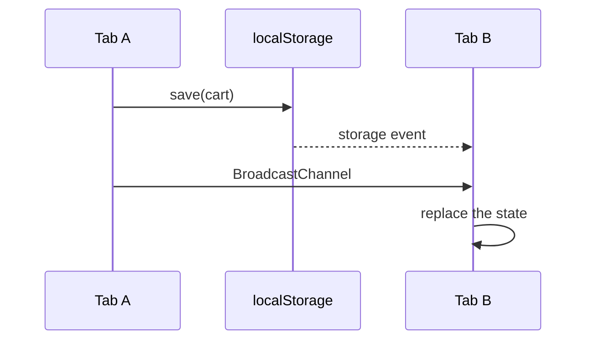

## What this lesson covers

Techniques needed with any state manager and asked about in frontend design interviews: data normalization, update strategies and conflicts, undo and redo, persisting state between sessions with versions and migrations, syncing between tabs. The examples run in Node.js, normalization on Redux Toolkit 2.14.

## Normalization

An API response is usually nested: an author in every post, a user in every comment. If you keep it like that, the same entity ends up in several copies:

```ts run
import { createEntityAdapter, createSelector, createSlice, configureStore, type PayloadAction } from '@reduxjs/toolkit'

// Nested API response: the same author is copied into every post
const response = [
  { id: 'p1', title: 'Hello', author: { id: 'u1', name: 'Ann' } },
  { id: 'p2', title: 'Again', author: { id: 'u1', name: 'Ann' } },
]
response[0].author.name = 'Ann Lee' // renamed in one place only
console.log('nested copies disagree:', response.map((p) => p.author.name))

// Normalized: each entity once, references by id
type User = { id: string; name: string }
type Post = { id: string; title: string; authorId: string }
const users = createEntityAdapter<User>()
const posts = createEntityAdapter<Post>({ sortComparer: (a, b) => a.title.localeCompare(b.title) })

const usersSlice = createSlice({
  name: 'users',
  initialState: users.getInitialState(),
  reducers: { usersReceived: users.upsertMany, userRenamed: (s, a: PayloadAction<User>) => users.updateOne(s, { id: a.payload.id, changes: { name: a.payload.name } }) },
})
const postsSlice = createSlice({ name: 'posts', initialState: posts.getInitialState(), reducers: { postsReceived: posts.setAll } })
const store = configureStore({ reducer: { users: usersSlice.reducer, posts: postsSlice.reducer } })

store.dispatch(usersSlice.actions.usersReceived(response.map((p) => p.author)))
store.dispatch(postsSlice.actions.postsReceived(response.map((p) => ({ id: p.id, title: p.title, authorId: p.author.id }))))
store.dispatch(usersSlice.actions.userRenamed({ id: 'u1', name: 'Ann Lee' }))
console.log(JSON.stringify(store.getState().users))

type RootState = ReturnType<typeof store.getState>
const userSelectors = users.getSelectors((s: RootState) => s.users)
const postSelectors = posts.getSelectors((s: RootState) => s.posts)
// Denormalize for the UI in a memoized selector
const selectPostsWithAuthors = createSelector([postSelectors.selectAll, userSelectors.selectEntities], (all, byId) =>
  all.map((p) => `${p.title} by ${byId[p.authorId]?.name}`),
)
console.log(selectPostsWithAuthors(store.getState()))
```

```output
nested copies disagree: [ 'Ann Lee', 'Ann' ]
{"ids":["u1"],"entities":{"u1":{"id":"u1","name":"Ann Lee"}}}
[ 'Again by Ann Lee', 'Hello by Ann Lee' ]
```



- In nested data the rename updated one copy, and the other stayed old. In normalized data every entity is stored **once** in a dictionary by id, and others reference it through `authorId`: one update is visible everywhere.
- The shape `{ ids: [...], entities: { [id]: ... } }`: `ids` keeps the order, `entities` gives O(1) lookup by id and an immutable update of one item without copying the whole list.
- `createEntityAdapter` (RTK) and `withEntities` (NgRx SignalStore) provide this shape and ready operations `addOne`, `upsertMany`, `updateOne`, `removeOne`; Apollo Client normalizes GraphQL responses itself by `__typename` and `id`.
- For the UI the data is assembled back (**denormalized**) in a memoized selector, like `selectPostsWithAuthors`.
- Normalization is needed when the same entities are shown in different places and change. For a list that is only read as a whole it is unnecessary: a query library keeps the response as it is.

## Update strategies and conflicts

| Strategy | How | When |
|---|---|---|
| Pessimistic | Wait for the server response, then update the UI | Payments, deletion, anything irreversible |
| Optimistic | Update at once, roll back on error | Likes, checkmarks, renaming; details in the server state lesson |
| Invalidation | After a mutation, reload the related data | The default in query libraries |
| Update from the response | The server returns the changed entity, put it in the cache | Saves a refetch |

If two parties can change the same data (two users, two tabs, offline edits), you need a **conflict** policy: "last write wins" is simple but silently loses other people's changes; a version or an `ETag` in the request (`If-Match`) lets the server answer `409 Conflict` or `412 Precondition Failed`, and the client offers to merge the changes. Collaborative editing uses CRDTs (Yjs, Automerge).

## Undo and redo

Immutable state makes undo almost free: previous states are just saved references.

```js run
// Undo and redo: a higher-order reducer keeps past and future states
function undoable(reducer) {
  const initial = { past: [], present: reducer(undefined, { type: '@@init' }), future: [] }
  return function (state = initial, action) {
    const { past, present, future } = state
    switch (action.type) {
      case 'UNDO':
        if (!past.length) return state
        return { past: past.slice(0, -1), present: past.at(-1), future: [present, ...future] }
      case 'REDO':
        if (!future.length) return state
        return { past: [...past, present], present: future[0], future: future.slice(1) }
      default: {
        const next = reducer(present, action)
        if (next === present) return state // nothing changed: no history entry
        return { past: [...past, present].slice(-50), present: next, future: [] } // a new change clears redo
      }
    }
  }
}

const text = (state = '', action) => (action.type === 'typed' ? state + action.payload : state)
const editor = undoable(text)
let state
for (const action of [{ type: 'typed', payload: 'Hel' }, { type: 'typed', payload: 'lo' }, { type: 'UNDO' }, { type: 'UNDO' }, { type: 'REDO' }, { type: 'typed', payload: 'p!' }, { type: 'REDO' }])
  console.log(action.type.padEnd(5), JSON.stringify((state = editor(state, action)).present), '| undo:', state.past.length, 'redo:', state.future.length)
```

```output
typed "Hel" | undo: 1 redo: 0
typed "Hello" | undo: 2 redo: 0
UNDO  "Hel" | undo: 1 redo: 1
UNDO  "" | undo: 0 redo: 2
REDO  "Hel" | undo: 1 redo: 1
typed "Help!" | undo: 2 redo: 0
REDO  "Help!" | undo: 2 redo: 0
```



- A **higher-order reducer** `undoable(reducer)` wraps any reducer and adds history without changing the reducer itself. Libraries like redux-undo work this way.
- A new change after an undo clears `future`: the redo branch no longer makes sense (the last `REDO` did nothing).
- History is limited (`slice(-50)`), and actions that did not change the state are not recorded. For big documents you store **patches** rather than snapshots (Immer can produce patches and inverse patches).

## Persisting between sessions

```js run
// Persisting state with a version and migrations, and syncing tabs
const storage = new Map() // stands for localStorage
const KEY = 'cart'
const VERSION = 2
const migrations = {
  1: (old) => ({ items: old.items.map((name) => ({ name, qty: 1 })) }), // v1 kept plain names
}

function save(state) {
  storage.set(KEY, JSON.stringify({ version: VERSION, state }))
}
function load() {
  const raw = storage.get(KEY)
  if (!raw) return { items: [] }
  try {
    let { version, state } = JSON.parse(raw)
    for (let v = version; v < VERSION; v++) state = migrations[v](state) // step by step to the current shape
    return state
  } catch {
    return { items: [] } // corrupted data must not break the app
  }
}

storage.set(KEY, JSON.stringify({ version: 1, state: { items: ['tea', 'cake'] } })) // written by an old release
console.log('migrated:', JSON.stringify(load()))
storage.set(KEY, '{broken')
console.log('corrupted:', JSON.stringify(load()))

// Two tabs: BroadcastChannel delivers messages to other contexts of the same origin
const tabA = new BroadcastChannel('cart')
const tabB = new BroadcastChannel('cart')
tabB.onmessage = (event) => {
  console.log('tab B got:', JSON.stringify(event.data))
  tabA.close()
  tabB.close()
}
const next = { items: [{ name: 'tea', qty: 2 }] }
save(next)
tabA.postMessage({ type: 'cart/replaced', state: next }) // the sender does not receive its own message
```

```output
migrated: {"items":[{"name":"tea","qty":1},{"name":"cake","qty":1}]}
corrupted: {"items":[]}
tab B got: {"type":"cart/replaced","state":{"items":[{"name":"tea","qty":2}]}}
```

- Saved state outlives releases, so it is stored with a **version**, and old shapes are converted step by step with migrations. Corrupted or foreign data must not break startup: parse in `try/catch` with a default value. That is how `persist` in Zustand and redux-persist work.
- `localStorage` is synchronous, stores only strings and is limited to a few megabytes per origin; for big data and an offline cache use IndexedDB. `sessionStorage` lives within one tab.
- Persist what the user expects to see again (a cart, a draft, settings). Do not persist a server cache without a version, or access tokens: anything in `localStorage` can be read by any script on the page in an XSS attack.

## Syncing tabs



- The `storage` event reaches **other** tabs of the same origin when `localStorage` changes; the tab that wrote does not receive it.
- `BroadcastChannel` passes arbitrary messages between tabs, windows and workers of one origin; the sender does not receive its own message either. It is used to sync logging out ("logged out in one tab, log out in all"), the cart, the theme.
- If you need one connection for all tabs (a WebSocket), keep it in a `SharedWorker` or elect a "leader" tab with the Web Locks API.

## Key points

- Normalization: each entity once in `{ ids, entities }`, references by id; denormalization in memoized selectors; `createEntityAdapter`, `withEntities`, the Apollo normalized cache.
- Updates: pessimistic for irreversible actions, optimistic with rollback for frequent ones; conflicts through versions and `409`/`412`, or CRDTs.
- Undo/redo: a higher-order reducer with `past`, `present`, `future`; a new change clears `future`; limited history or patches.
- Persist with a version, migrations and protection from corrupted data; do not persist tokens or the server cache.
- Syncing tabs: the `storage` event and `BroadcastChannel`; the sender does not receive its own message.
