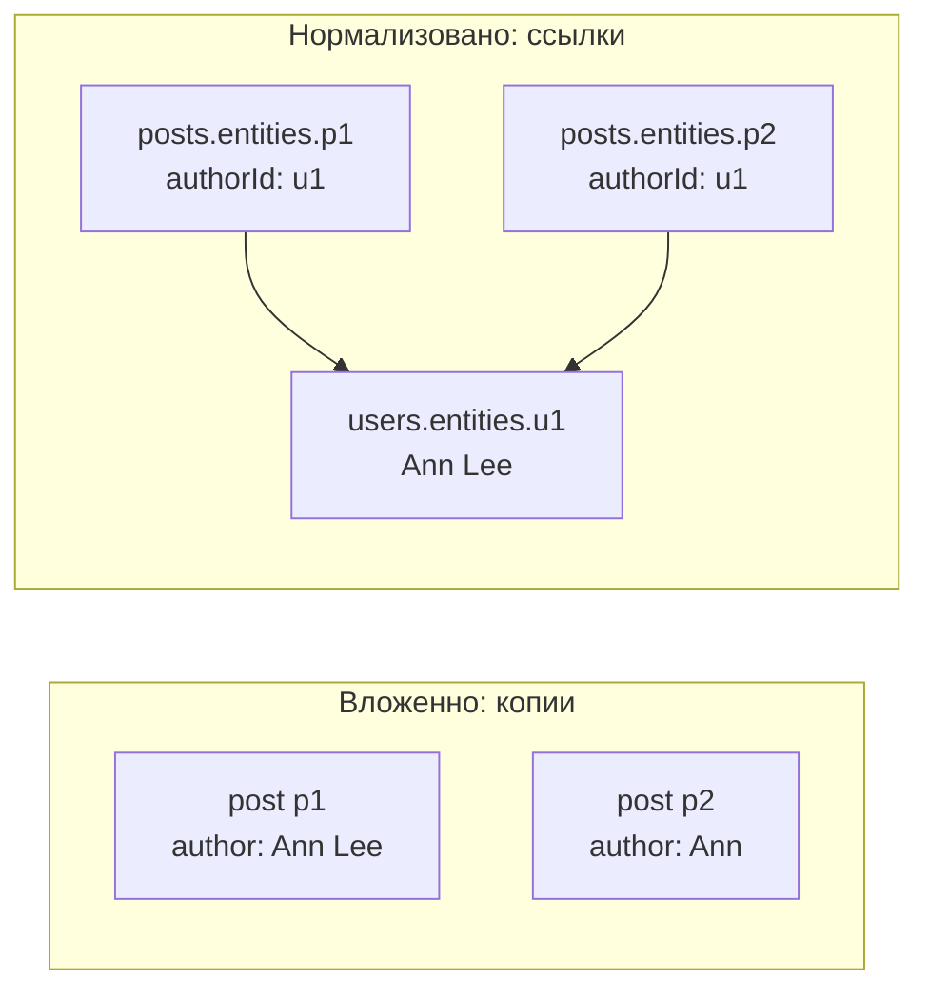
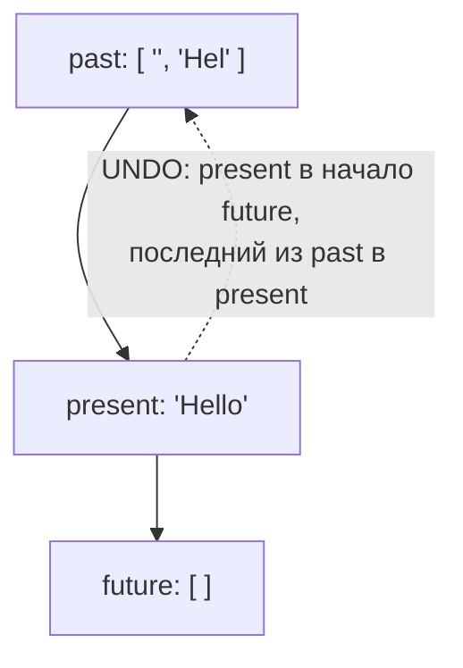
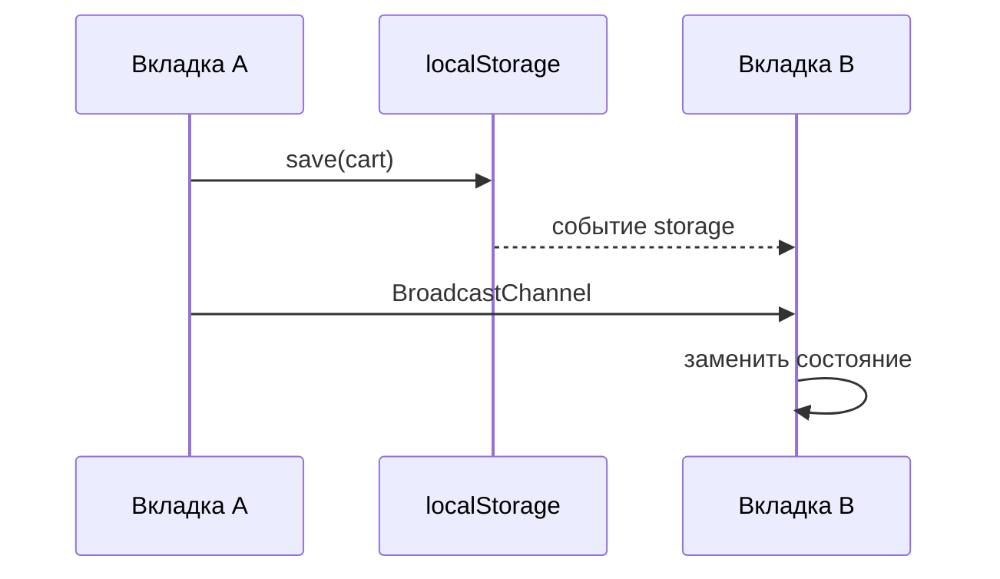

## О чём урок

Приёмы, которые нужны с любым менеджером состояний и о которых спрашивают на собеседовании по дизайну фронтенда: нормализация данных, стратегии обновления и конфликты, отмена и повтор действий (undo/redo), сохранение состояния между сессиями с версиями и миграциями, синхронизация между вкладками. Примеры выполняются в Node.js, нормализация на Redux Toolkit 2.14.

## Нормализация

Ответ API обычно вложенный: в каждом посте автор, в каждом комментарии пользователь. Если хранить так же, одна и та же сущность оказывается в нескольких копиях:

```ts run
import { createEntityAdapter, createSelector, createSlice, configureStore, type PayloadAction } from '@reduxjs/toolkit'

// Nested API response: the same author is copied into every post
const response = [
  { id: 'p1', title: 'Hello', author: { id: 'u1', name: 'Ann' } },
  { id: 'p2', title: 'Again', author: { id: 'u1', name: 'Ann' } },
]
response[0].author.name = 'Ann Lee' // renamed in one place only
console.log('nested copies disagree:', response.map((p) => p.author.name))

// Normalized: each entity once, references by id
type User = { id: string; name: string }
type Post = { id: string; title: string; authorId: string }
const users = createEntityAdapter<User>()
const posts = createEntityAdapter<Post>({ sortComparer: (a, b) => a.title.localeCompare(b.title) })

const usersSlice = createSlice({
  name: 'users',
  initialState: users.getInitialState(),
  reducers: { usersReceived: users.upsertMany, userRenamed: (s, a: PayloadAction<User>) => users.updateOne(s, { id: a.payload.id, changes: { name: a.payload.name } }) },
})
const postsSlice = createSlice({ name: 'posts', initialState: posts.getInitialState(), reducers: { postsReceived: posts.setAll } })
const store = configureStore({ reducer: { users: usersSlice.reducer, posts: postsSlice.reducer } })

store.dispatch(usersSlice.actions.usersReceived(response.map((p) => p.author)))
store.dispatch(postsSlice.actions.postsReceived(response.map((p) => ({ id: p.id, title: p.title, authorId: p.author.id }))))
store.dispatch(usersSlice.actions.userRenamed({ id: 'u1', name: 'Ann Lee' }))
console.log(JSON.stringify(store.getState().users))

type RootState = ReturnType<typeof store.getState>
const userSelectors = users.getSelectors((s: RootState) => s.users)
const postSelectors = posts.getSelectors((s: RootState) => s.posts)
// Denormalize for the UI in a memoized selector
const selectPostsWithAuthors = createSelector([postSelectors.selectAll, userSelectors.selectEntities], (all, byId) =>
  all.map((p) => `${p.title} by ${byId[p.authorId]?.name}`),
)
console.log(selectPostsWithAuthors(store.getState()))
```

```output
nested copies disagree: [ 'Ann Lee', 'Ann' ]
{"ids":["u1"],"entities":{"u1":{"id":"u1","name":"Ann Lee"}}}
[ 'Again by Ann Lee', 'Hello by Ann Lee' ]
```



- Во вложенных данных переименование обновило одну копию, а вторая осталась старой. В нормализованных каждая сущность хранится **один раз** в словаре по id, остальные ссылаются на неё через `authorId`: одно обновление видно везде.
- Форма `{ ids: [...], entities: { [id]: ... } }`: `ids` хранит порядок, `entities` даёт поиск по id за O(1) и неизменяемое обновление одного элемента без копирования всего списка.
- `createEntityAdapter` (RTK) и `withEntities` (NgRx SignalStore) дают эту форму и готовые операции `addOne`, `upsertMany`, `updateOne`, `removeOne`; Apollo Client нормализует ответы GraphQL сам по `__typename` и `id`.
- Для интерфейса данные собирают обратно (**денормализуют**) в мемоизированном селекторе, как `selectPostsWithAuthors`.
- Нормализация нужна, когда одни и те же сущности показаны в разных местах и меняются. Для списка, который только читают целиком, она лишняя: библиотека запросов хранит ответ как есть.

## Стратегии обновления и конфликты

| Стратегия | Как | Когда |
|---|---|---|
| Пессимистичная | Ждём ответа сервера, потом обновляем интерфейс | Платежи, удаление, всё необратимое |
| Оптимистичная | Обновляем сразу, откатываем при ошибке | Лайки, отметки, переименование; детали в уроке о серверном состоянии |
| Инвалидация | После мутации перезагружаем связанные данные | По умолчанию в библиотеках запросов |
| Обновление по ответу | Сервер возвращает изменённую сущность, кладём её в кэш | Экономит повторный запрос |

Если одни данные могут менять двое (два пользователя, две вкладки, офлайн-изменения), нужна политика **конфликтов**: «последняя запись побеждает» проста, но молча теряет чужие изменения; версия или `ETag` в запросе (`If-Match`) позволяет серверу ответить `409 Conflict` или `412 Precondition Failed`, и клиент предлагает объединить изменения. Для совместного редактирования применяют CRDT (Yjs, Automerge).

## Undo и redo

Неизменяемое состояние делает отмену почти бесплатной: прошлые состояния это просто сохранённые ссылки.

```js run
// Undo and redo: a higher-order reducer keeps past and future states
function undoable(reducer) {
  const initial = { past: [], present: reducer(undefined, { type: '@@init' }), future: [] }
  return function (state = initial, action) {
    const { past, present, future } = state
    switch (action.type) {
      case 'UNDO':
        if (!past.length) return state
        return { past: past.slice(0, -1), present: past.at(-1), future: [present, ...future] }
      case 'REDO':
        if (!future.length) return state
        return { past: [...past, present], present: future[0], future: future.slice(1) }
      default: {
        const next = reducer(present, action)
        if (next === present) return state // nothing changed: no history entry
        return { past: [...past, present].slice(-50), present: next, future: [] } // a new change clears redo
      }
    }
  }
}

const text = (state = '', action) => (action.type === 'typed' ? state + action.payload : state)
const editor = undoable(text)
let state
for (const action of [{ type: 'typed', payload: 'Hel' }, { type: 'typed', payload: 'lo' }, { type: 'UNDO' }, { type: 'UNDO' }, { type: 'REDO' }, { type: 'typed', payload: 'p!' }, { type: 'REDO' }])
  console.log(action.type.padEnd(5), JSON.stringify((state = editor(state, action)).present), '| undo:', state.past.length, 'redo:', state.future.length)
```

```output
typed "Hel" | undo: 1 redo: 0
typed "Hello" | undo: 2 redo: 0
UNDO  "Hel" | undo: 1 redo: 1
UNDO  "" | undo: 0 redo: 2
REDO  "Hel" | undo: 1 redo: 1
typed "Help!" | undo: 2 redo: 0
REDO  "Help!" | undo: 2 redo: 0
```



- **Редьюсер высшего порядка** `undoable(reducer)` оборачивает любой reducer и добавляет историю, не меняя сам reducer. Так устроены библиотеки вроде redux-undo.
- Новое изменение после отмены очищает `future`: ветка «повторов» больше не имеет смысла (последний `REDO` ничего не сделал).
- Историю ограничивают (`slice(-50)`), а действия, не изменившие состояние, в неё не пишут. Для больших документов хранят не снимки, а **патчи** (Immer умеет выдавать патчи и обратные патчи).

## Сохранение между сессиями

```js run
// Persisting state with a version and migrations, and syncing tabs
const storage = new Map() // stands for localStorage
const KEY = 'cart'
const VERSION = 2
const migrations = {
  1: (old) => ({ items: old.items.map((name) => ({ name, qty: 1 })) }), // v1 kept plain names
}

function save(state) {
  storage.set(KEY, JSON.stringify({ version: VERSION, state }))
}
function load() {
  const raw = storage.get(KEY)
  if (!raw) return { items: [] }
  try {
    let { version, state } = JSON.parse(raw)
    for (let v = version; v < VERSION; v++) state = migrations[v](state) // step by step to the current shape
    return state
  } catch {
    return { items: [] } // corrupted data must not break the app
  }
}

storage.set(KEY, JSON.stringify({ version: 1, state: { items: ['tea', 'cake'] } })) // written by an old release
console.log('migrated:', JSON.stringify(load()))
storage.set(KEY, '{broken')
console.log('corrupted:', JSON.stringify(load()))

// Two tabs: BroadcastChannel delivers messages to other contexts of the same origin
const tabA = new BroadcastChannel('cart')
const tabB = new BroadcastChannel('cart')
tabB.onmessage = (event) => {
  console.log('tab B got:', JSON.stringify(event.data))
  tabA.close()
  tabB.close()
}
const next = { items: [{ name: 'tea', qty: 2 }] }
save(next)
tabA.postMessage({ type: 'cart/replaced', state: next }) // the sender does not receive its own message
```

```output
migrated: {"items":[{"name":"tea","qty":1},{"name":"cake","qty":1}]}
corrupted: {"items":[]}
tab B got: {"type":"cart/replaced","state":{"items":[{"name":"tea","qty":2}]}}
```

- Сохранённое состояние переживает релизы, поэтому его хранят с **версией** и переводят старые формы миграциями шаг за шагом. Повреждённые или чужие данные не должны ломать запуск: разбор в `try/catch` и значение по умолчанию. Так работают `persist` в Zustand и redux-persist.
- `localStorage` синхронный, хранит только строки и ограничен несколькими мегабайтами на источник; для больших данных и офлайн-кэша берут IndexedDB. `sessionStorage` живёт в пределах вкладки.
- Сохраняют то, что пользователь ожидает увидеть снова (корзину, черновик, настройки). Не сохраняют серверный кэш без версии и токены доступа: всё, что лежит в `localStorage`, может прочитать любой скрипт на странице при XSS.

## Синхронизация вкладок



- Событие `storage` приходит **другим** вкладкам того же источника при изменении `localStorage`; сама вкладка, сделавшая запись, его не получает.
- `BroadcastChannel` передаёт произвольные сообщения между вкладками, окнами и воркерами одного источника; отправитель своё сообщение тоже не получает. Так синхронизируют выход из системы («вышли в одной вкладке, выйти во всех»), корзину, тему.
- Если нужно одно соединение на все вкладки (WebSocket), его держат в `SharedWorker` или выбирают «главную» вкладку через Web Locks API.

## Главное

- Нормализация: каждая сущность один раз в `{ ids, entities }`, ссылки по id; денормализация в мемоизированных селекторах; `createEntityAdapter`, `withEntities`, нормализованный кэш Apollo.
- Обновления: пессимистичные для необратимого, оптимистичные с откатом для частых действий; конфликты через версии и `409`/`412` или CRDT.
- Undo/redo: редьюсер высшего порядка с `past`, `present`, `future`; новое изменение очищает `future`; ограничение истории или патчи.
- Сохранение с версией, миграциями и защитой от повреждённых данных; токены и серверный кэш не сохранять.
- Синхронизация вкладок: событие `storage` и `BroadcastChannel`, отправитель своё сообщение не получает.
