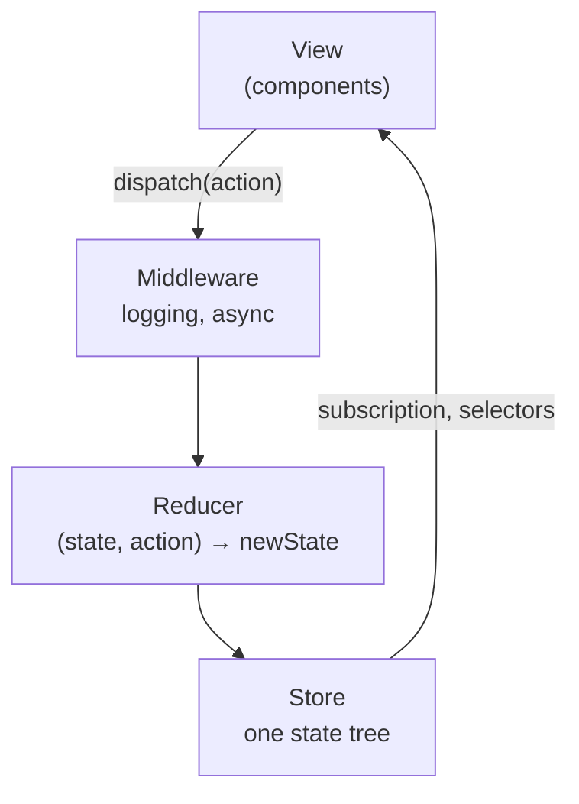
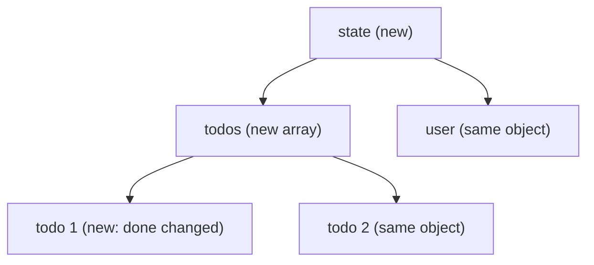
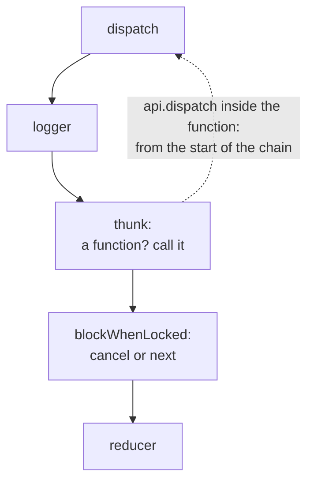

## What this lesson covers

Redux as an idea, without which you cannot understand Redux Toolkit, NgRx or half of the state questions: one-way data flow, the three principles, a store in a few lines, actions, pure reducers and immutability, middleware and thunk, `connect` versus hooks. Modern Redux code is written with Redux Toolkit (the next lesson), but this foundation is what gets asked. The examples run on Redux 5 (through `@reduxjs/toolkit` 2.14) in Node.js.

## One-way data flow



Redux grew out of the **Flux** architecture (Facebook, 2014): data flows around a loop in one direction. A component does not change state itself; it reports **what happened** (an action). A reducer computes the new state, the store notifies subscribers, and components read the parts they need through selectors.

**The three principles of Redux**:

1. **A single source of truth**: all global state lives in one object tree inside one store.
2. **State is read-only**: the only way to change it is to dispatch an action, a plain object describing an event.
3. **Changes are made with pure functions**: a reducer `(state, action) => newState` with no side effects or mutations.

What this gives you: every change is visible as an action in the log, state can be rebuilt by replaying actions (hence "time travel" in Redux DevTools), and reducers are tested as plain functions.

## A store by hand

A common task: write `createStore`. The core of Redux really fits in a few lines:

```js run
// The whole Redux core in a few lines: what an interviewer means by "write createStore"
function createStore(reducer, preloadedState) {
  let state = reducer(preloadedState, { type: '@@init' })
  const listeners = new Set()
  return {
    getState: () => state,
    dispatch(action) {
      if (typeof action?.type !== 'string') throw new TypeError('an action is a plain object with a string type')
      state = reducer(state, action) // the only place where state changes
      listeners.forEach((listener) => listener())
      return action
    },
    subscribe(listener) {
      listeners.add(listener)
      return () => listeners.delete(listener) // unsubscribe
    },
  }
}

function counter(state = { value: 0 }, action) {
  switch (action.type) {
    case 'counter/incremented':
      return { ...state, value: state.value + 1 }
    case 'counter/added':
      return { ...state, value: state.value + action.payload }
    default:
      return state // unknown actions return the same object
  }
}

const store = createStore(counter)
const unsubscribe = store.subscribe(() => console.log('state:', store.getState()))
store.dispatch({ type: 'counter/incremented' })
store.dispatch({ type: 'counter/added', payload: 5 })
unsubscribe()
store.dispatch({ type: 'counter/incremented' })
console.log('after unsubscribe:', store.getState())
try {
  store.dispatch({ payload: 1 })
} catch (e) {
  console.log(e.message)
}
```

```output
state: { value: 1 }
state: { value: 6 }
after unsubscribe: { value: 7 }
an action is a plain object with a string type
```

- `dispatch` is the only place where state changes; after it every subscriber is called.
- `subscribe` returns an unsubscribe function; UI bindings (`react-redux`, `@ngrx/store`) are built on it.
- Real Redux also throws on an action without a `type` ("Actions may not have an undefined "type" property") rather than ignoring it.

## Actions

An action is a **plain object** with a required string `type` field, usually with a `payload`:

```ts
{ type: 'cart/itemAdded', payload: { id: 'tea', qty: 1 } }
{ type: 'auth/loginFailed', payload: 'Wrong password', error: true }
```

- The name describes **an event in the past tense** in the `domain/event` format (`todos/todoAdded`), not a command to set a field (`SET_TODOS`). Several reducers can handle one action: `auth/loggedOut` clears both the cart and the profile.
- An action must be serializable (no functions, promises or class instances): that is what DevTools, logging and replay rely on.
- You can pass a function to `dispatch` only if a middleware (thunk) intercepts it; otherwise Redux throws "Actions must be plain objects".
- Action creators (`addItem(id)` returns an action) prevent typos in `type`; in Redux Toolkit `createSlice` generates them.

## Reducers and immutability

A reducer must be **pure**: the same `state` and `action` give the same result, with no requests, `Date.now()`, `Math.random()` or writes to `localStorage`. And it does not mutate state but returns a new object, copying the changed path:

```js run
import { legacy_createStore as createStore } from '@reduxjs/toolkit'

const initial = { todos: [{ id: 1, done: false }] }
function mutatingReducer(state = initial, action) {
  if (action.type === 'todos/toggled') {
    state.todos[0].done = !state.todos[0].done // mutation: same objects
    return state
  }
  return state
}
function immutableReducer(state = initial, action) {
  if (action.type === 'todos/toggled') {
    return { ...state, todos: state.todos.map((t) => (t.id === action.payload ? { ...t, done: !t.done } : t)) }
  }
  return state
}

for (const reducer of [mutatingReducer, immutableReducer]) {
  const store = createStore(reducer, structuredClone(initial))
  const selectTodos = (s) => s.todos
  const before = selectTodos(store.getState())
  store.dispatch({ type: 'todos/toggled', payload: 1 })
  const after = selectTodos(store.getState())
  // react-redux and memoized selectors compare by reference: same reference = "nothing changed"
  console.log(reducer.name.padEnd(16), 'changed?', before !== after, '| done:', after[0].done)
}
```

```output
mutatingReducer  changed? false | done: true
immutableReducer changed? true | done: true
```

Why a mutation breaks the app even though `done` changed in both cases: `useSelector`, `connect`, memoized selectors and `OnPush` in Angular compare **references**. The mutating reducer returned the same object, and subscribers decided nothing had changed: the screen will not update. An immutable update creates new objects only along the path to the change (`state`, `todos`, the changed item) and reuses the rest, so reference comparison is cheap and exact.



- For an unknown action a reducer returns **the same** object: that means "nothing changed".
- Writing copies by hand is tedious and error-prone; Redux Toolkit uses Immer, where "mutating" code becomes an immutable update (the next lesson).
- A big `switch` for the whole app is split into reducers per domain and combined with `combineReducers({ cart, user })`: each is responsible for its own piece of the tree.

## Middleware and async

A reducer cannot make requests, so side effects live in **middleware**: wrappers around `dispatch` that see every action before the reducer and can log, change, delay or cancel it, or dispatch new ones.

```js run
import { applyMiddleware, legacy_createStore as createStore } from '@reduxjs/toolkit'

const logger = (api) => (next) => (action) => {
  console.log('→ logger  ', action.type ?? 'a function')
  const result = next(action)
  console.log('← logger   state', JSON.stringify(api.getState()))
  return result
}
// redux-thunk in four lines: a function instead of an action gets dispatch and getState
const thunk = (api) => (next) => (action) => (typeof action === 'function' ? action(api.dispatch, api.getState) : next(action))
const blockWhenLocked = (api) => (next) => (action) => {
  if (api.getState().locked && action.type === 'cart/added') {
    console.log('✗ blocked ', action.type)
    return
  }
  return next(action)
}

function cart(state = { items: [], locked: false }, action) {
  switch (action.type) {
    case 'cart/added':
      return { ...state, items: [...state.items, action.payload] }
    case 'cart/locked':
      return { ...state, locked: true }
    default:
      return state
  }
}
const store = createStore(cart, applyMiddleware(logger, thunk, blockWhenLocked))

const checkout = () => async (dispatch, getState) => {
  dispatch({ type: 'cart/locked' })
  await Promise.resolve() // stands for a request
  return getState().items.length
}
store.dispatch({ type: 'cart/added', payload: 'tea' })
console.log('items sent:', await store.dispatch(checkout()))
store.dispatch({ type: 'cart/added', payload: 'cake' })
```

```output
→ logger   cart/added
← logger   state {"items":["tea"],"locked":false}
→ logger   a function
→ logger   cart/locked
← logger   state {"items":["tea"],"locked":true}
← logger   state {"items":["tea"],"locked":true}
items sent: 1
→ logger   cart/added
✗ blocked  cart/added
← logger   state {"items":["tea"],"locked":true}
```



- The signature `api => next => action`: `api` gives `getState` and `dispatch`, `next` passes the action to the next middleware, and the last `next` calls the reducer. Not calling `next` cancels the action.
- **thunk** is four lines: if `dispatch` receives a function, call it with `dispatch` and `getState`. Inside you can await requests and dispatch plain actions. A `dispatch` called from inside goes through the chain **from the start** (which is why `cart/locked` went through the logger again).
- Thunk is not outdated: Redux Toolkit's `configureStore` includes it by default, and `createAsyncThunk` is built on it. **Redux-Saga** (generators) handled complex flows with cancellation and parallel streams; new code replaces it with `createListenerMiddleware` and RTK Query, but it still appears in older projects.
- Custom middleware is written for analytics, error reporting, logging out on a 401 response.

## connect and hooks

Before hooks a component was connected to the store with the `connect` higher-order component from `react-redux`:

```tsx
// legacy: higher-order component
const mapStateToProps = (state: RootState) => ({ items: state.cart.items })
const mapDispatchToProps = { addItem }
export default connect(mapStateToProps, mapDispatchToProps)(Cart)

// today: hooks
function Cart() {
  const items = useSelector((state: RootState) => state.cart.items)
  const dispatch = useDispatch()
  return <button onClick={() => dispatch(addItem('tea'))}>{items.length}</button>
}
```

| | `connect` | `useSelector` / `useDispatch` |
|---|---|---|
| Subscription | `mapStateToProps`, shallow comparison of the result | A selector, compared by reference (`===`) or a custom function |
| Actions | `mapDispatchToProps` into props | `dispatch` right in the component |
| Wrappers | A higher-order component, "wrapper hell" in DevTools | None |
| TypeScript | Prop types are hard to infer | Typed hooks `useAppSelector` |
| Where you see it | Old code with class components | All new code |

`connect` is still supported, but new code uses hooks. The store is passed down through `<Provider store={store}>` (under the hood it is a React context, but the value in the context does not change, and the subscription goes directly to the store, so the context causes no extra renders).

## Key points

- One-way flow: View → `dispatch(action)` → middleware → reducer → store → subscribers → View.
- Three principles: a single source of truth, read-only state, changes through pure reducers.
- A store is `getState`, `dispatch`, `subscribe`; an action is a serializable object with a `type` in the `domain/event` format; Redux throws without a `type`.
- A reducer is pure and immutable: a mutation returns the same reference, and subscribers do not see the change.
- Middleware `api => next => action` for side effects; thunk passes `dispatch` and `getState` to a function and is included in Redux Toolkit by default.
- `connect` is the old way to connect; today it is `useSelector` and `useDispatch`.
