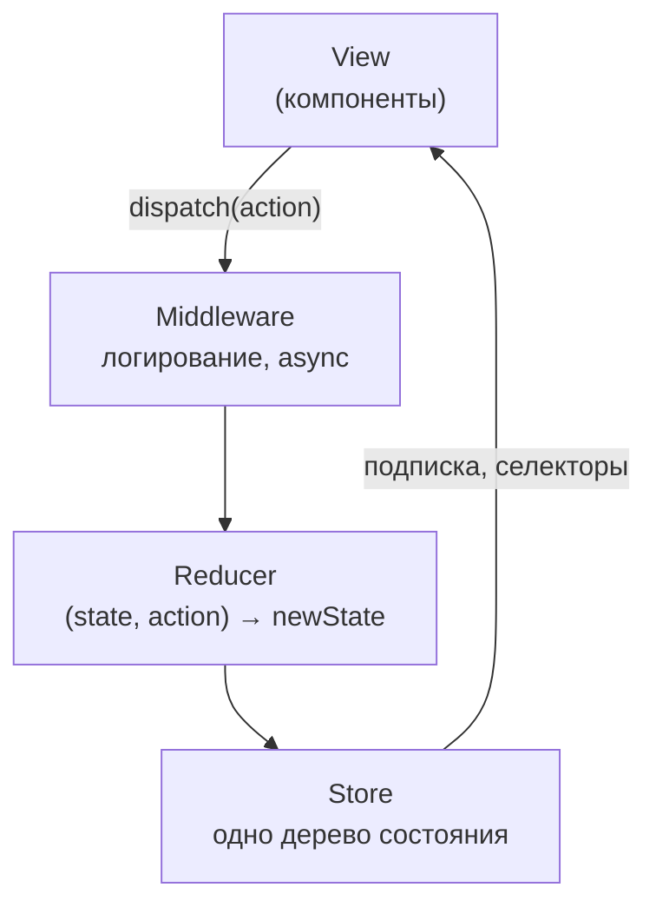
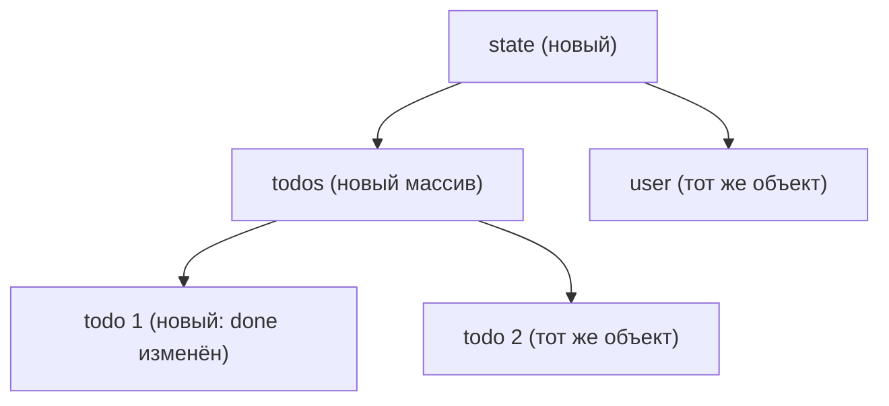
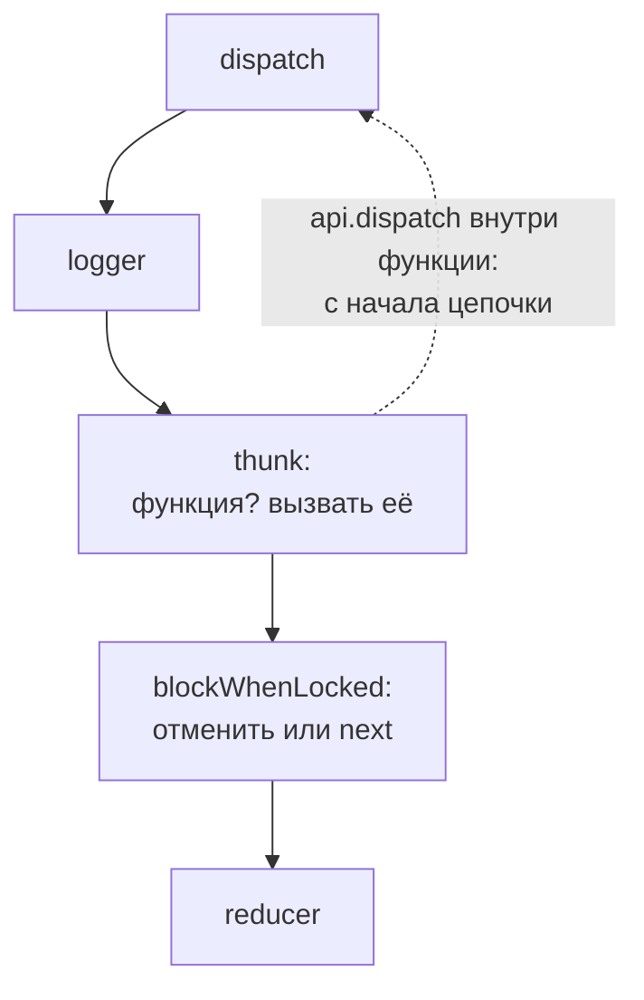

## О чём урок

Redux как идея, без которой не понять ни Redux Toolkit, ни NgRx, ни половину вопросов о состоянии: однонаправленный поток данных, три принципа, store из нескольких строк, actions, чистые reducers и неизменяемость, middleware и thunk, `connect` против хуков. Современный код на Redux пишут через Redux Toolkit (следующий урок), но спрашивают именно эту основу. Примеры выполняются на Redux 5 (через `@reduxjs/toolkit` 2.14) в Node.js.

## Однонаправленный поток данных



Redux вырос из архитектуры **Flux** (Facebook, 2014): данные текут по кругу в одну сторону. Компонент не меняет состояние сам, а сообщает, **что произошло** (action). Новое состояние вычисляет reducer, store уведомляет подписчиков, и компоненты читают нужные им части через селекторы.

**Три принципа Redux**:

1. **Единственный источник правды**: всё глобальное состояние лежит в одном дереве объектов внутри одного store.
2. **Состояние только для чтения**: единственный способ его изменить это отправить action, простой объект, описывающий событие.
3. **Изменения делают чистые функции**: reducer `(state, action) => newState` без побочных эффектов и мутаций.

Что это даёт: каждое изменение видно как action в логе, состояние можно восстановить, воспроизведя actions (отсюда «путешествие во времени» в Redux DevTools), reducers тестируются как обычные функции.

## Store своими руками

Частое задание: написать `createStore`. Ядро Redux действительно помещается в несколько строк:

```js run
// The whole Redux core in a few lines: what an interviewer means by "write createStore"
function createStore(reducer, preloadedState) {
  let state = reducer(preloadedState, { type: '@@init' })
  const listeners = new Set()
  return {
    getState: () => state,
    dispatch(action) {
      if (typeof action?.type !== 'string') throw new TypeError('an action is a plain object with a string type')
      state = reducer(state, action) // the only place where state changes
      listeners.forEach((listener) => listener())
      return action
    },
    subscribe(listener) {
      listeners.add(listener)
      return () => listeners.delete(listener) // unsubscribe
    },
  }
}

function counter(state = { value: 0 }, action) {
  switch (action.type) {
    case 'counter/incremented':
      return { ...state, value: state.value + 1 }
    case 'counter/added':
      return { ...state, value: state.value + action.payload }
    default:
      return state // unknown actions return the same object
  }
}

const store = createStore(counter)
const unsubscribe = store.subscribe(() => console.log('state:', store.getState()))
store.dispatch({ type: 'counter/incremented' })
store.dispatch({ type: 'counter/added', payload: 5 })
unsubscribe()
store.dispatch({ type: 'counter/incremented' })
console.log('after unsubscribe:', store.getState())
try {
  store.dispatch({ payload: 1 })
} catch (e) {
  console.log(e.message)
}
```

```output
state: { value: 1 }
state: { value: 6 }
after unsubscribe: { value: 7 }
an action is a plain object with a string type
```

- `dispatch` единственное место, где меняется состояние; после него вызываются все подписчики.
- `subscribe` возвращает функцию отписки; UI-привязки (`react-redux`, `@ngrx/store`) построены на ней.
- Настоящий Redux тоже бросает ошибку на action без `type` («Actions may not have an undefined "type" property»), а не игнорирует его.

## Actions

Action это **простой объект** с обязательным строковым полем `type`, обычно с `payload`:

```ts
{ type: 'cart/itemAdded', payload: { id: 'tea', qty: 1 } }
{ type: 'auth/loginFailed', payload: 'Wrong password', error: true }
```

- Имя описывает **событие в прошедшем времени** в формате `домен/событие` (`todos/todoAdded`), а не команду установки поля (`SET_TODOS`). Один action может обработать несколько reducers: `auth/loggedOut` очищает и корзину, и профиль.
- Action должен быть сериализуемым (без функций, промисов, экземпляров классов): так работают DevTools, логирование и повтор.
- Функцию в `dispatch` можно передать, только если её перехватит middleware (thunk); иначе Redux бросит «Actions must be plain objects».
- Функции-создатели (`addItem(id)` возвращает action) избавляют от опечаток в `type`; в Redux Toolkit их генерирует `createSlice`.

## Reducers и неизменяемость

Reducer обязан быть **чистым**: одинаковые `state` и `action` дают одинаковый результат, без запросов, `Date.now()`, `Math.random()` и записи в `localStorage`. И он не мутирует состояние, а возвращает новый объект, копируя изменённый путь:

```js run
import { legacy_createStore as createStore } from '@reduxjs/toolkit'

const initial = { todos: [{ id: 1, done: false }] }
function mutatingReducer(state = initial, action) {
  if (action.type === 'todos/toggled') {
    state.todos[0].done = !state.todos[0].done // mutation: same objects
    return state
  }
  return state
}
function immutableReducer(state = initial, action) {
  if (action.type === 'todos/toggled') {
    return { ...state, todos: state.todos.map((t) => (t.id === action.payload ? { ...t, done: !t.done } : t)) }
  }
  return state
}

for (const reducer of [mutatingReducer, immutableReducer]) {
  const store = createStore(reducer, structuredClone(initial))
  const selectTodos = (s) => s.todos
  const before = selectTodos(store.getState())
  store.dispatch({ type: 'todos/toggled', payload: 1 })
  const after = selectTodos(store.getState())
  // react-redux and memoized selectors compare by reference: same reference = "nothing changed"
  console.log(reducer.name.padEnd(16), 'changed?', before !== after, '| done:', after[0].done)
}
```

```output
mutatingReducer  changed? false | done: true
immutableReducer changed? true | done: true
```

Почему мутация ломает приложение, хотя значение `done` поменялось в обоих случаях: `useSelector`, `connect`, мемоизированные селекторы и `OnPush` в Angular сравнивают **ссылки**. Мутирующий reducer вернул тот же объект, и подписчики решили, что ничего не изменилось: экран не обновится. Неизменяемое обновление создаёт новые объекты только на пути к изменению (`state`, `todos`, изменённый элемент), остальные части переиспользуются, поэтому сравнение по ссылке дешёвое и точное.



- Неизвестный action reducer возвращает **тот же** объект: это значит «ничего не изменилось».
- Писать копии руками утомительно и чревато ошибками; Redux Toolkit использует Immer, где «мутирующий» код превращается в неизменяемое обновление (следующий урок).
- Большой `switch` на всё приложение разбивают на reducers по доменам и объединяют `combineReducers({ cart, user })`: каждый отвечает за свой кусок дерева.

## Middleware и асинхронность

Reducer не может делать запросы, поэтому побочные эффекты живут в **middleware**: обёртках вокруг `dispatch`, которые видят каждый action до reducer и могут его залогировать, изменить, задержать, отменить или отправить новые.

```js run
import { applyMiddleware, legacy_createStore as createStore } from '@reduxjs/toolkit'

const logger = (api) => (next) => (action) => {
  console.log('→ logger  ', action.type ?? 'a function')
  const result = next(action)
  console.log('← logger   state', JSON.stringify(api.getState()))
  return result
}
// redux-thunk in four lines: a function instead of an action gets dispatch and getState
const thunk = (api) => (next) => (action) => (typeof action === 'function' ? action(api.dispatch, api.getState) : next(action))
const blockWhenLocked = (api) => (next) => (action) => {
  if (api.getState().locked && action.type === 'cart/added') {
    console.log('✗ blocked ', action.type)
    return
  }
  return next(action)
}

function cart(state = { items: [], locked: false }, action) {
  switch (action.type) {
    case 'cart/added':
      return { ...state, items: [...state.items, action.payload] }
    case 'cart/locked':
      return { ...state, locked: true }
    default:
      return state
  }
}
const store = createStore(cart, applyMiddleware(logger, thunk, blockWhenLocked))

const checkout = () => async (dispatch, getState) => {
  dispatch({ type: 'cart/locked' })
  await Promise.resolve() // stands for a request
  return getState().items.length
}
store.dispatch({ type: 'cart/added', payload: 'tea' })
console.log('items sent:', await store.dispatch(checkout()))
store.dispatch({ type: 'cart/added', payload: 'cake' })
```

```output
→ logger   cart/added
← logger   state {"items":["tea"],"locked":false}
→ logger   a function
→ logger   cart/locked
← logger   state {"items":["tea"],"locked":true}
← logger   state {"items":["tea"],"locked":true}
items sent: 1
→ logger   cart/added
✗ blocked  cart/added
← logger   state {"items":["tea"],"locked":true}
```



- Сигнатура `api => next => action`: `api` даёт `getState` и `dispatch`, `next` передаёт action следующему middleware, а последний `next` вызывает reducer. Не вызвать `next` значит отменить action.
- **thunk** это четыре строки: если в `dispatch` пришла функция, вызвать её с `dispatch` и `getState`. Внутри можно ждать запросов и отправлять обычные actions. `dispatch`, вызванный изнутри, проходит цепочку **с начала** (поэтому `cart/locked` снова прошёл через logger).
- Thunk не устарел: он включён в `configureStore` Redux Toolkit по умолчанию, и на нём построен `createAsyncThunk`. **Redux-Saga** (генераторы) решала сложные сценарии с отменой и параллельными потоками; в новом коде её заменяют `createListenerMiddleware` и RTK Query, но в старых проектах она встречается.
- Свои middleware пишут для аналитики, отчётов об ошибках, выхода из системы при ответе 401.

## connect и хуки

До хуков компонент подключали к store через компонент высшего порядка `connect` из `react-redux`:

```tsx
// legacy: higher-order component
const mapStateToProps = (state: RootState) => ({ items: state.cart.items })
const mapDispatchToProps = { addItem }
export default connect(mapStateToProps, mapDispatchToProps)(Cart)

// today: hooks
function Cart() {
  const items = useSelector((state: RootState) => state.cart.items)
  const dispatch = useDispatch()
  return <button onClick={() => dispatch(addItem('tea'))}>{items.length}</button>
}
```

| | `connect` | `useSelector` / `useDispatch` |
|---|---|---|
| Подписка | `mapStateToProps`, поверхностное сравнение результата | Селектор, сравнение по ссылке (`===`) или своей функцией |
| Действия | `mapDispatchToProps` в пропсы | `dispatch` прямо в компоненте |
| Обёртки | Компонент высшего порядка, «ад обёрток» в DevTools | Нет |
| TypeScript | Сложно вывести типы пропсов | Типизированные хуки `useAppSelector` |
| Где встретить | Старый код с классовыми компонентами | Весь новый код |

`connect` по-прежнему поддерживается, но в новом коде используют хуки. Store передаётся вниз через `<Provider store={store}>` (под капотом это контекст React, но значение в контексте не меняется, а подписка идёт напрямую на store, поэтому лишних рендеров через контекст нет).

## Главное

- Однонаправленный поток: View → `dispatch(action)` → middleware → reducer → store → подписчики → View.
- Три принципа: один источник правды, состояние только для чтения, изменения через чистые reducers.
- Store это `getState`, `dispatch`, `subscribe`; action это сериализуемый объект с `type` в формате `домен/событие`; без `type` Redux бросает ошибку.
- Reducer чистый и неизменяемый: мутация возвращает ту же ссылку, и подписчики не видят изменения.
- Middleware `api => next => action` для побочных эффектов; thunk передаёт в функцию `dispatch` и `getState` и включён в Redux Toolkit по умолчанию.
- `connect` это старый способ подключения; сейчас `useSelector` и `useDispatch`.
