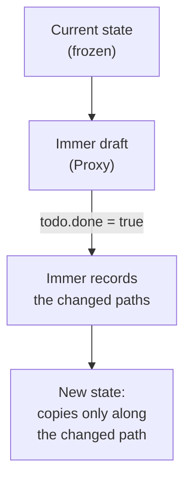
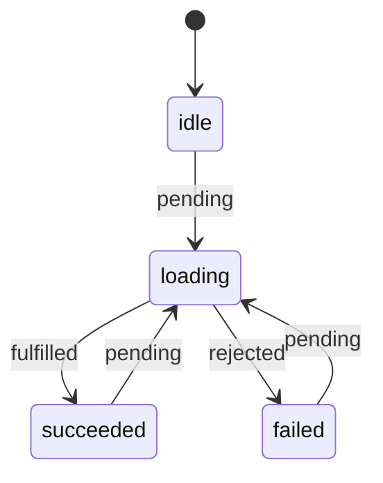

## What this lesson covers

How Redux is written today: Redux Toolkit (RTK), the official and recommended way. This lesson covers `createSlice` and Immer, what `configureStore` turns on by default, async operations with `createAsyncThunk`, memoized selectors and the typical mistake with them, `createEntityAdapter`, the listener middleware and where RTK Query fits. The examples run on `@reduxjs/toolkit` 2.14 in Node.js.

## What Redux Toolkit solves

| Problem of "hand-written" Redux | RTK solution |
|---|---|
| Type constants, action creators and a `switch` in three files | `createSlice`: reducers and actions in one place |
| Immutable updates by copying every level | Immer: "mutating" code on a draft |
| Manual store setup, thunk, DevTools | `configureStore` with sensible defaults |
| Three actions per request and error handling | `createAsyncThunk` |
| Recomputing derived data on every render | `createSelector` (Reselect) |
| Normalizing collections | `createEntityAdapter` |
| Loading and caching server data | RTK Query |

The Redux docs explicitly call "hand-written" Redux an outdated style: the plain `createStore` is marked `legacy_createStore`, and new code is written with RTK.

## createSlice and Immer

```ts run
import { configureStore, createSlice, nanoid, type PayloadAction } from '@reduxjs/toolkit'

interface Todo {
  id: string
  title: string
  done: boolean
}

const todosSlice = createSlice({
  name: 'todos',
  initialState: { items: [] as Todo[], filter: 'all' as 'all' | 'open' },
  reducers: {
    // Immer: "mutating" code on a draft produces a new immutable state
    todoAdded: {
      reducer(state, action: PayloadAction<Todo>) {
        state.items.push(action.payload)
      },
      prepare: (title: string) => ({ payload: { id: nanoid(4), title, done: false } }), // ids are made outside the reducer
    },
    todoToggled(state, action: PayloadAction<string>) {
      const todo = state.items.find((t) => t.id === action.payload)
      if (todo) todo.done = !todo.done
    },
    filterChanged: (state, action: PayloadAction<'all' | 'open'>) => ({ ...state, filter: action.payload }), // returning a new object also works
  },
})

const store = configureStore({ reducer: { todos: todosSlice.reducer } })
const { todoAdded, todoToggled } = todosSlice.actions
console.log(todoToggled('x'))

store.dispatch(todoAdded('Write tests'))
store.dispatch(todoAdded('Ship'))
const before = store.getState().todos
store.dispatch(todoToggled(before.items[0].id))
const after = store.getState().todos

console.log(after.items.map((t) => `${t.title}: ${t.done}`))
console.log('new state:', before !== after, '| changed item new:', before.items[0] !== after.items[0], '| untouched item reused:', before.items[1] === after.items[1])
try {
  ;(after.items[1] as Todo).done = true
} catch (e) {
  console.log('frozen:', (e as Error).constructor.name)
}
```

```output
{ type: 'todos/todoToggled', payload: 'x' }
[ 'Write tests: true', 'Ship: false' ]
new state: true | changed item new: true | untouched item reused: true
frozen: TypeError
```



- From a name and reducers, `createSlice` generates action creators (`todoToggled('x')` gives `{ type: 'todos/todoToggled', payload: 'x' }`) and the reducer itself.
- Inside a reducer `state` is an Immer **draft** (a proxy): assignments and `push` are recorded, and Immer builds a new immutable state. The changed item is new, the untouched one is reused, just like hand-written copying.
- You can either "mutate" the draft or **return** a new value, but not both. Mutating plain objects outside a reducer is still forbidden: in development Immer freezes the result, and a write throws a `TypeError`.
- `prepare` shapes the `payload` before the reducer: ids, dates and random values are generated there because the reducer must be pure.
- Reacting to other slices' actions (`auth/loggedOut` clears the cart) goes into `extraReducers` with `builder.addCase`.

## configureStore

`configureStore({ reducer: { todos, user } })` combines reducers itself and adds:

- the **thunk** middleware;
- in development, a **mutation** check (an error if state was changed between dispatches) and a **serializability** check (a warning if an action or the state holds a `Date`, `Map`, class instance or function);
- the **Redux DevTools** connection.

Add your own middleware to the defaults with `middleware: (getDefault) => getDefault().concat(...)`, as in the next example. In RTK 2 this must be a function: `configureStore` rejects an array with the error "`middleware` field must be a callback", so you cannot lose thunk and the checks by accident.

## createAsyncThunk

An async operation produces three actions: `pending` before the request, `fulfilled` with the result or `rejected` with the error.

```ts run
import { configureStore, createAsyncThunk, createSlice, type Middleware } from '@reduxjs/toolkit'

const fakeApi = async (id: number) => {
  await new Promise((r) => setTimeout(r, 5))
  if (id === 404) throw new Error('Not found')
  return { id, name: `User ${id}` }
}

const fetchUser = createAsyncThunk(
  'user/fetch',
  async (id: number, { rejectWithValue }) => {
    try {
      return await fakeApi(id)
    } catch (e) {
      return rejectWithValue((e as Error).message) // a serializable error for the reducer
    }
  },
  { condition: (_id, { getState }) => (getState() as { user: { status: string } }).user.status !== 'loading' }, // skip duplicates
)

const userSlice = createSlice({
  name: 'user',
  initialState: { status: 'idle', data: null as { id: number; name: string } | null, error: null as string | null },
  reducers: {},
  extraReducers: (builder) =>
    builder
      .addCase(fetchUser.pending, (state) => {
        state.status = 'loading'
        state.error = null
      })
      .addCase(fetchUser.fulfilled, (state, action) => {
        state.status = 'succeeded'
        state.data = action.payload
      })
      .addCase(fetchUser.rejected, (state, action) => {
        state.status = 'failed'
        state.error = action.payload as string
      }),
})

const logTypes: Middleware = () => (next) => (action) => {
  console.log('action:', (action as { type: string }).type)
  return next(action)
}
const store = configureStore({
  reducer: { user: userSlice.reducer },
  middleware: (getDefault) => getDefault().concat(logTypes), // thunk and dev checks stay included
})

const first = store.dispatch(fetchUser(1))
store.dispatch(fetchUser(2)) // condition returns false: not even a pending action
await first
console.log(store.getState().user)
const result = await store.dispatch(fetchUser(404))
console.log(store.getState().user.error, '| result is the rejected action:', fetchUser.rejected.match(result))
```

```output
action: user/fetch/pending
action: user/fetch/fulfilled
{ status: 'succeeded', data: { id: 1, name: 'User 1' }, error: null }
action: user/fetch/pending
action: user/fetch/rejected
Not found | result is the rejected action: true
```



- The second call `fetchUser(2)` did not even dispatch `pending`: `condition` returned `false` while loading was in progress. That is how duplicate requests are dropped.
- `rejectWithValue` puts a serializable error into `action.payload` for the reducer. Without it the error lands in `action.error` as `{ name, message, stack }`.
- `await dispatch(thunk)` returns the final action and **does not throw** even on failure. To get the result or an exception, call `.unwrap()`: `const user = await dispatch(fetchUser(1)).unwrap()`.
- The promise returned by `dispatch` has `abort()`; inside the thunk a `signal` is available for `fetch`.
- When there are many requests and they need caching, not just loading, `createAsyncThunk` turns into writing a cache by hand. Then you take RTK Query (below and in the server state lesson).

## Selectors and memoization

A selector is a `state => data` function. Components know selectors, not the shape of the state, and subscribe only to their piece: `useSelector` re-renders a component when the selector result changes by reference.

```ts run
import { createSelector } from '@reduxjs/toolkit'

type State = { todos: { id: number; done: boolean; title: string }[]; filter: 'all' | 'open' }
let state: State = { todos: [{ id: 1, done: false, title: 'a' }, { id: 2, done: true, title: 'b' }], filter: 'open' }

// Inline selector: a new array on every call, so useSelector sees "a change" after every action
const selectOpenInline = (s: State) => s.todos.filter((t) => !t.done)
console.log('inline, same state, same result?', selectOpenInline(state) === selectOpenInline(state))

let runs = 0
const selectVisible = createSelector([(s: State) => s.todos, (s: State) => s.filter], (todos, filter) => {
  runs++
  return filter === 'all' ? todos : todos.filter((t) => !t.done)
})
const r1 = selectVisible(state)
const r2 = selectVisible(state)
state = { ...state } // an unrelated action: new root object, same todos and filter
const r3 = selectVisible(state)
console.log('memoized:', r1 === r2 && r2 === r3, '| runs:', runs)
state = { ...state, todos: [...state.todos, { id: 3, done: false, title: 'c' }] }
console.log('after todos changed:', selectVisible(state).map((t) => t.title), '| runs:', runs)
```

```output
inline, same state, same result? false
memoized: true | runs: 1
after todos changed: [ 'a', 'c' ] | runs: 2
```

- A `filter` in a selector creates a **new array** on every call. `useSelector` calls the selector after **every** action in the store, so the component re-renders every time, even if the todos did not change (react-redux warns about this in development).
- `createSelector` recomputes only when the results of its input selectors (`todos`, `filter`) change; otherwise it returns the previous object. A new root state from an unrelated action did not trigger a recompute.
- Input selectors must be simple lookups (`s => s.todos`): if an input selector itself creates a new object, memoization never kicks in.
- Since Reselect 5 (inside RTK 2) the default is `weakMapMemoize`: the cache keeps results for different arguments, so a selector with a parameter (`selectTodosByList(state, listId)`) works without the per-component factory that used to be created with `useMemo`.
- Derived data is computed with selectors, not stored in state (see the kinds of state lesson).

## Normalization, listener middleware, RTK Query

- `createEntityAdapter` keeps a collection normalized as `{ ids: [], entities: {} }` and provides ready reducers (`addOne`, `upsertMany`, `removeOne`) and selectors (`selectAll`, `selectById`). Why normalize is covered in the patterns lesson.
- `createListenerMiddleware` reacts to actions with side effects ("after `cart/itemAdded` save the cart", "after `auth/loggedOut` cancel requests"): a light replacement for Redux-Saga in most cases.
- **RTK Query** describes an API declaratively and generates hooks with caching, deduplication, refetching and tag-based invalidation:

```ts
const api = createApi({
  baseQuery: fetchBaseQuery({ baseUrl: '/api' }),
  tagTypes: ['Todo'],
  endpoints: (build) => ({
    getTodos: build.query<Todo[], void>({ query: () => 'todos', providesTags: ['Todo'] }),
    addTodo: build.mutation<Todo, string>({
      query: (title) => ({ url: 'todos', method: 'POST', body: { title } }),
      invalidatesTags: ['Todo'], // every query that provides 'Todo' refetches
    }),
  }),
})
export const { useGetTodosQuery, useAddTodoMutation } = api
```

In a Redux app server data lives in RTK Query, and slices keep only client state.

## Structure and typing

- Folders by feature (`features/cart/cartSlice.ts`, `features/cart/Cart.tsx`), not by file type (`actions/`, `reducers/`).
- Types are inferred from the store: `type RootState = ReturnType<typeof store.getState>`, `type AppDispatch = typeof store.dispatch`, and typed hooks `useAppSelector = useSelector.withTypes<RootState>()`.
- Only serializable data goes into the store: dates as strings or numbers, no class instances.

## Key points

- RTK is the official way to write Redux; plain `createStore` is called legacy.
- `createSlice` generates actions and a reducer; Immer turns draft "mutations" into an immutable update; you cannot both mutate and return.
- `configureStore` includes thunk, mutation and serializability checks in development, and DevTools; add middleware through `getDefault().concat`.
- `createAsyncThunk`: `pending`, `fulfilled`, `rejected`; `condition` drops duplicates, `rejectWithValue` for errors, `unwrap()` to throw.
- A selector that creates a new array re-renders the component on any action; `createSelector` recomputes only when inputs change.
- `createEntityAdapter` for collections, the listener middleware for side effects, RTK Query for server data.
