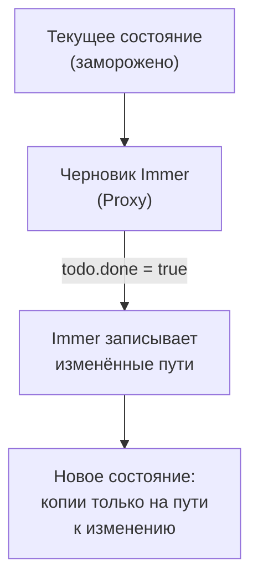
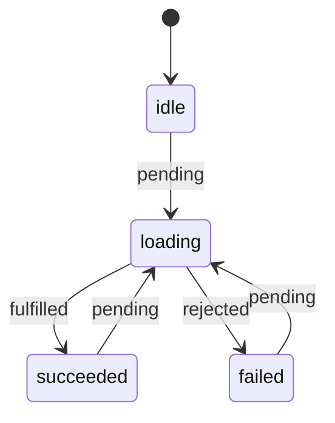

## О чём урок

Как пишут на Redux сейчас: Redux Toolkit (RTK), официальный и рекомендуемый способ. Здесь `createSlice` и Immer, что `configureStore` включает по умолчанию, асинхронные операции через `createAsyncThunk`, мемоизированные селекторы и типичная ошибка с ними, `createEntityAdapter`, listener middleware и место RTK Query. Примеры выполняются на `@reduxjs/toolkit` 2.14 в Node.js.

## Что решает Redux Toolkit

| Проблема «ручного» Redux | Решение в RTK |
|---|---|
| Константы типов, создатели actions и `switch` в трёх файлах | `createSlice`: reducers и actions в одном месте |
| Неизменяемые обновления копированием на каждом уровне | Immer: «мутирующий» код над черновиком |
| Ручная настройка store, thunk, DevTools | `configureStore` с разумными умолчаниями |
| Три action на каждый запрос и обработка ошибок | `createAsyncThunk` |
| Пересчёт производных данных на каждом рендере | `createSelector` (Reselect) |
| Нормализация коллекций | `createEntityAdapter` |
| Загрузка и кэширование серверных данных | RTK Query |

Документация Redux прямо называет «ручной» Redux устаревшим стилем: базовый `createStore` помечен как `legacy_createStore`, а новый код пишут на RTK.

## createSlice и Immer

```ts run
import { configureStore, createSlice, nanoid, type PayloadAction } from '@reduxjs/toolkit'

interface Todo {
  id: string
  title: string
  done: boolean
}

const todosSlice = createSlice({
  name: 'todos',
  initialState: { items: [] as Todo[], filter: 'all' as 'all' | 'open' },
  reducers: {
    // Immer: "mutating" code on a draft produces a new immutable state
    todoAdded: {
      reducer(state, action: PayloadAction<Todo>) {
        state.items.push(action.payload)
      },
      prepare: (title: string) => ({ payload: { id: nanoid(4), title, done: false } }), // ids are made outside the reducer
    },
    todoToggled(state, action: PayloadAction<string>) {
      const todo = state.items.find((t) => t.id === action.payload)
      if (todo) todo.done = !todo.done
    },
    filterChanged: (state, action: PayloadAction<'all' | 'open'>) => ({ ...state, filter: action.payload }), // returning a new object also works
  },
})

const store = configureStore({ reducer: { todos: todosSlice.reducer } })
const { todoAdded, todoToggled } = todosSlice.actions
console.log(todoToggled('x'))

store.dispatch(todoAdded('Write tests'))
store.dispatch(todoAdded('Ship'))
const before = store.getState().todos
store.dispatch(todoToggled(before.items[0].id))
const after = store.getState().todos

console.log(after.items.map((t) => `${t.title}: ${t.done}`))
console.log('new state:', before !== after, '| changed item new:', before.items[0] !== after.items[0], '| untouched item reused:', before.items[1] === after.items[1])
try {
  ;(after.items[1] as Todo).done = true
} catch (e) {
  console.log('frozen:', (e as Error).constructor.name)
}
```

```output
{ type: 'todos/todoToggled', payload: 'x' }
[ 'Write tests: true', 'Ship: false' ]
new state: true | changed item new: true | untouched item reused: true
frozen: TypeError
```



- `createSlice` по имени и reducers генерирует создатели actions (`todoToggled('x')` даёт `{ type: 'todos/todoToggled', payload: 'x' }`) и сам reducer.
- Внутри reducer `state` это **черновик** Immer (прокси): присваивания и `push` записываются, и Immer строит новое неизменяемое состояние. Изменённый элемент новый, нетронутый переиспользован, как при ручном копировании.
- Можно либо «мутировать» черновик, либо **вернуть** новое значение, но не оба сразу. Мутировать обычные объекты за пределами reducer по-прежнему нельзя: в разработке Immer замораживает результат, и запись бросает `TypeError`.
- `prepare` формирует `payload` до reducer: id, даты, случайные значения генерируют там, потому что reducer должен быть чистым.
- Реакция на чужие actions (`auth/loggedOut` очищает корзину) пишется в `extraReducers` через `builder.addCase`.

## configureStore

`configureStore({ reducer: { todos, user } })` сам объединяет reducers и добавляет:

- **thunk** middleware;
- в режиме разработки проверку **мутаций** (ошибка, если состояние изменили между dispatch) и проверку **сериализуемости** (предупреждение, если в action или состоянии `Date`, `Map`, класс или функция);
- подключение к **Redux DevTools**.

Свои middleware добавляют к стандартным через `middleware: (getDefault) => getDefault().concat(...)`, как в следующем примере. В RTK 2 это обязательно функция: массив `configureStore` отвергает с ошибкой «`middleware` field must be a callback», чтобы случайно не потерять thunk и проверки.

## createAsyncThunk

Асинхронная операция порождает три action: `pending` до запроса, `fulfilled` с результатом или `rejected` с ошибкой.

```ts run
import { configureStore, createAsyncThunk, createSlice, type Middleware } from '@reduxjs/toolkit'

const fakeApi = async (id: number) => {
  await new Promise((r) => setTimeout(r, 5))
  if (id === 404) throw new Error('Not found')
  return { id, name: `User ${id}` }
}

const fetchUser = createAsyncThunk(
  'user/fetch',
  async (id: number, { rejectWithValue }) => {
    try {
      return await fakeApi(id)
    } catch (e) {
      return rejectWithValue((e as Error).message) // a serializable error for the reducer
    }
  },
  { condition: (_id, { getState }) => (getState() as { user: { status: string } }).user.status !== 'loading' }, // skip duplicates
)

const userSlice = createSlice({
  name: 'user',
  initialState: { status: 'idle', data: null as { id: number; name: string } | null, error: null as string | null },
  reducers: {},
  extraReducers: (builder) =>
    builder
      .addCase(fetchUser.pending, (state) => {
        state.status = 'loading'
        state.error = null
      })
      .addCase(fetchUser.fulfilled, (state, action) => {
        state.status = 'succeeded'
        state.data = action.payload
      })
      .addCase(fetchUser.rejected, (state, action) => {
        state.status = 'failed'
        state.error = action.payload as string
      }),
})

const logTypes: Middleware = () => (next) => (action) => {
  console.log('action:', (action as { type: string }).type)
  return next(action)
}
const store = configureStore({
  reducer: { user: userSlice.reducer },
  middleware: (getDefault) => getDefault().concat(logTypes), // thunk and dev checks stay included
})

const first = store.dispatch(fetchUser(1))
store.dispatch(fetchUser(2)) // condition returns false: not even a pending action
await first
console.log(store.getState().user)
const result = await store.dispatch(fetchUser(404))
console.log(store.getState().user.error, '| result is the rejected action:', fetchUser.rejected.match(result))
```

```output
action: user/fetch/pending
action: user/fetch/fulfilled
{ status: 'succeeded', data: { id: 1, name: 'User 1' }, error: null }
action: user/fetch/pending
action: user/fetch/rejected
Not found | result is the rejected action: true
```



- Второй вызов `fetchUser(2)` не отправил даже `pending`: `condition` вернул `false`, пока идёт загрузка. Так убирают дубли запросов.
- `rejectWithValue` кладёт в `action.payload` сериализуемую ошибку для reducer. Без него ошибка попадает в `action.error` в виде `{ name, message, stack }`.
- `await dispatch(thunk)` возвращает итоговый action и **не бросает** исключение даже при ошибке. Чтобы получить результат или исключение, вызывают `.unwrap()`: `const user = await dispatch(fetchUser(1)).unwrap()`.
- Промис из `dispatch` имеет `abort()`; внутри thunk доступен `signal` для `fetch`.
- Если запросов много и их надо кэшировать, а не только загрузить, `createAsyncThunk` становится ручным написанием кэша. Тогда берут RTK Query (ниже и в уроке о серверном состоянии).

## Селекторы и мемоизация

Селектор это функция `state => данные`. Компоненты знают селекторы, а не форму состояния, и подписываются только на свой кусок: `useSelector` перерисовывает компонент, когда результат селектора изменился по ссылке.

```ts run
import { createSelector } from '@reduxjs/toolkit'

type State = { todos: { id: number; done: boolean; title: string }[]; filter: 'all' | 'open' }
let state: State = { todos: [{ id: 1, done: false, title: 'a' }, { id: 2, done: true, title: 'b' }], filter: 'open' }

// Inline selector: a new array on every call, so useSelector sees "a change" after every action
const selectOpenInline = (s: State) => s.todos.filter((t) => !t.done)
console.log('inline, same state, same result?', selectOpenInline(state) === selectOpenInline(state))

let runs = 0
const selectVisible = createSelector([(s: State) => s.todos, (s: State) => s.filter], (todos, filter) => {
  runs++
  return filter === 'all' ? todos : todos.filter((t) => !t.done)
})
const r1 = selectVisible(state)
const r2 = selectVisible(state)
state = { ...state } // an unrelated action: new root object, same todos and filter
const r3 = selectVisible(state)
console.log('memoized:', r1 === r2 && r2 === r3, '| runs:', runs)
state = { ...state, todos: [...state.todos, { id: 3, done: false, title: 'c' }] }
console.log('after todos changed:', selectVisible(state).map((t) => t.title), '| runs:', runs)
```

```output
inline, same state, same result? false
memoized: true | runs: 1
after todos changed: [ 'a', 'c' ] | runs: 2
```

- `filter` в селекторе создаёт **новый массив** при каждом вызове. `useSelector` вызывает селектор после **каждого** action в store, и компонент перерисовывается всегда, даже если задачи не менялись (в разработке react-redux предупреждает об этом).
- `createSelector` пересчитывает результат, только когда изменились результаты входных селекторов (`todos`, `filter`), иначе возвращает прошлый объект. Новое корневое состояние от постороннего action пересчёта не вызвало.
- Входные селекторы должны быть простыми выборками (`s => s.todos`): если входной селектор сам создаёт новый объект, мемоизация никогда не срабатывает.
- С Reselect 5 (внутри RTK 2) по умолчанию работает `weakMapMemoize`: кэш хранит результаты для разных аргументов, поэтому селектор с параметром (`selectTodosByList(state, listId)`) работает и без фабрики на каждый компонент, которую раньше создавали через `useMemo`.
- Производные данные считают селекторами, а не хранят в состоянии (урок о видах состояния).

## Нормализация, listener middleware, RTK Query

- `createEntityAdapter` хранит коллекцию в нормализованном виде `{ ids: [], entities: {} }` и даёт готовые reducers (`addOne`, `upsertMany`, `removeOne`) и селекторы (`selectAll`, `selectById`). Зачем нормализовать, разобрано в уроке о паттернах.
- `createListenerMiddleware` реагирует на actions побочными эффектами («после `cart/itemAdded` сохранить корзину», «после `auth/loggedOut` отменить запросы»): лёгкая замена Redux-Saga для большинства сценариев.
- **RTK Query** описывает API декларативно и генерирует хуки с кэшем, дедупликацией, повторной загрузкой и инвалидацией по тегам:

```ts
const api = createApi({
  baseQuery: fetchBaseQuery({ baseUrl: '/api' }),
  tagTypes: ['Todo'],
  endpoints: (build) => ({
    getTodos: build.query<Todo[], void>({ query: () => 'todos', providesTags: ['Todo'] }),
    addTodo: build.mutation<Todo, string>({
      query: (title) => ({ url: 'todos', method: 'POST', body: { title } }),
      invalidatesTags: ['Todo'], // every query that provides 'Todo' refetches
    }),
  }),
})
export const { useGetTodosQuery, useAddTodoMutation } = api
```

В приложении на Redux серверные данные держат в RTK Query, а в slices остаётся только клиентское состояние.

## Структура и типизация

- Папки по фичам (`features/cart/cartSlice.ts`, `features/cart/Cart.tsx`), а не по типам файлов (`actions/`, `reducers/`).
- Типы выводятся из store: `type RootState = ReturnType<typeof store.getState>`, `type AppDispatch = typeof store.dispatch`, и типизированные хуки `useAppSelector = useSelector.withTypes<RootState>()`.
- В store кладут только сериализуемые данные: даты строкой или числом, без экземпляров классов.

## Главное

- RTK это официальный способ писать на Redux; `createStore` сам по себе называется legacy.
- `createSlice` генерирует actions и reducer; Immer превращает «мутации» черновика в неизменяемое обновление; нельзя одновременно мутировать и возвращать.
- `configureStore` включает thunk, проверки мутаций и сериализуемости в разработке, DevTools; свои middleware через `getDefault().concat`.
- `createAsyncThunk`: `pending`, `fulfilled`, `rejected`; `condition` убирает дубли, `rejectWithValue` для ошибок, `unwrap()` для исключения.
- Селектор, создающий новый массив, перерисовывает компонент на любой action; `createSelector` пересчитывает только при изменении входов.
- `createEntityAdapter` для коллекций, listener middleware для побочных эффектов, RTK Query для серверных данных.
