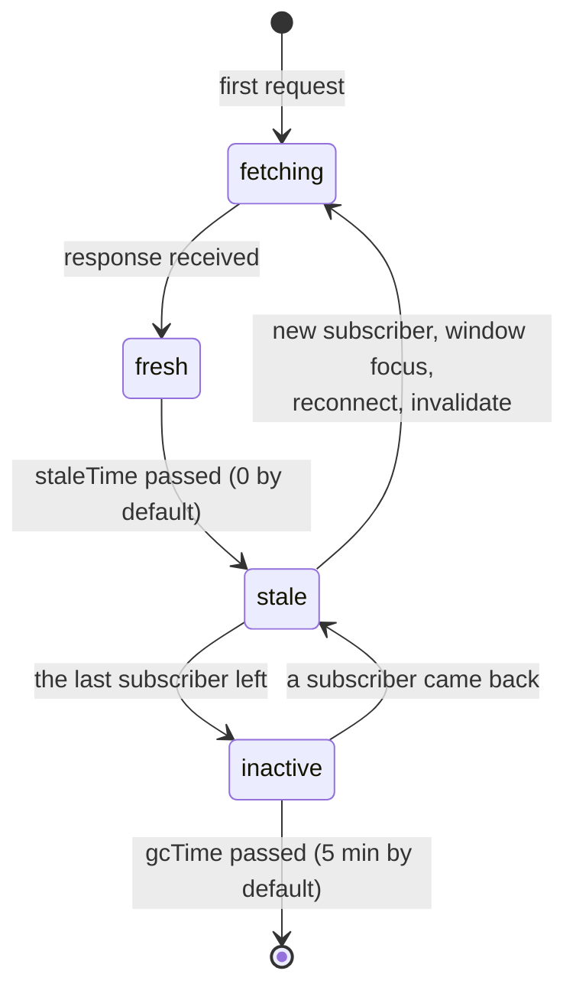
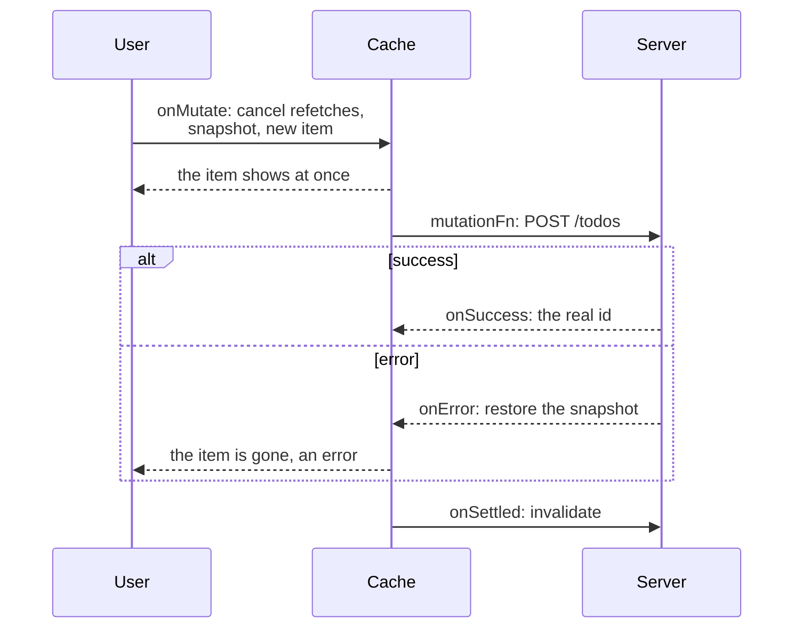

## What this lesson covers

Why server data is not "app state" but a cache with its own problems, and how TanStack Query (React Query) solves them: query keys, deduplication, freshness (`staleTime`) and garbage collection (`gcTime`), showing stale data during a background refetch, invalidation, mutations and optimistic updates with rollback. At the end, the equivalents in Vue, Angular and Redux. The examples run on `@tanstack/query-core` 5.107, the shared core of the React, Vue, Angular, Solid and Svelte adapters.

## How server state differs

Client state belongs to the app: it changes only when we change it. Server state **belongs to the server**, and the client has only a snapshot that:

- goes stale while the user is looking at the screen (someone else changed the data);
- is needed by several components at once, and fetching it separately for each is wasteful;
- loads asynchronously, may fail, needs retries, cancellation, pagination;
- after a change on the server (a mutation) must update everywhere it is shown.

Writing this by hand in `useEffect` or in Redux means reimplementing a cache: loading flags, races, retries, deciding "when to reload". Query libraries (TanStack Query, RTK Query, SWR, Pinia Colada, Apollo for GraphQL) do it for you. This is the "90% of the code for fetch, cache, sync" mentioned in the notes.

## Keys and deduplication

Every query in the cache is identified by a **key**: an array containing everything the result depends on (`['todos', { status, page }]`). The same key means the same data: simultaneous requests are merged, and the result is shared by all subscribers.

```ts run
import { QueryClient } from '@tanstack/query-core'

const client = new QueryClient({ defaultOptions: { queries: { gcTime: Infinity } } })
const keys = [['todos', 'list', { status: 'open' }], ['todos', 'list', { status: 'done' }], ['todos', 'detail', 7], ['users', 'list']]
for (const queryKey of keys) client.setQueryData(queryKey, 'cached')

const stale = () => client.getQueryCache().getAll().filter((q) => q.isStale()).map((q) => JSON.stringify(q.queryKey))
await client.invalidateQueries({ queryKey: ['todos', 'list'] }) // a prefix: both lists, not the detail
console.log(stale())
await client.invalidateQueries({ queryKey: ['todos'] }) // everything about todos
console.log(stale().length, 'stale; users untouched:', !stale().includes('["users","list"]'))
```

```output
[
  '["todos","list",{"status":"open"}]',
  '["todos","list",{"status":"done"}]'
]
3 stale; users untouched: true
```

- Keys are hierarchical: invalidating the prefix `['todos', 'list']` hits both lists but not the detail `['todos', 'detail', 7]`; the prefix `['todos']` hits everything about todos.
- Objects in a key are compared by content, not by reference (property order does not matter).
- The most common mistake: forgetting a parameter in the key (`['todos']` instead of `['todos', page]`). Different pages then share one cache entry, and the wrong data is shown.

## Freshness, background refetch, garbage collection



```ts run
import { QueryClient, QueryObserver } from '@tanstack/query-core'

const sleep = (ms: number) => new Promise((r) => setTimeout(r, ms))
let calls = 0
let serverTodos = ['write tests']
const fetchTodos = async () => {
  calls++
  await sleep(10)
  return [...serverTodos]
}

const client = new QueryClient({ defaultOptions: { queries: { staleTime: 60_000, gcTime: Infinity } } })
const todosQuery = { queryKey: ['todos'], queryFn: fetchTodos }

// Two components ask for the same data at once: one request
await Promise.all([client.fetchQuery(todosQuery), client.fetchQuery(todosQuery)])
console.log('deduplicated, calls:', calls)
await client.fetchQuery(todosQuery)
console.log('fresh data from the cache, calls:', calls)

// A mounted component = an observer; stale data is shown while it refetches in the background
const observer = new QueryObserver(client, todosQuery)
const seen: string[] = []
const unsubscribe = observer.subscribe((r) => seen.push(`${r.status}/${r.fetchStatus}: ${r.data?.join(', ')}`))
serverTodos = ['write tests', 'ship']
await client.invalidateQueries({ queryKey: ['todos'] }) // mark stale and refetch active queries
console.log(seen)
console.log('calls:', calls)
unsubscribe()
```

```output
deduplicated, calls: 1
fresh data from the cache, calls: 1
[
  'success/idle: write tests',
  'success/fetching: write tests',
  'success/idle: write tests, ship'
]
calls: 2
```

- Two simultaneous requests made **one** server call, and a repeated request within `staleTime` took data from the cache.
- `QueryObserver` is what `useQuery` does in a component. After invalidation the observer first got the **old data** with `fetchStatus: 'fetching'`, and then the new data. This is the **stale-while-revalidate** strategy: the user immediately sees what was there, with no spinner, and the data quietly updates.
- `status` describes the data (`pending`, `error`, `success`), and `fetchStatus` the request (`fetching`, `paused`, `idle`). So "has data and a background refetch is running" is `success` and `fetching` at the same time.
- `staleTime` is **0** by default: data is stale at once, and every new component, window focus and reconnect triggers a refetch. For reference data and rarely changing data set it to minutes.
- `gcTime` (called `cacheTime` in v4) is about something else: how long to keep data in memory that nobody subscribes to. A failed request is retried 3 times by default with exponential backoff.

## Mutations and optimistic updates

A change on the server (a mutation) is made with `useMutation`, and then the cache is updated: the simplest way is to **invalidate** the related keys (`invalidateQueries({ queryKey: ['todos'] })`), and active queries refetch. If waiting for the server takes long, update **optimistically**: show the result at once and roll back on error.

```ts run
import { MutationObserver, QueryClient } from '@tanstack/query-core'

type Todo = { id: number; title: string }
const client = new QueryClient({ defaultOptions: { queries: { gcTime: Infinity }, mutations: { gcTime: Infinity } } })
client.setQueryData<Todo[]>(['todos'], [{ id: 1, title: 'write tests' }])
const titles = () => client.getQueryData<Todo[]>(['todos'])!.map((t) => t.title)

const addTodo = new MutationObserver(client, {
  mutationFn: async (title: string) => {
    await new Promise((r) => setTimeout(r, 10))
    if (title.includes('!')) throw new Error('validation failed')
    return { id: 2, title }
  },
  onMutate: async (title) => {
    await client.cancelQueries({ queryKey: ['todos'] }) // a running refetch must not overwrite our change
    const previous = client.getQueryData<Todo[]>(['todos'])
    client.setQueryData<Todo[]>(['todos'], (old = []) => [...old, { id: -1, title }]) // show it at once
    console.log('optimistic:', titles())
    return { previous }
  },
  onError: (error, _title, context) => {
    client.setQueryData(['todos'], context?.previous) // roll back
    console.log('rolled back:', titles(), '|', error.message)
  },
  onSuccess: (saved) => {
    client.setQueryData<Todo[]>(['todos'], (old = []) => old.map((t) => (t.id === -1 ? saved : t))) // temporary id → real one
    console.log('confirmed:', client.getQueryData<Todo[]>(['todos']))
  },
})

await addTodo.mutate('ship').catch(() => {})
await addTodo.mutate('ship now!').catch(() => {})
```

```output
optimistic: [ 'write tests', 'ship' ]
confirmed: [ { id: 1, title: 'write tests' }, { id: 2, title: 'ship' } ]
optimistic: [ 'write tests', 'ship', 'ship now!' ]
rolled back: [ 'write tests', 'ship' ] | validation failed
```



- `cancelQueries` at the start is required: otherwise a background refetch started before the mutation returns the old list and overwrites the optimistic change.
- The snapshot from `onMutate` is returned as context and used in `onError` for the rollback.
- After a mutation (in `onSettled`) the key is usually invalidated anyway, to sync the cache with what the server actually saved.
- Update optimistically what almost always succeeds and is easy to roll back (a like, ticking a todo, renaming). Show a payment or an account deletion only after the server confirms. React 19 has `useOptimistic` for simple cases (see the React Actions lesson).

## In frameworks and alternatives

```tsx
// React: the same query in any component, no store, no effects
function TodoCount() {
  const { data, isPending, error } = useQuery({ queryKey: ['todos'], queryFn: fetchTodos, staleTime: 30_000 })
  if (isPending) return <Skeleton />
  if (error) return <Retry error={error} />
  return <span>{data.length}</span>
}
```

| Tool | Where | Features |
|---|---|---|
| TanStack Query | React, Vue, Solid, Svelte, Angular (experimental adapter) | Independent of any store, array keys, DevTools |
| RTK Query | Redux | Data lives in the Redux store, tag-based invalidation, hooks generated from an API description |
| SWR | React | Minimalist, by Vercel, the stale-while-revalidate principle in its name |
| Pinia Colada | Vue | A query layer on top of Pinia by the Pinia author |
| `resource` and `httpResource` | Angular | Built-in signal resources: loading driven by a signal parameter, no cache shared between components |
| Apollo Client, urql, Relay | GraphQL | A normalized cache by `id` and `__typename` |

Typical mistakes in interviews and in code:

- copying `data` from a query into `useState` or Redux: you get a second source of truth that does not update on refetch;
- storing client state (is a modal open) in the query cache: that is what plain state is for;
- forgetting parameters in the key, and setting `staleTime: Infinity` on data that changes.

## Key points

- Server state is a cache of someone else's data: it goes stale, is shared by components, is async; a hand-written version in `useEffect` or Redux repeats a query library.
- The key includes all query parameters; identical keys are deduplicated, invalidation works by prefix.
- `staleTime` (0 by default) decides when to refetch; `gcTime` (5 minutes) how long to keep unused data; `status` is about the data, `fetchStatus` about the request.
- Stale-while-revalidate: show old data, refresh in the background.
- A mutation, then invalidation; optimistically: `cancelQueries`, snapshot, change, roll back in `onError`, sync in `onSettled`.
- Equivalents: RTK Query in Redux, Pinia Colada in Vue, `resource`/`httpResource` in Angular, Apollo for GraphQL.
