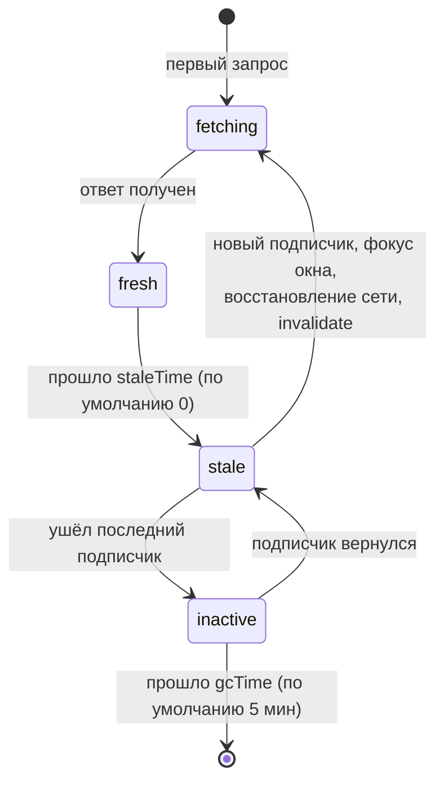
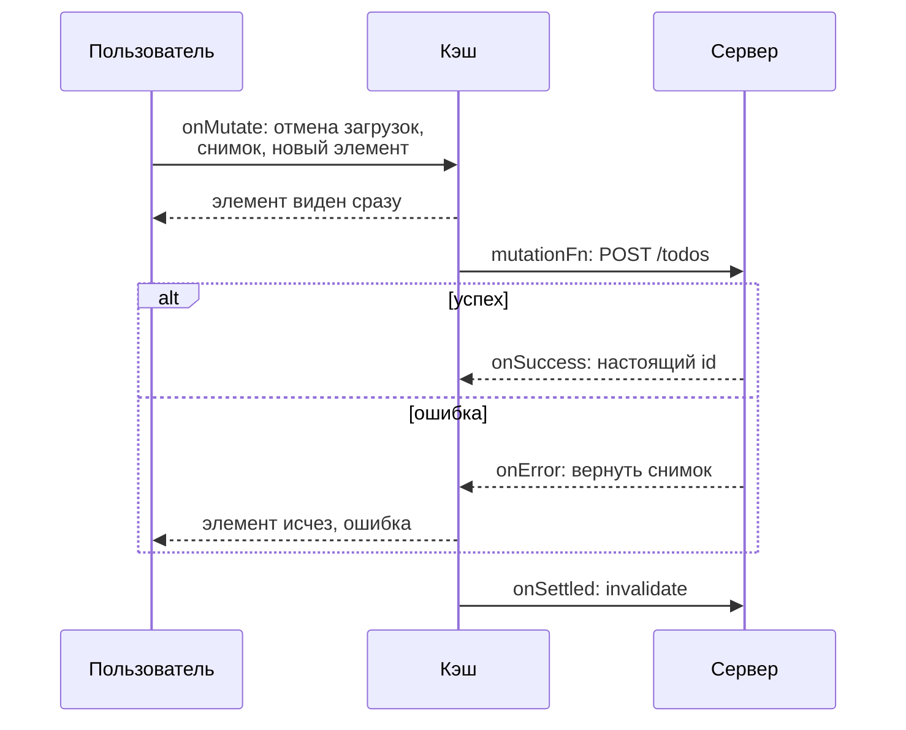

## О чём урок

Почему данные с сервера это не «состояние приложения», а кэш со своими задачами, и как их решает TanStack Query (React Query): ключи запросов, дедупликация, свежесть (`staleTime`) и сборка мусора (`gcTime`), показ устаревших данных во время фоновой загрузки, инвалидация, мутации и оптимистичные обновления с откатом. В конце аналоги в Vue, Angular и Redux. Примеры выполняются на `@tanstack/query-core` 5.107, общем ядре адаптеров для React, Vue, Angular, Solid и Svelte.

## Чем серверное состояние отличается

Клиентское состояние принадлежит приложению: оно меняется только когда меняем его мы. Серверное состояние **принадлежит серверу**, а у клиента лишь снимок, который:

- устаревает, пока пользователь смотрит на экран (данные поменял кто-то другой);
- нужен сразу нескольким компонентам, и запрашивать его каждому отдельно расточительно;
- загружается асинхронно, может не загрузиться, требует повтора, отмены, пагинации;
- после изменения на сервере (мутации) должен обновиться везде, где показан.

Писать это вручную в `useEffect` или в Redux значит заново реализовать кэш: флаги загрузки, гонки, повторы, решение «когда перезагрузить». Библиотеки запросов (TanStack Query, RTK Query, SWR, Pinia Colada, Apollo для GraphQL) делают это за вас. Это и есть «90% кода для fetch, cache, sync», о котором пишут в заметках.

## Ключи и дедупликация

Каждый запрос в кэше определяется **ключом**: массивом, в который входит всё, от чего зависит результат (`['todos', { status, page }]`). Одинаковый ключ означает одни и те же данные: одновременные запросы объединяются, а результат делится между всеми подписчиками.

```ts run
import { QueryClient } from '@tanstack/query-core'

const client = new QueryClient({ defaultOptions: { queries: { gcTime: Infinity } } })
const keys = [['todos', 'list', { status: 'open' }], ['todos', 'list', { status: 'done' }], ['todos', 'detail', 7], ['users', 'list']]
for (const queryKey of keys) client.setQueryData(queryKey, 'cached')

const stale = () => client.getQueryCache().getAll().filter((q) => q.isStale()).map((q) => JSON.stringify(q.queryKey))
await client.invalidateQueries({ queryKey: ['todos', 'list'] }) // a prefix: both lists, not the detail
console.log(stale())
await client.invalidateQueries({ queryKey: ['todos'] }) // everything about todos
console.log(stale().length, 'stale; users untouched:', !stale().includes('["users","list"]'))
```

```output
[
  '["todos","list",{"status":"open"}]',
  '["todos","list",{"status":"done"}]'
]
3 stale; users untouched: true
```

- Ключи иерархические: инвалидация по префиксу `['todos', 'list']` задевает оба списка, но не карточку `['todos', 'detail', 7]`; префикс `['todos']` задевает всё про задачи.
- Объекты в ключе сравниваются по содержимому, а не по ссылке (порядок свойств не важен).
- Самая частая ошибка: забыть параметр в ключе (`['todos']` вместо `['todos', page]`). Тогда разные страницы попадают в один кэш, и показываются чужие данные.

## Свежесть, фоновая загрузка, сборка мусора



```ts run
import { QueryClient, QueryObserver } from '@tanstack/query-core'

const sleep = (ms: number) => new Promise((r) => setTimeout(r, ms))
let calls = 0
let serverTodos = ['write tests']
const fetchTodos = async () => {
  calls++
  await sleep(10)
  return [...serverTodos]
}

const client = new QueryClient({ defaultOptions: { queries: { staleTime: 60_000, gcTime: Infinity } } })
const todosQuery = { queryKey: ['todos'], queryFn: fetchTodos }

// Two components ask for the same data at once: one request
await Promise.all([client.fetchQuery(todosQuery), client.fetchQuery(todosQuery)])
console.log('deduplicated, calls:', calls)
await client.fetchQuery(todosQuery)
console.log('fresh data from the cache, calls:', calls)

// A mounted component = an observer; stale data is shown while it refetches in the background
const observer = new QueryObserver(client, todosQuery)
const seen: string[] = []
const unsubscribe = observer.subscribe((r) => seen.push(`${r.status}/${r.fetchStatus}: ${r.data?.join(', ')}`))
serverTodos = ['write tests', 'ship']
await client.invalidateQueries({ queryKey: ['todos'] }) // mark stale and refetch active queries
console.log(seen)
console.log('calls:', calls)
unsubscribe()
```

```output
deduplicated, calls: 1
fresh data from the cache, calls: 1
[
  'success/idle: write tests',
  'success/fetching: write tests',
  'success/idle: write tests, ship'
]
calls: 2
```

- Два одновременных запроса дали **один** вызов сервера, а повторный запрос в пределах `staleTime` взял данные из кэша.
- `QueryObserver` это то, что делает `useQuery` в компоненте. После инвалидации наблюдатель сначала получил **старые данные** с `fetchStatus: 'fetching'`, а потом новые. Это стратегия **stale-while-revalidate**: пользователь сразу видит то, что было, без спиннера, и данные тихо обновляются.
- `status` описывает данные (`pending`, `error`, `success`), а `fetchStatus` сам запрос (`fetching`, `paused`, `idle`). Поэтому «есть данные и идёт фоновое обновление» это `success` и `fetching` одновременно.
- `staleTime` по умолчанию **0**: данные считаются устаревшими сразу, и каждый новый компонент, фокус окна и восстановление сети вызывают повторный запрос. Для справочников и редко меняющихся данных ставят минуты.
- `gcTime` (в v4 назывался `cacheTime`) отвечает за другое: сколько хранить в памяти данные, на которые никто не подписан. Неудачный запрос по умолчанию повторяется 3 раза с экспоненциальной задержкой.

## Мутации и оптимистичные обновления

Изменение на сервере (мутация) делают через `useMutation`, а затем обновляют кэш: проще всего **инвалидировать** связанные ключи (`invalidateQueries({ queryKey: ['todos'] })`), и активные запросы перезагрузятся. Если ждать сервер долго, обновляют **оптимистично**: показывают результат сразу и откатывают при ошибке.

```ts run
import { MutationObserver, QueryClient } from '@tanstack/query-core'

type Todo = { id: number; title: string }
const client = new QueryClient({ defaultOptions: { queries: { gcTime: Infinity }, mutations: { gcTime: Infinity } } })
client.setQueryData<Todo[]>(['todos'], [{ id: 1, title: 'write tests' }])
const titles = () => client.getQueryData<Todo[]>(['todos'])!.map((t) => t.title)

const addTodo = new MutationObserver(client, {
  mutationFn: async (title: string) => {
    await new Promise((r) => setTimeout(r, 10))
    if (title.includes('!')) throw new Error('validation failed')
    return { id: 2, title }
  },
  onMutate: async (title) => {
    await client.cancelQueries({ queryKey: ['todos'] }) // a running refetch must not overwrite our change
    const previous = client.getQueryData<Todo[]>(['todos'])
    client.setQueryData<Todo[]>(['todos'], (old = []) => [...old, { id: -1, title }]) // show it at once
    console.log('optimistic:', titles())
    return { previous }
  },
  onError: (error, _title, context) => {
    client.setQueryData(['todos'], context?.previous) // roll back
    console.log('rolled back:', titles(), '|', error.message)
  },
  onSuccess: (saved) => {
    client.setQueryData<Todo[]>(['todos'], (old = []) => old.map((t) => (t.id === -1 ? saved : t))) // temporary id → real one
    console.log('confirmed:', client.getQueryData<Todo[]>(['todos']))
  },
})

await addTodo.mutate('ship').catch(() => {})
await addTodo.mutate('ship now!').catch(() => {})
```

```output
optimistic: [ 'write tests', 'ship' ]
confirmed: [ { id: 1, title: 'write tests' }, { id: 2, title: 'ship' } ]
optimistic: [ 'write tests', 'ship', 'ship now!' ]
rolled back: [ 'write tests', 'ship' ] | validation failed
```



- `cancelQueries` в начале обязателен: иначе фоновая загрузка, начатая до мутации, вернёт старый список и затрёт оптимистичное изменение.
- Снимок из `onMutate` возвращается как контекст и используется в `onError` для отката.
- После мутации (в `onSettled`) обычно всё равно инвалидируют ключ, чтобы сверить кэш с тем, что реально сохранил сервер.
- Оптимистично обновляют то, что почти всегда успешно и легко откатывается (лайк, отметка задачи, переименование). Платёж или удаление аккаунта показывают только после подтверждения сервера. В React 19 для простых случаев есть `useOptimistic` (урок о React Actions).

## В фреймворках и альтернативы

```tsx
// React: the same query in any component, no store, no effects
function TodoCount() {
  const { data, isPending, error } = useQuery({ queryKey: ['todos'], queryFn: fetchTodos, staleTime: 30_000 })
  if (isPending) return <Skeleton />
  if (error) return <Retry error={error} />
  return <span>{data.length}</span>
}
```

| Инструмент | Где | Особенности |
|---|---|---|
| TanStack Query | React, Vue, Solid, Svelte, Angular (экспериментальный адаптер) | Не зависит от стора, ключи-массивы, DevTools |
| RTK Query | Redux | Данные живут в store Redux, инвалидация по тегам, генерация хуков из описания API |
| SWR | React | Минималистичный, от Vercel, сам принцип stale-while-revalidate в названии |
| Pinia Colada | Vue | Слой запросов поверх Pinia от автора Pinia |
| `resource` и `httpResource` | Angular | Встроенные сигнальные ресурсы: загрузка по сигналу-параметру, без кэша между компонентами |
| Apollo Client, urql, Relay | GraphQL | Нормализованный кэш по `id` и `__typename` |

Типичные ошибки на собеседовании и в коде:

- копировать `data` из запроса в `useState` или Redux: получится второй источник правды, который не обновится при повторной загрузке;
- хранить в кэше запросов клиентское состояние (открыта ли модалка): для этого есть обычное состояние;
- забывать параметры в ключе и ставить `staleTime: Infinity` на данные, которые меняются.

## Главное

- Серверное состояние это кэш чужих данных: устаревает, общее для компонентов, асинхронное; ручная реализация в `useEffect` или Redux повторяет библиотеку запросов.
- Ключ включает все параметры запроса; одинаковые ключи дедуплицируются, инвалидация работает по префиксу.
- `staleTime` (по умолчанию 0) решает, когда перезагружать; `gcTime` (5 минут) сколько держать неиспользуемое; `status` про данные, `fetchStatus` про запрос.
- Stale-while-revalidate: показываем старые данные, обновляем в фоне.
- Мутация, затем инвалидация; оптимистично: `cancelQueries`, снимок, изменение, откат в `onError`, сверка в `onSettled`.
- Аналоги: RTK Query в Redux, Pinia Colada в Vue, `resource`/`httpResource` в Angular, Apollo для GraphQL.
