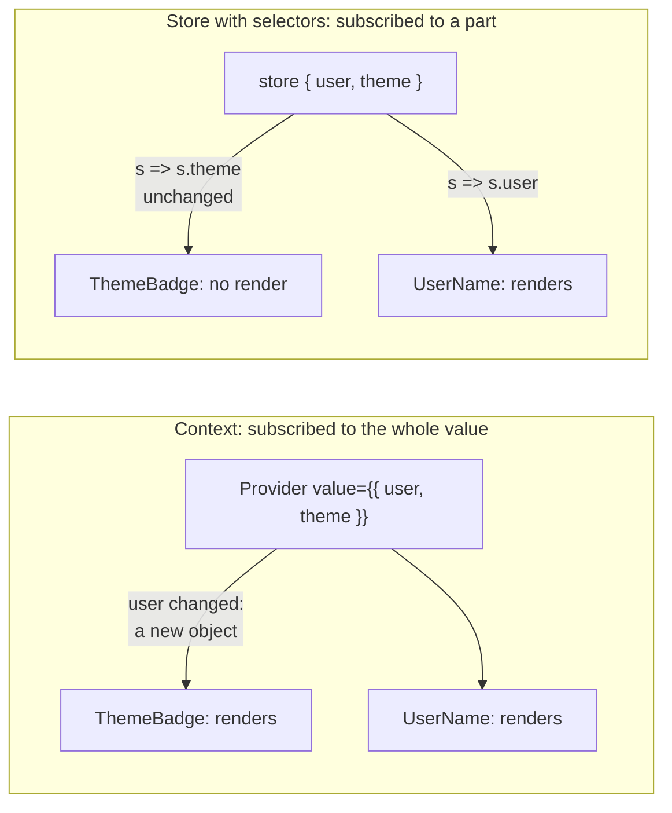
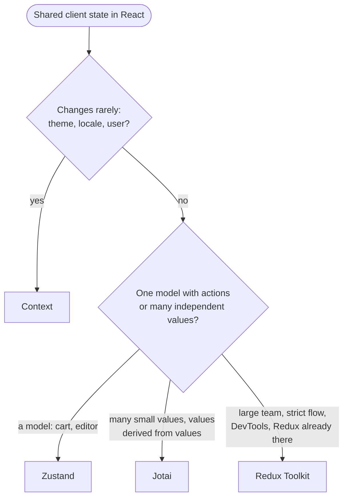

## What this lesson covers

The light alternatives to Redux most often chosen for client state in React: why a React context is not a state manager and when it re-renders too much, Zustand (a store hook with selectors), Jotai (atomic state, bottom-up), and how to choose between them. The examples run on React 19.3, Zustand 5 and Jotai 3, in jsdom and Node.js.

## Context passes values, it does not store them

A React context solves one problem: passing a value deep down without props on every level. The state itself is still held by `useState` or `useReducer` in the provider. The trouble starts when a big state object is put into a context: **any** change of the value re-renders **every** consumer, even those that need an unchanged part, and `memo` does not protect against it.

```jsx dom
import { createContext, memo, useContext, useState } from 'react'
import { createRoot } from 'react-dom/client'
import { flushSync } from 'react-dom'
import { create } from 'zustand'

const renders = {}
const count = (name) => (renders[name] = (renders[name] ?? 0) + 1)

// 1. One context with the whole app state
const AppContext = createContext(null)
const ThemeBadge = memo(function ThemeBadge() {
  count('context: ThemeBadge')
  return <i>{useContext(AppContext).theme}</i>
})
const UserName = memo(function UserName() {
  count('context: UserName')
  return <b>{useContext(AppContext).user}</b>
})
let setUserInContext
function ContextApp() {
  const [user, setUser] = useState('Ann')
  setUserInContext = setUser
  return (
    <AppContext value={{ user, theme: 'dark' }}>
      <ThemeBadge />
      <UserName />
    </AppContext>
  )
}

// 2. The same state in a Zustand store with selectors
const useApp = create(() => ({ user: 'Ann', theme: 'dark' }))
function StoreThemeBadge() {
  count('zustand: ThemeBadge')
  return <i>{useApp((s) => s.theme)}</i>
}
function StoreUserName() {
  count('zustand: UserName')
  return <b>{useApp((s) => s.user)}</b>
}

const root = createRoot(document.createElement('div'))
flushSync(() =>
  root.render(
    <>
      <ContextApp />
      <StoreThemeBadge />
      <StoreUserName />
    </>,
  ),
)
for (const key of Object.keys(renders)) renders[key] = 0

flushSync(() => setUserInContext('Bob'))
flushSync(() => useApp.setState({ user: 'Bob' }))
console.log(renders)
```

```output
{
  'context: ThemeBadge': 1,
  'context: UserName': 1,
  'zustand: ThemeBadge': 0,
  'zustand: UserName': 1
}
```



- `ThemeBadge` in the context re-rendered although the theme did not change: the provider value is a new object, and React notifies everyone who reads this context.
- Fixes within context: split it into several contexts (theme separately, user separately), memoize the value (`useMemo`), move frequently changing data out of the context. The `use-context-selector` library adds selectors, but React itself has no such API.
- Context is good for rarely changing values: theme, locale, the current user, dependency injection (an API client, a store). For frequently changing shared state use a store with selector subscriptions: there only `UserName` re-rendered.

## Zustand

Zustand keeps state outside React and exposes it through a hook; a component subscribes with a selector and re-renders only when the selector result changes (by `Object.is`). No provider, no actions and reducers: actions are functions in the store itself.

```js run
import { createStore } from 'zustand/vanilla'

const cart = createStore((set, get) => ({
  items: [],
  coupon: null,
  add: (name, price) => set((state) => ({ items: [...state.items, { name, price }] })), // merged into the state
  applyCoupon: (code) => set({ coupon: code }),
  total: () => get().items.reduce((sum, i) => sum + i.price, 0) * (get().coupon === 'HALF' ? 0.5 : 1),
}))

const stop = cart.subscribe((state, previous) => {
  if (state.items !== previous.items) console.log('items changed:', state.items.length)
})
cart.getState().add('tea', 4)
cart.getState().add('cake', 6)
cart.getState().applyCoupon('HALF') // items are the same array: the listener stays quiet
console.log('total:', cart.getState().total(), '| keys:', Object.keys(cart.getState()).join(', '))
cart.setState({ items: [] }, false) // shallow merge: actions and coupon are kept
console.log('after reset:', cart.getState().coupon, typeof cart.getState().add)
stop()
```

```output
items changed: 1
items changed: 2
total: 5 | keys: items, coupon, add, applyCoupon, total
items changed: 0
after reset: HALF function
```

- `set` **shallow-merges** the given object into the state (like `setState` in class components): `setState({ items: [] })` erased neither the coupon nor the actions. A second argument `true` replaces the state entirely. Nested objects are updated immutably, as in Redux (or with the `immer` middleware).
- A listener gets the new and the previous state, so it reacts only to the field it cares about (`state.items !== previous.items`).
- In a component: `const items = useCart((s) => s.items)`. A selector that returns a **new** object (`s => ({ a: s.a, b: s.b })`) gives a new reference on every store change; for several fields use `useShallow` from `zustand/react/shallow`. It is the same trap as with `useSelector` in Redux.
- Middleware: `persist` (saving to `localStorage` with versions and migrations), `devtools` (Redux DevTools), `immer`, `subscribeWithSelector`.
- A store from `zustand/vanilla` works without React too: in tests, in handlers outside components. With SSR a global store is shared by all requests, so in Next.js the store is created per request and passed through a context.

## Jotai

Jotai builds state **bottom-up** from atoms: small independent values. A derived atom is computed from others and recomputes only when the atoms it read change. A component subscribes to a specific atom through `useAtom`.

```js run
import { atom, createStore } from 'jotai/vanilla'

const priceAtom = atom(10)
const qtyAtom = atom(2)
const taxRateAtom = atom(0.2)
let recomputed = 0
const totalAtom = atom((get) => {
  recomputed++
  return get(priceAtom) * get(qtyAtom) * (1 + get(taxRateAtom))
})
// a write-only atom: one action that updates several atoms
const resetAtom = atom(null, (get, set) => {
  set(priceAtom, 0)
  set(qtyAtom, 0)
})
const themeAtom = atom('dark') // unrelated to the total

const store = createStore() // in React: <Provider store={store}> or the default store
const unsubscribe = store.sub(totalAtom, () => console.log('total →', store.get(totalAtom)))
console.log('total:', store.get(totalAtom))
store.set(qtyAtom, 3)
store.set(themeAtom, 'light') // does not touch totalAtom
console.log('recomputed:', recomputed)
store.set(resetAtom)
unsubscribe()
```

```output
total: 24
total → 36
recomputed: 2
total → 0
```

- `totalAtom` read the price, quantity and tax: changing the theme did not recompute it. Dependencies are tracked automatically, as in Vue `computed` or Angular signals.
- A write-only atom (`resetAtom`) is an action that changes several atoms; the subscriber got one notification with the final value.
- An async atom (`atom(async (get) => fetch(...))`) works with `Suspense`; `atomFamily` and `atomWithStorage` from `jotai/utils` cover atoms per parameter and persistence.
- By default atoms live in a shared store; `<Provider>` creates a separate scope (for example, per request with SSR or for isolated widgets).
- Recoil, where this approach came from, was archived in 2025; atomic state in React is now done with Jotai.

## How to choose



| | Context | Zustand | Jotai | Redux Toolkit |
|---|---|---|---|---|
| Model | A value, top-down | One store, top-down | Atoms, bottom-up | One store, actions and reducers |
| Subscription | The whole value | A selector | An atom | A selector |
| Boilerplate | Minimal | Minimal | Minimal | Moderate (slices) |
| Where state lives | In the provider | Outside React (a module) | In the Jotai store | Outside React (the store) |
| DevTools | React DevTools | Redux DevTools through middleware | Its own DevTools | Redux DevTools |

Server data goes into none of these: it belongs in a query library. Then `useState`, a context and a small Zustand store are often enough for client state.

## Key points

- A context passes a value, it does not manage state; any value change re-renders every consumer, `memo` does not help.
- Zustand: a store outside React, selector subscriptions, `set` shallow-merges, `useShallow` for several fields, middleware `persist`, `devtools`, `immer`.
- Jotai: atoms and derived atoms with automatic dependencies, action atoms, async atoms with `Suspense`.
- Context for rarely changing values, Zustand for a model with actions, Jotai for many small related values, RTK for a large team and a strict flow.
- A selector that creates a new object breaks fine-grained subscriptions in both Zustand and Redux.
