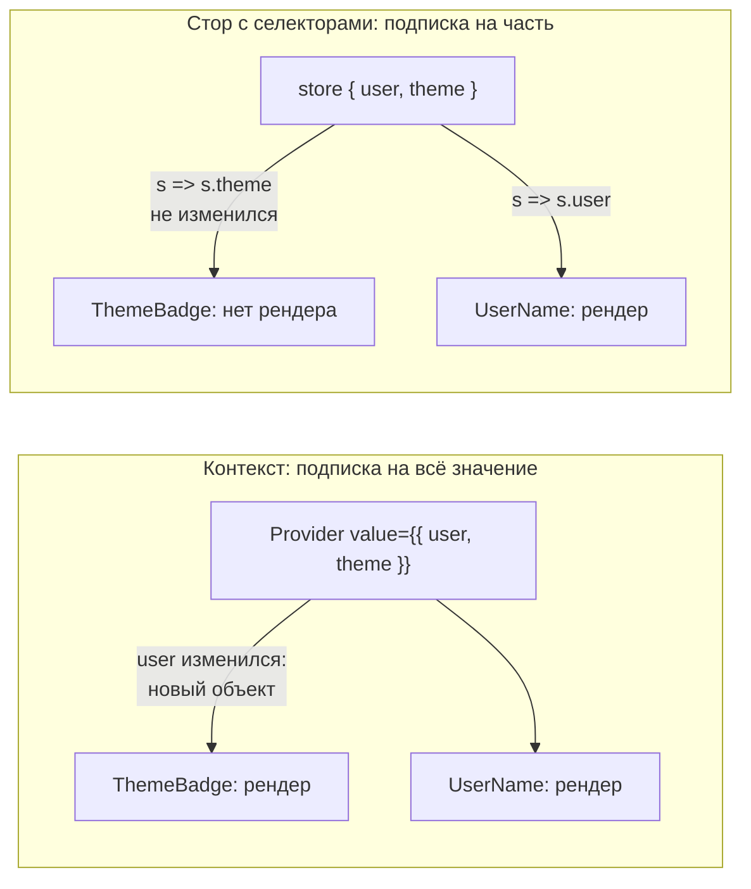
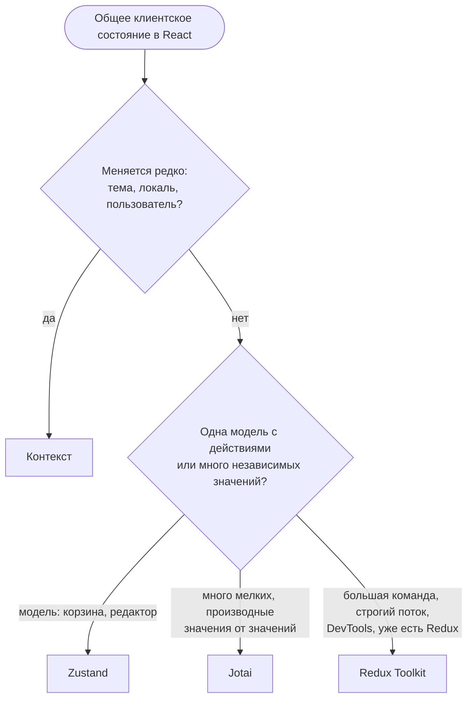

## О чём урок

Лёгкие альтернативы Redux, которые чаще всего выбирают для клиентского состояния в React: почему контекст React не менеджер состояний и когда он перерисовывает лишнее, Zustand (стор-хук с селекторами), Jotai (атомарное состояние снизу вверх) и как выбрать между ними. Примеры выполняются на React 19.3, Zustand 5 и Jotai 3, в jsdom и в Node.js.

## Контекст это передача, а не хранение

Контекст React решает одну задачу: передать значение глубоко вниз без пропсов на каждом уровне. Хранит состояние по-прежнему `useState` или `useReducer` в провайдере. Проблема появляется, когда в контекст кладут большой объект состояния: **любое** изменение значения перерисовывает **всех** потребителей, даже тех, кому нужна неизменившаяся часть, и `memo` от этого не защищает.

```jsx dom
import { createContext, memo, useContext, useState } from 'react'
import { createRoot } from 'react-dom/client'
import { flushSync } from 'react-dom'
import { create } from 'zustand'

const renders = {}
const count = (name) => (renders[name] = (renders[name] ?? 0) + 1)

// 1. One context with the whole app state
const AppContext = createContext(null)
const ThemeBadge = memo(function ThemeBadge() {
  count('context: ThemeBadge')
  return <i>{useContext(AppContext).theme}</i>
})
const UserName = memo(function UserName() {
  count('context: UserName')
  return <b>{useContext(AppContext).user}</b>
})
let setUserInContext
function ContextApp() {
  const [user, setUser] = useState('Ann')
  setUserInContext = setUser
  return (
    <AppContext value={{ user, theme: 'dark' }}>
      <ThemeBadge />
      <UserName />
    </AppContext>
  )
}

// 2. The same state in a Zustand store with selectors
const useApp = create(() => ({ user: 'Ann', theme: 'dark' }))
function StoreThemeBadge() {
  count('zustand: ThemeBadge')
  return <i>{useApp((s) => s.theme)}</i>
}
function StoreUserName() {
  count('zustand: UserName')
  return <b>{useApp((s) => s.user)}</b>
}

const root = createRoot(document.createElement('div'))
flushSync(() =>
  root.render(
    <>
      <ContextApp />
      <StoreThemeBadge />
      <StoreUserName />
    </>,
  ),
)
for (const key of Object.keys(renders)) renders[key] = 0

flushSync(() => setUserInContext('Bob'))
flushSync(() => useApp.setState({ user: 'Bob' }))
console.log(renders)
```

```output
{
  'context: ThemeBadge': 1,
  'context: UserName': 1,
  'zustand: ThemeBadge': 0,
  'zustand: UserName': 1
}
```



- `ThemeBadge` в контексте перерисовался, хотя тема не менялась: значение провайдера это новый объект, и React уведомляет всех, кто читает этот контекст.
- Исправления в рамках контекста: разделить на несколько контекстов (тема отдельно, пользователь отдельно), мемоизировать значение (`useMemo`), вынести часто меняющееся из контекста. Библиотека `use-context-selector` добавляет селекторы, но в самом React такого API нет.
- Контекст хорош для редко меняющихся значений: тема, локаль, текущий пользователь, внедрение зависимостей (клиент API, стор). Для часто меняющегося общего состояния берут стор с подпиской через селекторы: в нём перерисовался только `UserName`.

## Zustand

Zustand хранит состояние вне React и отдаёт его хуком; компонент подписывается селектором и перерисовывается, только когда результат селектора изменился (по `Object.is`). Нет провайдера, нет actions и reducers: действия это функции в самом сторе.

```js run
import { createStore } from 'zustand/vanilla'

const cart = createStore((set, get) => ({
  items: [],
  coupon: null,
  add: (name, price) => set((state) => ({ items: [...state.items, { name, price }] })), // merged into the state
  applyCoupon: (code) => set({ coupon: code }),
  total: () => get().items.reduce((sum, i) => sum + i.price, 0) * (get().coupon === 'HALF' ? 0.5 : 1),
}))

const stop = cart.subscribe((state, previous) => {
  if (state.items !== previous.items) console.log('items changed:', state.items.length)
})
cart.getState().add('tea', 4)
cart.getState().add('cake', 6)
cart.getState().applyCoupon('HALF') // items are the same array: the listener stays quiet
console.log('total:', cart.getState().total(), '| keys:', Object.keys(cart.getState()).join(', '))
cart.setState({ items: [] }, false) // shallow merge: actions and coupon are kept
console.log('after reset:', cart.getState().coupon, typeof cart.getState().add)
stop()
```

```output
items changed: 1
items changed: 2
total: 5 | keys: items, coupon, add, applyCoupon, total
items changed: 0
after reset: HALF function
```

- `set` **поверхностно сливает** переданный объект с состоянием (как `setState` в классовых компонентах): `setState({ items: [] })` не стёр ни купон, ни действия. Второй аргумент `true` заменяет состояние целиком. Вложенные объекты обновляют неизменяемо, как в Redux (или через middleware `immer`).
- Подписчик получает новое и прошлое состояние, поэтому реагирует только на нужное поле (`state.items !== previous.items`).
- В компоненте: `const items = useCart((s) => s.items)`. Селектор, возвращающий **новый** объект (`s => ({ a: s.a, b: s.b })`), даёт новую ссылку на каждое изменение стора; для нескольких полей используют `useShallow` из `zustand/react/shallow`. Это та же ловушка, что и с `useSelector` в Redux.
- Middleware: `persist` (сохранение в `localStorage` с версиями и миграциями), `devtools` (Redux DevTools), `immer`, `subscribeWithSelector`.
- Стор из `zustand/vanilla` работает и без React: в тестах, в обработчиках вне компонентов. При SSR глобальный стор общий для всех запросов, поэтому в Next.js стор создают на запрос и передают через контекст.

## Jotai

Jotai строит состояние **снизу вверх** из атомов: маленьких независимых значений. Производный атом вычисляется из других и пересчитывается, только когда изменились атомы, которые он прочитал. Компонент через `useAtom` подписывается на конкретный атом.

```js run
import { atom, createStore } from 'jotai/vanilla'

const priceAtom = atom(10)
const qtyAtom = atom(2)
const taxRateAtom = atom(0.2)
let recomputed = 0
const totalAtom = atom((get) => {
  recomputed++
  return get(priceAtom) * get(qtyAtom) * (1 + get(taxRateAtom))
})
// a write-only atom: one action that updates several atoms
const resetAtom = atom(null, (get, set) => {
  set(priceAtom, 0)
  set(qtyAtom, 0)
})
const themeAtom = atom('dark') // unrelated to the total

const store = createStore() // in React: <Provider store={store}> or the default store
const unsubscribe = store.sub(totalAtom, () => console.log('total →', store.get(totalAtom)))
console.log('total:', store.get(totalAtom))
store.set(qtyAtom, 3)
store.set(themeAtom, 'light') // does not touch totalAtom
console.log('recomputed:', recomputed)
store.set(resetAtom)
unsubscribe()
```

```output
total: 24
total → 36
recomputed: 2
total → 0
```

- `totalAtom` прочитал цену, количество и налог: смена темы его не пересчитала. Зависимости отслеживаются автоматически, как в `computed` Vue или сигналах Angular.
- Атом только для записи (`resetAtom`) это действие, меняющее несколько атомов; подписчик получил одно уведомление с итоговым значением.
- Асинхронный атом (`atom(async (get) => fetch(...))`) работает с `Suspense`; `atomFamily` и `atomWithStorage` из `jotai/utils` для атомов по параметру и сохранения.
- По умолчанию атомы живут в общем сторе; `<Provider>` создаёт отдельную область (например, для каждого запроса при SSR или для изолированных виджетов).
- Recoil, от которого произошёл этот подход, заархивирован в 2025 году; для атомарного состояния в React сейчас берут Jotai.

## Как выбрать



| | Контекст | Zustand | Jotai | Redux Toolkit |
|---|---|---|---|---|
| Модель | Значение сверху вниз | Один стор, сверху вниз | Атомы, снизу вверх | Один стор, actions и reducers |
| Подписка | На всё значение | Селектор | Атом | Селектор |
| Шаблонный код | Минимум | Минимум | Минимум | Средне (slices) |
| Где живёт состояние | В провайдере | Вне React (модуль) | В сторе Jotai | Вне React (store) |
| DevTools | React DevTools | Redux DevTools через middleware | Свои DevTools | Redux DevTools |

Серверные данные в любой из этих вариантов не кладут: для них библиотека запросов. Тогда для клиентского состояния часто хватает `useState`, контекста и небольшого Zustand.

## Главное

- Контекст передаёт значение, а не управляет состоянием; любое изменение значения перерисовывает всех потребителей, `memo` не помогает.
- Zustand: стор вне React, подписка селектором, `set` сливает поверхностно, `useShallow` для нескольких полей, middleware `persist`, `devtools`, `immer`.
- Jotai: атомы и производные атомы с автоматическими зависимостями, атомы-действия, асинхронные атомы с `Suspense`.
- Контекст для редко меняющегося, Zustand для модели с действиями, Jotai для множества мелких связанных значений, RTK для большой команды и строгого потока.
- Селектор, создающий новый объект, ломает точечную подписку и в Zustand, и в Redux.
