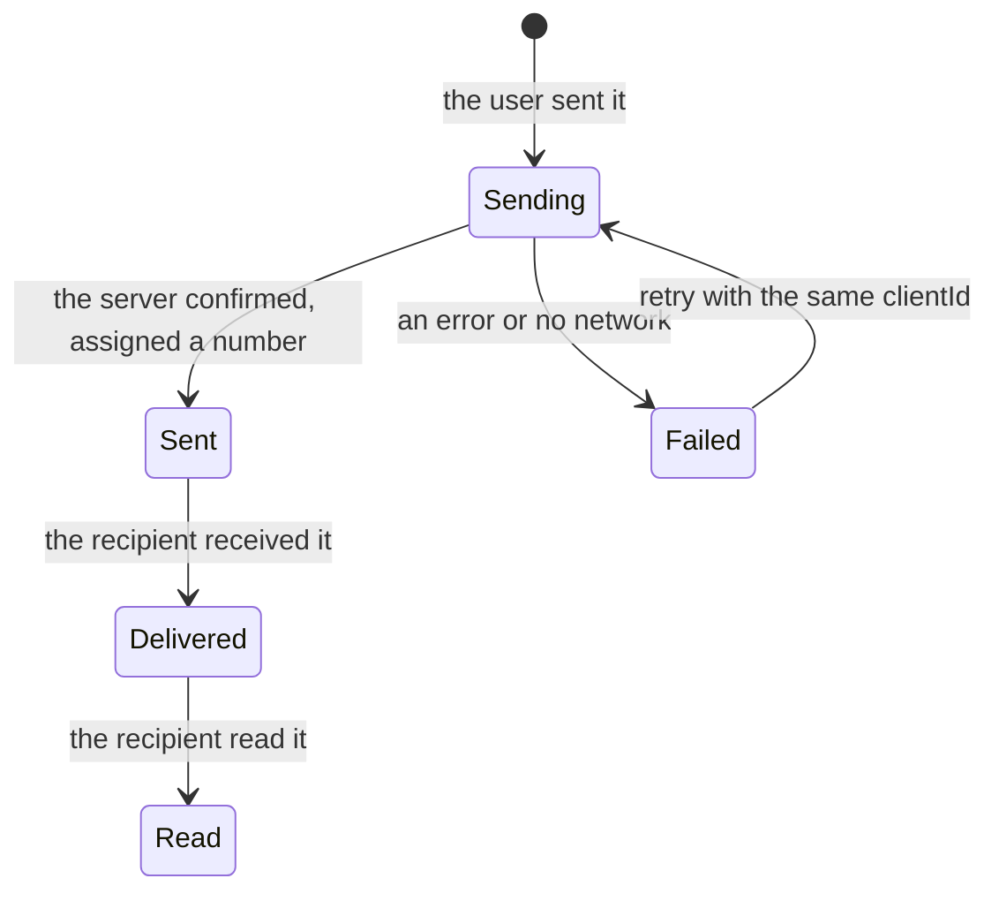

## What this lesson covers

The most common application tasks and what the discussion of each is built on: chat, an online shop and booking, a photo service and Pinterest, video streaming (including the TV interface from the notes), a collaborative editor, a drawing tool. For each: what to clarify, the key entities and API, the main deep-dive topic. The Node.js example lays out Pinterest cards into columns in two ways.

## A map of tasks

| Product | What to clarify | Key topic | More in |
|---|---|---|---|
| Chat | One-to-one and groups, history, attachments, offline | Real time, message order and status | `api-websocket` |
| Shop, booking | Catalog, search, cart, payment, regions | SSR and SEO, Core Web Vitals, the cart | `render-choosing`, `perf-metrics` |
| Photos, Pinterest | Browsing, uploading, editing | Images, layout, file upload | `perf-lcp` |
| Video | Catalog, player, devices (TV) | Adaptive streaming, the player, focus on TV | `html-media-seo` |
| Collaborative editor | How many people at once, offline | Syncing and conflicts | `state-patterns` |
| Drawing tool | Shapes, layers, collaboration | Canvas rendering, the scene model, undo | `state-patterns` |

## Chat



- **Entities**: `Conversation` (participants, the last message, the unread count), `Message` (`clientId`, `serverId`, `seq`, `authorId`, `text`, `status`, `createdAt`).
- **Channel**: a WebSocket for new messages, typing and statuses; history and the chat list over HTTP with a cursor (scrolling up).
- **Order**: a message shows right away with a "sending" status and a temporary `clientId`; the server assigns an increasing `seq` number within the chat, and the client sorts by it, not by the device clock.
- **Reconnecting**: the client remembers the last `seq` it received and asks for what it missed; resending with the same `clientId` does not create a duplicate.
- **UI**: a list scrolled to the bottom that keeps its position when older messages load at the top; "typing…" is sent at most once every few seconds; new messages reach screen readers through `aria-live="polite"`.

## Shop and booking

- **Rendering**: the catalog and product pages are indexed and must open fast from search, so SSR or static generation with revalidation; the cart and checkout are personal and can render on the client.
- **SEO**: page titles and descriptions, canonical URLs for filters, structured product data (JSON-LD `Product` with price and availability), a sitemap.
- **Speed** directly affects sales: the main product image with `fetchpriority="high"`, sizes on all images, light JavaScript on the product page.
- **Search and filters** in the URL (shareable as a link), pagination by page numbers: this is the case where an offset fits.
- **Cart**: the source of truth is the server; a guest cart is kept in a cookie or `localStorage` and merged with the server one after login; prices and availability are rechecked at checkout.
- **Payment**: card fields in the payment provider's frame so the card number never passes through your code; prices through `Intl.NumberFormat` in the region's currency.

## Photos and Pinterest

```ts run
// Pins with known image sizes: the API returns width and height, so the layout is computed before images load.
const pins = [
  { id: 'a', w: 600, h: 900 }, { id: 'b', w: 600, h: 400 }, { id: 'c', w: 600, h: 1200 },
  { id: 'd', w: 600, h: 500 }, { id: 'e', w: 600, h: 700 }, { id: 'f', w: 600, h: 450 },
  { id: 'g', w: 600, h: 800 }, { id: 'h', w: 600, h: 600 }, { id: 'i', w: 600, h: 1000 },
]
const COLUMNS = 3
const COLUMN_WIDTH = 236 // px on screen
const GAP = 16

function layout(pickColumn: (heights: number[], index: number) => number) {
  const heights = Array(COLUMNS).fill(0)
  const placed = pins.map((pin, index) => {
    const col = pickColumn(heights, index)
    const height = Math.round((pin.h / pin.w) * COLUMN_WIDTH) // keep the aspect ratio
    const top = heights[col]
    heights[col] += height + GAP
    return `${pin.id}:c${col}@${top}`
  })
  const tallest = Math.max(...heights)
  const shortest = Math.min(...heights)
  return { placed, heights, gap: tallest - shortest }
}

const roundRobin = layout((_, i) => i % COLUMNS)
const shortestFirst = layout((h) => h.indexOf(Math.min(...h)))
console.log('round-robin   columns', roundRobin.heights.join(' / '), 'px, ragged by', roundRobin.gap, 'px')
console.log('shortest-first columns', shortestFirst.heights.join(' / '), 'px, ragged by', shortestFirst.gap, 'px')
console.log('positions:', shortestFirst.placed.join(' '))
```

```output
round-robin   columns 914 / 716 / 1090 px, ragged by 374 px
shortest-first columns 1070 / 831 / 819 px, ragged by 251 px
positions: a:c0@0 b:c1@0 c:c2@0 d:c1@173 e:c0@370 f:c1@386 g:c2@488 h:c1@579 i:c0@661
```

- The API returns the width and height of each image, so the layout is computed **before the images load**: the columns do not jump.
- Placing cards round-robin gives a ragged bottom (a 374 px difference); putting each into the shortest column is more even (251 px). Masonry layouts work this way; with infinite scrolling new cards continue the same scheme, and a long feed is virtualized.
- **Images**: AVIF or WebP, `srcset` and `sizes` for the column width, lazy loading below the screen, a placeholder color or a blurred tiny version while the original loads.
- **Upload**: resize and compress on the client (`canvas`, `createImageBitmap`), progress, chunked upload that can resume after a drop, direct upload to storage through a signed URL.

## Video

- **Streaming**: the video is cut into short segments in several qualities (HLS, DASH); the player picks the quality by network speed and buffer through Media Source Extensions (adaptive bitrate). Libraries: hls.js, dash.js, Shaka Player; Safari plays HLS by itself.
- **Player**: controls usable from the keyboard, WebVTT captions through `<track>`, audio description as a separate track, remembering the watch position.
- **Catalog** from the Netflix notes: rows of cards as separate requests with a cursor, prefetching neighboring rows, posters in several sizes.
- **TV**: control by remote, that is by arrows: spatial navigation between cards, a very visible focus (an enlarged card), large text for viewing from three meters, weak TV hardware.

## Collaborative editor

- **Document model**: a tree of blocks or a sequence of characters with formatting attributes.
- **Conflicts**: two people edit the same place. **OT** (operational transformation, Google Docs) transforms operations against each other through a central server. **CRDTs** (Yjs, Automerge) are built so that copies converge to one state in any order of application, and suit offline work and exchange without a central server.
- **Presence**: other participants' cursors and selections over a separate lightweight channel, not saved into the document.
- **Offline**: edits accumulate locally and merge on reconnect; version history for rolling back.

## Drawing tool

- **Rendering**: thousands of shapes in the DOM are slow, so `<canvas>` (2D or WebGL) with your own hit testing of the cursor against shapes.
- **Scene model**: shapes with `id`s, layers, transforms; the selection and the tool as UI state.
- **Undo**: a command stack with inverse operations (the `state-patterns` lesson); in collaboration only your own actions are undone.
- **Accessibility** is not provided by canvas: you need a parallel tree of accessible elements or a list of objects.

## Key points

- Each product sets its key topic: real time for chat, SEO and speed for a shop, images for photos, streaming for video, conflicts for an editor, canvas for drawing.
- Chat: WebSocket, a `clientId` and a server `seq`, message statuses, catching up after a reconnect.
- Shop: SSR for the catalog, structured data, filters in the URL, a server cart with a guest version, payment in the provider's frame.
- Photos: sizes from the API, layout before loading, the shortest column, modern formats, chunked upload.
- Video: HLS or DASH through MSE, `<track>` captions, arrow navigation and a visible focus on TV.
- Editors: OT or CRDT for conflicts, a separate presence channel, canvas and a command stack for drawing.
