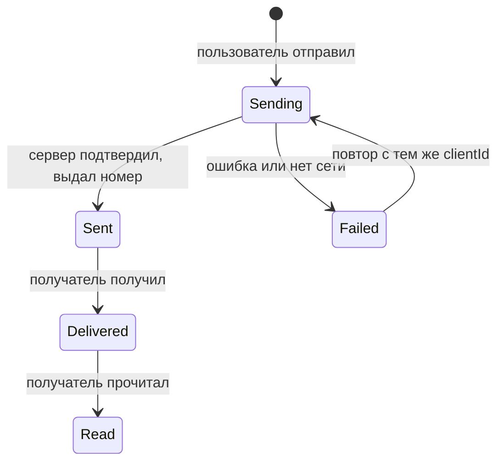

## О чём урок

Самые частые задачи-приложения и то, на чём строится разговор о каждой: чат, интернет-магазин и бронирование, фотосервис и Pinterest, видеостриминг (включая ТВ-интерфейс из заметок), совместный редактор, графический редактор. Для каждой: что уточнить, ключевые сущности и API, главная тема глубокого разбора. Пример в Node.js раскладывает карточки Pinterest по колонкам двумя способами.

## Карта задач

| Продукт | Что уточнить | Главная тема | Где подробнее |
|---|---|---|---|
| Чат | Личные и групповые, история, вложения, офлайн | Реальное время, порядок и статусы сообщений | `api-websocket` |
| Магазин, бронирование | Каталог, поиск, корзина, оплата, регионы | SSR и SEO, Core Web Vitals, корзина | `render-choosing`, `perf-metrics` |
| Фото, Pinterest | Просмотр, загрузка, редактирование | Изображения, раскладка, загрузка файлов | `perf-lcp` |
| Видео | Каталог, плеер, устройства (ТВ) | Адаптивный стриминг, плеер, фокус на ТВ | `html-media-seo` |
| Совместный редактор | Сколько людей одновременно, офлайн | Синхронизация и конфликты | `state-patterns` |
| Графический редактор | Фигуры, слои, совместная работа | Отрисовка на canvas, модель сцены, undo | `state-patterns` |

## Чат



- **Сущности**: `Conversation` (участники, последнее сообщение, число непрочитанных), `Message` (`clientId`, `serverId`, `seq`, `authorId`, `text`, `status`, `createdAt`).
- **Канал**: WebSocket для новых сообщений, набора текста и статусов; история и список чатов через HTTP с курсором (прокрутка вверх).
- **Порядок**: сообщение показывается сразу со статусом «отправляется» и временным `clientId`; сервер присваивает возрастающий номер `seq` в чате, и клиент сортирует по нему, а не по часам устройства.
- **Переподключение**: клиент помнит последний полученный `seq` и запрашивает пропущенное; повтор отправки с тем же `clientId` не создаёт дубль.
- **Интерфейс**: список, прокрученный к низу, с сохранением позиции при подгрузке старых сообщений сверху; «печатает…» отправляют не чаще раза в несколько секунд; новые сообщения для скринридера через `aria-live="polite"`.

## Магазин и бронирование

- **Рендеринг**: каталог и карточки товаров индексируются и должны быстро открываться с поиска, поэтому SSR или статическая генерация с обновлением; корзина и оформление персональны и могут рендериться на клиенте.
- **SEO**: заголовки и описания страниц, канонические URL для фильтров, структурированные данные о товаре (JSON-LD `Product` с ценой и наличием), карта сайта.
- **Скорость** влияет на продажи напрямую: главная картинка товара с `fetchpriority="high"`, размеры у всех изображений, лёгкий JavaScript на странице товара.
- **Поиск и фильтры** в URL (ссылкой можно поделиться), пагинация по номерам страниц, это тот случай, где подходит смещение.
- **Корзина**: источник истины на сервере; корзину гостя хранят в cookie или `localStorage` и сливают с серверной после входа; цены и наличие перепроверяют при оформлении.
- **Оплата**: поля карты во фрейме платёжного провайдера, чтобы номер карты не проходил через ваш код; цены через `Intl.NumberFormat` с валютой региона.

## Фото и Pinterest

```ts run
// Pins with known image sizes: the API returns width and height, so the layout is computed before images load.
const pins = [
  { id: 'a', w: 600, h: 900 }, { id: 'b', w: 600, h: 400 }, { id: 'c', w: 600, h: 1200 },
  { id: 'd', w: 600, h: 500 }, { id: 'e', w: 600, h: 700 }, { id: 'f', w: 600, h: 450 },
  { id: 'g', w: 600, h: 800 }, { id: 'h', w: 600, h: 600 }, { id: 'i', w: 600, h: 1000 },
]
const COLUMNS = 3
const COLUMN_WIDTH = 236 // px on screen
const GAP = 16

function layout(pickColumn: (heights: number[], index: number) => number) {
  const heights = Array(COLUMNS).fill(0)
  const placed = pins.map((pin, index) => {
    const col = pickColumn(heights, index)
    const height = Math.round((pin.h / pin.w) * COLUMN_WIDTH) // keep the aspect ratio
    const top = heights[col]
    heights[col] += height + GAP
    return `${pin.id}:c${col}@${top}`
  })
  const tallest = Math.max(...heights)
  const shortest = Math.min(...heights)
  return { placed, heights, gap: tallest - shortest }
}

const roundRobin = layout((_, i) => i % COLUMNS)
const shortestFirst = layout((h) => h.indexOf(Math.min(...h)))
console.log('round-robin   columns', roundRobin.heights.join(' / '), 'px, ragged by', roundRobin.gap, 'px')
console.log('shortest-first columns', shortestFirst.heights.join(' / '), 'px, ragged by', shortestFirst.gap, 'px')
console.log('positions:', shortestFirst.placed.join(' '))
```

```output
round-robin   columns 914 / 716 / 1090 px, ragged by 374 px
shortest-first columns 1070 / 831 / 819 px, ragged by 251 px
positions: a:c0@0 b:c1@0 c:c2@0 d:c1@173 e:c0@370 f:c1@386 g:c2@488 h:c1@579 i:c0@661
```

- API отдаёт ширину и высоту каждого изображения, поэтому раскладку считают **до загрузки картинок**: колонки не прыгают.
- Карточки по кругу дают рваный низ (разница 374 px); класть каждую в самую короткую колонку ровнее (251 px). Так работают раскладки masonry; при бесконечной прокрутке новые карточки продолжают ту же схему, а длинную ленту виртуализируют.
- **Изображения**: AVIF или WebP, `srcset` и `sizes` под ширину колонки, ленивая загрузка ниже экрана, заглушка цветом или размытой мини-версией, пока грузится оригинал.
- **Загрузка**: уменьшить и сжать на клиенте (`canvas`, `createImageBitmap`), прогресс, загрузка частями с возможностью продолжить после обрыва, прямая загрузка в хранилище по подписанному URL.

## Видео

- **Стриминг**: видео нарезано на короткие сегменты в нескольких качествах (HLS, DASH); плеер через Media Source Extensions выбирает качество по скорости сети и буферу (адаптивный битрейт). Библиотеки: hls.js, dash.js, Shaka Player; Safari воспроизводит HLS сам.
- **Плеер**: доступные элементы управления с клавиатуры, субтитры WebVTT через `<track>`, описание видео (аудиодескрипция) отдельной дорожкой, запоминание позиции просмотра.
- **Каталог** из заметок про Netflix: ряды карточек как отдельные запросы с курсором, предзагрузка соседних рядов, постеры в нескольких размерах.
- **ТВ**: управление пультом, то есть стрелками: пространственная навигация между карточками, хорошо заметный фокус (увеличение карточки), крупный текст для просмотра с трёх метров, слабое железо телевизора.

## Совместный редактор

- **Модель документа**: дерево блоков или последовательность символов с атрибутами форматирования.
- **Конфликты**: два человека правят одно место. **OT** (operational transformation, Google Docs) преобразует операции относительно друг друга через центральный сервер. **CRDT** (Yjs, Automerge) устроены так, что копии сходятся в одно состояние в любом порядке применения, и подходят для офлайна и обмена без центрального сервера.
- **Присутствие**: курсоры и выделения других участников отдельным лёгким каналом, без сохранения в документ.
- **Офлайн**: правки копятся локально и сливаются при подключении; история версий для отката.

## Графический редактор

- **Отрисовка**: тысячи фигур в DOM медленные, поэтому `<canvas>` (2D или WebGL) с собственной проверкой попадания курсора по фигурам.
- **Модель сцены**: фигуры с `id`, слоями, трансформациями; выделение и инструмент как состояние интерфейса.
- **Отмена**: стек команд с обратными операциями (урок `state-patterns`); при совместной работе отменяются только свои действия.
- **Доступность** canvas сама не даёт: нужно параллельное дерево доступных элементов или список объектов.

## Главное

- Каждый продукт задаёт главную тему: реальное время для чата, SEO и скорость для магазина, изображения для фото, стриминг для видео, конфликты для редактора, canvas для рисования.
- Чат: WebSocket, `clientId` и серверный `seq`, статусы сообщения, догрузка пропущенного после переподключения.
- Магазин: SSR каталога, структурированные данные, фильтры в URL, корзина на сервере с гостевой версией, оплата во фрейме провайдера.
- Фото: размеры из API, раскладка до загрузки, самая короткая колонка, современные форматы, загрузка частями.
- Видео: HLS или DASH через MSE, субтитры `<track>`, на ТВ навигация стрелками и заметный фокус.
- Редакторы: OT или CRDT для конфликтов, отдельный канал присутствия, canvas и стек команд для рисования.
