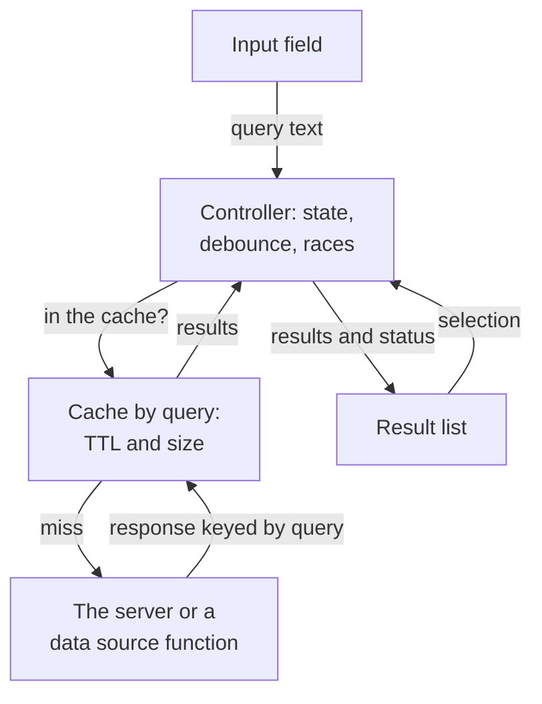

## What this lesson covers

A walkthrough of a UI component task: "design an autocomplete that different sites can use". The requirements, the component's parts, its API (data, event, behavior and rendering props), request races, how the cache is built and how long it lives, states, keyboard, ARIA roles for a combobox and IME input. The walkthrough follows GreatFrontEnd's playbook; the server side (the response format, debounce on MSW) is covered in the `api-design` lesson. The Node.js example shows a response race and a size-limited cache.

## R: requirements

- The component is **generic**: different products plug it in, so the field and the result list are customizable.
- Results can be text, an image with text, a complex card: not every kind can be foreseen, so a custom render function is needed.
- All devices: desktop, tablet, phone.
- Fuzzy search (typos) is not in the first version.
- The server already exists and returns results for a query string.

## A: architecture



- The **input field** passes text to the controller.
- The **result list** shows what the controller gave it and reports the selection.
- The **cache** keeps responses to past queries so the network is not hit again.
- The **controller** ties everything together: like the Controller in MVC, input, cache and server access and selection all pass through it.

## D: data

| Where | What |
|---|---|
| Controller | `query`, `status` (`idle`, `loading`, `ready`, `error`), `activeIndex`, `isOpen` |
| Cache | The normalized query (`trim`, lower case) → `{ at, items }` |
| Result | `id` (stable), `text`, `type`, optional `subtitle` and `imageUrl` |
| Props | Settings from the product: see below |

## I: component API

| Category | Props | Why |
|---|---|---|
| Data source | `fetchResults(query, { signal, limit })` | The component knows nothing about URLs, auth and the response format: the product handles that |
| Count | `maxResults` | How many to show |
| Events | `onSelect`, `onInput`, `onFocus`, `onBlur` | The product's reaction, analytics |
| Behavior | `minQueryLength`, `debounceMs`, `initialResults` | Do not search by one letter, do not send a request per key, show recent items on focus |
| Cache | `cache: 'network-only' \| 'network-and-cache' \| 'cache-only'`, `cacheTtlMs`, `cacheSize` | The strategy depends on the product |
| Rendering | `theme`, `classNames`, `renderItem(item, state)` | From simple to flexible |

Three ways to customize the look, in order of growing flexibility and work for the consumer: a theme object (`{ textColor, fontSize }`), custom classes for the component's parts, a render function that receives the data and fully decides how a row looks. Usually all three are offered, the function for special cases.

The server only needs `GET /search?q=lis&limit=5` returning a list of results; for the format and match highlighting see `api-design`.

## O: races and the cache

```ts run
const cities = ['Lisbon', 'Lima', 'Lille', 'Linz', 'Leeds', 'Lyon', 'London']
const sleep = (ms: number) => new Promise((r) => setTimeout(r, ms))
let requests = 0
// The server: a shorter query is slower here, so its answer arrives after a longer one.
async function search(q: string): Promise<string[]> {
  requests++
  await sleep(q.length === 1 ? 300 : 10)
  return cities.filter((c) => c.toLowerCase().startsWith(q))
}

// A cache keyed by the normalized query, with a time limit and a size limit (least recently used out).
class QueryCache {
  private map = new Map<string, { at: number; items: string[] }>()
  constructor(private max: number, private ttlMs: number, private now: () => number) {}
  get(q: string) {
    const hit = this.map.get(q)
    if (!hit || this.now() - hit.at > this.ttlMs) return undefined
    this.map.delete(q)
    this.map.set(q, hit) // move to the end: most recently used
    return hit.items
  }
  set(q: string, items: string[]) {
    this.map.delete(q)
    this.map.set(q, { at: this.now(), items })
    if (this.map.size > this.max) this.map.delete(this.map.keys().next().value!)
  }
  keys = () => [...this.map.keys()].join(',')
}

function controller(guarded: boolean) {
  let input = ''
  let shown: string[] = []
  const cache = new QueryCache(3, 60_000, () => Date.now())
  return {
    async type(value: string) {
      input = value
      const q = value.trim().toLowerCase()
      const cached = cache.get(q)
      if (cached) return void (shown = cached)
      const items = await search(q)
      cache.set(q, items)
      // Guarded: render only if this answer is for what is in the field now.
      if (!guarded || q === input.trim().toLowerCase()) shown = items
    },
    view: () => `field "${input}" shows [${shown.join(', ')}]`,
    cacheKeys: () => cache.keys(),
  }
}

for (const guarded of [false, true]) {
  requests = 0
  const c = controller(guarded)
  const typing = [c.type('l'), sleep(5).then(() => c.type('li'))] // the user types fast
  await Promise.all(typing)
  console.log(guarded ? 'keyed by query:' : 'last response: ', c.view())
}

requests = 0
const c = controller(true)
for (const q of ['li', 'lis', 'lisb']) await c.type(q)
await c.type('lis') // backspace: answered from the cache
await c.type('le')  // a 4th query: the least recently used entry ('li') is evicted
console.log('requests:', requests, '| cache:', c.cacheKeys(), '|', c.view())
```

```output
last response:  field "li" shows [Lisbon, Lima, Lille, Linz, Leeds, Lyon, London]
keyed by query: field "li" shows [Lisbon, Lima, Lille, Linz]
requests: 4 | cache: lisb,lis,le | field "le" shows [Leeds]
```

- The user quickly typed `l` and `li`. The response to the short query arrived last, and the naive controller showed it under a field containing `li`: Leeds and London are in the list. The order of responses is **not** the order of requests.
- The right way is to store a response **by its query key** and show only the results for what is in the field now. The answer to `l` still went into the cache and will help if the user deletes a letter.
- Two requests with the same key are told apart by a generation counter: only the response to the newest one is written. `AbortController` saves network and work, but correctness does not depend on it: cancellation can be late.
- Going back to `lis` was answered by the cache without a request. The new query `le` evicted `li`, unused for the longest time (LRU): the cache is limited to three entries. 4 requests for 5 inputs in total.

**How the cache is built**
- A dictionary "query → results" is simple and fast, but results are duplicated between `li`, `lis`, `lisb`. You can keep a dictionary "query → ids" plus a shared dictionary of results by `id`.
- Keeping one flat list and filtering on the client is bad: with large data and weak devices it blocks the main thread, and the server's ranking order is lost.
- Lifetime depends on the product: general search can be cached for long, personal search (friends, recent items) briefly, quotes and prices are better not cached at all.

**Performance**
- A `debounce` of about 200–300 ms cuts requests per key; `minQueryLength` avoids searching by one letter.
- A long result list is virtualized; the component code is light, heavy result cards load on demand.

## O: UX and accessibility

- **States**: loading, empty ("nothing found"), an error with a retry; long strings are truncated with an ellipsis but fully available to screen readers.
- **Phones**: large touch rows, `autocapitalize="off"`, `autocorrect="off"`, `enterkeyhint="search"`; the list must not hide under the keyboard.
- **Keyboard**: up and down arrows move the active item, Enter selects the active one (without one it submits the form), Escape closes the list.
- **IME** (Chinese, Japanese input): while a character is being composed (`compositionstart` … `compositionend`), Enter and the arrows belong to the input method, and the request is made for the final text.
- **ARIA** by the combobox pattern from APG:
  - the field has `role="combobox"`, `aria-autocomplete="list"`, `aria-expanded`, `aria-controls` pointing at the list, and a visible label or `aria-label`;
  - the list has `role="listbox"`, the items `role="option"` with stable `id`s;
  - focus stays in the field, the active item is pointed to by `aria-activedescendant` and has `aria-selected="true"`;
  - "Loading", the result count and "Nothing found" are announced by a separate `role="status"` element, not by the list itself.
- The list closes on selection, on Escape and when focus leaves the whole component; closing right on the field's `blur` can remove an item before the click on it fires.

## Key points

- Parts: the field, the list, the controller, the cache; the product passes the data source as a function with an `AbortSignal`.
- Component API: the source, the count, events, behavior (`debounceMs`, `minQueryLength`), the cache, rendering (theme, classes, `renderItem`).
- Responses arrive out of order: results are stored by query key and shown only for the current input; cancelling a request is a saving, not a guard.
- The cache: a dictionary by normalized query, a TTL per product, a size limit with LRU eviction.
- Accessibility: `combobox`, `listbox`, `option`, `aria-activedescendant`, a separate `role="status"`, keyboard and IME.
