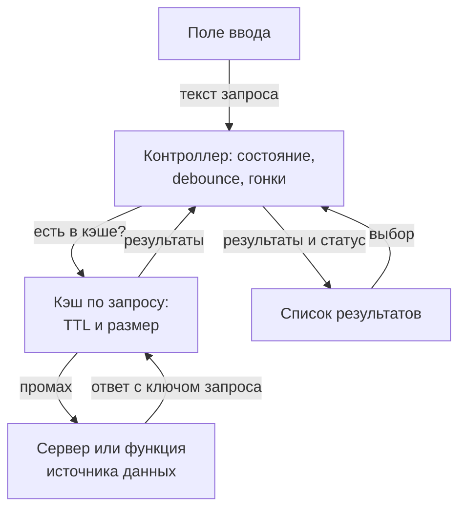

## О чём урок

Разбор задачи на UI-компонент: «спроектируйте автодополнение, которым смогут пользоваться разные сайты». Требования, части компонента, его API (пропсы данных, событий, поведения и отрисовки), гонки запросов, устройство кэша и время его жизни, состояния, клавиатура, роли ARIA для combobox и ввод через IME. Разбор следует плейбуку GreatFrontEnd; серверную сторону (формат ответа, debounce на MSW) разбирает урок `api-design`. Пример в Node.js показывает гонку ответов и кэш с ограничением размера.

## R: требования

- Компонент **общий**: его подключают разные продукты, поэтому поле и список результатов настраиваются.
- Результаты бывают текстом, картинкой с текстом, сложной карточкой: заранее всех видов не предусмотреть, значит нужна своя функция отрисовки.
- Все устройства: десктоп, планшет, телефон.
- Нечёткий поиск (опечатки) не в первой версии.
- Сервер уже есть и отдаёт результаты по строке запроса.

## A: архитектура



- **Поле ввода** передаёт текст контроллеру.
- **Список результатов** показывает то, что дал контроллер, и сообщает о выборе.
- **Кэш** хранит ответы прошлых запросов, чтобы не ходить в сеть повторно.
- **Контроллер** связывает всё: как Controller в MVC, через него проходят ввод, обращения к кэшу и серверу, выбор.

## D: данные

| Где | Что |
|---|---|
| Контроллер | `query`, `status` (`idle`, `loading`, `ready`, `error`), `activeIndex`, `isOpen` |
| Кэш | Запрос в нормализованном виде (`trim`, нижний регистр) → `{ at, items }` |
| Результат | `id` (стабильный), `text`, `type`, необязательные `subtitle` и `imageUrl` |
| Пропсы | Настройки от продукта: см. ниже |

## I: API компонента

| Категория | Пропсы | Зачем |
|---|---|---|
| Источник данных | `fetchResults(query, { signal, limit })` | Компонент не знает про URL, авторизацию и формат ответа: это делает продукт |
| Количество | `maxResults` | Сколько показывать |
| События | `onSelect`, `onInput`, `onFocus`, `onBlur` | Реакция продукта, аналитика |
| Поведение | `minQueryLength`, `debounceMs`, `initialResults` | Не искать по одной букве, не слать запрос на каждую клавишу, показать недавнее при фокусе |
| Кэш | `cache: 'network-only' \| 'network-and-cache' \| 'cache-only'`, `cacheTtlMs`, `cacheSize` | Стратегия зависит от продукта |
| Отрисовка | `theme`, `classNames`, `renderItem(item, state)` | От простого к гибкому |

Три способа настроить внешний вид, по возрастанию гибкости и работы для потребителя: объект темы (`{ textColor, fontSize }`), свои классы для частей компонента, функция отрисовки, которая получает данные и полностью решает, как выглядит строка. Обычно дают все три, функцию для особых случаев.

Серверу достаточно `GET /search?q=lis&limit=5` со списком результатов; формат и подсветку совпадений см. в `api-design`.

## O: гонки и кэш

```ts run
const cities = ['Lisbon', 'Lima', 'Lille', 'Linz', 'Leeds', 'Lyon', 'London']
const sleep = (ms: number) => new Promise((r) => setTimeout(r, ms))
let requests = 0
// The server: a shorter query is slower here, so its answer arrives after a longer one.
async function search(q: string): Promise<string[]> {
  requests++
  await sleep(q.length === 1 ? 300 : 10)
  return cities.filter((c) => c.toLowerCase().startsWith(q))
}

// A cache keyed by the normalized query, with a time limit and a size limit (least recently used out).
class QueryCache {
  private map = new Map<string, { at: number; items: string[] }>()
  constructor(private max: number, private ttlMs: number, private now: () => number) {}
  get(q: string) {
    const hit = this.map.get(q)
    if (!hit || this.now() - hit.at > this.ttlMs) return undefined
    this.map.delete(q)
    this.map.set(q, hit) // move to the end: most recently used
    return hit.items
  }
  set(q: string, items: string[]) {
    this.map.delete(q)
    this.map.set(q, { at: this.now(), items })
    if (this.map.size > this.max) this.map.delete(this.map.keys().next().value!)
  }
  keys = () => [...this.map.keys()].join(',')
}

function controller(guarded: boolean) {
  let input = ''
  let shown: string[] = []
  const cache = new QueryCache(3, 60_000, () => Date.now())
  return {
    async type(value: string) {
      input = value
      const q = value.trim().toLowerCase()
      const cached = cache.get(q)
      if (cached) return void (shown = cached)
      const items = await search(q)
      cache.set(q, items)
      // Guarded: render only if this answer is for what is in the field now.
      if (!guarded || q === input.trim().toLowerCase()) shown = items
    },
    view: () => `field "${input}" shows [${shown.join(', ')}]`,
    cacheKeys: () => cache.keys(),
  }
}

for (const guarded of [false, true]) {
  requests = 0
  const c = controller(guarded)
  const typing = [c.type('l'), sleep(5).then(() => c.type('li'))] // the user types fast
  await Promise.all(typing)
  console.log(guarded ? 'keyed by query:' : 'last response: ', c.view())
}

requests = 0
const c = controller(true)
for (const q of ['li', 'lis', 'lisb']) await c.type(q)
await c.type('lis') // backspace: answered from the cache
await c.type('le')  // a 4th query: the least recently used entry ('li') is evicted
console.log('requests:', requests, '| cache:', c.cacheKeys(), '|', c.view())
```

```output
last response:  field "li" shows [Lisbon, Lima, Lille, Linz, Leeds, Lyon, London]
keyed by query: field "li" shows [Lisbon, Lima, Lille, Linz]
requests: 4 | cache: lisb,lis,le | field "le" shows [Leeds]
```

- Пользователь быстро набрал `l` и `li`. Ответ на короткий запрос пришёл последним, и наивный контроллер показал его под полем с текстом `li`: в списке Leeds и London. Порядок ответов **не равен** порядку запросов.
- Правильно хранить ответ **по ключу запроса** и показывать только результаты для того, что сейчас в поле. Ответ на `l` всё равно попал в кэш и пригодится, если пользователь сотрёт букву.
- Два запроса с одним ключом различают счётчиком поколений: записывается только ответ на самый новый. `AbortController` экономит сеть и работу, но корректность от него не зависит: отмена может опоздать.
- Возврат к `lis` ответил кэш без запроса. Новый запрос `le` вытеснил дольше всех не использованный `li` (LRU): кэш ограничен тремя записями. Всего 4 запроса на 5 вводов.

**Устройство кэша**
- Словарь «запрос → результаты» прост и быстр, но результаты дублируются между `li`, `lis`, `lisb`. Можно хранить словарь «запрос → идентификаторы» плюс общий словарь результатов по `id`.
- Хранить один плоский список и фильтровать на клиенте плохо: на больших данных и слабых устройствах это блокирует главный поток, а порядок ранжирования сервера теряется.
- Время жизни зависит от продукта: общий поиск можно кэшировать долго, персональный (друзья, недавние) недолго, котировки и цены лучше не кэшировать вовсе.

**Производительность**
- `debounce` около 200–300 мс отсекает запросы на каждую клавишу; `minQueryLength` не ищет по одной букве.
- Длинный список результатов виртуализируют; код компонента лёгкий, тяжёлые карточки результатов грузят по требованию.

## O: UX и доступность

- **Состояния**: загрузка, пусто («ничего не найдено»), ошибка с повтором; длинные строки обрезаются с многоточием, но полностью доступны скринридеру.
- **Телефоны**: крупные строки для касания, `autocapitalize="off"`, `autocorrect="off"`, `enterkeyhint="search"`; список не должен прятаться под клавиатурой.
- **Клавиатура**: стрелки вверх и вниз двигают активный пункт, Enter выбирает активный (без него отправляет форму), Escape закрывает список.
- **IME** (китайский, японский ввод): пока идёт составление символа (`compositionstart` … `compositionend`), Enter и стрелки принадлежат методу ввода, а запрос делают по итоговому тексту.
- **ARIA** по паттерну combobox из APG:
  - у поля `role="combobox"`, `aria-autocomplete="list"`, `aria-expanded`, `aria-controls` на список и видимая подпись или `aria-label`;
  - у списка `role="listbox"`, у пунктов `role="option"` со стабильными `id`;
  - фокус остаётся в поле, активный пункт указывает `aria-activedescendant`, у него `aria-selected="true"`;
  - «Загрузка», число результатов и «Ничего не найдено» объявляет отдельный элемент `role="status"`, а не сам список.
- Список закрывают при выборе, Escape и уходе фокуса из всего компонента; закрытие сразу по `blur` поля может убрать пункт раньше, чем сработает клик по нему.

## Главное

- Части: поле, список, контроллер, кэш; источник данных передаёт продукт функцией с `AbortSignal`.
- API компонента: источник, количество, события, поведение (`debounceMs`, `minQueryLength`), кэш, отрисовка (тема, классы, `renderItem`).
- Ответы приходят не по порядку: результаты хранят по ключу запроса и показывают только для текущего ввода; отмена запроса это экономия, а не защита.
- Кэш: словарь по нормализованному запросу, TTL по продукту, ограничение размера с вытеснением LRU.
- Доступность: `combobox`, `listbox`, `option`, `aria-activedescendant`, отдельный `role="status"`, клавиатура и IME.
