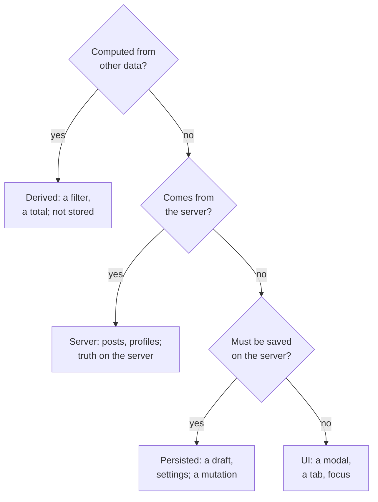

## What this lesson covers

Step D of RADIO: what data the client has and where it comes from, the four buckets of state (server, UI, derived, ephemeral), where to keep each (a store, a component, the URL, a query cache), a normalized store instead of nested objects, a feed as a list of ids with cursors, and why derived values are not stored. The example runs in Node.js: the same feed in nested and normalized form. State libraries are covered in the `state` track.

## Where data comes from



The Notion notes have four buckets, and they are handy in an interview:

| Bucket | Examples | Where it lives | Specifics |
|---|---|---|---|
| Server state | Movies, profiles, the feed, watch progress | A query cache (TanStack Query, RTK Query, Apollo) or a normalized store | The source of truth is the server: pagination, staleness, refetching |
| UI state | The active tab, whether a modal is open, the selected item | A component; in the store if shared by several parts | Changes instantly, without the server |
| Derived | A filtered and sorted list, a total, counters | Not stored: a selector or a computation during render | Storing derived data makes it go out of sync |
| Ephemeral | Drag position, animation progress, hover | Locally in a component | Does not affect the rest of the state |

**State in the URL** stands apart: filters, sorting, the page, the open item. It gives shareable links, back and forward buttons and bookmarks for free; in an interview it is almost always a plus.

## Describing entities

| Entity | Fields | Source | Owner |
|---|---|---|---|
| `Post` | `id`, `authorId`, `text`, `mediaIds`, `likes`, `viewerReaction`, `createdAt` | Server | Store |
| `User` | `id`, `name`, `avatarUrl` | Server | Store |
| `Feed` | `postIds`, `nextCursor`, `hasMore`, `fetchedAt` | Server | Store |
| `Draft` | `text`, `mediaIds`, `status` (`idle`, `uploading`, `failed`) | Client, persisted | Composer |
| UI | `isComposerOpen`, `menuPostId` | Client, not persisted | Components |

Name the field types and mark the source: this shows what goes to the server, what can be lost when the tab closes, and what will have to be recomputed. Client data does not have to mirror the database schema: in the Notion editor (the product itself, not the notes) each block of a document is stored as a separate record pointing to its parent, and the client assembles them into a tree for display.

## Normalization

```ts run
// A feed page as a nested API returns it: every post carries a full copy of its author.
type User = { id: string; name: string }
type NestedPost = { id: string; text: string; author: User; likes: number }
const page1: NestedPost[] = [
  { id: 'p3', text: 'Moved to Lisbon!', author: { id: 'u1', name: 'Ann' }, likes: 4 },
  { id: 'p2', text: 'Coffee recommendations?', author: { id: 'u2', name: 'Bob' }, likes: 1 },
  { id: 'p1', text: 'First post', author: { id: 'u1', name: 'Ann' }, likes: 9 },
]
const page2: NestedPost[] = [{ id: 'p0', text: 'Hello world', author: { id: 'u1', name: 'Ann' }, likes: 2 }]

// The normalized store: each entity once, relations by id, the feed is an ordered list of ids.
type Store = {
  usersById: Record<string, User>
  postsById: Record<string, { id: string; text: string; authorId: string; likes: number }>
  feed: { postIds: string[]; nextCursor: string | null }
}
const store: Store = { usersById: {}, postsById: {}, feed: { postIds: [], nextCursor: null } }

function mergePage(posts: NestedPost[], nextCursor: string | null) {
  for (const { author, ...post } of posts) {
    store.usersById[author.id] = author
    store.postsById[post.id] = { ...post, authorId: author.id }
    if (!store.feed.postIds.includes(post.id)) store.feed.postIds.push(post.id)
  }
  store.feed.nextCursor = nextCursor
}
mergePage(page1, 'p1')
mergePage(page2, null)

// Derived data is computed from the store, not stored next to it.
const feedView = () => store.feed.postIds.map((id) => {
  const p = store.postsById[id]
  return `${store.usersById[p.authorId].name}: ${p.text}`
})
const totalLikes = () => Object.values(store.postsById).reduce((sum, p) => sum + p.likes, 0)

const nested = [...page1, ...page2]
console.log('copies of Ann: nested', nested.filter((p) => p.author.id === 'u1').length, '| normalized', 1)

// Ann renames herself: one write in the normalized store, every place that shows her updates.
store.usersById.u1 = { ...store.usersById.u1, name: 'Anna' }
nested[0].author.name = 'Anna' // in the nested shape only the copy we remembered to change
console.log('normalized feed:', feedView().join(' | '))
console.log('nested feed:    ', nested.map((p) => `${p.author.name}: ${p.text}`).join(' | '))

// A like updates one record; the total is derived, so it cannot go out of sync.
store.postsById.p2.likes += 1
console.log('total likes:', totalLikes(), '| next cursor:', store.feed.nextCursor)
```

```output
copies of Ann: nested 3 | normalized 1
normalized feed: Anna: Moved to Lisbon! | Bob: Coffee recommendations? | Anna: First post | Anna: Hello world
nested feed:     Anna: Moved to Lisbon! | Bob: Coffee recommendations? | Ann: First post | Ann: Hello world
total likes: 17 | next cursor: null
```

- In the nested form the author repeats in every post: three copies of Ann. After the rename only the copy someone remembered got updated, and the feed shows two different names for one person.
- In a normalized store each entity is stored once in a dictionary by `id`, relations go through ids (`authorId`), and the feed is an ordered list of `postIds`. One record updated every place where the person is shown.
- A new feed page merges with the existing data: entities go into dictionaries, ids are appended to the end of the list, the cursor is replaced.
- A like changes one post record, and the overall total is computed from the store, so it cannot drift from the data.
- Normalization can be done by the server (a response already shaped as `{ posts, users, media }`) or by the client's data access layer. The first is lighter for weak devices, the second keeps the API simpler. More on normalization and libraries in the `state-patterns` lesson.

## Where to keep it

- Put server data into a query cache rather than copying it into a separate store: the cache itself knows about staleness, retries and shared requests (the `state-server` lesson).
- A global store only for what several parts need and what does not come from the server: the theme, the current user, a draft, open panels.
- Keep UI state as low in the tree as possible: if a blinking cursor in the search field re-renders the whole page, the state lives too high.
- Keep filters and the selected item that people want to share in the URL.

## Key points

- Data is server data, data created on the client (persisted or not) and derived data; for each entity give the fields, types, source and owner.
- The four buckets from the notes: server, UI, derived, ephemeral; plus URL state for filters and links.
- A normalized store: dictionaries by `id`, relations through ids, the feed as a list of `postIds` with a cursor; one update is visible everywhere.
- Derived data is computed, not stored; server data lives in a query cache, UI state as low in the tree as possible.
- Normalization can happen on the server or the client; the choice depends on devices and API simplicity.
