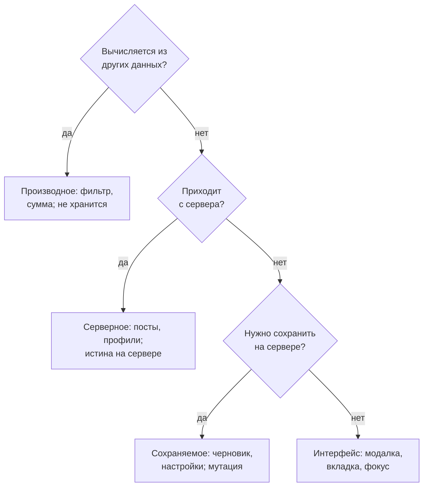

## О чём урок

Шаг D в RADIO: какие данные есть на клиенте и откуда они, четыре корзины состояния (серверное, интерфейса, производное, мгновенное), где хранить каждое (стор, компонент, URL, кэш запросов), нормализованный стор вместо вложенных объектов, лента как список идентификаторов с курсорами, и почему производные значения не хранят. Пример выполняется в Node.js: одна и та же лента во вложенной и нормализованной форме. Библиотеки состояния разобраны в треке `state`.

## Откуда данные



В заметках Notion четыре корзины, и они удобны на собеседовании:

| Корзина | Примеры | Где живёт | Особенности |
|---|---|---|---|
| Серверное состояние | Фильмы, профили, лента, прогресс просмотра | Кэш запросов (TanStack Query, RTK Query, Apollo) или нормализованный стор | Источник истины на сервере: пагинация, устаревание, повторный запрос |
| Состояние интерфейса | Активная вкладка, открыта ли модалка, выбранный элемент | Компонент; общее для нескольких частей в сторе | Меняется мгновенно, без сервера |
| Производное | Отфильтрованный и отсортированный список, сумма, счётчики | Не хранится: селектор или вычисление при рендере | Хранение производного рассинхронизирует данные |
| Мгновенное (ephemeral) | Позиция при перетаскивании, прогресс анимации, наведение | Локально в компоненте | Не влияет на остальное состояние |

Отдельно стоит **состояние в URL**: фильтры, сортировка, страница, открытый элемент. Оно бесплатно даёт ссылки, которыми можно поделиться, кнопки «назад» и «вперёд» и закладки; на собеседовании это почти всегда плюс.

## Описание сущностей

| Сущность | Поля | Откуда | Кто владеет |
|---|---|---|---|
| `Post` | `id`, `authorId`, `text`, `mediaIds`, `likes`, `viewerReaction`, `createdAt` | Сервер | Стор |
| `User` | `id`, `name`, `avatarUrl` | Сервер | Стор |
| `Feed` | `postIds`, `nextCursor`, `hasMore`, `fetchedAt` | Сервер | Стор |
| `Draft` | `text`, `mediaIds`, `status` (`idle`, `uploading`, `failed`) | Клиент, сохраняется | Композер |
| Интерфейс | `isComposerOpen`, `menuPostId` | Клиент, не сохраняется | Компоненты |

Называйте типы полей и помечайте источник: так видно, что уйдёт на сервер, что можно потерять при закрытии вкладки и что придётся пересчитывать. Данные клиента не обязаны повторять схему базы: в редакторе Notion (сам продукт, не заметки) каждый блок документа хранится отдельной записью со ссылкой на родителя, а клиент собирает из них дерево для отображения.

## Нормализация

```ts run
// A feed page as a nested API returns it: every post carries a full copy of its author.
type User = { id: string; name: string }
type NestedPost = { id: string; text: string; author: User; likes: number }
const page1: NestedPost[] = [
  { id: 'p3', text: 'Moved to Lisbon!', author: { id: 'u1', name: 'Ann' }, likes: 4 },
  { id: 'p2', text: 'Coffee recommendations?', author: { id: 'u2', name: 'Bob' }, likes: 1 },
  { id: 'p1', text: 'First post', author: { id: 'u1', name: 'Ann' }, likes: 9 },
]
const page2: NestedPost[] = [{ id: 'p0', text: 'Hello world', author: { id: 'u1', name: 'Ann' }, likes: 2 }]

// The normalized store: each entity once, relations by id, the feed is an ordered list of ids.
type Store = {
  usersById: Record<string, User>
  postsById: Record<string, { id: string; text: string; authorId: string; likes: number }>
  feed: { postIds: string[]; nextCursor: string | null }
}
const store: Store = { usersById: {}, postsById: {}, feed: { postIds: [], nextCursor: null } }

function mergePage(posts: NestedPost[], nextCursor: string | null) {
  for (const { author, ...post } of posts) {
    store.usersById[author.id] = author
    store.postsById[post.id] = { ...post, authorId: author.id }
    if (!store.feed.postIds.includes(post.id)) store.feed.postIds.push(post.id)
  }
  store.feed.nextCursor = nextCursor
}
mergePage(page1, 'p1')
mergePage(page2, null)

// Derived data is computed from the store, not stored next to it.
const feedView = () => store.feed.postIds.map((id) => {
  const p = store.postsById[id]
  return `${store.usersById[p.authorId].name}: ${p.text}`
})
const totalLikes = () => Object.values(store.postsById).reduce((sum, p) => sum + p.likes, 0)

const nested = [...page1, ...page2]
console.log('copies of Ann: nested', nested.filter((p) => p.author.id === 'u1').length, '| normalized', 1)

// Ann renames herself: one write in the normalized store, every place that shows her updates.
store.usersById.u1 = { ...store.usersById.u1, name: 'Anna' }
nested[0].author.name = 'Anna' // in the nested shape only the copy we remembered to change
console.log('normalized feed:', feedView().join(' | '))
console.log('nested feed:    ', nested.map((p) => `${p.author.name}: ${p.text}`).join(' | '))

// A like updates one record; the total is derived, so it cannot go out of sync.
store.postsById.p2.likes += 1
console.log('total likes:', totalLikes(), '| next cursor:', store.feed.nextCursor)
```

```output
copies of Ann: nested 3 | normalized 1
normalized feed: Anna: Moved to Lisbon! | Bob: Coffee recommendations? | Anna: First post | Anna: Hello world
nested feed:     Anna: Moved to Lisbon! | Bob: Coffee recommendations? | Ann: First post | Ann: Hello world
total likes: 17 | next cursor: null
```

- Во вложенной форме автор повторяется в каждом посте: три копии Ann. После переименования обновилась только та копия, о которой вспомнили, и лента показывает два разных имени одного человека.
- В нормализованном сторе каждая сущность хранится один раз в словаре по `id`, связи идут через идентификаторы (`authorId`), лента это упорядоченный список `postIds`. Одна запись обновила все места, где человек показан.
- Новая страница ленты сливается с имеющимися данными: сущности кладутся в словари, идентификаторы дописываются в конец списка, курсор заменяется.
- Лайк меняет одну запись поста, а общая сумма вычисляется из стора и поэтому не может разойтись с данными.
- Нормализовать может сервер (ответ сразу вида `{ posts, users, media }`) или слой доступа к данным на клиенте. Первый вариант легче для слабых устройств, второй проще для API. Подробнее о нормализации и библиотеках в уроке `state-patterns`.

## Где хранить

- Данные с сервера кладите в кэш запросов, а не копируйте в отдельный стор: кэш сам знает об устаревании, повторах и общих запросах (урок `state-server`).
- Глобальный стор только для того, что нужно нескольким частям и не приходит с сервера: тема, текущий пользователь, черновик, открытые панели.
- Состояние интерфейса держите как можно ниже в дереве: если мигающий курсор в поле поиска перерисовывает всю страницу, состояние лежит слишком высоко.
- Фильтры и выбранный элемент, которыми хочется делиться, держите в URL.

## Главное

- Данные бывают серверными, созданными на клиенте (сохраняемыми или нет) и производными; у каждой сущности указывают поля, типы, источник и владельца.
- Четыре корзины из заметок: серверное, интерфейса, производное, мгновенное; плюс состояние в URL для фильтров и ссылок.
- Нормализованный стор: словари по `id`, связи через идентификаторы, лента как список `postIds` с курсором; одно обновление видно везде.
- Производное не хранят, а вычисляют; серверное держат в кэше запросов, интерфейс как можно ниже в дереве.
- Нормализовать может сервер или клиент; выбор зависит от устройств и простоты API.
