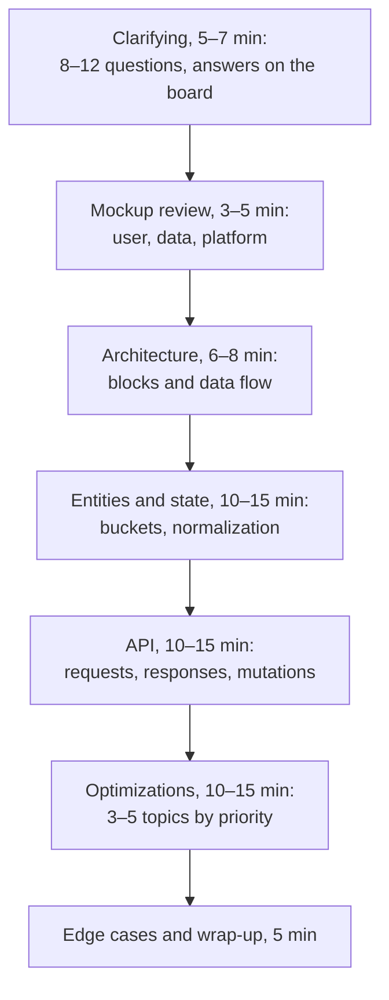

## What this lesson covers

How to run the round itself: a 60-minute plan from the Notion notes (the "UI State & Schema Design" format based on a mockup), a list of clarifying questions, reviewing the mockup through three lenses, state buckets, the API, edge cases and the wrap-up; what to say out loud, how to use the board, a cheatsheet of evaluation criteria and five practice tasks from the notes with what to cover in each. The RADIO method is covered in the `sd-radio` lesson.

## A 60-minute plan

The timing is approximate: in an hour-long round some time goes to introductions and questions at the end. If the interviewer pulls toward one topic earlier, follow them, but keep the uncovered steps in mind.

## Clarifying

Ask 8–12 questions right after you see the mockup or the task, and write the answers where they are visible:

- The user's primary action and the secondary ones; read-only or changes (add to a list, like, reorder, edit)?
- Which states are required: loading, empty, error, partial failure?
- Server data or client-only; does it change in real time?
- How many items at most: 10, 100, 10,000 (then virtualization)?
- Platforms: web, mobile, TV with a remote?
- Accessibility: screen reader, keyboard, high contrast?
- Offline, slow network, prefetching?
- Dark theme, A/B tests and flags, state in the URL, multiple profiles and syncing across devices?

Each answer immediately implies something: if there are changes, clarify optimistic or pessimistic updates, rollback and conflicts; if offline is needed, an action queue and a "data may be stale" mark.

## Reviewing the mockup

If you were given a mockup, assess it out loud through three lenses:

| Lens | Questions |
|---|---|
| User | Is the primary action obvious? Is the hierarchy clear, where to look first? Is it easy to get from one place to another? |
| Engineer | What breaks with real data: a long title, no cover, 0 or 10,000 items, a slow response? |
| Platform | How does it work on a TV or a cheap phone: touch target size, readability from a distance, focus, contrast? |

Research does not support the notes' "three-click rule": users happily make more steps if each step is clear (a Nielsen Norman Group article). Talk about how clear the path is, not about the number of clicks.

## Entities, API, edge cases

- **Entities**: list them (movie, profile, row, progress), sort them into buckets (server, UI, derived, ephemeral) and show the normalized shape (the `sd-data-model` lesson).
- **Data flow** in one line: request, normalization, store, render, action, optimistic update, server, sync.
- **API**: paths and parameters (`GET /rows/{id}?cursor=…&count=20`, `POST /my-list/{id}`), the response shape (flat or nested, full or delta), what the client computes (duration formatting, sorting).
- **Edge cases** for each feature: loading, error, empty, success; races (cancelling stale requests); partial failure (some rows loaded); retries with a growing delay; behavior without a network.

## How to carry yourself

- **Think out loud**: the interviewer evaluates only what is said and drawn.
- **Breadth first, then depth**: the overall diagram before details; ask where to go deeper.
- **Name options**: "an offset is possible, so is a cursor; a cursor here, because the feed changes".
- **Use the board**: RADIO or the plan in a corner, requirements as a list, rectangles with arrows and data labels. Practice in Excalidraw or diagrams.net beforehand.
- **Name only what you can explain**: say "partial hydration" and you will be asked how it works.
- **Wrap up**: at the end, two or three sentences about the solution, the main tradeoffs and what you would do next.

## An evaluation cheatsheet

| Axis | What to show |
|---|---|
| Problem exploration | Questions, requirements, scope, choosing what matters |
| Architecture | Blocks with responsibilities, links and APIs between them |
| Technical proficiency | Performance, networking, accessibility, i18n, security where it matters |
| Tradeoffs | Two or three options, the cost of each, a recommendation |
| Product and UX | Loading, errors, the empty state, mobile, keyboard |
| Communication | Clear, out loud, with questions and taking hints into account |

## Practice tasks from the notes

| Task | State | Key points to cover |
|---|---|---|
| A movie card and a details modal | Server: movie details; UI: `selectedMovieId`, whether the modal is open; derived: similar movies | Focus in the modal and back to the card, a details skeleton, a loading error, a URL to link to the movie |
| "My list" | Server: the list; UI: the selected movie; ephemeral: a toast | Optimistic adding and rollback, offline, an empty list, `role="status"` for the toast |
| A filter and sort panel | Server: movies; UI: filters, expanded groups; derived: the filtered list | Filters in the URL, filtering on the server or the client, an empty result, a slow network |
| A profile switcher | Server: profiles, avatars; UI: `activeProfileId`; derived: personal recommendations | Clearing the cache on profile switch, a kids profile, an avatar loading error |
| A carousel (a row of movies) | Server: the row's movies; UI: the visible index; ephemeral: scroll position | Lazy poster loading, arrows and swipe, keyboard and focus, an empty row |

For each, go through RADIO in 30–45 minutes with a timer and say it out loud; then compare with the `sd-news-feed`, `sd-autocomplete`, `sd-app-cases` walkthroughs.

## Key points

- The hour's plan: clarifying, mockup review, architecture, entities and state, API, optimizations, edge cases and wrap-up.
- 8–12 questions at the start with the answers written down; each requirement implies something (rollback, offline, virtualization).
- A mockup is reviewed through three lenses: user, engineer, platform; a clear path matters more than the number of clicks.
- For each feature: loading, error, empty, success, races, partial failure, retries, offline.
- Out loud, breadth first, options with costs, a board with a plan, a wrap-up at the end.
