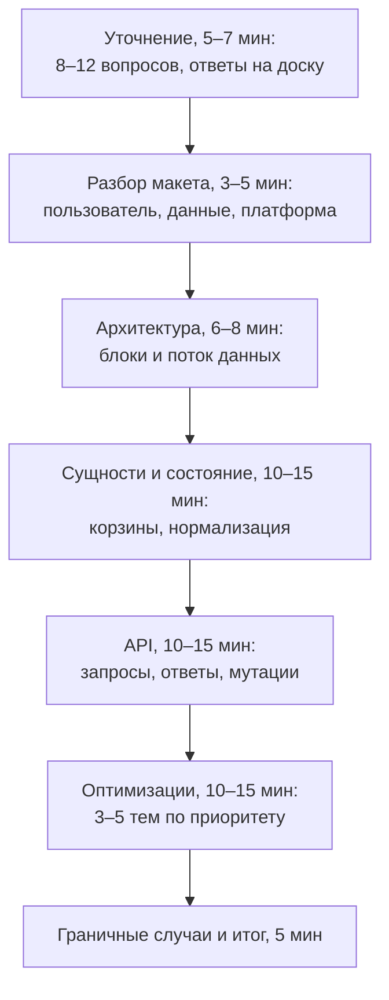

## О чём урок

Как провести сам раунд: план на 60 минут из заметок Notion (формат «UI State & Schema Design» по макету), список уточняющих вопросов, разбор макета через три линзы, корзины состояния, API, граничные случаи и итог; что проговаривать вслух, как вести доску, шпаргалка по критериям оценки и пять тренировочных задач из заметок с тем, что в них покрыть. Метод RADIO разобран в уроке `sd-radio`.

## План на 60 минут

Время ориентировочное: на часовом раунде часть уходит на знакомство и вопросы в конце. Если интервьюер тянет в одну тему раньше, идите за ним, но держите в голове непокрытые шаги.

## Уточнение

Задайте 8–12 вопросов сразу после того, как увидели макет или задачу, и запишите ответы там, где их видно:

- Главное действие пользователя и второстепенные; только чтение или изменения (добавить в список, лайк, порядок, редактирование)?
- Какие состояния обязательны: загрузка, пусто, ошибка, частичный отказ?
- Данные с сервера или только клиентские; меняются ли они в реальном времени?
- Сколько элементов максимум: 10, 100, 10 000 (тогда виртуализация)?
- Платформы: веб, мобильный, ТВ с пультом?
- Доступность: скринридер, клавиатура, высокий контраст?
- Офлайн, медленная сеть, предзагрузка?
- Тёмная тема, A/B-тесты и флаги, состояние в URL, несколько профилей и синхронизация между устройствами?

Каждый ответ сразу тянет следствие: если есть изменения, уточните оптимистичное или пессимистичное обновление, откат и конфликты; если нужен офлайн, то очередь действий и пометку «данные могли устареть».

## Разбор макета

Если дали макет, оцените его вслух тремя линзами:

| Линза | Вопросы |
|---|---|
| Пользователь | Очевидно ли главное действие? Понятна ли иерархия, куда смотреть сначала? Легко ли дойти из одного места в другое? |
| Инженер | Что сломается на реальных данных: длинное название, нет обложки, 0 или 10 000 элементов, медленный ответ? |
| Платформа | Как это работает на ТВ или дешёвом телефоне: размер целей касания, читаемость с расстояния, фокус, контраст? |

«Правило трёх кликов» из заметок исследования не подтверждают: пользователи спокойно делают больше переходов, если каждый шаг понятен (статья Nielsen Norman Group). Говорите о ясности пути, а не о числе кликов.

## Сущности, API, граничные случаи

- **Сущности**: перечислите (фильм, профиль, ряд, прогресс), разложите по корзинам (серверное, интерфейса, производное, мгновенное) и покажите нормализованную форму (урок `sd-data-model`).
- **Поток данных** одной строкой: запрос, нормализация, стор, отрисовка, действие, оптимистичное обновление, сервер, синхронизация.
- **API**: пути и параметры (`GET /rows/{id}?cursor=…&count=20`, `POST /my-list/{id}`), форма ответа (плоская или вложенная, полная или дельта), что считает клиент (форматирование длительности, сортировка).
- **Граничные случаи** для каждой функции: загрузка, ошибка, пусто, успех; гонки (отмена устаревших запросов); частичный отказ (часть рядов загрузилась); повторы с растущей задержкой; поведение без сети.

## Как держаться

- **Думайте вслух**: интервьюер оценивает только сказанное и нарисованное.
- **Сначала ширина, потом глубина**: общая схема до деталей; спросите, куда углубиться.
- **Называйте варианты**: «можно offset, можно курсор; здесь курсор, потому что лента меняется».
- **Ведите доску**: RADIO или план в углу, требования списком, прямоугольники со стрелками и подписями данных. Заранее потренируйтесь в Excalidraw или diagrams.net.
- **Называйте только то, что можете объяснить**: на «частичную гидратацию» спросят, как она работает.
- **Подводите итог**: в конце две-три фразы о решении, главных компромиссах и том, что сделали бы дальше.

## Шпаргалка по оценке

| Ось | Что показать |
|---|---|
| Исследование задачи | Вопросы, требования, границы, выбор главного |
| Архитектура | Блоки с ответственностью, связи и API между ними |
| Техническая глубина | Производительность, сеть, доступность, i18n, безопасность там, где важно |
| Компромиссы | Два-три варианта, цена каждого, рекомендация |
| Продукт и UX | Загрузка, ошибки, пустое состояние, мобильные, клавиатура |
| Общение | Ясно, вслух, с вопросами и учётом подсказок |

## Тренировочные задачи из заметок

| Задача | Состояние | Главное в разборе |
|---|---|---|
| Карточка фильма и модальное окно с деталями | Серверное: детали фильма; интерфейса: `selectedMovieId`, открыто ли окно; производное: похожие фильмы | Фокус в окне и возврат на карточку, скелетон деталей, ошибка загрузки, URL для ссылки на фильм |
| «Мой список» | Серверное: список; интерфейса: выбранный фильм; мгновенное: уведомление | Оптимистичное добавление и откат, офлайн, пустой список, `role="status"` для уведомления |
| Панель фильтров и сортировки | Серверное: фильмы; интерфейса: фильтры, раскрытые группы; производное: отфильтрованный список | Фильтры в URL, фильтровать на сервере или клиенте, пустой результат, медленная сеть |
| Выбор профиля | Серверное: профили, аватары; интерфейса: `activeProfileId`; производное: персональные рекомендации | Сброс кэша при смене профиля, детский профиль, ошибка загрузки аватаров |
| Карусель (ряд фильмов) | Серверное: фильмы ряда; интерфейса: видимый индекс; мгновенное: позиция прокрутки | Ленивая загрузка постеров, стрелки и свайп, клавиатура и фокус, пустой ряд |

Для каждой пройдите RADIO за 30–45 минут с таймером и проговорите вслух; затем сравните с разборами `sd-news-feed`, `sd-autocomplete`, `sd-app-cases`.

## Главное

- План часа: уточнение, разбор макета, архитектура, сущности и состояние, API, оптимизации, граничные случаи и итог.
- 8–12 вопросов в начале с записью ответов; каждое требование тянет следствие (откат, офлайн, виртуализация).
- Макет разбирают тремя линзами: пользователь, инженер, платформа; ясность пути важнее числа кликов.
- Для каждой функции: загрузка, ошибка, пусто, успех, гонки, частичный отказ, повторы, офлайн.
- Вслух, сначала ширина, варианты с ценой, доска с планом, итог в конце.
