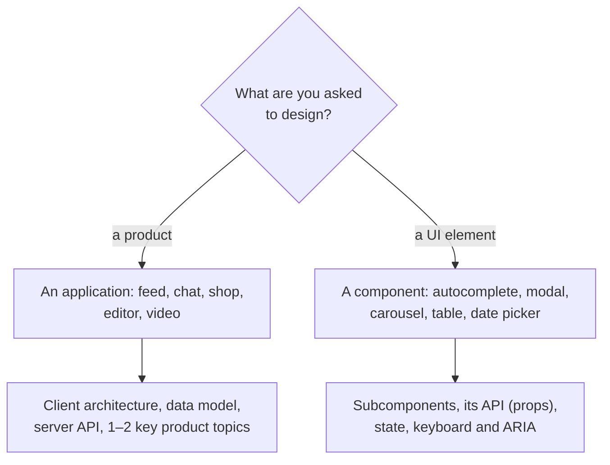

## What this lesson covers

What front end system design is and how it differs from the back end variant, the kinds of questions (an application or a UI component), which topics matter for different products, the criteria an interviewer uses and the mistakes that most often fail the round. The lesson builds on GreatFrontEnd's Front End System Design Playbook and the Notion notes; the next lesson covers the RADIO method.

## What this interview is

A system design round gives a vague task like "design a news feed" and 30–60 minutes. There is no correct answer: what is evaluated is how you narrow the task, split the product into parts, choose between options and explain the choice. It resembles a technical review of a design document with a colleague, only compressed in time. At senior level and above this round often decides both the offer and the level.

| | Back end and full stack | Front end |
|---|---|---|
| What the architecture is made of | Services: load balancer, databases, queues, caches, CDN | Parts of the client: view, store, data access layer |
| Capacity estimation | Often needed | Usually not needed |
| Data model | A database schema | Application state |
| What is a "black box" | The client | The server |
| Interfaces | Between services (HTTP, gRPC, queues) | Client and server (HTTP, WebSocket, SSE), events inside the client |
| Deep topics | Scaling, reliability, consistency | Performance, UX, accessibility, internationalization, security |

The same prompt "the Facebook feed" leads to sharding and fan-out to millions of followers in a back end interview, and to pagination, rendering a long list, reactions and post creation in a front end one. Material about distributed systems is nearly useless for the front end round.

## Two kinds of questions

- **Applications**: how the client is built and how it talks to the server. Each product sets its own key topics, and most of the time goes to them: for a shop SEO and speed (they directly affect sales), for a chat the real-time protocol, while SEO is irrelevant there.
- **UI components**: almost always complex ones with keyboard and accessibility requirements (autocomplete, menu, modal, date picker, editor), not a button. You describe the subcomponents, the external API (which props it accepts), the internal state and a way to customize the appearance.

| Product | Key discussion topic | Lesson |
|---|---|---|
| News feed | Pagination, a long list, optimistic reactions | `sd-news-feed` |
| Chat | Real time, message order and status, offline work | `sd-app-cases` |
| Shop, booking | SSR and SEO, Core Web Vitals, the cart | `sd-app-cases` |
| Photos, Pinterest | Images, masonry layout, file upload | `sd-app-cases` |
| Video | Adaptive streaming, the player | `sd-app-cases` |
| Collaborative editor | Syncing and conflict resolution | `sd-app-cases` |
| Autocomplete and other components | Component API, request races, cache, ARIA | `sd-autocomplete` |

## How it is evaluated

GreatFrontEnd's playbook names six axes. The interviewer records only what you **said or drew**: a tradeoff you weighed silently does not exist for the evaluation.

1. **Problem exploration**: clarifying questions, functional and non-functional requirements, the scope, choosing what matters.
2. **Architecture**: the task is split into independent parts, each with a clear responsibility, and how they communicate is described; the design is buildable and extensible.
3. **Technical proficiency**: knowledge of fundamentals (performance, networking, HTML and CSS, accessibility, i18n, security) where it matters for the product.
4. **Exploration and tradeoffs**: two or three solutions for each subproblem, pros and cons, a recommendation for the context. Even an obviously bad option is worth naming with a short reason why it is bad.
5. **Product and UX sense**: loading, errors, the empty state, mobile devices, the keyboard.
6. **Communication**: clear, to the point, asking the interviewer questions and taking their hints into account.

## Common mistakes

- **Designing right away** without questions: the result is a nice answer to the wrong task.
- **No structure**: the story jumps around and important parts stay uncovered. RADIO written in a corner of the board helps.
- **"There is only one right solution"**: the interviewer expects a comparison of options.
- **Thinking silently**: it is joint work, reason out loud.
- **Going down a rabbit hole**: twenty minutes on one minor component. First the overall architecture, then depth where it matters; if unsure, ask where to dig.
- **Buzzwords without understanding**: "partial hydration" or "CRDT" will surely trigger a follow-up question.
- **Arguing about frameworks and tools**: React or Vue, Tailwind or CSS modules, webpack or Vite almost never change the architecture. The exception is when the choice follows from the requirements, for example SSR for SEO.

## Key points

- Front end system design is about the client: the view, state, data layer, server API, performance, UX and accessibility; the server is a black box.
- Two kinds of questions: an application (architecture and 1–2 key product topics) and a UI component (API, state, keyboard and ARIA).
- Key topics depend on the product: SEO for a shop, real time for a chat, streaming for video.
- Six evaluation axes: problem exploration, architecture, technical proficiency, tradeoffs, product and UX, communication; only what is said out loud counts.
- Mistakes: designing without questions, without structure, with one "right" solution, silently, in one detail, with buzzwords, arguing about frameworks.
