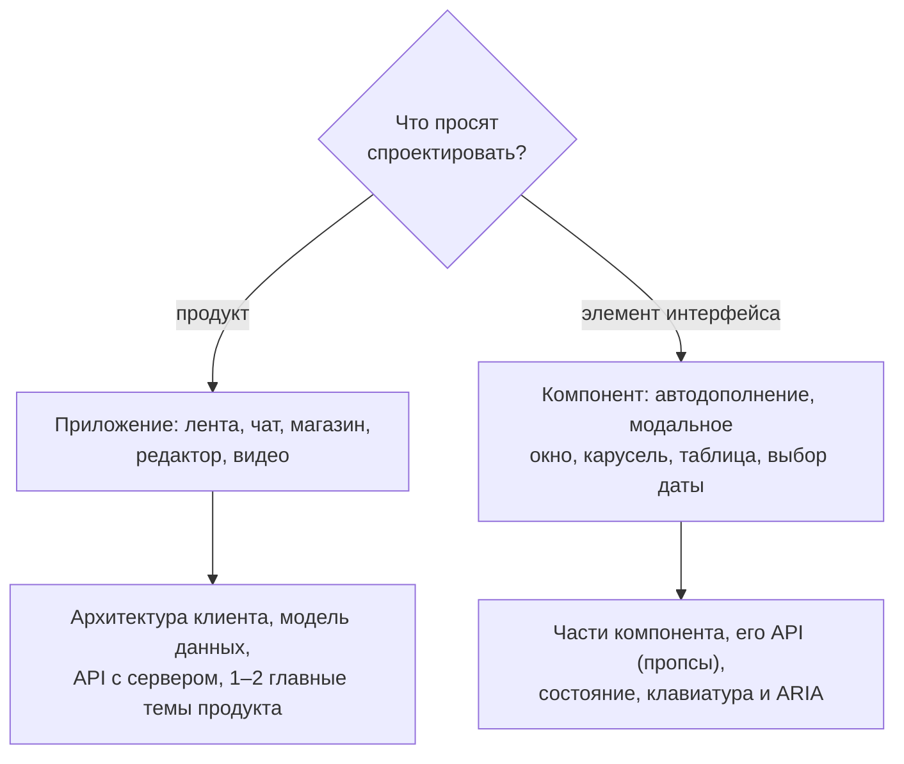

## О чём урок

Что такое frontend system design и чем он отличается от backend-варианта, какие бывают задачи (приложение или UI-компонент), какие темы важны для разных продуктов, по каким критериям оценивает интервьюер и какие ошибки чаще всего проваливают раунд. Урок опирается на Front End System Design Playbook от GreatFrontEnd и заметки Notion; следующий урок разбирает метод RADIO.

## Что это за интервью

На system design дают расплывчатую задачу вроде «спроектируйте ленту новостей» и 30–60 минут. Правильного ответа нет: оценивают, как вы сужаете задачу, раскладываете продукт на части, выбираете между вариантами и объясняете выбор. Это похоже на техническое ревью дизайн-документа с коллегой, только в сжатом времени. На уровне senior и выше этот раунд часто решает и само предложение, и грейд.

| | Backend и full stack | Frontend |
|---|---|---|
| Из чего архитектура | Сервисы: балансировщик, базы, очереди, кэши, CDN | Части клиента: представление, стор, слой доступа к данным |
| Оценка нагрузки | Часто нужна | Обычно не нужна |
| Модель данных | Схема базы | Состояние приложения |
| Что считают «чёрным ящиком» | Клиент | Сервер |
| Интерфейсы | Между сервисами (HTTP, gRPC, очереди) | Клиент и сервер (HTTP, WebSocket, SSE), события внутри клиента |
| Глубокие темы | Масштабирование, надёжность, согласованность | Производительность, UX, доступность, интернационализация, безопасность |

Одна и та же формулировка «лента Facebook» на backend-интервью ведёт к шардированию и рассылке постов миллионам подписчиков, а на frontend к пагинации, рендерингу длинного списка, реакциям и созданию поста. Материалы про распределённые системы для frontend-раунда почти бесполезны.

## Два вида задач

- **Приложения**: устройство клиента и общение с сервером. Каждый продукт задаёт свои главные темы, и на них уходит основное время: магазину важны SEO и скорость (они напрямую влияют на продажи), чату протокол реального времени, а SEO там не нужно вовсе.
- **UI-компоненты**: почти всегда сложные, с клавиатурой и доступностью (автодополнение, меню, модальное окно, выбор даты, редактор), а не кнопка. Нужно описать подкомпоненты, внешний API (какие пропсы принимает), внутреннее состояние и способ настроить внешний вид.

| Продукт | Главная тема разговора | Урок |
|---|---|---|
| Лента новостей | Пагинация, длинный список, оптимистичные реакции | `sd-news-feed` |
| Чат | Реальное время, порядок и статусы сообщений, работа без сети | `sd-app-cases` |
| Магазин, бронирование | SSR и SEO, Core Web Vitals, корзина | `sd-app-cases` |
| Фото, Pinterest | Изображения, раскладка masonry, загрузка файлов | `sd-app-cases` |
| Видео | Адаптивный стриминг, плеер | `sd-app-cases` |
| Совместный редактор | Синхронизация и разрешение конфликтов | `sd-app-cases` |
| Автодополнение и другие компоненты | API компонента, гонки запросов, кэш, ARIA | `sd-autocomplete` |

## Как оценивают

Плейбук GreatFrontEnd выделяет шесть осей. Интервьюер записывает только то, что вы **сказали или нарисовали**: компромисс, который вы обдумали молча, для оценки не существует.

1. **Исследование задачи**: уточняющие вопросы, функциональные и нефункциональные требования, границы задачи, выбор главного.
2. **Архитектура**: задача разбита на независимые части, у каждой понятная ответственность, описано, как они общаются; решение реализуемо и расширяемо.
3. **Техническая глубина**: знание основ (производительность, сеть, HTML и CSS, доступность, i18n, безопасность) там, где это важно для продукта.
4. **Варианты и компромиссы**: для каждой подзадачи два-три решения, плюсы и минусы, рекомендация под контекст. Даже очевидно плохой вариант стоит назвать и коротко объяснить, почему он плох.
5. **Продукт и UX**: загрузка, ошибки, пустое состояние, мобильные устройства, клавиатура.
6. **Общение**: ясно, по делу, с вопросами к интервьюеру и с учётом его подсказок.

## Частые ошибки

- **Сразу проектировать**, не задав вопросов: получается красивый ответ не на ту задачу.
- **Без структуры**: рассказ скачет, а важные части остаются непокрытыми. Помогает RADIO, выписанный в углу доски.
- **«Есть только одно правильное решение»**: интервьюер ждёт сравнения вариантов.
- **Думать молча**: это совместная работа, рассуждайте вслух.
- **Уйти в кроличью нору**: двадцать минут про один второстепенный компонент. Сначала общая архитектура, потом глубина там, где важно; если сомневаетесь, спросите, куда копать.
- **Модные слова без понимания**: «частичная гидратация» или «CRDT» обязательно вызовут уточняющий вопрос.
- **Спорить о фреймворках и инструментах**: React или Vue, Tailwind или CSS-модули, webpack или Vite почти никогда не меняют архитектуру. Исключение: когда выбор следует из требований, например SSR для SEO.

## Главное

- Frontend system design про клиент: представление, состояние, слой данных, API с сервером, производительность, UX и доступность; сервер это чёрный ящик.
- Два вида задач: приложение (архитектура и 1–2 главные темы продукта) и UI-компонент (API, состояние, клавиатура и ARIA).
- Главные темы зависят от продукта: SEO для магазина, реальное время для чата, стриминг для видео.
- Шесть осей оценки: исследование задачи, архитектура, техническая глубина, компромиссы, продукт и UX, общение; засчитывается только сказанное вслух.
- Ошибки: проектировать без вопросов, без структуры, с одним «правильным» решением, молча, в одной детали, с модными словами, со спором о фреймворках.
