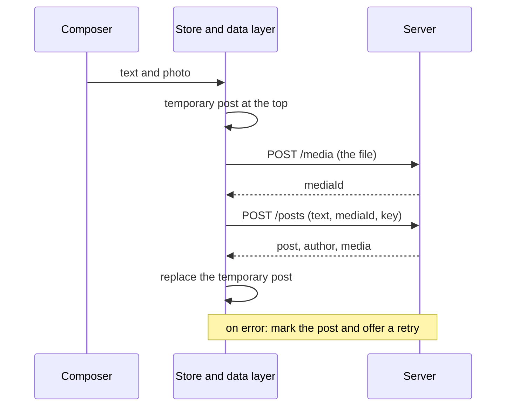

## What this lesson covers

A full walkthrough of the classic task "design a news feed" with RADIO: the scope, rendering and navigation, client layers, entities, the feed and post creation APIs, cursor pagination, and then the deep dive: virtualization, infinite scrolling, restoring the position, fresh posts, optimistic reactions, images, safe text, accessibility and languages. The walkthrough follows GreatFrontEnd's playbook. The Node.js example compares offset and cursor pagination when new posts arrive in the feed.

## R: requirements

- **Core**: browse a feed of friends' posts, react, create a post. Comments, shares and a single post page later, if time allows.
- **Posts**: text and images; video and polls are out of the first version.
- **Loading more**: infinite scrolling; what to do with new posts in a long session is decided separately.
- **Devices**: web first, a good mobile experience is desirable.
- **Out of scope**: ranking, ads, server-side fan-out of posts to followers.

## A: architecture

- **Rendering**: for a signed-in user's feed a sensible default is CSR. The feed is personal, it needs no SEO, and state lives in the browser for the whole long session. To keep LCP good, the app shell and the first feed request are kept light. Public post pages and logged-out pages are rendered on the server (SSR): first render and indexing matter there. Meta-frameworks allow choosing the strategy per route.
- **Navigation**: SPA. A post opened from the feed is already in the store, so the post page shows instantly and only comments are loaded. In an MPA each navigation throws away the cache, the draft and the scroll position.
- **Layers**: the view (feed, post, composer), the store (normalized entities, the draft, data freshness), the data access layer (requests, cache, pagination, retries), the server. The layer diagram is in the `sd-radio` lesson.

## D: data

| Entity | Fields |
|---|---|
| `Post` | `id`, `authorId`, `body` (text plus ranges of mentions, hashtags, links), `mediaIds`, `reactionCounts`, `viewerReaction`, `createdAt` |
| `User` | `id`, `name`, `handle`, `avatarUrl` |
| `Media` | `id`, `src`, `alt`, `width`, `height` |
| `Feed` | `postIds`, `olderCursor`, `newerCursor`, `hasOlder`, `fetchedAt` |
| `Draft` | `body`, `mediaIds`, `uploadState`, `submitState` |

- The feed is an ordered list of ids with cursors, while posts, users and media sit in normalized dictionaries (the `sd-data-model` lesson). The same post is shown in the feed and on the post page without copies.
- Post text is stored as **text plus typed ranges** (`{ type: 'mention', start, end, userId }`), not as ready-made HTML: web and mobile clients render it the same way, and there is nothing in it to execute.
- An image has `width` and `height` from the start: space for it is reserved before loading, and the feed does not jump (CLS).

## I: API

| Request | Purpose |
|---|---|
| `GET /feed?cursor=…&limit=10` | A feed page; the response is `{ posts, users, media, nextCursor }` |
| `GET /posts/{id}` | One post for its page |
| `POST /media` | Upload an image, the response is a `mediaId` (often a signed URL to upload straight to storage) |
| `POST /posts` | Create a post: `{ body, mediaIds }` plus an idempotency key |
| `PUT /posts/{id}/reaction`, `DELETE …` | Set or remove a reaction |

- The server takes who is viewing the feed from the session (a cookie or a token), not from a `userId` parameter: otherwise anyone could request someone else's feed.
- Personal responses are marked `Cache-Control: private`; caches on the client and in the Service Worker are tied to the account and cleared on logout.
- Every mutation carries an **idempotency key** created when the button is pressed: a retry after a network drop does not create a second post (an example is in the `sd-optimizations` lesson).

### Pagination

```ts run
// A server feed, newest first. Posts are numbered so the order is easy to follow.
let feed = ['p8', 'p7', 'p6', 'p5', 'p4', 'p3', 'p2', 'p1']
const publish = (...ids: string[]) => (feed = [...ids, ...feed])

const byOffset = (offset: number, limit: number) => feed.slice(offset, offset + limit)
function byCursor(cursor: string | null, limit: number) {
  const start = cursor ? feed.indexOf(cursor) + 1 : 0 // "the posts after this one"
  const items = feed.slice(start, start + limit)
  return { items, nextCursor: items.at(-1) ?? null }
}

function scroll(title: string, loadPage: (page: number) => string[]) {
  feed = ['p8', 'p7', 'p6', 'p5', 'p4', 'p3', 'p2', 'p1']
  const shown: string[] = []
  for (let page = 0; page < 3; page++) {
    shown.push(...loadPage(page))
    if (page === 0) publish('p10', 'p9') // two friends post while the user reads the first page
  }
  const dupes = shown.filter((id, i) => shown.indexOf(id) !== i)
  const missing = ['p8', 'p7', 'p6', 'p5', 'p4', 'p3', 'p2', 'p1'].filter((id) => !shown.includes(id))
  console.log(title.padEnd(7), shown.join(' '), '| duplicates:', dupes.join(' ') || 'none', '| missing:', missing.join(' ') || 'none')
}

scroll('offset', (page) => byOffset(page * 3, 3))
let cursor: string | null = null
scroll('cursor', () => {
  const res = byCursor(cursor, 3)
  cursor = res.nextCursor
  return res.items
})
// Newer posts are fetched separately ("2 new posts" button), not mixed into the scroll.
console.log('newer than p8:', feed.slice(0, feed.indexOf('p8')).join(' '))
```

```output
offset  p8 p7 p6 p7 p6 p5 p4 p3 p2 | duplicates: p7 p6 | missing: p1
cursor  p8 p7 p6 p5 p4 p3 p2 p1 | duplicates: none | missing: none
newer than p8: p10 p9
```

- While the user read the first page, two new posts were published. With **offset** pagination (`offset=3`) the list shifted: the second page repeated `p7` and `p6`, and `p1` was never shown.
- A **cursor** means "posts after `p6`": inserts at the top do not affect the next page. New posts are requested separately (`newerCursor`) and shown with a "2 new posts" button instead of being inserted above what the person is reading.
- Offsets suit static lists with page numbers (search results, an admin table); for a feed you pick a cursor. The cursor is opaque to the client: the server encodes the position in it.
- The page size can be chosen from the window height: with CSR the client knows `innerHeight` before the first request.

## Creating a post



## O: deep dive

**The feed list**
- **Virtualization**: only posts in the viewport plus a small margin are in the DOM; those that left are replaced with empty blocks of the same height so scrolling does not jump. The cost: heights must be measured (text and images), a focused element may unmount, the browser's find-in-page will not see hidden content. More in the `perf-runtime` lesson.
- **Infinite scrolling**: a marker at the end of the list and an `IntersectionObserver` with a margin of about one screen height (`rootMargin`), not a `scroll` handler with `getBoundingClientRect` (the `browser-observers` lesson).
- **Loading**: a post-shaped skeleton instead of a spinner: the space is reserved, and content lands without jumps.
- **Returning to the feed**: data and position come from the store; it is more reliable to remember the id of the post at the top edge and the offset inside it than pixels.
- **Freshness**: after a long absence check for new posts and offer them with a button; sync tabs through `BroadcastChannel`.

**Posts**
- **Optimistic reactions**: the counter changes immediately and rolls back on error; requests for one post run in order, stale responses are ignored.
- **Images**: `width` and `height` or `aspect-ratio`, `srcset` and `sizes`, `loading="lazy"` below the first screen, `fetchpriority="high"` for the first post's image (the `perf-lcp` lesson).
- **Text**: mentions and links are built into elements from the ranges, without `innerHTML`; links are checked for `javascript:` (the `sec-xss` lesson).
- **Code on demand**: the emoji editor, the photo viewer, the post menu load through `import()` on first use.
- **Time**: "5 minutes ago" through `Intl.RelativeTimeFormat`, the exact date in `<time datetime>` and a tooltip.

**Accessibility and languages**
- The feed pattern from ARIA APG: a `role="feed"` container, each post an `<article>` with `aria-posinset` and `aria-setsize` (or `-1` if the total is unknown), `aria-busy="true"` while loading, moving between posts with Page Down and Page Up.
- Reaction buttons with a clear name and state (`aria-pressed`), focus returns to the composer after an error, `prefers-reduced-motion` for animations.
- Right-to-left languages (`dir="auto"` for post text), counters through `Intl.NumberFormat` (`1.2K`) and `Intl.PluralRules`.

## Key points

- Core: browsing the feed, reactions, creating a post; ranking and fan-out are out of scope.
- CSR and SPA for a signed-in feed, SSR for public post pages; a normalized store, the feed as `postIds` with cursors.
- API: `GET /feed` with a cursor, media uploaded before the post is created, the user from the session, an idempotency key on every mutation.
- A cursor instead of an offset: new posts cause no duplicates or gaps; fresh ones are shown with a button.
- Deep dive: virtualization, `IntersectionObserver`, skeletons, restoring position, optimistic reactions, image sizes, text without `innerHTML`, `role="feed"`, `Intl`.
