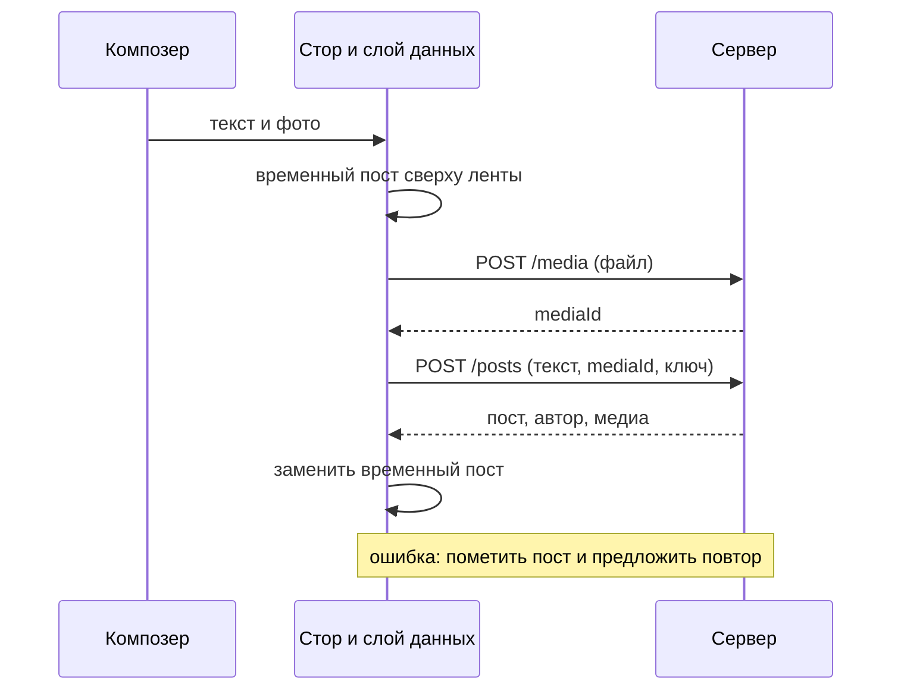

## О чём урок

Полный разбор классической задачи «спроектируйте ленту новостей» по RADIO: границы задачи, рендеринг и навигация, слои клиента, сущности, API ленты и создания поста, пагинация по курсору, а затем глубокий разбор: виртуализация, бесконечная прокрутка, восстановление позиции, свежие посты, оптимистичные реакции, изображения, безопасный текст, доступность и языки. Разбор следует плейбуку GreatFrontEnd. Пример в Node.js сравнивает пагинацию по смещению и по курсору, когда в ленту приходят новые посты.

## R: требования

- **Ядро**: смотреть ленту постов друзей, ставить реакции, создавать пост. Комментарии, репосты и страница одного поста потом, если останется время.
- **Посты**: текст и изображения; видео и опросы вне первой версии.
- **Подгрузка**: бесконечная прокрутка; что делать с новыми постами в долгой сессии, решаем отдельно.
- **Устройства**: веб в первую очередь, хороший мобильный опыт желателен.
- **Вне задачи**: ранжирование, реклама, рассылка постов подписчикам на сервере.

## A: архитектура

- **Рендеринг**: для ленты вошедшего пользователя разумный выбор по умолчанию CSR. Лента персональна, SEO ей не нужно, а состояние живёт в браузере всю долгую сессию. Чтобы LCP оставался хорошим, оболочку приложения и первый запрос ленты держат лёгкими. Публичные страницы постов и страницы для гостей рендерят на сервере (SSR): там важны первый показ и индексация. Метафреймворки позволяют выбирать стратегию по маршруту.
- **Навигация**: SPA. Пост, открытый из ленты, уже лежит в сторе, поэтому страница поста показывается сразу, а догружаются только комментарии. В MPA каждый переход сбрасывает кэш, черновик и позицию прокрутки.
- **Слои**: представление (лента, пост, композер), стор (нормализованные сущности, черновик, свежесть данных), слой доступа к данным (запросы, кэш, пагинация, повторы), сервер. Схема слоёв в уроке `sd-radio`.

## D: данные

| Сущность | Поля |
|---|---|
| `Post` | `id`, `authorId`, `body` (текст и диапазоны упоминаний, хэштегов, ссылок), `mediaIds`, `reactionCounts`, `viewerReaction`, `createdAt` |
| `User` | `id`, `name`, `handle`, `avatarUrl` |
| `Media` | `id`, `src`, `alt`, `width`, `height` |
| `Feed` | `postIds`, `olderCursor`, `newerCursor`, `hasOlder`, `fetchedAt` |
| `Draft` | `body`, `mediaIds`, `uploadState`, `submitState` |

- Лента это упорядоченный список идентификаторов с курсорами, а посты, пользователи и медиа лежат в нормализованных словарях (урок `sd-data-model`). Один и тот же пост показывается в ленте и на странице поста без копий.
- Текст поста хранят как **текст плюс типизированные диапазоны** (`{ type: 'mention', start, end, userId }`), а не как готовый HTML: его одинаково отрисуют веб и мобильные клиенты, и в нём нечему исполниться.
- У изображения сразу есть `width` и `height`: место под картинку резервируется до загрузки, и лента не прыгает (CLS).

## I: API

| Запрос | Назначение |
|---|---|
| `GET /feed?cursor=…&limit=10` | Страница ленты; ответ `{ posts, users, media, nextCursor }` |
| `GET /posts/{id}` | Один пост для его страницы |
| `POST /media` | Загрузка изображения, ответ `mediaId` (часто подписанный URL для загрузки прямо в хранилище) |
| `POST /posts` | Создать пост: `{ body, mediaIds }` и ключ идемпотентности |
| `PUT /posts/{id}/reaction`, `DELETE …` | Поставить или убрать реакцию |

- Кто смотрит ленту, сервер берёт из сессии (cookie или токен), а не из параметра `userId`: иначе любой запросит чужую ленту.
- Персональные ответы помечают `Cache-Control: private`; кэш на клиенте и в Service Worker привязывают к аккаунту и чистят при выходе.
- Каждая мутация несёт **ключ идемпотентности**, созданный в момент нажатия кнопки: повтор после обрыва сети не создаст второй пост (пример в уроке `sd-optimizations`).

### Пагинация

```ts run
// A server feed, newest first. Posts are numbered so the order is easy to follow.
let feed = ['p8', 'p7', 'p6', 'p5', 'p4', 'p3', 'p2', 'p1']
const publish = (...ids: string[]) => (feed = [...ids, ...feed])

const byOffset = (offset: number, limit: number) => feed.slice(offset, offset + limit)
function byCursor(cursor: string | null, limit: number) {
  const start = cursor ? feed.indexOf(cursor) + 1 : 0 // "the posts after this one"
  const items = feed.slice(start, start + limit)
  return { items, nextCursor: items.at(-1) ?? null }
}

function scroll(title: string, loadPage: (page: number) => string[]) {
  feed = ['p8', 'p7', 'p6', 'p5', 'p4', 'p3', 'p2', 'p1']
  const shown: string[] = []
  for (let page = 0; page < 3; page++) {
    shown.push(...loadPage(page))
    if (page === 0) publish('p10', 'p9') // two friends post while the user reads the first page
  }
  const dupes = shown.filter((id, i) => shown.indexOf(id) !== i)
  const missing = ['p8', 'p7', 'p6', 'p5', 'p4', 'p3', 'p2', 'p1'].filter((id) => !shown.includes(id))
  console.log(title.padEnd(7), shown.join(' '), '| duplicates:', dupes.join(' ') || 'none', '| missing:', missing.join(' ') || 'none')
}

scroll('offset', (page) => byOffset(page * 3, 3))
let cursor: string | null = null
scroll('cursor', () => {
  const res = byCursor(cursor, 3)
  cursor = res.nextCursor
  return res.items
})
// Newer posts are fetched separately ("2 new posts" button), not mixed into the scroll.
console.log('newer than p8:', feed.slice(0, feed.indexOf('p8')).join(' '))
```

```output
offset  p8 p7 p6 p7 p6 p5 p4 p3 p2 | duplicates: p7 p6 | missing: p1
cursor  p8 p7 p6 p5 p4 p3 p2 p1 | duplicates: none | missing: none
newer than p8: p10 p9
```

- Пока пользователь читал первую страницу, вышли два новых поста. При пагинации по **смещению** (`offset=3`) список сдвинулся: вторая страница повторила `p7` и `p6`, а `p1` так и не показался.
- **Курсор** означает «посты после `p6`»: вставки сверху не влияют на следующую страницу. Новые посты запрашивают отдельно (`newerCursor`) и показывают кнопкой «2 новых поста», а не вставляют над тем, что человек читает.
- Смещение подходит для статичных списков с номерами страниц (результаты поиска, таблица в админке); для ленты выбирают курсор. Курсор непрозрачен для клиента: сервер сам кодирует в нём позицию.
- Размер страницы можно подобрать по высоте окна: при CSR клиент знает `innerHeight` до первого запроса.

## Создание поста



## O: глубокий разбор

**Список ленты**
- **Виртуализация**: в DOM только посты в окне и небольшой запас; ушедшие заменяются пустыми блоками той же высоты, чтобы не сбить прокрутку. Цена: высоты надо измерять (текст и картинки), сфокусированный элемент может размонтироваться, поиск браузера по странице не найдёт скрытое. Подробнее в уроке `perf-runtime`.
- **Бесконечная прокрутка**: маркер в конце списка и `IntersectionObserver` с запасом около высоты экрана (`rootMargin`), а не обработчик `scroll` с `getBoundingClientRect` (урок `browser-observers`).
- **Загрузка**: скелетон в форме поста вместо спиннера: место зарезервировано, контент встаёт без скачков.
- **Возврат на ленту**: данные и позиция берутся из стора; надёжнее запоминать идентификатор поста у верхнего края и смещение внутри него, чем пиксели.
- **Свежесть**: после долгого отсутствия проверить новые посты и предложить их кнопкой; вкладки синхронизировать через `BroadcastChannel`.

**Посты**
- **Оптимистичные реакции**: счётчик меняется сразу, при ошибке откатывается; запросы по одному посту выполняются по очереди, устаревшие ответы игнорируются.
- **Изображения**: `width` и `height` или `aspect-ratio`, `srcset` и `sizes`, `loading="lazy"` ниже первого экрана, `fetchpriority="high"` для картинки первого поста (урок `perf-lcp`).
- **Текст**: упоминания и ссылки собираются из диапазонов в элементы, без `innerHTML`; ссылки проверяют на `javascript:` (урок `sec-xss`).
- **Код по требованию**: редактор с эмодзи, просмотр фото, меню поста загружаются через `import()` при первом использовании.
- **Время**: «5 минут назад» через `Intl.RelativeTimeFormat`, точная дата в `<time datetime>` и подсказке.

**Доступность и языки**
- Паттерн feed из ARIA APG: контейнер `role="feed"`, каждый пост `<article>` с `aria-posinset` и `aria-setsize` (или `-1`, если общее число неизвестно), `aria-busy="true"` на время подгрузки, переход между постами клавишами Page Down и Page Up.
- Кнопки реакций с понятным именем и состоянием (`aria-pressed`), фокус возвращается в композер после ошибки, `prefers-reduced-motion` для анимаций.
- Языки справа налево (`dir="auto"` для текста поста), счётчики через `Intl.NumberFormat` (`1,2 тыс.`) и `Intl.PluralRules`.

## Главное

- Ядро: просмотр ленты, реакции, создание поста; ранжирование и рассылка вне задачи.
- CSR и SPA для ленты вошедшего пользователя, SSR для публичных страниц постов; нормализованный стор, лента как `postIds` с курсорами.
- API: `GET /feed` с курсором, загрузка медиа до создания поста, пользователь из сессии, ключ идемпотентности на каждую мутацию.
- Курсор вместо смещения: новые посты не дают дублей и пропусков; свежие показывают кнопкой.
- Разбор: виртуализация, `IntersectionObserver`, скелетоны, возврат позиции, оптимистичные реакции, размеры изображений, текст без `innerHTML`, `role="feed"`, `Intl`.
