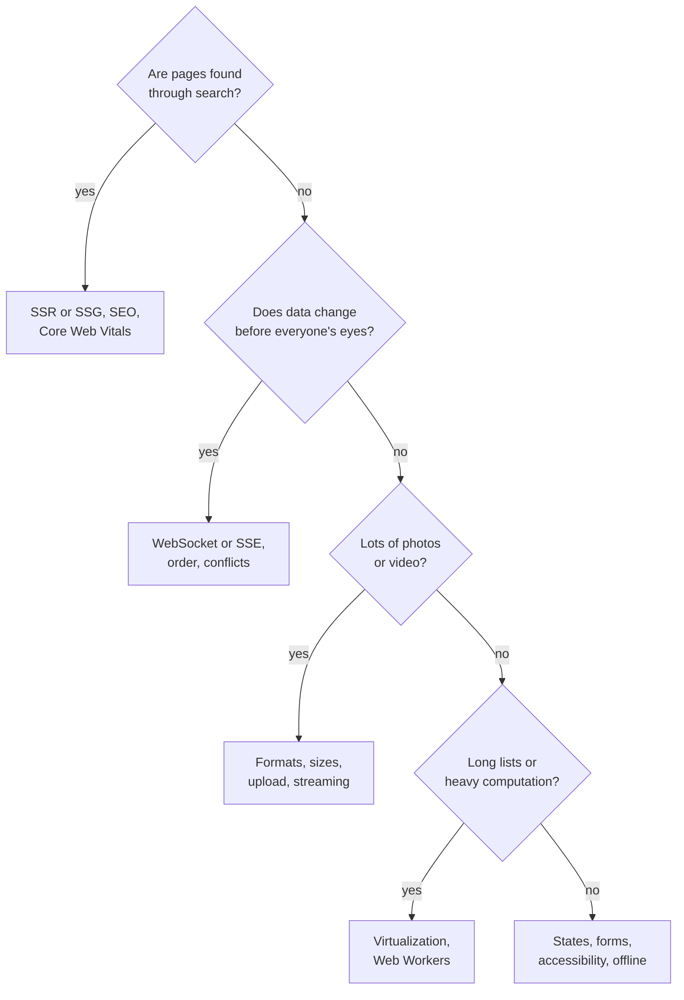

## What this lesson covers

Step O of RADIO, which takes up to 40% of the time: how to pick topics by product and what to say about each. Network and data, images and JavaScript, runtime performance, perceived speed, resilience to failures and offline work, accessibility, languages, security. The topic list comes from the Notion notes and GreatFrontEnd's playbook; details on each topic are in lessons of other tracks. The Node.js example shows an offline action queue and idempotency keys.

## How to pick topics



Take 2–4 topics: one or two key ones for the product and one where you are strong. For each, name the problem, two or three solutions, their cost and a recommendation. Generic advice ("minify, compress, cache") unconnected to the product earns no points.

## Network and data

- **Protocols**: HTTP/2 and HTTP/3 multiplex requests over one connection; HTTP/3 runs over QUIC (UDP), and a lost packet does not delay other streams (the `net-http` lesson).
- **Compression and CDN**: Brotli for text, static files from the nearest CDN node, hashed files cached for a year (the `net-caching`, `tool-chunks` lessons).
- **Response shape**: a BFF or GraphQL to get exactly the needed fields in one request; cursor pagination; partial failures (the `api-design` lesson).
- **Ahead of time**: `preload` for critical fonts and images, prefetching data on card hover, `stale-while-revalidate` in the query cache (the `perf-resources`, `state-server` lessons).

## Resources and JavaScript

- **Images**: AVIF or WebP, `srcset` and `sizes`, `loading="lazy"` below the screen, sizes known up front (the `perf-lcp` lesson).
- **JavaScript**: splitting by routes and heavy components, tree shaking, heavy libraries on demand (the `perf-javascript`, `tool-tree-shaking` lessons). The notes' scheme "a modern bundle plus ES5 for old browsers" is outdated: all supported browsers run ES modules.

## Runtime and rendering

- **The main thread**: heavy computation (parsing large JSON, encryption, filtering thousands of records) in a Web Worker; long tasks are split up (the `perf-inp` lesson).
- **Lists**: virtualization when there are hundreds of rows or more; `debounce` and `throttle` for input, scrolling, resizing.
- **Framework**: state as low in the tree as possible, memoization only where measured, low-priority updates through `useTransition` (the `react-performance`, `perf-runtime` lessons).
- **Browser**: animations on `transform` and `opacity` (no layout recalculation), do not alternate reading and writing DOM sizes in a loop, `contain` and `content-visibility` for independent blocks (the `browser-layout-paint` lesson).
- **Memory**: event delegation, unsubscribing and `AbortController` on unmount, `WeakMap` for data tied to objects.

## Perceived speed

- Skeletons instead of spinners, space for images and banners reserved up front (`aspect-ratio`) so there are no shifts (the `perf-cls` lesson).
- Optimistic updates: show the result right away, roll back on error.
- Every component is designed with three mandatory states: loading, an error with clear text and a retry, empty with a hint on what to do.

## Failures and offline

```ts run
// A server that remembers idempotency keys it has already processed.
function createServer() {
  const posts: string[] = []
  const seen = new Map<string, number>()
  let calls = 0
  return {
    posts,
    // The first call succeeds on the server, but the response is lost on the way back.
    async createPost(text: string, key?: string): Promise<number> {
      calls++
      if (key && seen.has(key)) return seen.get(key)!
      posts.push(text)
      const id = posts.length
      if (key) seen.set(key, id)
      if (calls === 1) throw new Error('timeout: the response did not arrive')
      return id
    },
  }
}

// The outbox: actions wait in a queue while offline; each keeps the key created at submit time.
function createOutbox(server: ReturnType<typeof createServer>, useKeys: boolean) {
  const queue: { text: string; key?: string; tries: number }[] = []
  let online = false
  let counter = 0
  return {
    submit(text: string) {
      queue.push({ text, key: useKeys ? `post-${++counter}` : undefined, tries: 0 })
    },
    async goOnline() {
      online = true
      while (online && queue.length) {
        const item = queue[0]
        try {
          await server.createPost(item.text, item.key)
          queue.shift()
        } catch {
          item.tries++ // in a real app: wait 2^tries seconds with jitter, then retry
        }
      }
    },
    size: () => queue.length,
  }
}

for (const useKeys of [false, true]) {
  const server = createServer()
  const outbox = createOutbox(server, useKeys)
  outbox.submit('Landed in Lisbon') // written in the plane, offline
  outbox.submit('Great coffee here')
  console.log(useKeys ? 'with keys:   ' : 'without keys:', 'queued', outbox.size(), 'while offline')
  await outbox.goOnline()
  console.log('  server has', server.posts.length, 'posts:', server.posts.join(' | '))
}
```

```output
without keys: queued 2 while offline
  server has 3 posts: Landed in Lisbon | Landed in Lisbon | Great coffee here
with keys:    queued 2 while offline
  server has 2 posts: Landed in Lisbon | Great coffee here
```

- Two posts were written without a network and wait in a queue (an outbox). After connecting, the first request **reached the server, but the response was lost**, and the client sent it again.
- Without a key the server created the post twice. With an idempotency key created **when the button was pressed**, the server recognized the retry and returned the post it had already created.
- Retries use a growing delay with random spread (exponential backoff with jitter) so thousands of clients do not hit the server at once; only safe requests and requests with a key are retried.
- Reading offline: a Service Worker or IndexedDB with the latest data and a mark that it may be stale (the `net-caching`, `async-timers-workers` lessons). A partial failure: one broken row does not break the whole page (an error boundary around the block).

## Accessibility

The list from the notes, checked against WCAG 2.2:

- **Keyboard and focus**: everything works with Tab, Enter, Space and arrows; a visible focus (do not remove `outline` without a replacement); a modal keeps focus inside and returns it to the button that opened it (`<dialog>` with `showModal()` makes the background inert by itself); a "Skip to content" link.
- **Semantics**: `<button>`, not `<div onclick>`; a label for icon buttons (`aria-label="Play Stranger Things"`); headings in level order; ARIA only where no suitable element exists.
- **Dynamic content**: notifications through `role="status"` (polite, after the current phrase) or `role="alert"` (urgent).
- **Vision**: text contrast at least 4.5:1 (3:1 for large text); status not by color alone; `prefers-reduced-motion` turns off trailer autoplay and zoom.
- **Scaling**: the page does not break when text is enlarged to 200%. Browser zoom enlarges pixels too, while `rem` is needed to respect the font size chosen in browser settings.
- **Target size**: WCAG 2.2 at level AA requires at least 24×24 CSS pixels (or enough spacing); 44×44 is level AAA and platform guidance.
- **Media**: subtitles (a translation of speech) and captions for deaf viewers (speech plus sounds), audio description, a transcript.
- In detail in the `html-a11y`, `html-aria`, `html-dialogs` lessons.

## Languages and security

- **i18n**: texts through translation keys, `Intl` for numbers, currencies, dates and plurals, right-to-left languages (`dir`, logical CSS properties like `margin-inline-start`), long translations do not break the layout.
- **Security**: user text without `innerHTML` or through a sanitizer, CSP, tokens not in `localStorage`, CSRF for cookie sessions, a cache of personal data tied to the account (the `security` track).

## Key points

- Topics are picked by product: SEO, real time, media, long lists or forms and states; 2–4 topics with options and costs.
- Network: HTTP/2 and HTTP/3, Brotli, CDN, an exact response shape, cursors, prefetching; resources: image formats and sizes, splitting JS.
- Runtime: Web Workers, virtualization, `debounce`, state lower in the tree, animations on `transform`; perceived speed: skeletons, optimistic updates, three states.
- Failures: an outbox, an idempotency key at button press, retries with backoff and jitter, offline reading, isolating partial failures.
- Accessibility by WCAG 2.2: keyboard and focus, semantics, `role="status"`, 4.5:1 contrast, 200% scaling, 24×24 targets at AA.
