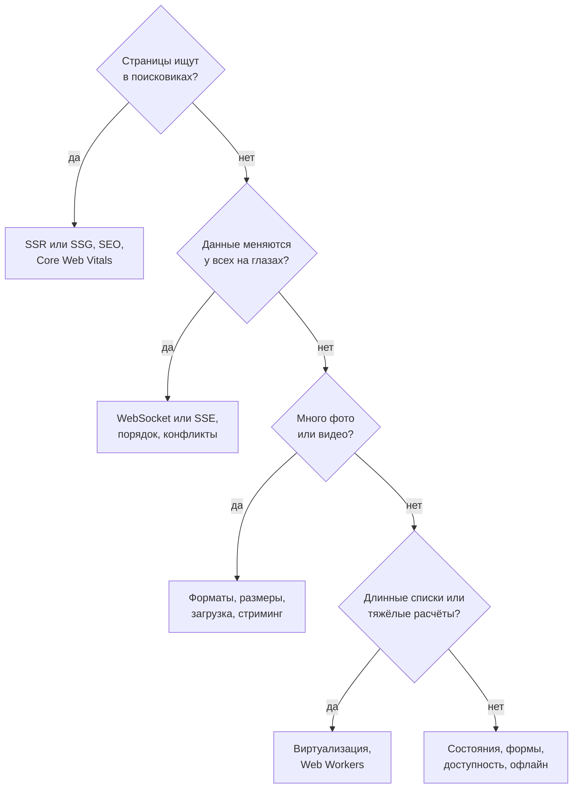

## О чём урок

Шаг O в RADIO, на который уходит до 40 % времени: как выбрать темы по продукту и что сказать по каждой. Сеть и данные, изображения и JavaScript, производительность во время работы, воспринимаемая скорость, устойчивость к сбоям и офлайн, доступность, языки, безопасность. Список тем взят из заметок Notion и плейбука GreatFrontEnd, подробности по каждой теме в уроках других треков. Пример в Node.js показывает очередь действий без сети и ключи идемпотентности.

## Как выбрать темы



Возьмите 2–4 темы: одну-две главные для продукта и одну, где вы сильны. Для каждой назовите проблему, два-три решения, их цену и рекомендацию. Общие советы («минифицировать, сжать, кэшировать») без связи с продуктом очков не дают.

## Сеть и данные

- **Протоколы**: HTTP/2 и HTTP/3 мультиплексируют запросы в одном соединении; HTTP/3 работает поверх QUIC (UDP), и потеря пакета не задерживает другие потоки (урок `net-http`).
- **Сжатие и CDN**: Brotli для текста, статика с ближайшего узла CDN, файлы с хэшем кэшируются на год (уроки `net-caching`, `tool-chunks`).
- **Форма ответа**: BFF или GraphQL, чтобы получить ровно нужные поля одним запросом; пагинация курсором; частичные отказы (урок `api-design`).
- **Заранее**: `preload` для критичных шрифтов и картинок, предзагрузка данных при наведении на карточку, `stale-while-revalidate` в кэше запросов (уроки `perf-resources`, `state-server`).

## Ресурсы и JavaScript

- **Изображения**: AVIF или WebP, `srcset` и `sizes`, `loading="lazy"` ниже экрана, размеры заранее (урок `perf-lcp`).
- **JavaScript**: разбиение по маршрутам и тяжёлым компонентам, tree shaking, тяжёлые библиотеки по требованию (уроки `perf-javascript`, `tool-tree-shaking`). Схема «современный бандл и ES5 для старых браузеров» из заметок устарела: все поддерживаемые браузеры выполняют ES-модули.

## Работа и отрисовка

- **Главный поток**: тяжёлые расчёты (разбор больших JSON, шифрование, фильтрация тысяч записей) в Web Worker; длинные задачи дробить (урок `perf-inp`).
- **Списки**: виртуализация, если строк сотни и больше; `debounce` и `throttle` для ввода, прокрутки, изменения размера.
- **Фреймворк**: состояние как можно ниже в дереве, мемоизация только там, где измерено, низкоприоритетные обновления через `useTransition` (уроки `react-performance`, `perf-runtime`).
- **Браузер**: анимации через `transform` и `opacity` (без перерасчёта раскладки), не чередовать чтение и запись размеров DOM в цикле, `contain` и `content-visibility` для независимых блоков (урок `browser-layout-paint`).
- **Память**: делегирование событий, отписка и `AbortController` при размонтировании, `WeakMap` для данных, привязанных к объектам.

## Воспринимаемая скорость

- Скелетоны вместо спиннеров, место под картинки и баннеры заранее (`aspect-ratio`), чтобы не было сдвигов (урок `perf-cls`).
- Оптимистичные обновления: показать результат сразу, откатить при ошибке.
- Каждый компонент проектируют с тремя обязательными состояниями: загрузка, ошибка с понятным текстом и повтором, пусто с подсказкой, что делать.

## Сбои и офлайн

```ts run
// A server that remembers idempotency keys it has already processed.
function createServer() {
  const posts: string[] = []
  const seen = new Map<string, number>()
  let calls = 0
  return {
    posts,
    // The first call succeeds on the server, but the response is lost on the way back.
    async createPost(text: string, key?: string): Promise<number> {
      calls++
      if (key && seen.has(key)) return seen.get(key)!
      posts.push(text)
      const id = posts.length
      if (key) seen.set(key, id)
      if (calls === 1) throw new Error('timeout: the response did not arrive')
      return id
    },
  }
}

// The outbox: actions wait in a queue while offline; each keeps the key created at submit time.
function createOutbox(server: ReturnType<typeof createServer>, useKeys: boolean) {
  const queue: { text: string; key?: string; tries: number }[] = []
  let online = false
  let counter = 0
  return {
    submit(text: string) {
      queue.push({ text, key: useKeys ? `post-${++counter}` : undefined, tries: 0 })
    },
    async goOnline() {
      online = true
      while (online && queue.length) {
        const item = queue[0]
        try {
          await server.createPost(item.text, item.key)
          queue.shift()
        } catch {
          item.tries++ // in a real app: wait 2^tries seconds with jitter, then retry
        }
      }
    },
    size: () => queue.length,
  }
}

for (const useKeys of [false, true]) {
  const server = createServer()
  const outbox = createOutbox(server, useKeys)
  outbox.submit('Landed in Lisbon') // written in the plane, offline
  outbox.submit('Great coffee here')
  console.log(useKeys ? 'with keys:   ' : 'without keys:', 'queued', outbox.size(), 'while offline')
  await outbox.goOnline()
  console.log('  server has', server.posts.length, 'posts:', server.posts.join(' | '))
}
```

```output
without keys: queued 2 while offline
  server has 3 posts: Landed in Lisbon | Landed in Lisbon | Great coffee here
with keys:    queued 2 while offline
  server has 2 posts: Landed in Lisbon | Great coffee here
```

- Два поста написаны без сети и ждут в очереди (outbox). После подключения первый запрос **дошёл до сервера, но ответ потерялся**, и клиент повторил отправку.
- Без ключа сервер создал пост дважды. С ключом идемпотентности, созданным **в момент нажатия кнопки**, сервер узнал повтор и вернул уже созданный пост.
- Повторы делают с растущей задержкой и случайным разбросом (exponential backoff with jitter), чтобы тысячи клиентов не ударили по серверу одновременно; повторяют только безопасные запросы и запросы с ключом.
- Чтение без сети: Service Worker или IndexedDB с последними данными и пометкой, что они могут быть устаревшими (уроки `net-caching`, `async-timers-workers`). Частичный отказ: один упавший ряд не ломает всю страницу (error boundary вокруг блока).

## Доступность

Список из заметок, сверенный с WCAG 2.2:

- **Клавиатура и фокус**: всё управляется с Tab, Enter, Space и стрелками; видимый фокус (не убирать `outline` без замены); модальное окно держит фокус внутри и возвращает его на кнопку, которая его открыла (`<dialog>` с `showModal()` делает фон недоступным сам); ссылка «Перейти к содержимому».
- **Семантика**: `<button>`, а не `<div onclick>`; подпись для кнопок-иконок (`aria-label="Смотреть «Очень странные дела»"`); заголовки по порядку уровней; ARIA только там, где нет подходящего элемента.
- **Динамика**: уведомления через `role="status"` (вежливо, после текущей фразы) или `role="alert"` (срочно).
- **Зрение**: контраст текста не меньше 4,5:1 (крупного 3:1); статус не только цветом; `prefers-reduced-motion` отключает автозапуск трейлеров и зум.
- **Масштаб**: страница не ломается при увеличении текста до 200 %. Масштаб браузера увеличивает и пиксели, а `rem` нужен, чтобы учитывать размер шрифта, выбранный в настройках браузера.
- **Размер целей**: WCAG 2.2 на уровне AA требует хотя бы 24×24 CSS-пикселя (или достаточный отступ); 44×44 это уровень AAA и рекомендации платформ.
- **Медиа**: субтитры (перевод речи) и титры для глухих (речь плюс звуки), аудиодескрипция, расшифровка.
- Подробно в уроках `html-a11y`, `html-aria`, `html-dialogs`.

## Языки и безопасность

- **i18n**: тексты через ключи перевода, `Intl` для чисел, валют, дат и множественного числа, языки справа налево (`dir`, логические свойства CSS `margin-inline-start`), длинные переводы не ломают вёрстку.
- **Безопасность**: пользовательский текст без `innerHTML` или через санитайзер, CSP, токены не в `localStorage`, CSRF для cookie-сессий, кэш персональных данных привязан к аккаунту (трек `security`).

## Главное

- Темы выбирают по продукту: SEO, реальное время, медиа, длинные списки или формы и состояния; 2–4 темы с вариантами и ценой.
- Сеть: HTTP/2 и HTTP/3, Brotli, CDN, точная форма ответа, курсоры, предзагрузка; ресурсы: форматы и размеры изображений, разбиение JS.
- Работа: Web Workers, виртуализация, `debounce`, состояние ниже в дереве, анимации на `transform`; воспринимаемая скорость: скелетоны, оптимистичные обновления, три состояния.
- Сбои: outbox, ключ идемпотентности при нажатии, повторы с backoff и jitter, офлайн-чтение, изоляция частичных отказов.
- Доступность по WCAG 2.2: клавиатура и фокус, семантика, `role="status"`, контраст 4,5:1, масштаб 200 %, цели 24×24 на AA.
