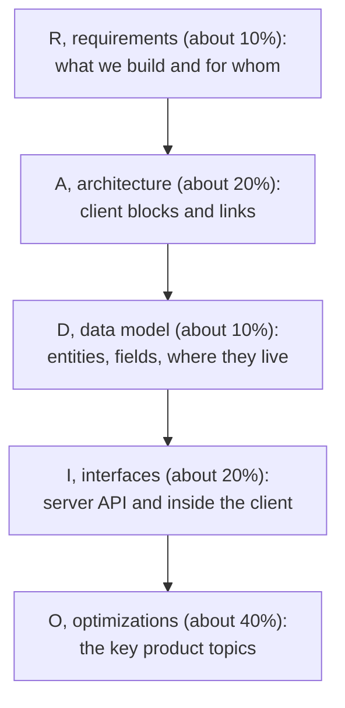
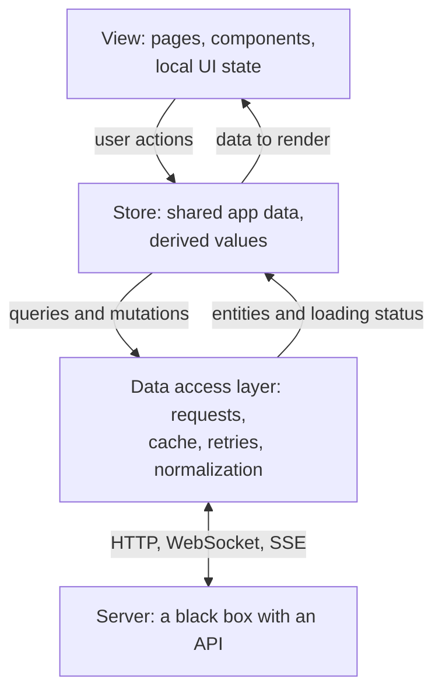

## What this lesson covers

The RADIO method for front end system design: requirements, architecture, data model, interfaces and optimizations; how much time each step gets, which questions to ask at the start, which blocks a client architecture is made of, how to describe the API between client and server and inside the client, how to pick topics for a deep dive and what is not worth discussing. The method was proposed by Yangshun Tay in GreatFrontEnd's playbook; the Notion notes use it too.

## Five steps

It is a checklist, not a strict order. Requirements always come first; architecture and data usually early, because everything else depends on them; for some products it is easier to start with the API. If a new requirement breaks the data model, go back to it. The interviewer may ask for a deep dive into one part right away: follow them, but then come back to the steps not yet covered. Write R, A, D, I, O in a corner of the board and tick off what is done.

For narrow tasks ("build mentions in Slack") the full RADIO is not needed: there is hardly any architecture there.

## R: requirements

The task is vague on purpose. Treat the interviewer as a product manager: it is better to propose a list of requirements yourself and agree on it than to wait for an answer to every question. Write down what was agreed.

- **Main use cases**: what matters in "Facebook"? The feed, loading more of it and creating a post, not friends and groups.
- **Functional requirements**: what the product cannot work without. **Non-functional**: speed, how many items fit on a page, UX, accessibility.
- **Core and nice-to-have**: which post formats to support first (text and photos) and which later (video, polls).
- **Devices and platforms**: desktop only, mobile, TV with a remote (then focus and arrow navigation).
- **Data volume**: 100 rows or 100,000 (virtualization, server-side pagination).
- **Users and roles**: who uses it, are there admins, is authentication needed.
- **Real time and offline**: does data change before the user's eyes, does the product work without a network.
- **Languages and regions**: translations, number, currency and date formats through `Intl`, right-to-left languages.
- **Accessibility**: keyboard, screen readers, contrast; for some products it is a legal requirement.

## A: architecture

- **Server**: a black box exposing an API. Do not go into database schemas and load balancers unless asked.
- **View**: what the user sees; local state (whether a list is open, a field's value) stays in components.
- **Store**: data needed by several parts: the user, loaded entities, shared layout state. One-way flow: the view sends an action, the store changes, the view re-renders.
- **Data access layer**: requests, cache, retries, cancellation, shaping the response into a convenient form. If offline storage appears later, only this layer changes.
- Draw rectangles with arrows, label what data flows along them, and describe each block's responsibility in words. For a small product or a component a separate store may be unnecessary.
- Decide **where computation happens**: filtering, sorting, the cart total on the server or on the client. Each option has its cost: data volume, weak devices, network latency.
- Rendering decisions (CSR, SSR, SSG) and navigation (SPA or MPA) belong here too: the `render-choosing` lesson and the feed walkthrough in `sd-news-feed`.

## D: data model

For each entity: fields with types, where the data comes from (the server or created on the client), whether it must be persisted, which block owns it. In detail, with normalization, in the `sd-data-model` lesson.

## I: interfaces

| Where | Name | Parameters | Result |
|---|---|---|---|
| Server and client | HTTP method and path, socket message type | Query and request body | A response, usually JSON |
| Inside the client | A function, a store action, an event | Arguments, action payload | A return value, new state |

- **Server and client**: HTTP (REST), WebSocket and SSE are usually enough; GraphQL, long polling and WebRTC are for special cases. How to choose is covered in the `api` track (`api-design`, `api-polling-sse`, `api-websocket`).
- **Inside the client**: props and callbacks (down and up the tree), store actions (`addReaction(postId, type)` and how they change the data), event subscriptions (`addEventListener`, an event bus).
- **A component API**, if you design a component: data props (`items`), event props (`onSelect`), behavior props (`maxResults`, `debounceMs`), styling props (`className`), render functions or slots (`renderItem`). An example is in the `sd-autocomplete` lesson.

## O: optimizations and deep dive

This is where most of the time and most of the points are. Pick 2–4 topics:

- **What matters for the product**: SEO and speed for a shop, syncing and conflicts for a collaborative editor, pagination and a long list for a feed.
- **Your strengths**: if you know accessibility or performance well, show it with examples from this product.
- Do not spend time on what does not change the architecture: the choice of framework or CSS library, the bundler, the linter, CI, logging. The exception is when the choice follows from the requirements (SSR for SEO, edge rendering for a global audience).

The list of topics and how they relate to products is in the `sd-optimizations` lesson.

## Key points

- RADIO: requirements, architecture, data, interfaces, optimizations; a time guide of 10, 20, 10, 20 and 40%.
- It is a checklist: requirements first, then flexible, with returns; write the letters on the board.
- Propose requirements yourself: use cases, functional and non-functional, the core, devices, volume, offline, languages, accessibility.
- Client architecture: view, store, data access layer, the server as a black box; each block has its own responsibility.
- Interfaces: HTTP, WebSocket, SSE with the server; props, store actions and events inside; component props by category.
- Optimizations: 2–4 topics that matter for the product; no arguments about frameworks and tools.
