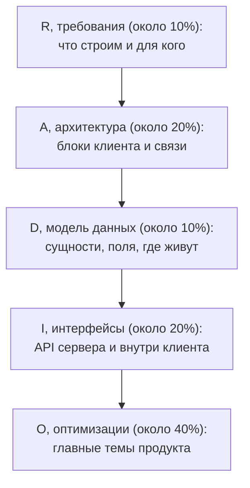
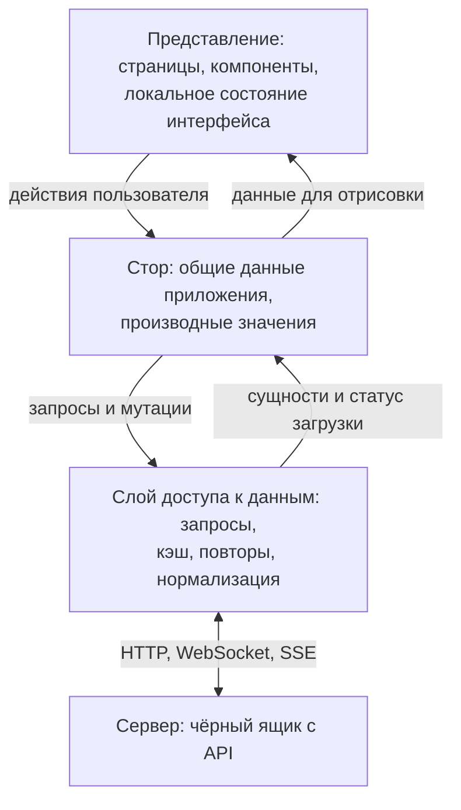

## О чём урок

Метод RADIO для frontend system design: требования, архитектура, модель данных, интерфейсы и оптимизации; сколько времени давать каждому шагу, какие вопросы задать в начале, из каких блоков складывается архитектура клиента, как описывать API между клиентом и сервером и внутри клиента, как выбрать темы для глубокого разбора и о чём не стоит говорить. Метод предложил Янгшун Тай в плейбуке GreatFrontEnd; заметки Notion используют его же.

## Пять шагов

Это чек-лист, а не строгий порядок. Требования идут первыми всегда; архитектура и данные обычно рано, потому что от них зависит всё остальное; для некоторых продуктов удобнее начать с API. Если новое требование ломает модель данных, к ней возвращаются. Интервьюер может сразу попросить углубиться в одну часть: идите за ним, но потом вернитесь к непокрытым шагам. Выпишите R, A, D, I, O в углу доски и отмечайте пройденное.

Для узких задач («сделайте упоминания в Slack») RADIO целиком не нужен: архитектуры там почти нет.

## R: требования

Задача нарочно размыта. Относитесь к интервьюеру как к продакт-менеджеру: лучше самому предложить список требований и согласовать его, чем ждать ответа на каждый вопрос. Запишите договорённости.

- **Основные сценарии**: что в «Facebook» главное? Лента, её подгрузка и создание поста, а не друзья и группы.
- **Функциональные требования**: без чего продукт не работает. **Нефункциональные**: скорость, сколько элементов на странице, UX, доступность.
- **Ядро и «хорошо бы»**: какие форматы постов поддержать сначала (текст и фото), а что потом (видео, опросы).
- **Устройства и платформы**: только десктоп, мобильные, ТВ с пультом (тогда фокус и навигация стрелками).
- **Объём данных**: 100 строк или 100 000 (виртуализация, серверная пагинация).
- **Пользователи и роли**: кто пользуется, есть ли администраторы, нужна ли авторизация.
- **Реальное время и офлайн**: меняются ли данные на глазах, работает ли продукт без сети.
- **Языки и регионы**: переводы, форматы чисел, валют и дат через `Intl`, языки справа налево.
- **Доступность**: клавиатура, скринридеры, контраст; для части продуктов это требование закона.

## A: архитектура

- **Сервер**: чёрный ящик, который отдаёт API. В схемы базы и балансировщики не уходите, если не попросят.
- **Представление**: то, что видит пользователь; локальное состояние (открыт ли список, значение поля) остаётся в компонентах.
- **Стор**: данные, нужные нескольким частям: пользователь, загруженные сущности, общее состояние раскладки. Однонаправленный поток: представление шлёт действие, стор меняется, представление перерисовывается.
- **Слой доступа к данным**: запросы, кэш, повторы, отмена, приведение ответа к удобной форме. Если позже появится офлайн-хранилище, изменится только этот слой.
- Нарисуйте прямоугольники со стрелками, подпишите, какие данные по ним идут, и словами опишите ответственность каждого блока. Для маленького продукта или компонента отдельный стор может быть лишним.
- Решите, **где идут вычисления**: фильтрация, сортировка, сумма корзины на сервере или на клиенте. У каждого варианта своя цена: объём данных, слабые устройства, задержка сети.
- Решения о рендеринге (CSR, SSR, SSG) и навигации (SPA или MPA) тоже здесь: урок `render-choosing` и разбор ленты в `sd-news-feed`.

## D: модель данных

Для каждой сущности: поля с типами, откуда данные (с сервера или созданы на клиенте), нужно ли их сохранять, какой блок ими владеет. Подробно, с нормализацией, в уроке `sd-data-model`.

## I: интерфейсы

| Где | Название | Параметры | Результат |
|---|---|---|---|
| Сервер и клиент | Метод и путь HTTP, тип сообщения сокета | Query и тело запроса | Ответ, обычно JSON |
| Внутри клиента | Функция, действие стора, событие | Аргументы, payload действия | Возвращаемое значение, новое состояние |

- **Сервер и клиент**: чаще всего хватает HTTP (REST), WebSocket и SSE; GraphQL, длинный опрос и WebRTC нужны для особых случаев. Как выбрать, разобрано в треке `api` (`api-design`, `api-polling-sse`, `api-websocket`).
- **Внутри клиента**: пропсы и колбэки (вниз и вверх по дереву), действия стора (`addReaction(postId, type)` и как они меняют данные), подписка на события (`addEventListener`, шина событий).
- **API компонента**, если проектируете компонент: пропсы данных (`items`), событий (`onSelect`), поведения (`maxResults`, `debounceMs`), оформления (`className`), функции отрисовки или слоты (`renderItem`). Пример в уроке `sd-autocomplete`.

## O: оптимизации и глубокий разбор

Здесь больше всего времени и больше всего очков. Выбирайте 2–4 темы:

- **Главное для продукта**: SEO и скорость для магазина, синхронизация и конфликты для совместного редактора, пагинация и длинный список для ленты.
- **Ваши сильные стороны**: если вы хорошо знаете доступность или производительность, покажите это на примерах из этого продукта.
- Не тратьте время на то, что не меняет архитектуру: выбор фреймворка или CSS-библиотеки, сборщик, линтер, CI, логирование. Исключение: когда выбор следует из требований (SSR для SEO, рендеринг на краю сети для глобальной аудитории).

Список тем и их связь с продуктами в уроке `sd-optimizations`.

## Главное

- RADIO: требования, архитектура, данные, интерфейсы, оптимизации; ориентир времени 10, 20, 10, 20 и 40 %.
- Это чек-лист: требования первыми, дальше гибко, с возвратами; выпишите буквы на доске.
- Требования предлагайте сами: сценарии, функциональные и нефункциональные, ядро, устройства, объём, офлайн, языки, доступность.
- Архитектура клиента: представление, стор, слой доступа к данным, сервер как чёрный ящик; у каждого блока своя ответственность.
- Интерфейсы: HTTP, WebSocket, SSE с сервером; пропсы, действия стора и события внутри; пропсы компонента по категориям.
- Оптимизации: 2–4 темы, главные для продукта; без споров о фреймворках и инструментах.
