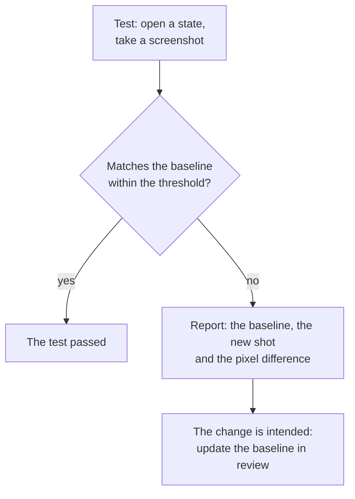

## What this lesson covers

Two checks that functional tests do not do: accessibility and appearance. What axe-core finds automatically and what it misses, where to run it (unit tests, Playwright, Storybook), ARIA snapshots as a check of the structure for screen readers, keyboard checks, visual regression with screenshots (Playwright, Vitest browser mode, cloud services), and why screenshot tests can be unstable. The example runs in jsdom with axe-core.

## Automated accessibility checks

**axe-core** is Deque's engine of WCAG rules: Lighthouse, the axe DevTools extension, `@axe-core/playwright`, `vitest-axe` and the Storybook accessibility addon use it. It checks the DOM and reports violations with a severity level.

```js dom
import axe from 'axe-core'

// A sign-up form with four typical mistakes.
document.documentElement.lang = 'en'
document.body.innerHTML = `
  <main>
    <h1>Sign up</h1>
    <form>
      <input type="email" placeholder="Email">
      
      <button><svg viewBox="0 0 10 10"><path d="M0 0h10v10z"/></svg></button>
      <div role="button" onclick="history.back()">Cancel</div>
    </form>
  </main>`

const { violations } = await axe.run(document.body, { resultTypes: ['violations'] })
for (const v of violations) console.log(`found    ${v.id} (${v.impact}): ${v.help}`)

// What a person checking with a keyboard and a screen reader would also notice.
const manual = {
  'the email field has only a placeholder, it disappears on input': 'label',
  'the "button" made of a div cannot be reached with Tab': 'focus-order-semantics',
}
const ids = violations.map((v) => v.id)
for (const [problem, rule] of Object.entries(manual)) if (!ids.includes(rule)) console.log(`missed   ${problem}`)
```

```output
found    button-name (critical): Buttons must have discernible text
found    image-alt (critical): Images must have alternative text
missed   the email field has only a placeholder, it disappears on input
missed   the "button" made of a div cannot be reached with Tab
```

- axe found the image without `alt` and the icon button without an accessible name: these are mistakes that can be checked from the DOM unambiguously.
- A field with only a `placeholder` is not a violation for the rules (the field has an accessible name), although the hint disappears on input and is hard to see; WCAG requires a visible label.
- The rules did not catch `<div role="button">` without `tabindex` and a keyboard handler: it works with a mouse and is unreachable with a keyboard.
- The conclusion: automation finds a noticeable share of problems, but not all of them. The rest is caught by tests by roles (the `test-components` lesson) and checks with a keyboard and a screen reader (the `html-a11y` lesson).
- Contrast is not checked in jsdom: there are no computed styles or layout. It is checked in a browser: in Playwright or Vitest browser mode.

## Where to run it

```ts
// Playwright: the whole page in a real browser, including contrast
import AxeBuilder from '@axe-core/playwright'

test('checkout page has no detectable a11y violations', async ({ page }) => {
  await page.goto('/checkout')
  const results = await new AxeBuilder({ page }).withTags(['wcag2a', 'wcag2aa', 'wcag22aa']).analyze()
  expect(results.violations).toEqual([])
})
```

| Level | How | What it gives |
|---|---|---|
| Linter | `eslint-plugin-jsx-a11y`, Angular and Vue rules | Markup mistakes before running anything |
| Components | `vitest-axe` or `axe.run` in a component test | Each component in several states |
| Storybook | The a11y addon with Vitest | All stories are checked in CI |
| End-to-end | `@axe-core/playwright` on key pages | Contrast, the whole page, after interactions |
| Manually | Keyboard, VoiceOver, NVDA | Focus logic, order, announcements |

## ARIA snapshots and the keyboard

```ts
// Playwright: the accessibility tree of the navigation must stay like this
await expect(page.getByRole('navigation')).toMatchAriaSnapshot(`
  - navigation:
    - link "Catalog"
    - link "Cart (1)"
    - button "Account"
`)

// Keyboard: Tab order and Escape in a dialog
await page.keyboard.press('Tab')
await expect(page.getByRole('link', { name: 'Skip to content' })).toBeFocused()
await page.getByRole('button', { name: 'Filters' }).click()
await page.keyboard.press('Escape')
await expect(page.getByRole('button', { name: 'Filters' })).toBeFocused() // focus returned to the trigger
```

- An **ARIA snapshot** compares the accessibility tree (roles and names), not HTML: changing classes and wrappers does not break it, but a lost button name does.
- Keyboard scenarios (Tab, Shift+Tab, Escape, arrows in a menu) are written as ordinary e2e tests: focus returning after a dialog closes, a focus trap, skipping navigation.

## Visual regression



```ts
// Playwright
await expect(page.getByRole('dialog')).toHaveScreenshot('filters-dialog.png', { maxDiffPixelRatio: 0.01 })
// Vitest browser mode (stable since Vitest 4)
await expect(page.getByRole('dialog')).toMatchScreenshot('filters-dialog')
```

- A screenshot test catches what functional tests do not see: a shifted layout, a missing icon, a broken theme, text wrapping.
- **Sources of instability**: fonts and anti-aliasing differ between operating systems, animations, a caret in a field, dates, random data, ads. That is why baselines are taken and compared in the same environment (usually Playwright's Docker image in CI), animations are turned off, dynamic areas are masked (`mask: [page.getByTestId('clock')]`), and a difference threshold is set.
- Shoot **components and key states**, not whole pages: a large shot fails on any small thing and gets updated without looking.
- Cloud services (Chromatic for Storybook, Percy, Argos) store baselines, show the differences in review and take shots in several browsers.

## Key points

- axe-core finds unambiguous violations from the DOM (no `alt`, a button without a name), but misses logic: a placeholder instead of a label, a `div` unreachable with a keyboard. Contrast only in a browser.
- Accessibility checks at every level: the linter, components, Storybook, `@axe-core/playwright` on key pages, plus a manual check with a keyboard and a screen reader.
- ARIA snapshots compare roles and names, not HTML; keyboard scenarios are written as e2e tests.
- Visual regression compares screenshots with a baseline; stability comes from the same environment, turned-off animations, masks and a threshold.
- Shoot components and key states; update baselines deliberately in review.
