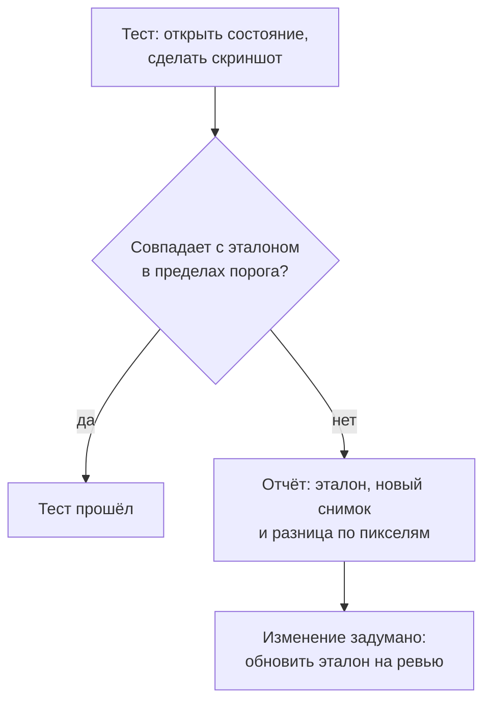

## О чём урок

Две проверки, которые функциональные тесты не делают: доступность и внешний вид. Что автоматически находит axe-core и что он пропускает, где его запускать (unit-тесты, Playwright, Storybook), ARIA-снимки как проверка структуры для скринридеров, проверки с клавиатуры, визуальная регрессия скриншотами (Playwright, браузерный режим Vitest, облачные сервисы) и почему скриншот-тесты бывают нестабильными. Пример выполняется в jsdom на axe-core.

## Автоматическая проверка доступности

**axe-core** это движок правил WCAG от Deque: его используют Lighthouse, расширение axe DevTools, `@axe-core/playwright`, `vitest-axe` и дополнение доступности в Storybook. Он проверяет DOM и сообщает нарушения с уровнем важности.

```js dom
import axe from 'axe-core'

// A sign-up form with four typical mistakes.
document.documentElement.lang = 'en'
document.body.innerHTML = `
  <main>
    <h1>Sign up</h1>
    <form>
      <input type="email" placeholder="Email">
      
      <button><svg viewBox="0 0 10 10"><path d="M0 0h10v10z"/></svg></button>
      <div role="button" onclick="history.back()">Cancel</div>
    </form>
  </main>`

const { violations } = await axe.run(document.body, { resultTypes: ['violations'] })
for (const v of violations) console.log(`found    ${v.id} (${v.impact}): ${v.help}`)

// What a person checking with a keyboard and a screen reader would also notice.
const manual = {
  'the email field has only a placeholder, it disappears on input': 'label',
  'the "button" made of a div cannot be reached with Tab': 'focus-order-semantics',
}
const ids = violations.map((v) => v.id)
for (const [problem, rule] of Object.entries(manual)) if (!ids.includes(rule)) console.log(`missed   ${problem}`)
```

```output
found    button-name (critical): Buttons must have discernible text
found    image-alt (critical): Images must have alternative text
missed   the email field has only a placeholder, it disappears on input
missed   the "button" made of a div cannot be reached with Tab
```

- axe нашёл картинку без `alt` и кнопку-иконку без доступного имени: это ошибки, которые проверяются по DOM однозначно.
- Поле только с `placeholder` правило не считает нарушением (у поля есть доступное имя), хотя подсказка исчезает при вводе и плохо видна; WCAG требует видимую подпись.
- `<div role="button">` без `tabindex` и обработчика клавиатуры правила не поймали: с мышью работает, с клавиатуры недоступен.
- Вывод: автоматика находит заметную часть проблем, но не все. Остальное ловят тесты по ролям (урок `test-components`), проверка с клавиатуры и скринридером (урок `html-a11y`).
- Контраст в jsdom не проверяется: нет вычисленных стилей и вёрстки. Его проверяют в браузере: в Playwright или браузерном режиме Vitest.

## Где запускать

```ts
// Playwright: the whole page in a real browser, including contrast
import AxeBuilder from '@axe-core/playwright'

test('checkout page has no detectable a11y violations', async ({ page }) => {
  await page.goto('/checkout')
  const results = await new AxeBuilder({ page }).withTags(['wcag2a', 'wcag2aa', 'wcag22aa']).analyze()
  expect(results.violations).toEqual([])
})
```

| Уровень | Как | Что даёт |
|---|---|---|
| Линтер | `eslint-plugin-jsx-a11y`, правила Angular и Vue | Ошибки в разметке до запуска |
| Компоненты | `vitest-axe` или `axe.run` в тесте компонента | Каждый компонент в нескольких состояниях |
| Storybook | Дополнение a11y с Vitest | Все истории проверяются в CI |
| End-to-end | `@axe-core/playwright` на ключевых страницах | Контраст, страница целиком, после взаимодействий |
| Вручную | Клавиатура, VoiceOver, NVDA | Логика фокуса, порядок, озвучивание |

## ARIA-снимки и клавиатура

```ts
// Playwright: the accessibility tree of the navigation must stay like this
await expect(page.getByRole('navigation')).toMatchAriaSnapshot(`
  - navigation:
    - link "Catalog"
    - link "Cart (1)"
    - button "Account"
`)

// Keyboard: Tab order and Escape in a dialog
await page.keyboard.press('Tab')
await expect(page.getByRole('link', { name: 'Skip to content' })).toBeFocused()
await page.getByRole('button', { name: 'Filters' }).click()
await page.keyboard.press('Escape')
await expect(page.getByRole('button', { name: 'Filters' })).toBeFocused() // focus returned to the trigger
```

- **ARIA-снимок** сравнивает дерево доступности (роли и имена), а не HTML: изменение классов и обёрток его не ломает, а пропавшее имя кнопки ломает.
- Сценарии с клавиатуры (Tab, Shift+Tab, Escape, стрелки в меню) пишут как обычные e2e-тесты: возврат фокуса после закрытия диалога, ловушка фокуса, пропуск навигации.

## Визуальная регрессия



```ts
// Playwright
await expect(page.getByRole('dialog')).toHaveScreenshot('filters-dialog.png', { maxDiffPixelRatio: 0.01 })
// Vitest browser mode (stable since Vitest 4)
await expect(page.getByRole('dialog')).toMatchScreenshot('filters-dialog')
```

- Скриншот-тест ловит то, что функциональные тесты не видят: съехавшую вёрстку, пропавшую иконку, сломанную тему, перенос текста.
- **Источники нестабильности**: шрифты и сглаживание различаются между ОС, анимации, курсор в поле, даты, случайные данные, реклама. Поэтому эталоны снимают и сравнивают в одинаковом окружении (обычно Docker-образ Playwright в CI), отключают анимации, маскируют динамические области (`mask: [page.getByTestId('clock')]`) и задают порог различий.
- Снимают **компоненты и ключевые состояния**, а не все страницы целиком: большой снимок падает от любой мелочи, и его обновляют не глядя.
- Облачные сервисы (Chromatic для Storybook, Percy, Argos) хранят эталоны, показывают различия на ревью и снимают в нескольких браузерах.

## Главное

- axe-core находит однозначные нарушения по DOM (нет `alt`, нет имени у кнопки), но пропускает логику: подсказку вместо подписи, недоступный с клавиатуры `div`. Контраст только в браузере.
- Проверки доступности на всех уровнях: линтер, компоненты, Storybook, `@axe-core/playwright` на ключевых страницах, плюс ручная проверка клавиатурой и скринридером.
- ARIA-снимки сравнивают роли и имена, а не HTML; сценарии с клавиатуры пишут как e2e.
- Визуальная регрессия сравнивает скриншоты с эталоном; стабильность даёт одинаковое окружение, отключённые анимации, маски и порог.
- Снимают компоненты и ключевые состояния; эталоны обновляют осознанно на ревью.
