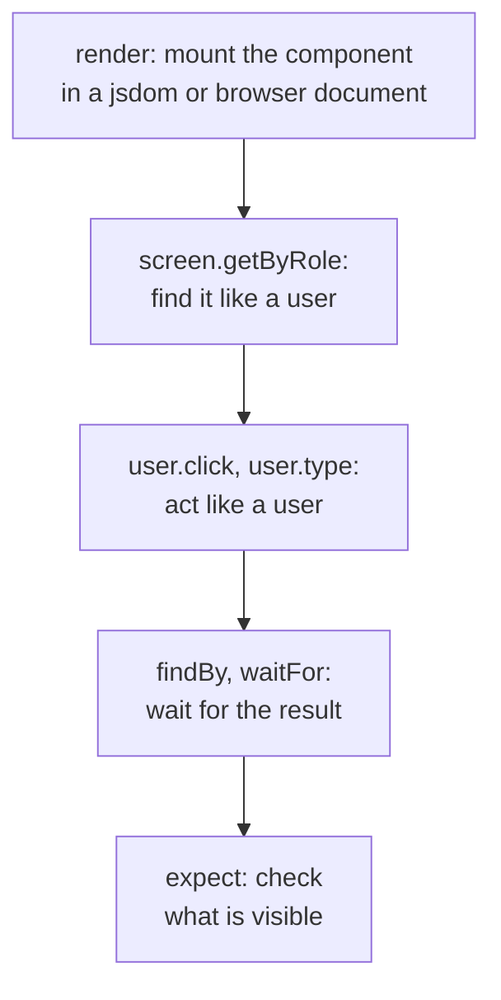

## What this lesson covers

How to test components of any framework: the Testing Library principle, query priority, `user-event` versus `fireEvent` and which events they actually fire, waiting for an asynchronous result, why a test by roles survives refactoring and a test by classes does not, and the Testing Library wrappers and native tools of React, Vue and Angular. A React component test is covered in detail in the `react-a11y-testing` lesson, Angular in `ng-testing`, Vue in `vue-app`. The example runs in jsdom on plain DOM.

## The Testing Library principle

The library's main principle: the closer a test is to how the app is used, the more confidence it gives.

Testing Library gives no access to a component's state, instance or methods. A test finds elements the way a user does (by role, label, text), acts like a user (click, type, Tab) and checks what the user sees. The core `@testing-library/dom` does not depend on a framework; the wrappers for React, Vue, Angular and Svelte only mount the component.



## Query priority

1. **`getByRole('button', { name: 'Save' })`**: role and accessible name. It works for almost everything and checks accessibility at the same time: an element without a role or a name will not be found.
2. **`getByLabelText('Email')`**: form fields by their label.
3. **`getByPlaceholderText`, `getByText`, `getByDisplayValue`**: when there is no role.
4. **`getByAltText`, `getByTitle`**.
5. **`getByTestId`**: the last option, when nothing else is possible (a canvas, complex graphics).

| Prefix | No element | Several | Waits |
|---|---|---|---|
| `getBy` | Error | Error | No |
| `queryBy` | `null` | Error | No; for checking absence |
| `findBy` | Error after a timeout | Error | Yes, returns a promise |
| `getAllBy`, `queryAllBy`, `findAllBy` | Error, `[]`, error | An array | Like the single ones |

## Events and resilience to refactoring

```js dom
import { fireEvent, screen } from '@testing-library/dom'
import userEvent from '@testing-library/user-event'

// A tiny search field in plain DOM: the same queries work for React, Vue, Angular, Svelte.
document.body.innerHTML = `
  <label for="q">Search</label><input id="q" class="search__input">
  <button class="btn btn--primary">Find</button>`
const input = screen.getByRole('textbox', { name: 'Search' })
const seen = []
for (const type of ['keydown', 'keypress', 'input', 'keyup', 'change', 'focus', 'pointerdown', 'mousedown', 'mouseup', 'click'])
  for (const el of [input, screen.getByRole('button')]) el.addEventListener(type, () => seen.push(type))

fireEvent.change(input, { target: { value: 'vue' } })
console.log('fireEvent.change:', seen.join(' '))

seen.length = 0
input.value = ''
const user = userEvent.setup()
await user.type(input, 'vu')
console.log('user.type "vu"  :', seen.join(' '))

seen.length = 0
await user.click(screen.getByRole('button', { name: 'Find' }))
console.log('user.click      :', seen.join(' '))

// After a "refactoring" the markup changes, the behavior does not.
document.querySelector('button').className = 'Button_root__x7f2a'
console.log('by class   :', document.querySelector('.btn--primary') ? 'found' : 'test breaks')
console.log('by role    :', screen.queryByRole('button', { name: 'Find' }) ? 'found' : 'test breaks')
```

```output
fireEvent.change: change
user.type "vu"  : pointerdown mousedown focus mouseup click keydown keypress input keyup keydown keypress input keyup
user.click      : pointerdown mousedown change focus mouseup click
by class   : test breaks
by role    : found
```

- **`fireEvent.change`** sent one `change` event: no focus, no key presses. A handler on `keydown` or `input` will not fire in such a test, although it will for the user.
- **`user-event`** reproduces the whole action: before typing, the pointer and focus, then `keydown`, `keypress`, `input`, `keyup` for each character. Clicking the button moved focus away from the field, which is exactly when the browser's `change` for the field arrived. `fireEvent` is left for events the user does not trigger directly (`scroll`, `load`).
- `userEvent.setup()` is called at the start of the test, and every action is awaited.
- After the "refactoring" the button's class changed: a test by class would break, although the button works. The test by role and name found it. It breaks only if something the user sees changes.

## Asynchrony

- Data after a request is awaited with **`await screen.findByRole(...)`** or **`await waitFor(() => expect(...))`**, not with a pause in the test.
- Inside `waitFor` only assertions, no actions: the callback is retried until it succeeds or times out (1 s by default).
- React's "not wrapped in act(...)" warning means the state updated when the test was not waiting: wait for the result with `findBy` rather than silencing the warning.
- To check that an element disappeared: `await waitForElementToBeRemoved(() => screen.queryByText('Loading…'))`.

## Wrappers and native tools

| Framework | Testing Library | Native tools |
|---|---|---|
| React | `@testing-library/react`: `render`, `renderHook` | No separate official library; Testing Library became the standard |
| Vue | `@testing-library/vue` | Vue Test Utils (`mount`, `wrapper.find`, `emitted`), the official library |
| Angular | `@testing-library/angular` | `TestBed`, `ComponentFixture`, component harnesses (Angular CDK) |
| Svelte, Solid, Preact | Their own wrappers | Each framework has its own |

Native tools give access to the component's instance and events (`wrapper.emitted()` in Vue): this is handy for component libraries but pulls tests toward implementation details. Angular's **harnesses** are close to the Testing Library approach: the test works with a component through the harness API (`await button.click()`), not through Angular Material's DOM structure.

## Where to run

- **jsdom or happy-dom** in Vitest: fast, fits most components. No layout and no real window focus.
- **Vitest browser mode**: the same test in real Chromium, Firefox or WebKit through Playwright. Needed when behavior depends on sizes, scrolling, CSS, `IntersectionObserver`. The locators are the same: `page.getByRole(...)`, and in Vitest 5 "element not found" errors show the accessibility tree.
- **Storybook 10** with the Vitest addon runs stories as tests: each story is checked for rendering, and the `play` function describes an interaction.

## Key points

- A test finds, acts and checks like a user; the Testing Library core does not depend on a framework.
- Query priority: role and name, label, text, `getByTestId` last; `getBy` throws, `queryBy` for absence, `findBy` waits.
- `user-event` fires the full chain of events (focus, keys, `input`), `fireEvent` a single event; actions are awaited.
- A test by roles survives markup refactoring, a test by classes does not.
- Asynchrony through `findBy` and `waitFor`, not pauses; the `act` warning means the result was not awaited.
- jsdom for most components, Vitest browser mode for layout, Storybook for stories as tests.
