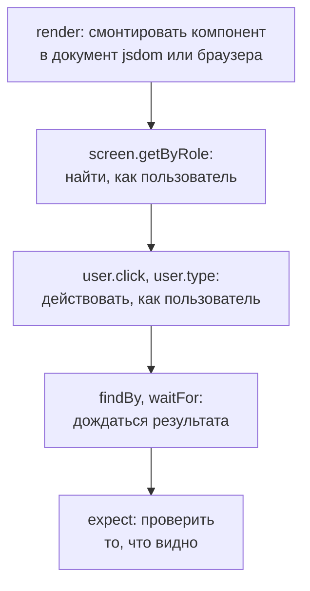

## О чём урок

Как тестировать компоненты любого фреймворка: принцип Testing Library, приоритет запросов, `user-event` против `fireEvent` и какие события они на самом деле вызывают, ожидание асинхронного результата, почему тест по ролям переживает рефакторинг, а тест по классам нет, и обёртки Testing Library и родные инструменты React, Vue и Angular. Тест компонента React подробно разобран в уроке `react-a11y-testing`, Angular в `ng-testing`, Vue в `vue-app`. Пример выполняется в jsdom на чистом DOM.

## Принцип Testing Library

Главный принцип библиотеки: чем ближе тест к тому, как приложением пользуются, тем больше уверенности он даёт.

Testing Library не даёт доступа к состоянию, экземпляру и методам компонента. Тест находит элементы так же, как пользователь (по роли, подписи, тексту), действует как пользователь (клик, ввод, Tab) и проверяет то, что пользователь видит. Ядро `@testing-library/dom` не зависит от фреймворка, обёртки для React, Vue, Angular, Svelte только монтируют компонент.



## Приоритет запросов

1. **`getByRole('button', { name: 'Сохранить' })`**: роль и доступное имя. Работает почти для всего и заодно проверяет доступность: элемент без роли или имени не найдётся.
2. **`getByLabelText('Email')`**: поля формы по подписи.
3. **`getByPlaceholderText`, `getByText`, `getByDisplayValue`**: когда роли нет.
4. **`getByAltText`, `getByTitle`**.
5. **`getByTestId`**: последний вариант, когда остальное невозможно (холст, сложная графика).

| Префикс | Нет элемента | Несколько | Ждёт |
|---|---|---|---|
| `getBy` | Ошибка | Ошибка | Нет |
| `queryBy` | `null` | Ошибка | Нет; для проверки отсутствия |
| `findBy` | Ошибка после таймаута | Ошибка | Да, возвращает промис |
| `getAllBy`, `queryAllBy`, `findAllBy` | Ошибка, `[]`, ошибка | Массив | Как у одиночных |

## События и устойчивость к рефакторингу

```js dom
import { fireEvent, screen } from '@testing-library/dom'
import userEvent from '@testing-library/user-event'

// A tiny search field in plain DOM: the same queries work for React, Vue, Angular, Svelte.
document.body.innerHTML = `
  <label for="q">Search</label><input id="q" class="search__input">
  <button class="btn btn--primary">Find</button>`
const input = screen.getByRole('textbox', { name: 'Search' })
const seen = []
for (const type of ['keydown', 'keypress', 'input', 'keyup', 'change', 'focus', 'pointerdown', 'mousedown', 'mouseup', 'click'])
  for (const el of [input, screen.getByRole('button')]) el.addEventListener(type, () => seen.push(type))

fireEvent.change(input, { target: { value: 'vue' } })
console.log('fireEvent.change:', seen.join(' '))

seen.length = 0
input.value = ''
const user = userEvent.setup()
await user.type(input, 'vu')
console.log('user.type "vu"  :', seen.join(' '))

seen.length = 0
await user.click(screen.getByRole('button', { name: 'Find' }))
console.log('user.click      :', seen.join(' '))

// After a "refactoring" the markup changes, the behavior does not.
document.querySelector('button').className = 'Button_root__x7f2a'
console.log('by class   :', document.querySelector('.btn--primary') ? 'found' : 'test breaks')
console.log('by role    :', screen.queryByRole('button', { name: 'Find' }) ? 'found' : 'test breaks')
```

```output
fireEvent.change: change
user.type "vu"  : pointerdown mousedown focus mouseup click keydown keypress input keyup keydown keypress input keyup
user.click      : pointerdown mousedown change focus mouseup click
by class   : test breaks
by role    : found
```

- **`fireEvent.change`** отправил одно событие `change`: ни фокуса, ни нажатий клавиш. Обработчик на `keydown` или `input` в таком тесте не сработает, хотя у пользователя сработает.
- **`user-event`** воспроизводит действие целиком: перед вводом указатель и фокус, затем для каждого символа `keydown`, `keypress`, `input`, `keyup`. Клик по кнопке увёл фокус с поля, поэтому браузерное `change` поля пришло именно тогда. `fireEvent` оставляют для событий, которых пользователь напрямую не вызывает (`scroll`, `load`).
- `userEvent.setup()` вызывают в начале теста, а все действия ждут через `await`.
- После «рефакторинга» класс кнопки изменился: тест по классу сломался бы, хотя кнопка работает. Тест по роли и имени нашёл её. Он сломается, только если изменится то, что видит пользователь.

## Асинхронность

- Данные после запроса ждут через **`await screen.findByRole(...)`** или **`await waitFor(() => expect(...))`**, а не через паузу в тесте.
- Внутри `waitFor` только проверки, без действий: колбэк повторяется до успеха или таймаута (1 с по умолчанию).
- Предупреждение React «not wrapped in act(...)» значит, что состояние обновилось, когда тест этого не ждал: нужно дождаться результата через `findBy`, а не глушить предупреждение.
- Чтобы проверить, что элемент исчез: `await waitForElementToBeRemoved(() => screen.queryByText('Загрузка…'))`.

## Обёртки и родные инструменты

| Фреймворк | Testing Library | Родные инструменты |
|---|---|---|
| React | `@testing-library/react`: `render`, `renderHook` | Отдельной официальной библиотеки нет, Testing Library стала стандартом |
| Vue | `@testing-library/vue` | Vue Test Utils (`mount`, `wrapper.find`, `emitted`), официальная библиотека |
| Angular | `@testing-library/angular` | `TestBed`, `ComponentFixture`, харнессы компонентов (Angular CDK) |
| Svelte, Solid, Preact | Свои обёртки | У каждого фреймворка свои |

Родные инструменты дают доступ к экземпляру и событиям компонента (`wrapper.emitted()` во Vue): это удобно для библиотек компонентов, но тянет тесты к деталям реализации. **Харнессы** Angular похожи на подход Testing Library: тест работает с компонентом через API харнесса (`await button.click()`), а не через DOM-структуру Angular Material.

## Где выполнять

- **jsdom или happy-dom** в Vitest: быстро, подходит для большинства компонентов. Нет вёрстки и настоящего фокуса окна.
- **Браузерный режим Vitest**: тот же тест в настоящем Chromium, Firefox или WebKit через Playwright. Нужен, когда поведение зависит от размеров, прокрутки, CSS, `IntersectionObserver`. Локаторы в нём те же: `page.getByRole(...)`, а ошибки «элемент не найден» в Vitest 5 показывают дерево доступности.
- **Storybook 10** с дополнением для Vitest запускает истории как тесты: каждая история проверяется на рендер, а функция `play` описывает взаимодействие.

## Главное

- Тест ищет, действует и проверяет как пользователь; ядро Testing Library не зависит от фреймворка.
- Приоритет запросов: роль и имя, подпись, текст, `getByTestId` последним; `getBy` бросает, `queryBy` для отсутствия, `findBy` ждёт.
- `user-event` вызывает полную цепочку событий (фокус, клавиши, `input`), `fireEvent` одно событие; действия ждут через `await`.
- Тест по ролям переживает рефакторинг разметки, тест по классам нет.
- Асинхронность через `findBy` и `waitFor`, а не паузы; предупреждение про `act` значит, что результат не дождались.
- jsdom для большинства компонентов, браузерный режим Vitest для вёрстки, Storybook для историй как тестов.
