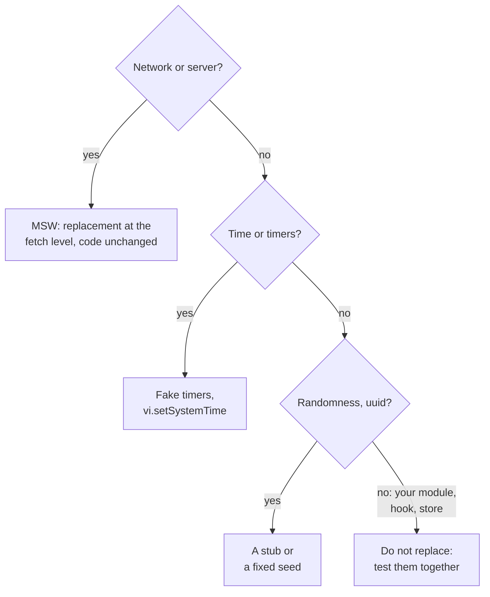

## What this lesson covers

Test doubles: how a stub, a spy, a mock and a fake differ, the functions `vi.fn`, `vi.spyOn` and the new `vi.when`, replacing modules with `vi.mock` and why it is used with care, what to replace (boundaries: the network, time, randomness, missing browser APIs) and what not to, fake timers, MSW in tests, and clearing mocks between tests. The example runs real Vitest on temporary files.

## Kinds of doubles

| Kind | What it does | Example |
|---|---|---|
| Dummy | Fills a parameter, is not used | `onClose={() => {}}` in a test where closing is not checked |
| Stub | Returns a set answer | `vi.fn().mockResolvedValue([])` instead of loading a list |
| Spy | Records calls, can keep the real behavior | `vi.spyOn(console, 'error')` |
| Mock | A stub with expectations: you check how it was called | `expect(onSave).toHaveBeenCalledWith({ name: 'Ann' })` |
| Fake | A simplified working implementation | An in-memory store instead of IndexedDB, MSW instead of a server |

In Vitest all of this is done with one function, `vi.fn()`; the names matter for understanding **what** the test checks: the result of the code's work (stubs) or how the code talks to its neighbors (mocks).

## What to replace



- Replace **boundaries** that are slow, unstable or unavailable in a test: the network, time, random numbers, browser APIs missing in jsdom (`IntersectionObserver`, `matchMedia`), analytics and logging.
- Your own modules, hooks and stores are usually **not mocked**: a test with a replaced neighbor checks that the code calls the neighbor the way you think, not that everything works together. After refactoring such tests break, although the behavior is correct.
- The more mocks in a test, the less it proves. If a component test needs five mocked modules, that is a signal about coupling in the code.

## Mocks, spies and timers

```js run
import { mkdtempSync, rmSync, writeFileSync } from 'node:fs'
import { join } from 'node:path'
import { startVitest } from 'vitest/node'

const search = `
export function createSearch(fetchResults, onResults) {
  let timer
  return (query) => {
    clearTimeout(timer)
    timer = setTimeout(async () => onResults(await fetchResults(query)), 300)
  }
}`
const test = `
import { afterEach, expect, test, vi } from 'vitest'
import { createSearch } from './search.js'
afterEach(() => vi.useRealTimers())

test('real timers: the test has to wait', async () => {
  const fetchResults = vi.fn().mockResolvedValue([])
  createSearch(fetchResults, () => {})('re')
  expect(fetchResults).toHaveBeenCalledTimes(1) // checked too early
})

test('fake timers: one request after 300 ms', async () => {
  vi.useFakeTimers()
  const fetchResults = vi.fn()
  vi.when(fetchResults).calledWith('re').thenResolve(['React', 'Redux'])
  const onResults = vi.fn()
  const run = createSearch(fetchResults, onResults)
  run('r'); run('re')
  await vi.advanceTimersByTimeAsync(299)
  expect(fetchResults).not.toHaveBeenCalled()
  await vi.advanceTimersByTimeAsync(1)
  expect(fetchResults).toHaveBeenCalledExactlyOnceWith('re')
  expect(onResults).toHaveBeenCalledWith(['React', 'Redux'])
})

test('spy on console.warn', () => {
  const warn = vi.spyOn(console, 'warn').mockImplementation(() => {})
  console.warn('prop "size" is deprecated')
  expect(warn).toHaveBeenCalledWith(expect.stringContaining('deprecated'))
  warn.mockRestore()
})`

const dir = mkdtempSync(join(process.cwd(), 'node_modules', '.vt-'))
writeFileSync(join(dir, 'search.js'), search)
writeFileSync(join(dir, 'search.test.js'), test)
const vitest = await startVitest('test', [], { root: dir, watch: false, reporters: [{}] })
for (const t of vitest.state.getTestModules()[0].children.allTests()) {
  const { state, errors } = t.result()
  console.log(state.padEnd(7), t.name + (errors ? '\n        ' + errors[0].message.split('\n')[0] : ''))
}
await vitest.close()
rmSync(dir, { recursive: true })
process.exitCode = 0
```

```output
failed  real timers: the test has to wait
        expected "vi.fn()" to be called 1 times, but got 0 times
passed  fake timers: one request after 300 ms
passed  spy on console.warn
```

- The first test checked the call right away, while the function with a 300 ms delay had not fired yet. Waiting a real 300 ms in a test is bad: slow and unstable under load.
- **Fake timers** (`vi.useFakeTimers()`) stop time: it moves only on the command `vi.advanceTimersByTimeAsync(ms)`. The test checked exactly what is required: no request at 299 ms, exactly one request with the last value at 300.
- **`vi.when`** (Vitest 5) sets different answers for different arguments; a call with other arguments goes to the mock's regular implementation, and without one returns `undefined` (checked by running it).
- The **spy** on `console.warn` silenced the output and checked the call; `mockRestore()` brought back the real function. At the end of tests timers are restored too (`vi.useRealTimers()` in `afterEach`).
- For dates: `vi.setSystemTime(new Date('2026-01-01'))` fixes "now" for `Date` and Temporal, and a test about "today" does not fail at midnight.

## Replacing modules

```ts
import { expect, test, vi } from 'vitest'
import { trackEvent } from './analytics'
import { checkout } from './checkout'

vi.mock('./analytics', () => ({ trackEvent: vi.fn() })) // hoisted above the imports

test('checkout sends an analytics event', async () => {
  await checkout({ items: 2 })
  expect(trackEvent).toHaveBeenCalledWith('checkout', { items: 2 })
})
```

- `vi.mock` is **hoisted** above the imports: the module is replaced before the code under test loads it. That is why the factory cannot reference test variables, except ones created through `vi.hoisted`.
- A partial replacement: `vi.mock('./api', async (importOriginal) => ({ ...(await importOriginal()), fetchUser: vi.fn() }))` keeps the other exports real.
- Replacing modules is justified for external effects (analytics, logging, payment SDKs). For the network MSW is better: the code is tested together with its `fetch`, headers and response parsing.

## The network: MSW in tests

```ts
// vitest.setup.ts
import { setupServer } from 'msw/node'
import { http, HttpResponse } from 'msw/http'

export const server = setupServer(http.get('https://api.example.com/user', () => HttpResponse.json({ name: 'Ann' })))
beforeAll(() => server.listen({ onUnhandledFrame: 'error' })) // a request without a handler fails the test
afterEach(() => server.resetHandlers()) // handlers added in a test do not leak into the next one
afterAll(() => server.close())

// in a test: the error branch
server.use(http.get('https://api.example.com/user', () => HttpResponse.json({ message: 'down' }, { status: 503 })))
```

MSW replaces responses at the `fetch` and `WebSocket` level, so the same handlers work in unit and component tests, in Storybook and in the browser during development. Details with examples are in the `api-mocking` lesson.

## Clearing between tests

| Function | What it does |
|---|---|
| `mockClear()`, `vi.clearAllMocks()` | Erases the call history, the implementation stays. In Vitest 5 it is on by default before each test (`clearMocks: true`) |
| `mockReset()`, `vi.resetAllMocks()` | Erases the history and the set behavior |
| `mockRestore()`, `vi.restoreAllMocks()` | Brings back the real function for `vi.spyOn` |
| `vi.unstubAllGlobals()`, `vi.useRealTimers()` | Brings back replaced globals and timers |

If a test passes alone and fails in the full run, the first thing to look for is an uncleared mock or shared state (the `test-practice` lesson).

## Key points

- Dummy, stub, spy, mock, fake: in Vitest it is all `vi.fn()`, but it matters what is checked, the result or the communication with neighbors.
- Replace boundaries: the network (MSW), time (fake timers), randomness, missing browser APIs; your own modules are usually tested together.
- Fake timers and `vi.advanceTimersByTimeAsync` instead of waiting real time; `vi.setSystemTime` for dates.
- `vi.mock` is hoisted above the imports; it is justified for external effects like analytics.
- `vi.when` in Vitest 5 sets answers by arguments; `clearMocks` is now on by default; spies and timers are restored after the test.
