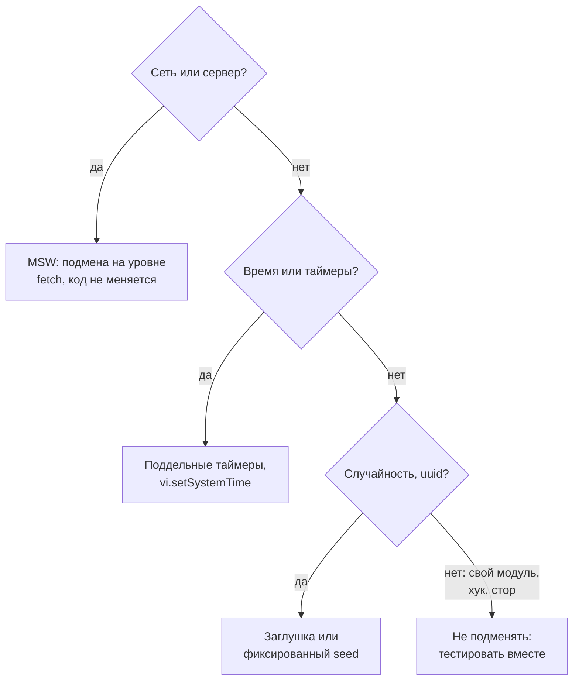

## О чём урок

Тестовые двойники: чем отличаются заглушка, шпион, мок и фейк, функции `vi.fn`, `vi.spyOn` и новая `vi.when`, подмена модулей через `vi.mock` и почему её используют осторожно, что подменять (границы: сеть, время, случайность, отсутствующие браузерные API) и чего не подменять, поддельные таймеры, MSW в тестах и очистка моков между тестами. Пример запускает настоящий Vitest на временных файлах.

## Виды двойников

| Вид | Что делает | Пример |
|---|---|---|
| Dummy | Заполняет параметр, не используется | `onClose={() => {}}` в тесте, где закрытие не проверяют |
| Stub (заглушка) | Возвращает заданный ответ | `vi.fn().mockResolvedValue([])` вместо загрузки списка |
| Spy (шпион) | Записывает вызовы, может оставить настоящее поведение | `vi.spyOn(console, 'error')` |
| Mock | Заглушка с ожиданиями: проверяют, как её вызвали | `expect(onSave).toHaveBeenCalledWith({ name: 'Ann' })` |
| Fake | Упрощённая рабочая реализация | Хранилище в памяти вместо IndexedDB, MSW вместо сервера |

В Vitest всё это делается одной функцией `vi.fn()`; названия важны, чтобы понимать, **что** тест проверяет: результат работы кода (заглушки) или то, как код общается с соседями (моки).

## Что подменять



- Подменяют **границы**, которые медленны, нестабильны или недоступны в тесте: сеть, время, случайные числа, браузерные API, которых нет в jsdom (`IntersectionObserver`, `matchMedia`), аналитику и логирование.
- Свои модули, хуки и сторы обычно **не мокают**: тест с подменённым соседом проверяет, что код вызывает соседа так, как вы думаете, а не что всё вместе работает. После рефакторинга такие тесты ломаются, хотя поведение верное.
- Чем больше в тесте моков, тем меньше он доказывает. Если для теста компонента нужно замокать пять модулей, это сигнал о связности кода.

## Моки, шпионы и таймеры

```js run
import { mkdtempSync, rmSync, writeFileSync } from 'node:fs'
import { join } from 'node:path'
import { startVitest } from 'vitest/node'

const search = `
export function createSearch(fetchResults, onResults) {
  let timer
  return (query) => {
    clearTimeout(timer)
    timer = setTimeout(async () => onResults(await fetchResults(query)), 300)
  }
}`
const test = `
import { afterEach, expect, test, vi } from 'vitest'
import { createSearch } from './search.js'
afterEach(() => vi.useRealTimers())

test('real timers: the test has to wait', async () => {
  const fetchResults = vi.fn().mockResolvedValue([])
  createSearch(fetchResults, () => {})('re')
  expect(fetchResults).toHaveBeenCalledTimes(1) // checked too early
})

test('fake timers: one request after 300 ms', async () => {
  vi.useFakeTimers()
  const fetchResults = vi.fn()
  vi.when(fetchResults).calledWith('re').thenResolve(['React', 'Redux'])
  const onResults = vi.fn()
  const run = createSearch(fetchResults, onResults)
  run('r'); run('re')
  await vi.advanceTimersByTimeAsync(299)
  expect(fetchResults).not.toHaveBeenCalled()
  await vi.advanceTimersByTimeAsync(1)
  expect(fetchResults).toHaveBeenCalledExactlyOnceWith('re')
  expect(onResults).toHaveBeenCalledWith(['React', 'Redux'])
})

test('spy on console.warn', () => {
  const warn = vi.spyOn(console, 'warn').mockImplementation(() => {})
  console.warn('prop "size" is deprecated')
  expect(warn).toHaveBeenCalledWith(expect.stringContaining('deprecated'))
  warn.mockRestore()
})`

const dir = mkdtempSync(join(process.cwd(), 'node_modules', '.vt-'))
writeFileSync(join(dir, 'search.js'), search)
writeFileSync(join(dir, 'search.test.js'), test)
const vitest = await startVitest('test', [], { root: dir, watch: false, reporters: [{}] })
for (const t of vitest.state.getTestModules()[0].children.allTests()) {
  const { state, errors } = t.result()
  console.log(state.padEnd(7), t.name + (errors ? '\n        ' + errors[0].message.split('\n')[0] : ''))
}
await vitest.close()
rmSync(dir, { recursive: true })
process.exitCode = 0
```

```output
failed  real timers: the test has to wait
        expected "vi.fn()" to be called 1 times, but got 0 times
passed  fake timers: one request after 300 ms
passed  spy on console.warn
```

- Первый тест проверил вызов сразу, а функция с задержкой 300 мс ещё не сработала. Ждать настоящие 300 мс в тесте плохо: медленно и нестабильно под нагрузкой.
- **Поддельные таймеры** (`vi.useFakeTimers()`) останавливают время: оно идёт только по команде `vi.advanceTimersByTimeAsync(ms)`. Тест проверил ровно то, что требуется: за 299 мс запроса нет, на 300-й ровно один запрос с последним значением.
- **`vi.when`** (Vitest 5) задаёт разные ответы на разные аргументы; вызов с другими аргументами уходит в обычную реализацию мока, а без неё возвращает `undefined` (проверено запуском).
- **Шпион** на `console.warn` заглушил вывод и проверил вызов; `mockRestore()` вернул настоящую функцию. В конце тестов восстанавливают и таймеры (`vi.useRealTimers()` в `afterEach`).
- Для дат: `vi.setSystemTime(new Date('2026-01-01'))` фиксирует «сейчас» для `Date` и Temporal, и тест про «сегодня» не падает в полночь.

## Подмена модулей

```ts
import { expect, test, vi } from 'vitest'
import { trackEvent } from './analytics'
import { checkout } from './checkout'

vi.mock('./analytics', () => ({ trackEvent: vi.fn() })) // hoisted above the imports

test('checkout sends an analytics event', async () => {
  await checkout({ items: 2 })
  expect(trackEvent).toHaveBeenCalledWith('checkout', { items: 2 })
})
```

- `vi.mock` **поднимается** над импортами: модуль подменяется до того, как его загрузит тестируемый код. Поэтому внутри фабрики нельзя обращаться к переменным теста, кроме созданных через `vi.hoisted`.
- Частичная подмена: `vi.mock('./api', async (importOriginal) => ({ ...(await importOriginal()), fetchUser: vi.fn() }))` оставляет остальные экспорты настоящими.
- Подмена модулей оправдана для внешних эффектов (аналитика, логирование, SDK оплаты). Для сети лучше MSW: код тестируется вместе со своим `fetch`, заголовками и разбором ответа.

## Сеть: MSW в тестах

```ts
// vitest.setup.ts
import { setupServer } from 'msw/node'
import { http, HttpResponse } from 'msw/http'

export const server = setupServer(http.get('https://api.example.com/user', () => HttpResponse.json({ name: 'Ann' })))
beforeAll(() => server.listen({ onUnhandledFrame: 'error' })) // a request without a handler fails the test
afterEach(() => server.resetHandlers()) // handlers added in a test do not leak into the next one
afterAll(() => server.close())

// in a test: the error branch
server.use(http.get('https://api.example.com/user', () => HttpResponse.json({ message: 'down' }, { status: 503 })))
```

MSW подменяет ответы на уровне `fetch` и `WebSocket`, поэтому одни и те же обработчики работают в unit- и компонентных тестах, в Storybook и в браузере при разработке. Подробно с примерами в уроке `api-mocking`.

## Очистка между тестами

| Функция | Что делает |
|---|---|
| `mockClear()`, `vi.clearAllMocks()` | Стирает историю вызовов, реализация остаётся. В Vitest 5 включено по умолчанию перед каждым тестом (`clearMocks: true`) |
| `mockReset()`, `vi.resetAllMocks()` | Стирает историю и заданное поведение |
| `mockRestore()`, `vi.restoreAllMocks()` | Возвращает настоящую функцию для `vi.spyOn` |
| `vi.unstubAllGlobals()`, `vi.useRealTimers()` | Возвращает подменённые глобальные объекты и таймеры |

Если тест проходит отдельно и падает в общем прогоне, первым делом ищут неочищенный мок или общее состояние (урок `test-practice`).

## Главное

- Dummy, stub, spy, mock, fake: в Vitest всё через `vi.fn()`, но важно понимать, что проверяется, результат или общение с соседями.
- Подменяют границы: сеть (MSW), время (поддельные таймеры), случайность, отсутствующие браузерные API; свои модули обычно тестируют вместе.
- Поддельные таймеры и `vi.advanceTimersByTimeAsync` вместо ожидания настоящего времени; `vi.setSystemTime` для дат.
- `vi.mock` поднимается над импортами; оправдан для внешних эффектов вроде аналитики.
- `vi.when` в Vitest 5 задаёт ответы по аргументам; `clearMocks` теперь включён по умолчанию; шпионы и таймеры восстанавливают после теста.
