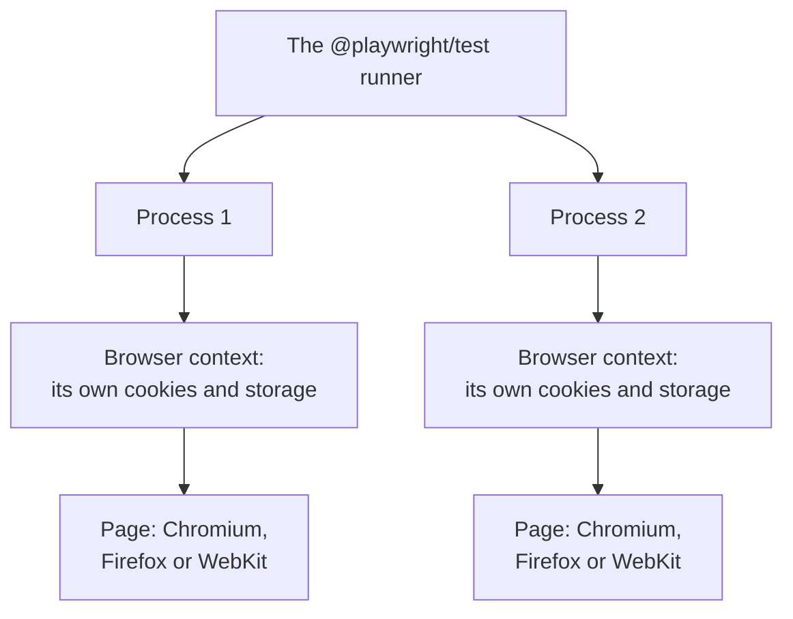

## What this lesson covers

End-to-end tests with Playwright: what they check and how many you need, how Playwright works (browsers, contexts, parallel processes), locators and auto-waiting, why a retrying assertion is more reliable than a pause, replacing the network with `page.route`, logging in once for all tests, page objects and fixtures, tracing to investigate failures, running in CI, and a comparison with Cypress. An example in jsdom models three ways to wait for a result.

## What end-to-end checks

The test runs the real build in a real browser and walks the user's path: open a page, log in, add an item, pay. It catches what component tests cannot see: the build, routing, headers and cookies, CSP, interaction with a real or test backend.

The price: such tests are slow (seconds per test), need an environment and data, and are more often unstable. That is why they are written for **key flows** that bring money or without which the product cannot be used, while variations and edge cases are checked with component tests.

## How Playwright works



- Tests run **in parallel** in several processes; each test gets a new **browser context**, the equivalent of a clean profile: its own cookies, `localStorage`, cache. Tests do not affect each other, and creating a context takes milliseconds.
- One test suite runs in Chromium, Firefox and WebKit (Safari's engine), and with mobile device emulation.
- Protractor, which the old notes rely on, was shut down in 2023; since Angular 12 `ng e2e` has no default tool.

```ts
import { expect, test } from '@playwright/test'

test('a user buys a book', async ({ page }) => {
  await page.goto('/catalog')
  await page.getByRole('link', { name: 'Clean Code' }).click()
  await page.getByRole('button', { name: 'Add to cart' }).click()
  await page.getByRole('link', { name: 'Cart (1)' }).click()
  await page.getByRole('button', { name: 'Checkout' }).click()
  await expect(page.getByRole('heading', { name: 'Thank you for your order' })).toBeVisible()
})
```

## Locators and waiting

- A **locator** is a description of how to find an element, not the element itself: it is looked up again on every action. The priority is as in Testing Library: `getByRole`, `getByLabel`, `getByText`, `getByTestId` last; CSS and XPath only when there is no other way.
- Locators are **strict**: if two elements match the description, the action fails with an error rather than clicking the first one. Narrow it with a chain (`page.getByRole('row', { name: 'Ann' }).getByRole('button', { name: 'Delete' })`) or `filter`.
- **Auto-waiting**: before a click Playwright waits until the element appears, becomes visible, stable (not animating), not disabled, and receives events. Manual `waitForTimeout` calls are not needed.
- **Web-first assertions** (`await expect(locator).toHaveText(...)`) retry the check until it passes or the timeout ends (5 seconds by default).

```js dom
// The page: after a click, the order status arrives from the server some time later.
// Ten runs with different server times, as on a shared CI machine.
const serverTimes = [15, 70, 30, 55, 20, 75, 40, 65, 25, 60]
function renderPage(delay) {
  document.body.innerHTML = '<button>Pay</button><p role="status"></p>'
  document.querySelector('button').onclick = () =>
    setTimeout(() => (document.querySelector('[role=status]').textContent = 'Paid'), delay)
}
const sleep = (ms) => new Promise((r) => setTimeout(r, ms))
const statusText = () => document.querySelector('[role=status]').textContent

// Like Playwright's web-first assertions: retry until it matches or the timeout ends.
async function expectEventually(read, expected, timeout = 5000) {
  const start = Date.now()
  while (Date.now() - start < timeout) {
    if (read() === expected) return true
    await sleep(10)
  }
  return false
}

const strategies = {
  'check right away   ': async () => statusText() === 'Paid',
  'sleep 45 ms, check ': async () => (await sleep(45), statusText() === 'Paid'),
  'retry until timeout': async () => expectEventually(statusText, 'Paid'),
}
for (const [name, check] of Object.entries(strategies)) {
  let passed = 0
  for (const delay of serverTimes) {
    renderPage(delay)
    document.querySelector('button').click()
    if (await check()) passed++
    await sleep(80) // let the pending update finish before the next run
  }
  console.log(name, `passed ${passed} of ${serverTimes.length}`)
}
```

```output
check right away    passed 0 of 10
sleep 45 ms, check  passed 5 of 10
retry until timeout passed 10 of 10
```

- The check right after the click never passed: the response had not arrived yet.
- The pause passed in half of the runs: it all depends on whether the server made it in time. On a slow CI machine there are more of these "sometimes", and the test is called unstable, although the bug is in the test itself.
- The retrying check always passed and took exactly as long as needed. This is how `expect(locator)` in Playwright, `findBy` in Testing Library and `expect.poll` in Vitest work.

## Network, login, structure

```ts
// Mock one API call: test the error state without breaking the real backend
await page.route('**/api/orders', (route) => route.fulfill({ status: 503, json: { message: 'down' } }))

// auth.setup.ts: log in once and save cookies and storage to a file
setup('log in', async ({ page }) => {
  await page.goto('/login')
  await page.getByLabel('Email').fill(process.env.E2E_USER!)
  await page.getByLabel('Password').fill(process.env.E2E_PASSWORD!)
  await page.getByRole('button', { name: 'Log in' }).click()
  await page.context().storageState({ path: 'playwright/.auth/user.json' })
})
// playwright.config.ts: other projects depend on 'setup' and use storageState: 'playwright/.auth/user.json'
```

- **`page.route`** replaces or modifies responses: server errors, slow responses, empty lists. Do not overuse it: e2e is valuable because it checks the real integration; a fully mocked e2e test is an expensive component test.
- **Log in once**: the `setup` project logs in and saves the state (`storageState`), and the other tests start already logged in. Credentials come from CI environment variables, not from the code.
- **Data**: each test creates its own data through the API (a new user, an order) and does not depend on what another test left behind. A shared test database that tests modify is the main source of instability.
- **Page objects and fixtures**: repeated actions go into page classes (`await cart.checkout()`) or Playwright fixtures (`test.extend`) that prepare the environment and pass it into the test.

## Investigating failures and CI

- **Tracing** (trace viewer): a recording of every step with a DOM snapshot, network, console and timing. In CI `trace: 'on-first-retry'` is turned on, and the archive is opened from the report.
- **Retries** (`retries: 2` in CI) separate a consistently failing test from an unstable one: the report marks a test that passed on the second attempt as flaky. That is a signal to fix it, not a reason to add more retries.
- **Sharding**: `npx playwright test --shard=1/4` splits the suite between CI machines; the reports are merged afterwards.
- **`webServer`** in the config starts the built app before the tests; test the production build, not the dev server.

| | Playwright | Cypress |
|---|---|---|
| Where the test runs | A separate process drives the browser over a protocol | Inside the browser next to the app |
| Browsers | Chromium, Firefox, WebKit | Chromium family, Firefox, WebKit experimentally |
| Several tabs, windows, domains | Yes | Limited |
| Parallelism | Built in, free | Through a paid cloud service or third-party solutions |
| Strength | Speed, isolation, tracing, cross-browser | An interactive debugger in the browser, a large community |

## Key points

- End-to-end checks the build, routing, cookies and the backend in a real browser; it is written for key flows, and variations are left to component tests.
- Playwright: parallel processes, a new browser context for each test, Chromium, Firefox and WebKit; Protractor is shut down.
- Locators by role, strict; auto-waiting before actions; `expect(locator)` retries the check for up to 5 seconds.
- A pause in a test makes it unstable; a retrying check waits exactly as long as needed.
- `page.route` for errors and edge cases, logging in once through `storageState`, each test's own data, page objects and fixtures.
- In CI: tracing on retry, `retries` as an instability detector, sharding, tests against the production build.
