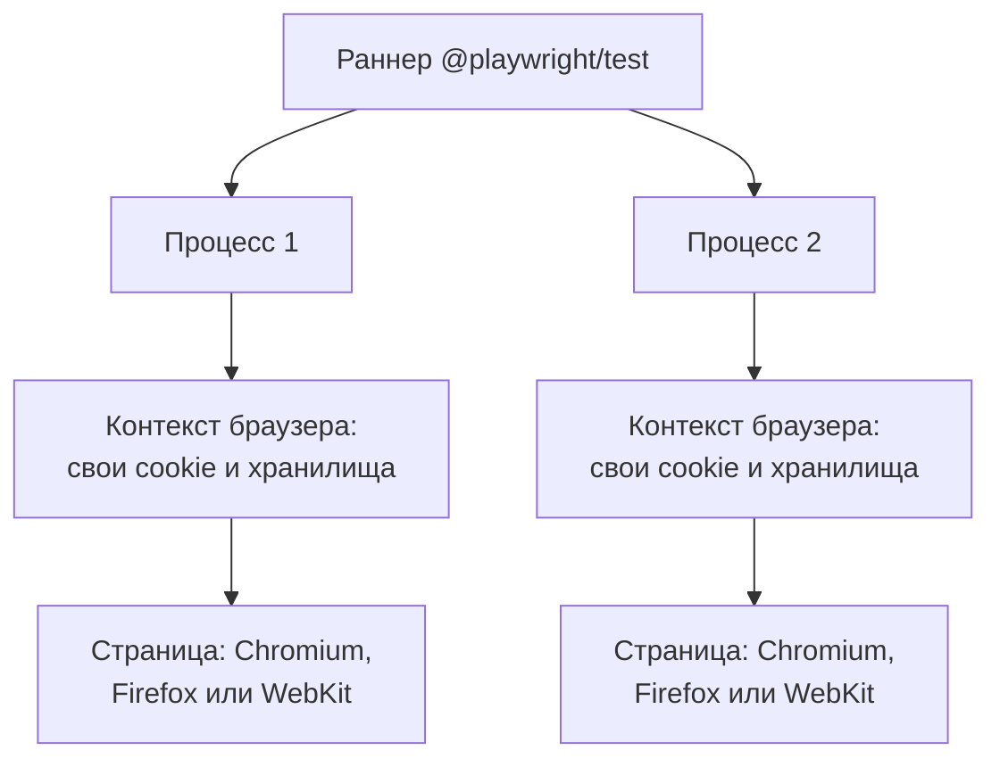

## О чём урок

End-to-end тесты на Playwright: что они проверяют и сколько их нужно, как устроен Playwright (браузеры, контексты, параллельные процессы), локаторы и автоматическое ожидание, почему проверка с повтором надёжнее паузы, подмена сети через `page.route`, вход один раз на все тесты, page objects и фикстуры, трассировка для разбора падений, запуск в CI и сравнение с Cypress. Пример в jsdom моделирует три способа дождаться результата.

## Что проверяет end-to-end

Тест запускает настоящую сборку в настоящем браузере и проходит путь пользователя: открыть страницу, войти, добавить товар, оплатить. Он ловит то, чего не видят тесты компонентов: сборку, маршрутизацию, заголовки и cookie, CSP, взаимодействие с настоящим или тестовым бэкендом.

Цена: такие тесты медленные (секунды на тест), требуют окружения и данных и чаще бывают нестабильными. Поэтому их пишут на **ключевые сценарии**, которые приносят деньги или без которых продуктом не пользоваться, а варианты и граничные случаи проверяют тестами компонентов.

## Как устроен Playwright



- Тесты идут **параллельно** в нескольких процессах; каждый тест получает новый **контекст браузера**, аналог чистого профиля: свои cookie, `localStorage`, кэш. Тесты не влияют друг на друга, а создание контекста занимает миллисекунды.
- Один набор тестов запускается в Chromium, Firefox и WebKit (движок Safari), а также с эмуляцией мобильных устройств.
- Protractor, на который опираются старые заметки, закрыт в 2023 году; у `ng e2e` с Angular 12 нет инструмента по умолчанию.

```ts
import { expect, test } from '@playwright/test'

test('a user buys a book', async ({ page }) => {
  await page.goto('/catalog')
  await page.getByRole('link', { name: 'Clean Code' }).click()
  await page.getByRole('button', { name: 'Add to cart' }).click()
  await page.getByRole('link', { name: 'Cart (1)' }).click()
  await page.getByRole('button', { name: 'Checkout' }).click()
  await expect(page.getByRole('heading', { name: 'Thank you for your order' })).toBeVisible()
})
```

## Локаторы и ожидание

- **Локатор** это описание, как найти элемент, а не сам элемент: он ищется заново при каждом действии. Приоритет как в Testing Library: `getByRole`, `getByLabel`, `getByText`, `getByTestId` последним; CSS и XPath только когда иначе нельзя.
- Локаторы **строгие**: если под описание подходят два элемента, действие падает с ошибкой, а не кликает по первому. Уточняют цепочкой (`page.getByRole('row', { name: 'Ann' }).getByRole('button', { name: 'Delete' })`) или `filter`.
- **Автоматическое ожидание**: перед кликом Playwright ждёт, пока элемент появится, станет видимым, стабильным (не анимируется), не отключённым и будет получать события. Ручные `waitForTimeout` не нужны.
- **Web-first assertions** (`await expect(locator).toHaveText(...)`) повторяют проверку, пока она не пройдёт или не кончится таймаут (5 секунд по умолчанию).

```js dom
// The page: after a click, the order status arrives from the server some time later.
// Ten runs with different server times, as on a shared CI machine.
const serverTimes = [15, 70, 30, 55, 20, 75, 40, 65, 25, 60]
function renderPage(delay) {
  document.body.innerHTML = '<button>Pay</button><p role="status"></p>'
  document.querySelector('button').onclick = () =>
    setTimeout(() => (document.querySelector('[role=status]').textContent = 'Paid'), delay)
}
const sleep = (ms) => new Promise((r) => setTimeout(r, ms))
const statusText = () => document.querySelector('[role=status]').textContent

// Like Playwright's web-first assertions: retry until it matches or the timeout ends.
async function expectEventually(read, expected, timeout = 5000) {
  const start = Date.now()
  while (Date.now() - start < timeout) {
    if (read() === expected) return true
    await sleep(10)
  }
  return false
}

const strategies = {
  'check right away   ': async () => statusText() === 'Paid',
  'sleep 45 ms, check ': async () => (await sleep(45), statusText() === 'Paid'),
  'retry until timeout': async () => expectEventually(statusText, 'Paid'),
}
for (const [name, check] of Object.entries(strategies)) {
  let passed = 0
  for (const delay of serverTimes) {
    renderPage(delay)
    document.querySelector('button').click()
    if (await check()) passed++
    await sleep(80) // let the pending update finish before the next run
  }
  console.log(name, `passed ${passed} of ${serverTimes.length}`)
}
```

```output
check right away    passed 0 of 10
sleep 45 ms, check  passed 5 of 10
retry until timeout passed 10 of 10
```

- Проверка сразу после клика не прошла ни разу: ответ ещё не пришёл.
- Пауза прошла в половине запусков: всё зависит от того, успел ли сервер. На медленной машине CI таких «иногда» становится больше, и тест называют нестабильным, хотя ошибка в нём самом.
- Проверка с повтором прошла всегда и заняла ровно столько, сколько нужно. Так работают `expect(locator)` в Playwright, `findBy` в Testing Library и `expect.poll` в Vitest.

## Сеть, вход, структура

```ts
// Mock one API call: test the error state without breaking the real backend
await page.route('**/api/orders', (route) => route.fulfill({ status: 503, json: { message: 'down' } }))

// auth.setup.ts: log in once and save cookies and storage to a file
setup('log in', async ({ page }) => {
  await page.goto('/login')
  await page.getByLabel('Email').fill(process.env.E2E_USER!)
  await page.getByLabel('Password').fill(process.env.E2E_PASSWORD!)
  await page.getByRole('button', { name: 'Log in' }).click()
  await page.context().storageState({ path: 'playwright/.auth/user.json' })
})
// playwright.config.ts: other projects depend on 'setup' and use storageState: 'playwright/.auth/user.json'
```

- **`page.route`** подменяет или изменяет ответы: ошибки сервера, медленные ответы, пустые списки. Злоупотреблять нельзя: e2e ценен тем, что проверяет настоящую интеграцию; полностью замоканный e2e это дорогой тест компонента.
- **Вход один раз**: проект `setup` входит и сохраняет состояние (`storageState`), остальные тесты стартуют уже залогиненными. Учётные данные берут из переменных окружения CI, а не из кода.
- **Данные**: каждый тест создаёт свои данные через API (нового пользователя, заказ) и не зависит от того, что оставил другой тест. Общая тестовая база, которую тесты меняют, главный источник нестабильности.
- **Page objects и фикстуры**: повторяющиеся действия выносят в классы страниц (`await cart.checkout()`) или фикстуры Playwright (`test.extend`), которые подготавливают окружение и передают его в тест.

## Разбор падений и CI

- **Трассировка** (trace viewer): запись каждого шага со снимком DOM, сетью, консолью и временем. В CI включают `trace: 'on-first-retry'` и открывают архив из отчёта.
- **Повторы** (`retries: 2` в CI) отделяют стабильно падающий тест от нестабильного: отчёт помечает тест, прошедший со второй попытки, как flaky. Это сигнал чинить, а не повод увеличить число повторов.
- **Шардирование**: `npx playwright test --shard=1/4` делит набор между машинами CI; отчёты потом объединяют.
- **`webServer`** в конфигурации поднимает собранное приложение перед тестами; тестируют production-сборку, а не dev-сервер.

| | Playwright | Cypress |
|---|---|---|
| Где работает тест | Отдельный процесс управляет браузером по протоколу | Внутри браузера рядом с приложением |
| Браузеры | Chromium, Firefox, WebKit | Chromium-семейство, Firefox, WebKit экспериментально |
| Несколько вкладок, окна, домены | Да | Ограниченно |
| Параллельность | Встроенная, бесплатно | Через платный облачный сервис или сторонние решения |
| Сильная сторона | Скорость, изоляция, трассировка, кроссбраузерность | Интерактивный отладчик в браузере, большое сообщество |

## Главное

- End-to-end проверяет сборку, маршрутизацию, cookie и бэкенд в настоящем браузере; пишут на ключевые сценарии, варианты оставляют тестам компонентов.
- Playwright: параллельные процессы, новый контекст браузера на каждый тест, Chromium, Firefox и WebKit; Protractor закрыт.
- Локаторы по роли, строгие; автоматическое ожидание перед действием; `expect(locator)` повторяет проверку до 5 секунд.
- Пауза в тесте делает его нестабильным; проверка с повтором ждёт ровно сколько нужно.
- `page.route` для ошибок и граничных случаев, вход один раз через `storageState`, свои данные на каждый тест, page objects и фикстуры.
- В CI трассировка на повторе, `retries` как детектор нестабильности, шардирование, тесты против production-сборки.
