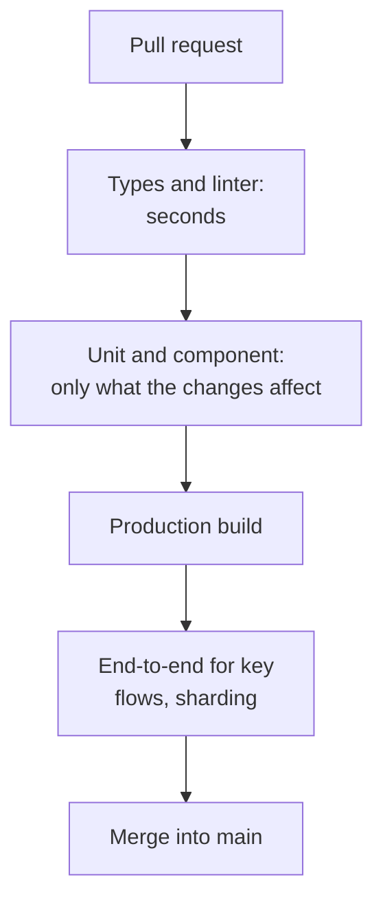

## What this lesson covers

Tests in everyday work: where unstable (flaky) tests come from and how to find them, shuffling the order, tests in CI and how to keep them fast (only what the changes affect, sharding), coverage thresholds, TDD and when it helps, and how to answer "how would you test this feature" and "what is a good test" in an interview. The example runs real Vitest with the test order shuffled.

## Unstable tests

An unstable test sometimes passes and sometimes fails **with no code changes**. It is worse than a missing one: the team gets used to rerunning CI, stops trusting a red status and misses a real bug.

| Cause | Example | Fix |
|---|---|---|
| Shared state | A module-level variable, a store, a mock without clearing | Fresh state in `beforeEach`, `clearMocks`, `restoreMocks` |
| Test order | A test assumes another one ran first | Each test prepares everything itself; shuffling in CI |
| Time | Pauses, "today", midnight, the time zone | Fake timers, `vi.setSystemTime`, a fixed `TZ` |
| Asynchrony | A check before the response, a promise without `await` | `findBy`, `expect.poll`, web-first assertions, `await` everywhere |
| Network and data | A real API, a shared test database | MSW, each test's own data |
| Environment | Fonts in screenshots, a slow CI machine, animations | A Docker image, animations off, timeouts with headroom |
| Randomness | `Math.random`, `crypto.randomUUID` in data | A stub or a fixed seed |

```js run
import { mkdtempSync, rmSync, writeFileSync } from 'node:fs'
import { join } from 'node:path'
import { startVitest } from 'vitest/node'

// Two tests share a module-level cart: the second one silently depends on running first.
const test = `
import { expect, test } from 'vitest'
const cart = []
const add = (item) => cart.push(item)

test('adds an item', () => {
  add('book')
  expect(cart).toHaveLength(1)
})
test('starts empty', () => {
  expect(cart).toHaveLength(0)
})
test('total of two items', () => {
  const local = []
  local.push(10, 20)
  expect(local.reduce((a, b) => a + b, 0)).toBe(30)
})`

const dir = mkdtempSync(join(process.cwd(), 'node_modules', '.vt-'))
writeFileSync(join(dir, 'cart.test.js'), test)
// The same file in different orders, as with sequence.shuffle in CI.
for (const seed of [1, 2, 3, 4, 5, 6]) {
  const vitest = await startVitest('test', [], { root: dir, watch: false, reporters: [{}], sequence: { shuffle: true, seed } })
  const tests = vitest.state.getTestModules()[0].children.allTests()
  const failed = [...tests].filter((t) => t.result().state === 'failed').map((t) => t.name)
  console.log(`seed ${seed}:`, failed.length ? `FAILED ${failed.join(', ')}` : 'passed')
  await vitest.close()
}
rmSync(dir, { recursive: true })
process.exitCode = 0
```

```output
seed 1: FAILED starts empty
seed 2: passed
seed 3: passed
seed 4: FAILED starts empty
seed 5: FAILED starts empty
seed 6: FAILED starts empty
```

- The "starts empty" test passes only if it runs **before** "adds an item". Without shuffling, the result depends on the order in which the tests are written: move or add a test, and a test nobody touched fails.
- `sequence.shuffle` with different seeds finds such dependencies; the seed is printed in the report, and the failure is reproduced locally with the same seed.
- The third test creates its own data inside and passes in any order: that is how tests should be built.

What to do with a found unstable test: reproduce it (repeat it a hundred times: the `{ repeats: 100 }` option of a Vitest test, `playwright test --repeat-each=100`), fix the cause, and while fixing it **move it to quarantine** with a ticket, rather than deleting it or adding retries.

## Tests in CI



- **Fast checks first**: a type error shows up in seconds, and expensive stages do not run for nothing.
- **Only what is affected**: `vitest --changed` takes the tests that depend on changed files, `--since-last-run` (Vitest 5.1) only what changed since the last run; in monorepos `nx affected` runs tests only for affected projects (a lesson of the "Tooling" track).
- **Sharding**: `vitest --shard=1/4` and `playwright test --shard=1/4` split the suite between machines.
- **Reports**: JUnit for CI, the HTML report and Playwright traces as artifacts, so a failure can be investigated without a local run.
- The full suite, including all browsers and visual tests, is often run before a release or on a schedule, and only the essentials on every pull request.

## Coverage in CI

```ts
// vitest.config.ts
export default defineConfig({
  test: {
    coverage: {
      provider: 'v8',
      include: ['src/**'],
      thresholds: { lines: 80, branches: 75 }, // the build fails below these numbers
    },
  },
})
```

- The threshold is set at a level the team really keeps and raised gradually; a "100%" goal breeds tests for the sake of the number (the `test-strategy` lesson).
- Coverage of **new and changed** code matters more: services like Codecov show it right in the pull request.

## TDD

Test-driven development: first a failing test (red), then the minimal code to make it pass (green), then improving the code while the tests stay green (refactor).

- It works well for **logic with clear inputs and outputs**: validation, price calculation, a parser, a reducer, fixing a bug (first a test that reproduces the bug).
- It works worse for layout and exploratory work, when the interface is not clear yet: there tests are written after the behavior settles.
- It helps even without strict TDD: a test written before the code checks the requirement, not what the code already does.

## How to answer in an interview

"How would you test this feature" (for example, search with suggestions):

1. **Risks and requirements**: what matters to the user (suggestions appear, selection with the keyboard, no races on fast typing, a network error does not break the field).
2. **Logic with unit tests**: filtering, highlighting matches, debounce on fake timers.
3. **The component with a component test**: typing through `user-event`, requests through MSW, suggestions found by the `option` role, arrows and Enter, the error state, cancelling a stale request.
4. **One e2e test** for the main path: type, select, land on the result page.
5. **Accessibility**: `axe` in the component test, the `combobox` and `listbox` roles, focus.
6. What I do **not** test: internal state, the exact number of renders, styles.

"What is a good test": it checks behavior, not implementation; it fails when functionality breaks and does not fail on refactoring; it is independent of other tests and their order; it is fast and stable; its name and error message make it clear what broke.

## Key points

- An unstable test is worse than a missing one; causes: shared state, order, time, asynchrony, network, environment, randomness.
- Shuffling the order (`sequence.shuffle`) finds dependencies between tests; each test prepares its own data.
- An unstable test is reproduced with repeats, its cause is fixed, and meanwhile it goes to quarantine, rather than getting retries.
- CI: fast checks first, only affected tests, sharding, reports and traces as artifacts.
- A reasonable, growing coverage threshold, with coverage of changed code mattering more; TDD is good for logic and bug fixes.
- In an interview: risks, logic with unit tests, the component with MSW and `user-event`, one e2e test, accessibility, and what I do not test.
